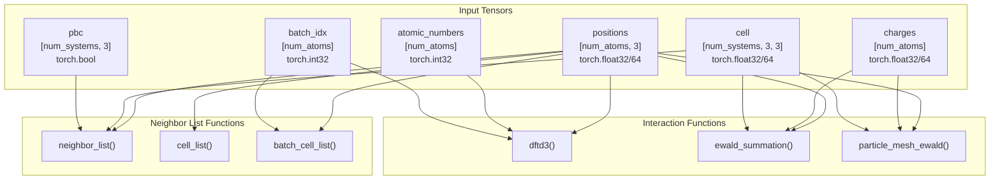
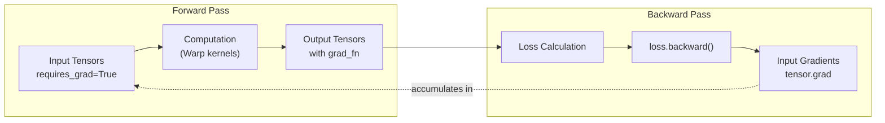
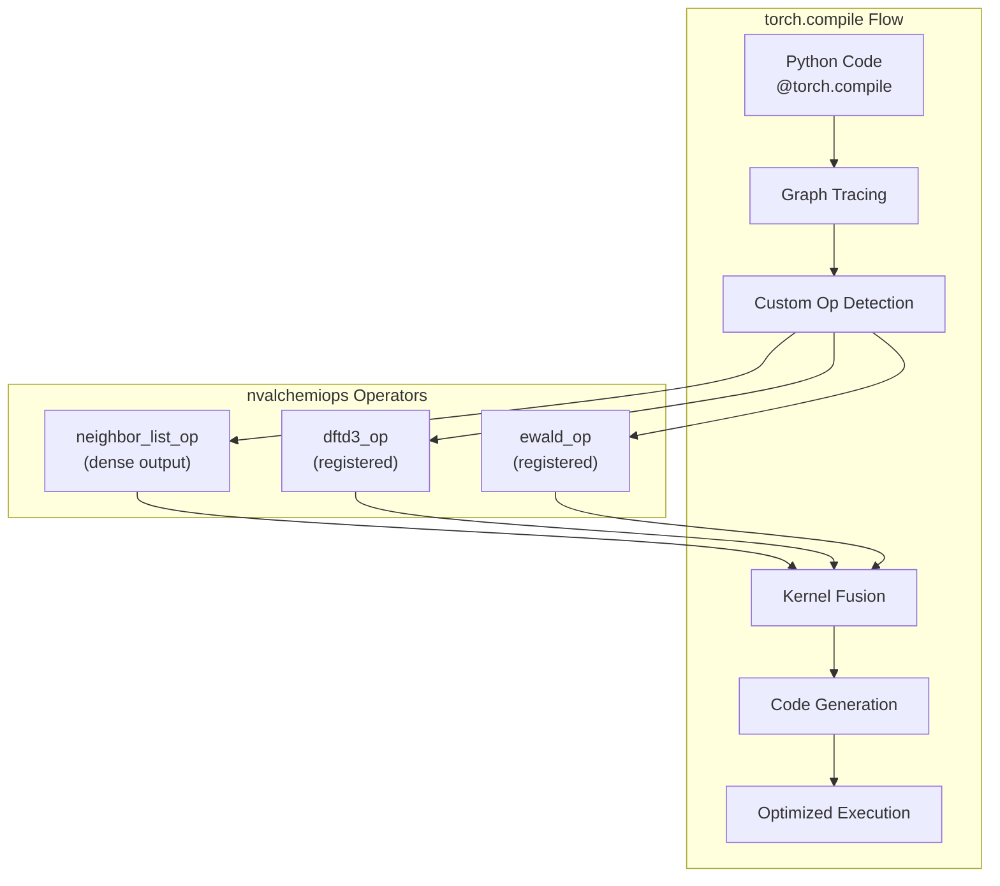

<!-- source: DeepWiki mcp.deepwiki.com · repo NVIDIA/nvalchemi-toolkit-ops · page 3.2 PyTorch Compatibility · fetched 2026-10-26 -->

# PyTorch Compatibility

<details>
<summary>Relevant source files</summary>

The following files were used as context for generating this wiki page:

- [README.md](README.md)
- [docs/userguide/about/faq.md](docs/userguide/about/faq.md)
- [docs/userguide/about/intro.md](docs/userguide/about/intro.md)

</details>


This page documents how NVIDIA ALCHEMI Toolkit-Ops integrates with PyTorch, including tensor handling, automatic differentiation, and JIT compilation support. This covers the interface layer between PyTorch and the underlying NVIDIA Warp kernels.

For details on the Warp backend implementation, see [NVIDIA Warp Integration](#3.1). For information on batched computation patterns, see [Batch Processing](#3.3). For specific API function signatures, see [API Reference](#5).

## Overview

All computational primitives in `nvalchemiops` accept PyTorch tensors as inputs and return PyTorch tensors as outputs. The toolkit integrates with PyTorch's device management, automatic differentiation, and JIT compilation systems to provide a seamless experience for ML researchers and computational chemistry workflows.

**Key Integration Points:**
- Native PyTorch tensor interface for all inputs and outputs
- Automatic CPU/GPU device handling
- Gradient flow through `torch.autograd` where applicable
- `torch.compile` compatibility via custom operator registration
- Support for mixed precision (`torch.float32`, `torch.float64`)

Sources: [README.md:1-203](), [docs/userguide/about/intro.md:355-377]()

## Tensor Interface

### Input Requirements

All primitive functions accept standard PyTorch tensors with specific shape and dtype requirements:



**Tensor Compatibility:**
- **Device**: Tensors can reside on CPU (`'cpu'`) or CUDA GPU (`'cuda:0'`, etc.)
- **Dtype**: Floating-point tensors support `torch.float32` and `torch.float64`
- **Memory**: Contiguous tensors are preferred; non-contiguous tensors are handled automatically
- **Gradients**: Input tensors can have `requires_grad=True` for automatic differentiation

Sources: [README.md:57-90](), [docs/userguide/about/intro.md:72-154]()

### Output Tensors

All functions return PyTorch tensors with the same device and dtype as the inputs:

| Function | Output Tensors | Shapes | Description |
|----------|---------------|---------|-------------|
| `neighbor_list()` | `neighbor_matrix`<br/>`num_neighbors`<br/>`shift_matrix` | `[num_atoms, max_neighbors]`<br/>`[num_atoms]`<br/>`[num_atoms, max_neighbors, 3]` | Dense neighbor format |
| `neighbor_list(..., return_neighbor_list=True)` | `edge_index`<br/>`neighbor_ptr`<br/>`shifts` | `[2, num_pairs]`<br/>`[num_atoms + 1]`<br/>`[num_pairs, 3]` | Sparse COO format |
| `dftd3()` | `energies`<br/>`forces`<br/>`coord_nums`<br/>`virials` | `[num_systems]`<br/>`[num_atoms, 3]`<br/>`[num_atoms]`<br/>`[num_systems, 3, 3]` | D3 corrections |
| `ewald_summation()` | `atom_energies`<br/>`atom_forces` | `[num_atoms]`<br/>`[num_atoms, 3]` | Per-atom electrostatics |
| `particle_mesh_ewald()` | `atom_energies`<br/>`atom_forces` | `[num_atoms]`<br/>`[num_atoms, 3]` | Per-atom electrostatics |

Sources: [README.md:72-89](), [docs/userguide/about/intro.md:58-154](), [README.md:126-136]()

## Device Handling

### Automatic Device Placement

The toolkit respects PyTorch's device placement conventions. All computations occur on the device where the input tensors reside:

```python
# Example: GPU computation
positions = torch.randn(10000, 3, device='cuda:0')
cell = torch.eye(3, device='cuda:0').unsqueeze(0)

# neighbor_list automatically executes on cuda:0
neighbor_matrix, num_neighbors, shifts = neighbor_list(
    positions, cutoff=6.0, cell=cell, pbc=[True, True, True]
)
# Output tensors are on cuda:0
assert neighbor_matrix.device.type == 'cuda'
```

```python
# Example: CPU computation
positions = torch.randn(1000, 3, device='cpu')
cell = torch.eye(3, device='cpu').unsqueeze(0)

# neighbor_list executes on CPU via Warp's CPU backend
neighbor_matrix, num_neighbors, shifts = neighbor_list(
    positions, cutoff=6.0, cell=cell, pbc=[True, True, True]
)
# Output tensors are on CPU
assert neighbor_matrix.device == torch.device('cpu')
```

**Device Requirements:**
- All input tensors must reside on the same device
- Mixed device inputs raise an error
- CPU execution uses Warp's x86/ARM backend (including Apple Silicon)
- GPU execution requires CUDA Compute Capability 8.0+ (A100, H100, etc.)

Sources: [README.md:57-90](), [docs/userguide/about/faq.md:15-23]()

### Default Device Configuration

PyTorch's default device can be set globally to simplify code:

```python
# Set default device for all tensor creation
torch.set_default_device(torch.device("cuda"))
torch.set_default_dtype(torch.float32)

# Tensors created without explicit device use the default
positions = torch.randn((50000, 3))  # Automatically on cuda
cell = torch.eye(3).unsqueeze(0)     # Automatically on cuda

neighbor_matrix, num_neighbors, shifts = neighbor_list(
    positions, cutoff=6.0, cell=cell, pbc=[True, True, False]
)
```

Sources: [README.md:61-62]()

## Autograd Integration

### Gradient Flow

Select functions support automatic differentiation through `torch.autograd`. Gradients flow through computations where physically meaningful:



**Gradient Support by Component:**

| Function | Gradient Support | Notes |
|----------|-----------------|-------|
| `neighbor_list()` | No | Discrete operation; neighbors change discontinuously |
| `dftd3()` | Yes (positions) | Forces computed via multi-pass kernel architecture |
| `ewald_summation()` | Yes (positions, charges) | Real + reciprocal space gradient calculation |
| `particle_mesh_ewald()` | Yes (positions, charges) | FFT-accelerated gradient computation |

### Example: Gradient-Based Optimization

```python
# Geometry optimization using autograd
positions = torch.randn(100, 3, device='cuda', requires_grad=True)
atomic_numbers = torch.randint(1, 10, (100,), device='cuda')
cell = torch.eye(3, device='cuda').unsqueeze(0)

# Build neighbor list (no gradients needed)
with torch.no_grad():
    neighbors, neighbor_ptr, shifts = neighbor_list(
        positions, cutoff=40.0, cell=cell, pbc=[True, True, True],
        return_neighbor_list=True
    )

# Compute D3 energy with gradients
energy, forces, coord_nums = dftd3(
    positions, atomic_numbers, neighbor_list=neighbors,
    a1=0.4289, a2=4.4407, s8=0.7875, d3_params=d3_params,
    cell=cell, unit_shifts=shifts
)

# Backpropagate to get position gradients
energy.backward()
position_gradient = positions.grad  # shape: [100, 3]
```

**Important Notes:**
- Neighbor lists should be recomputed periodically during optimization
- Use `torch.no_grad()` context to prevent gradient tracking in neighbor construction
- Forces returned by `dftd3()` are equivalent to `-1 * gradient` of energy

Sources: [docs/userguide/about/intro.md:361-363](), [docs/userguide/about/intro.md:164-254]()

## torch.compile Support

### Custom Operator Registration

Select kernels are registered as custom PyTorch operators for `torch.compile` compatibility. This enables JIT compilation of ML training loops without graph breaks:



### torch.compile Requirements

To use `torch.compile` without graph breaks:

1. **Pre-allocate Output Tensors**: Many kernels support in-place output to avoid dynamic shape inference
2. **Use Dense Format**: Neighbor matrix format is preferred over sparse COO for compiled code
3. **Constant Shapes**: System sizes should be fixed within a compiled function
4. **Check Compatibility**: Docstrings indicate which functions support `torch.compile`

Sources: [docs/userguide/about/faq.md:60-74](), [docs/userguide/about/intro.md:361-363]()

### Example: Compiled Training Loop

```python
@torch.compile(mode='reduce-overhead')
def compute_batch_energy(positions, atomic_numbers, cell, pbc, d3_params):
    """Compiled function for batched D3 energy calculation."""
    # Pre-allocate neighbor list outputs
    max_neighbors = 128
    num_atoms = positions.shape[0]
    
    neighbor_matrix = torch.zeros(
        (num_atoms, max_neighbors), dtype=torch.int32, device=positions.device
    )
    num_neighbors = torch.zeros(num_atoms, dtype=torch.int32, device=positions.device)
    shift_matrix = torch.zeros(
        (num_atoms, max_neighbors, 3), dtype=torch.int32, device=positions.device
    )
    
    # Compute neighbors (in-place into pre-allocated tensors)
    neighbor_list(
        positions, cutoff=40.0, cell=cell, pbc=pbc, method="cell_list",
        neighbor_matrix=neighbor_matrix, 
        num_neighbors=num_neighbors,
        shift_matrix=shift_matrix
    )
    
    # Compute D3 energy
    energy, forces, coord_nums = dftd3(
        positions, atomic_numbers, 
        neighbor_matrix=neighbor_matrix,
        neighbor_matrix_shifts=shift_matrix,
        a1=0.4289, a2=4.4407, s8=0.7875, 
        d3_params=d3_params,
        cell=cell
    )
    
    return energy.sum()

# First call triggers compilation
energy = compute_batch_energy(positions, numbers, cell, pbc, d3_params)

# Subsequent calls use compiled kernel
for _ in range(100):
    energy = compute_batch_energy(positions, numbers, cell, pbc, d3_params)
```

### Compilation Modes

PyTorch's `torch.compile` supports multiple modes with different optimization strategies:

| Mode | Optimization Level | Use Case |
|------|-------------------|----------|
| `default` | Balanced | General purpose |
| `reduce-overhead` | High | Small kernels, low latency |
| `max-autotune` | Highest | Large batches, throughput focus |

**Recommendations:**
- Use `reduce-overhead` for neighbor list calculations (small per-call overhead)
- Use `max-autotune` for large batched D3/electrostatics computations
- Profile with `TORCH_COMPILE_DEBUG=1` to diagnose graph breaks

Sources: [docs/userguide/about/faq.md:60-74]()

### Graph Break Detection

Common causes of graph breaks in `nvalchemiops`:

1. **Dynamic Shapes**: Varying `num_atoms` or `num_systems` between calls
2. **Conditional Logic**: Branching based on tensor values (e.g., automatic algorithm selection)
3. **In-Place Operations**: Some Warp kernels may trigger graph breaks
4. **Python Loops**: Iterating over tensor dimensions in Python space

**Debugging:**
```bash
# Enable compilation logging
TORCH_COMPILE_DEBUG=1 python your_script.py

# Check for graph breaks
TORCH_LOGS="+dynamo" python your_script.py
```

Sources: [docs/userguide/about/faq.md:60-74]()

## Precision and Dtype Handling

### Supported Data Types

| Tensor Type | Supported Dtypes | Notes |
|-------------|-----------------|-------|
| Positions | `float32`, `float64` | Internal computations match input precision |
| Cell vectors | `float32`, `float64` | Must match position dtype |
| Atomic numbers | `int32` | Fixed integer type |
| Batch indices | `int32` | Fixed integer type |
| Neighbor matrix | `int32` | Fixed integer type |
| Shifts | `int32` | Fixed integer type |
| Charges | `float32`, `float64` | Must match position dtype |
| PBC flags | `bool` | Fixed boolean type |

### Mixed Precision Considerations

```python
# Example: float32 for neighbor lists, float64 for energy
with torch.cuda.amp.autocast(enabled=False):
    # Neighbor list in float32 (sufficient precision)
    positions_f32 = positions.to(torch.float32)
    neighbors, _, shifts = neighbor_list(
        positions_f32, cutoff=40.0, cell=cell.to(torch.float32),
        pbc=pbc, return_neighbor_list=True
    )

# D3 calculation in float64 (higher precision for energy)
positions_f64 = positions.to(torch.float64)
cell_f64 = cell.to(torch.float64)
energy, forces, coord_nums = dftd3(
    positions_f64, atomic_numbers, neighbor_list=neighbors,
    a1=0.4289, a2=4.4407, s8=0.7875, d3_params=d3_params,
    cell=cell_f64, unit_shifts=shifts
)
```

**Precision Guidelines:**
- **Neighbor lists**: `float32` is sufficient for spatial decomposition
- **DFT-D3**: Use `float64` for energy conservation in MD simulations
- **Electrostatics**: Use `float64` for accurate reciprocal space calculations
- **GNN training**: `float32` is typically sufficient

Sources: [README.md:61](), [docs/userguide/about/intro.md:172-174]()

## Best Practices

### Memory Management

```python
# Pre-allocate tensors outside training loop
max_neighbors = 128
num_atoms = positions.shape[0]

neighbor_matrix = torch.empty(
    (num_atoms, max_neighbors), dtype=torch.int32, device='cuda'
)
num_neighbors_out = torch.empty(num_atoms, dtype=torch.int32, device='cuda')
shift_matrix = torch.empty(
    (num_atoms, max_neighbors, 3), dtype=torch.int32, device='cuda'
)

# Reuse pre-allocated tensors in loop
for epoch in range(num_epochs):
    neighbor_list(
        positions, cutoff=6.0, cell=cell, pbc=pbc,
        neighbor_matrix=neighbor_matrix,
        num_neighbors=num_neighbors_out,
        shift_matrix=shift_matrix
    )
    # ... rest of training loop
```

### Device Synchronization

```python
# Explicit synchronization for accurate timing
torch.cuda.synchronize()
start = torch.cuda.Event(enable_timing=True)
end = torch.cuda.Event(enable_timing=True)

start.record()
neighbor_matrix, num_neighbors, shifts = neighbor_list(
    positions, cutoff=6.0, cell=cell, pbc=pbc
)
end.record()

torch.cuda.synchronize()
elapsed_time = start.elapsed_time(end)  # milliseconds
```

### Gradient Checkpointing

For memory-constrained training with large systems:

```python
from torch.utils.checkpoint import checkpoint

def compute_dispersion(positions, numbers, cell, d3_params):
    neighbors, _, shifts = neighbor_list(
        positions, cutoff=40.0, cell=cell, pbc=[True, True, True],
        return_neighbor_list=True
    )
    energy, forces, coord_nums = dftd3(
        positions, numbers, neighbor_list=neighbors,
        a1=0.4289, a2=4.4407, s8=0.7875, d3_params=d3_params,
        cell=cell, unit_shifts=shifts
    )
    return energy

# Use gradient checkpointing to trade compute for memory
energy = checkpoint(
    compute_dispersion, positions, numbers, cell, d3_params,
    use_reentrant=False
)
```

### Error Handling

```python
try:
    neighbor_matrix, num_neighbors, shifts = neighbor_list(
        positions, cutoff=6.0, cell=cell, pbc=pbc
    )
except RuntimeError as e:
    if "out of memory" in str(e).lower():
        # Handle OOM gracefully
        torch.cuda.empty_cache()
        # Retry with smaller batch or different algorithm
    else:
        raise
```

Sources: [docs/userguide/about/faq.md:60-74](), [README.md:57-90]()

---

**Related Pages:**
- [NVIDIA Warp Integration](#3.1) - Backend kernel implementation
- [Batch Processing](#3.3) - Heterogeneous system batching
- [Neighbor List API](#5.1) - Complete API reference
- [Dispersion API](#5.2) - DFT-D3 API details
- [Electrostatics API](#5.3) - Ewald/PME API details

---

