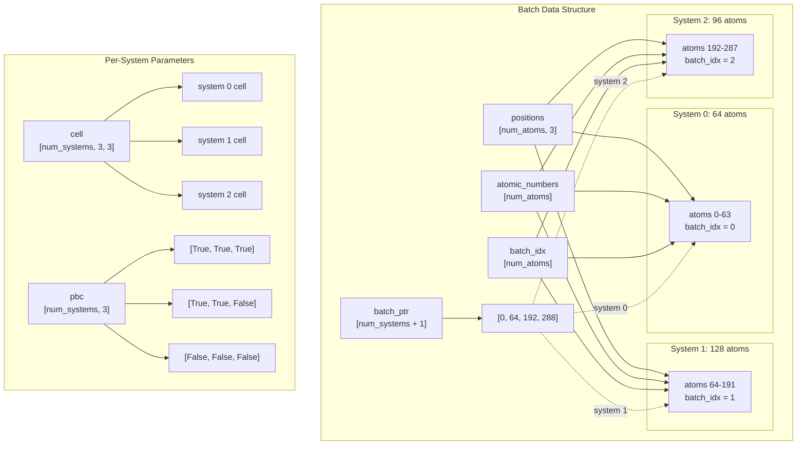
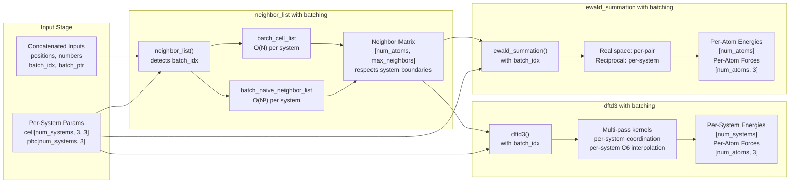
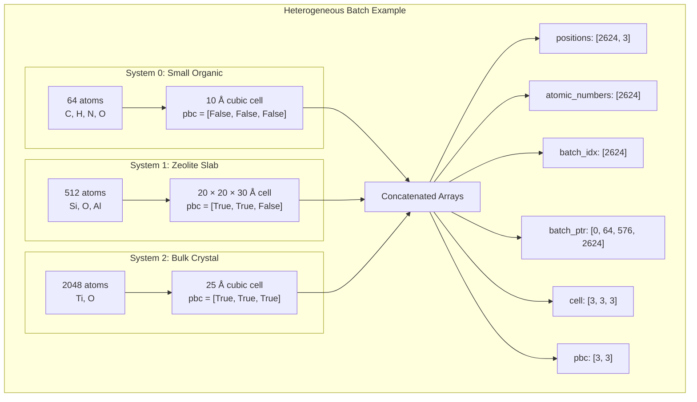
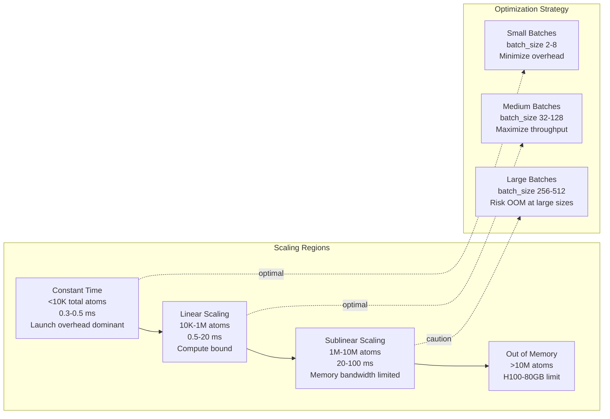

<!-- source: DeepWiki mcp.deepwiki.com · repo NVIDIA/nvalchemi-toolkit-ops · page 3.3 Batch Processing · fetched 2026-10-26 -->

# Batch Processing

<details>
<summary>Relevant source files</summary>

The following files were used as context for generating this wiki page:

- [README.md](README.md)
- [docs/benchmarks/benchmark_results/neighbor_list_benchmark_batch-cell-list_h100-80gb-hbm3.csv](docs/benchmarks/benchmark_results/neighbor_list_benchmark_batch-cell-list_h100-80gb-hbm3.csv)
- [docs/userguide/about/intro.md](docs/userguide/about/intro.md)

</details>


## Purpose and Scope

This document describes the native batch processing capabilities in NVIDIA ALCHEMI Toolkit-Ops, which enable simultaneous computation over multiple heterogeneous systems with different sizes, periodic boundary conditions, and functional parameters. Batch processing is a first-class design feature that enables high-throughput workflows for machine learning training, conformer screening, and molecular database processing.

For algorithm selection between batched and single-system methods, see [Algorithm Selection](#2.1.1). For performance benchmarks of batched operations, see [Batched Performance](#4.1.2) and [Batched DFT-D3 Performance](#4.2.2). For PyTorch tensor integration, see [PyTorch Compatibility](#3.2).

## Batch Data Model

Batched systems in the toolkit use a compressed sparse representation where all atoms across all systems are concatenated into unified arrays. Two auxiliary arrays define system boundaries:

| Parameter | Type | Shape | Description |
|-----------|------|-------|-------------|
| `batch_idx` | `torch.Tensor` | `[num_atoms]` | Maps each atom to its system index (0-indexed) |
| `batch_ptr` | `torch.Tensor` | `[num_systems + 1]` | Cumulative atom count; system `i` spans `[batch_ptr[i]:batch_ptr[i+1]]` |
| `positions` | `torch.Tensor` | `[num_atoms, 3]` | Concatenated atomic positions |
| `atomic_numbers` | `torch.Tensor` | `[num_atoms]` | Concatenated atomic numbers |
| `cell` | `torch.Tensor` | `[num_systems, 3, 3]` | Per-system unit cells (heterogeneous allowed) |
| `pbc` | `torch.Tensor` | `[num_systems, 3]` | Per-system periodic boundary conditions |



**Diagram: Batch Data Structure** - Shows how concatenated atom arrays are partitioned into systems using `batch_idx` and `batch_ptr`, with per-system heterogeneous parameters.

Sources: [README.md:95-139](), [docs/userguide/about/intro.md:228-252]()

## Batch Processing Flow

Batched operations process all systems in parallel on the GPU, with automatic handling of heterogeneous system sizes and parameters. The computation flow isolates system boundaries while maximizing GPU occupancy:



**Diagram: Batched Computation Flow** - Shows how batched inputs flow through neighbor list construction and interaction calculations, with automatic isolation of system boundaries.

Sources: [docs/userguide/about/intro.md:108-143](), [README.md:95-139]()

## Component Support

### Neighbor Lists

The `neighbor_list` function automatically dispatches to batch-aware algorithms when `batch_idx` is provided:

**batch_cell_list**
- Dispatched for systems with ≥5000 atoms per system
- Constructs per-system cell decompositions in parallel
- O(N) complexity per system with spatial hashing
- Maximum tested configuration: 512 systems × 131,072 atoms (67M total atoms)
- See [nvalchemiops/neighborlist/celllist_batch.py]()

**batch_naive_neighbor_list**
- Dispatched for systems with <5000 atoms per system  
- Computes all-pairs distances within each system
- O(N²) complexity per system with lower kernel overhead
- Efficient for small molecule batches
- See [nvalchemiops/neighborlist/naive_batch.py]()

Both algorithms respect system boundaries: atom `i` in system `k` only finds neighbors within the same system `k`. The `neighbor_matrix` output has shape `[num_atoms, max_neighbors]` with consistent indexing across the concatenated atom array.

```python
# Example: Batch of 32 systems with 128 atoms each
neighbor_matrix, num_neighbors, shift_matrix = neighbor_list(
    positions,          # [4096, 3] concatenated
    cutoff=6.0,
    cell=cell,          # [32, 3, 3] per-system cells
    pbc=pbc,            # [32, 3] per-system PBC
    batch_idx=batch_idx # [4096] mapping atoms to systems
)
# neighbor_matrix[i, j] only contains neighbors from same system as atom i
```

Sources: [docs/userguide/about/intro.md:108-143](), [README.md:52-92]()

### Dispersion Corrections

The `dftd3` function computes batched DFT-D3(BJ) corrections with per-system energy aggregation:

```python
# Batched DFT-D3 with different cells per system
energies, forces, coord_nums, virials = dftd3(
    positions=positions,        # [num_atoms, 3]
    numbers=atomic_numbers,     # [num_atoms]
    neighbor_matrix=neighbors,  # from batched neighbor_list
    neighbor_matrix_shifts=shifts,
    batch_idx=batch_idx,        # [num_atoms]
    cell=cells,                 # [num_systems, 3, 3]
    # Functional parameters (same across batch)
    a1=0.4289, a2=4.4407, s8=0.7875,
    d3_params=d3_params,
    compute_virial=True
)
# energies.shape = [num_systems] - one per system
# forces.shape = [num_atoms, 3] - per-atom forces
# coord_nums.shape = [num_atoms] - coordination numbers
```

**Key Features:**
- Coordination numbers computed per-system (neighbors from same system only)
- C6 coefficients interpolated independently per atom based on local coordination
- Energy aggregation via `scatter_add` using `batch_idx`
- Forces remain per-atom for direct use in optimization
- Virials accumulated per-system when `compute_virial=True`

The four-pass kernel architecture (see [Multi-Pass Kernel Architecture](#2.2.1)) operates identically for batched systems, with system boundaries enforced at the neighbor list level.

Sources: [README.md:94-139](), [docs/userguide/about/intro.md:228-252]()

### Electrostatics

Both `ewald_summation` and `particle_mesh_ewald` support batched computation with per-system reciprocal space calculations:

**Ewald Summation**
```python
# Batched Ewald with per-system cells
atom_energies, atom_forces = ewald_summation(
    positions=positions,
    charges=charges,            # [num_atoms]
    cell=cells,                 # [num_systems, 3, 3]
    neighbor_matrix=neighbors,
    neighbor_matrix_shifts=shifts,
    batch_idx=batch_idx,
    accuracy=1e-6
)
# atom_energies.shape = [num_atoms]
# Sum per-system: system_energies = scatter_add(atom_energies, batch_idx)
```

**Particle Mesh Ewald**
```python
# Batched PME with FFT per system
atom_energies, atom_forces = particle_mesh_ewald(
    positions=positions,
    charges=charges,
    cell=cells,                 # [num_systems, 3, 3]
    neighbor_matrix=neighbors,
    neighbor_matrix_shifts=shifts,
    batch_idx=batch_idx,
    accuracy=1e-6
)
```

**Implementation Details:**
- Real-space component: computed per-pair using neighbor list (system boundaries enforced)
- Reciprocal space: computed per-system with independent k-vector grids
- Self-energy correction: computed per-system based on per-system charges
- PME mesh: allocated per-system with heterogeneous grid sizes based on cell dimensions

Sources: [README.md:141-177](), [docs/userguide/about/intro.md:328-352]()

## Heterogeneous Systems

The toolkit supports heterogeneous batching where systems differ in multiple dimensions:

| Heterogeneity Type | Implementation | Example |
|-------------------|----------------|---------|
| **System Size** | Variable `batch_ptr` intervals | System 0: 64 atoms, System 1: 192 atoms, System 2: 1024 atoms |
| **Unit Cell** | `cell[num_systems, 3, 3]` | System 0: cubic, System 1: orthorhombic, System 2: triclinic |
| **Periodicity** | `pbc[num_systems, 3]` | System 0: fully periodic, System 1: slab (2D), System 2: cluster (0D) |
| **Composition** | Concatenated `atomic_numbers` | System 0: organic molecule, System 1: metal oxide, System 2: zeolite |
| **Functional Parameters** | Broadcast or per-system | DFT-D3: same damping parameters, different geometries |



**Diagram: Heterogeneous Batch Configuration** - Shows three systems with different sizes, compositions, cells, and periodicities combined into a single batch.

**Constraints:**
- All systems must use the same cutoff radius for neighbor lists
- Functional parameters (e.g., DFT-D3 damping) are typically broadcast across batch
- Per-system functional parameters require manual looping or custom kernel modifications
- Maximum neighbors per atom is constant across batch (`max_neighbors` parameter)

Sources: [docs/userguide/about/intro.md:108-143](), [docs/benchmarks/benchmark_results/neighbor_list_benchmark_batch-cell-list_h100-80gb-hbm3.csv:1-205]()

## Performance Characteristics

Batch processing exhibits distinct scaling behavior compared to sequential single-system processing. The following table summarizes performance metrics from H100-80GB benchmarks:

| Batch Size | Atoms/System | Total Atoms | Median Time (ms) | Peak Memory (GB) | Throughput (atoms/ms) |
|------------|--------------|-------------|------------------|------------------|-----------------------|
| 2 | 64 | 128 | 0.36 | 0.51 | 355 |
| 32 | 64 | 2048 | 0.38 | 8.10 | 5,389 |
| 512 | 64 | 32768 | 0.39 | 129.58 | 84,021 |
| 2 | 1024 | 2048 | 0.44 | 8.10 | 4,655 |
| 32 | 1024 | 32768 | 0.46 | 129.54 | 71,235 |
| 512 | 1024 | 524288 | 2.33 | 2072.54 | 225,014 |
| 2 | 16384 | 32768 | 0.90 | 129.51 | 36,409 |
| 128 | 16384 | 2097152 | 15.09 | 8288.22 | 138,975 |
| 512 | 16384 | 8388608 | 58.82 | 33152.89 | 142,602 |

**Key Observations:**
1. **Constant-time region**: For small total atom counts (<10K), time remains ~0.3-0.5ms regardless of batch size due to kernel launch overhead
2. **Linear scaling region**: Between 10K-1M total atoms, time scales linearly with throughput of ~100K-200K atoms/ms
3. **Memory scaling**: Memory grows linearly with total atoms at ~4-4.5 MB per 1K atoms
4. **Throughput saturation**: Maximum throughput of ~225K atoms/ms achieved at moderate batch sizes (32-128) with large systems (1K-4K atoms/system)



**Diagram: Performance Scaling Regions** - Shows the four distinct performance regimes and optimal batch sizes for each region.

**Failure Modes:**
- **Out-of-Memory**: Total atoms > 16M typically OOM on H100-80GB
- **Zero neighbors**: Reported as `total_neighbors = 0, time = inf` in benchmarks
- **Maximum observed successful config**: 512 systems × 98,304 atoms/system = 50M atoms (see line 196-197)

Sources: [docs/benchmarks/benchmark_results/neighbor_list_benchmark_batch-cell-list_h100-80gb-hbm3.csv:1-205]()

## Implementation Details

Batch processing is implemented at the kernel level using NVIDIA Warp with careful attention to memory coalescing and system boundary enforcement:

### Kernel-Level Batching

**batch_cell_list**
- Constructs per-system cell grids in parallel using `batch_idx` to partition atoms
- Hash function incorporates system index: `hash = cell_hash(position, system_idx)`
- Cell list query restricted to same system: `if atom_system == neighbor_system`
- Supports heterogeneous cell sizes with pre-computed per-system reciprocal lattice vectors
- See [nvalchemiops/neighborlist/celllist_batch.py]()

**batch_naive_neighbor_list**
- Thread block per system for small systems, thread per atom-pair for large batches
- Distance calculations skip cross-system pairs via early exit
- PBC handling uses per-system cell and pbc arrays indexed by `batch_idx[atom_i]`
- See [nvalchemiops/neighborlist/naive_batch.py]()

### Memory Layout

Batched arrays use a **Structure of Arrays (SoA)** layout for coalesced GPU access:

```
positions:        [x₀, x₁, ..., xₙ, y₀, y₁, ..., yₙ, z₀, z₁, ..., zₙ]  (strided)
atomic_numbers:   [Z₀, Z₁, ..., Zₙ]                                      (contiguous)
batch_idx:        [s₀, s₁, ..., sₙ]                                      (contiguous)
neighbor_matrix:  [n₀₀, n₀₁, ..., n₀ₖ, n₁₀, n₁₁, ..., nₙₖ]             (row-major)
```

Adjacent threads access adjacent atoms in the concatenated array, ensuring memory coalescing. Per-system parameters (`cell`, `pbc`) are accessed via indirect indexing: `cell[batch_idx[atom_i]]`.

### System Boundary Enforcement

System isolation is enforced at three levels:

1. **Neighbor construction**: Neighbor list algorithms only consider atoms with matching `batch_idx`
2. **Interaction kernels**: Force and energy kernels read `batch_idx[i]` and `batch_idx[j]` to validate pairs
3. **Aggregation**: Scatter operations use `batch_idx` as indices for per-system reduction

```python
# Pseudo-code for batched force kernel
@wp.kernel
def batched_force_kernel(
    positions: wp.array(dtype=wp.vec3),
    batch_idx: wp.array(dtype=wp.int32),
    neighbor_matrix: wp.array2d(dtype=wp.int32),
    forces: wp.array(dtype=wp.vec3)
):
    atom_i = wp.tid()
    system_i = batch_idx[atom_i]
    
    for k in range(max_neighbors):
        atom_j = neighbor_matrix[atom_i, k]
        if atom_j < 0:
            break
        
        system_j = batch_idx[atom_j]
        # Skip cross-system pairs (should never occur if neighbor list is correct)
        if system_i != system_j:
            continue
        
        # Compute force contribution
        f = compute_force(positions[atom_i], positions[atom_j])
        wp.atomic_add(forces, atom_i, f)
```

### Compilation and Caching

Warp kernels are Just-In-Time (JIT) compiled with batch-aware specializations:
- First invocation triggers compilation for specific (`num_atoms`, `max_neighbors`, `num_systems`) shapes
- Compiled kernels are cached for subsequent calls with same shapes
- Shape changes trigger recompilation (typical overhead: 0.1-1s)
- `torch.compile` wraps Warp kernels as custom operators, preserving batching semantics

Sources: [docs/userguide/about/intro.md:1-388](), [README.md:1-203]()

---

