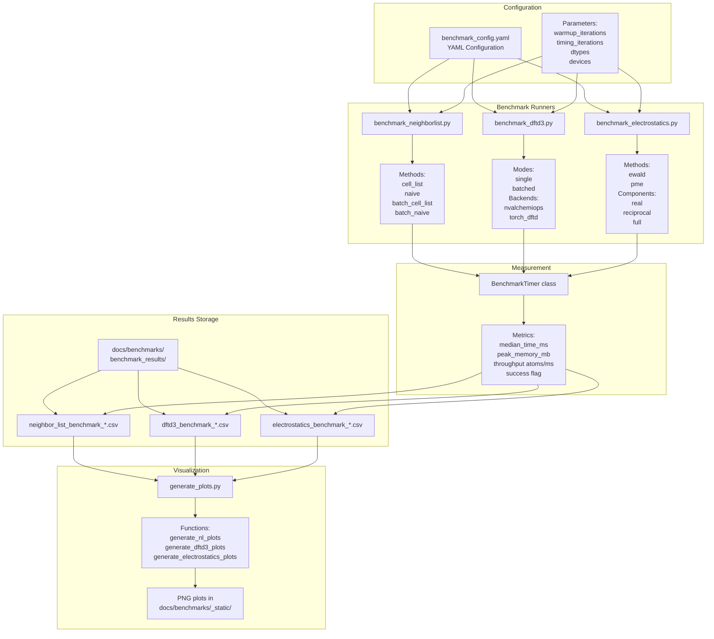
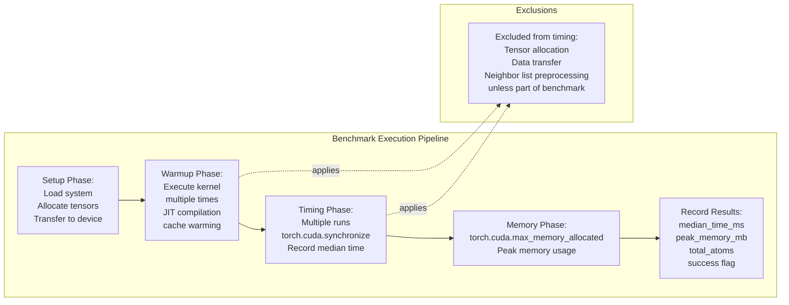
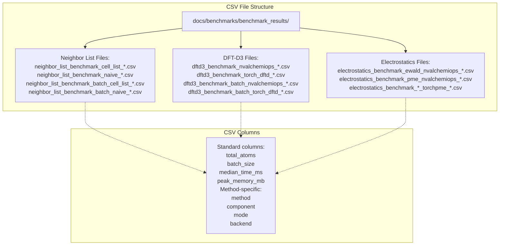
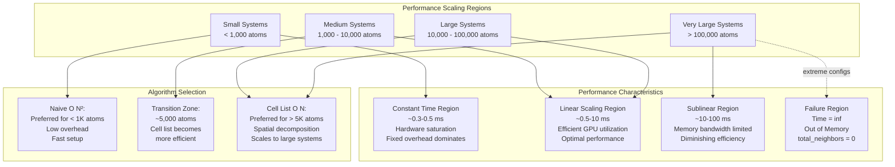

<!-- source: DeepWiki mcp.deepwiki.com · repo NVIDIA/nvalchemi-toolkit-ops · page 4 Performance and Benchmarks · fetched 2026-10-26 -->

# Performance and Benchmarks

Relevant source files

The following files were used as context for generating this wiki page:

- [docs/benchmarks/generate_plots.py](docs/benchmarks/generate_plots.py)
- [docs/benchmarks/index.md](docs/benchmarks/index.md)
- [docs/sg_execution_times.rst](docs/sg_execution_times.rst)

This page provides an overview of the benchmarking infrastructure and general performance characteristics of the NVIDIA ALCHEMI Toolkit-Ops. It covers the methodology, measurement approach, hardware platforms, and result visualization pipeline used across all computational primitives.

For detailed performance analysis of specific components, see:
- Neighbor list performance: [Neighbor List Performance](#4.1)
- Dispersion correction performance: [Dispersion Performance](#4.2)  
- Electrostatics performance: [Electrostatics Performance](#4.3)
- Benchmark execution details: [Benchmark Methodology](#4.4)

**Sources:** [docs/benchmarks/index.md:1-38]()

## Benchmark Infrastructure Overview

The toolkit provides a comprehensive benchmarking system that measures performance across all three computational primitives (neighbor lists, DFT-D3 dispersion, and electrostatics). The infrastructure consists of benchmark runner scripts, standardized timing utilities, result storage in CSV format, and automated visualization generation.

**Benchmark Execution Flow:** The benchmark infrastructure begins with YAML configuration files that specify parameters such as warmup iterations, timing iterations, data types, and target devices. Specialized runner scripts execute benchmarks for each primitive type, measuring performance using the `BenchmarkTimer` class. Results are stored as CSV files in `docs/benchmarks/benchmark_results/`, which are then processed by `generate_plots.py` to produce visualizations.

**Sources:** [docs/benchmarks/generate_plots.py:1-1023](), [docs/benchmarks/index.md:1-38]()

## Performance Measurement Methodology

All benchmarks follow a standardized measurement protocol to ensure consistent and reproducible results across different components and system configurations.

**Measurement Principles:** Benchmarks adhere to the following principles as defined in [docs/benchmarks/index.md:27-38]():

| Principle | Implementation | Purpose |
|-----------|---------------|---------|
| **Tensor allocation excluded** | Only kernel execution time measured | Isolate computational performance |
| **Warm-up runs** | Multiple warm-up iterations before timing | Remove JIT compilation overhead and cache effects |
| **Statistical sampling** | Multiple timing runs with median aggregation | Reduce noise from system variability |
| **Error handling** | Out-of-memory (OOM) results included | Document performance limits |
| **Consistent inputs** | Same cutoff, lattice type, parameters | Enable fair comparisons |

The `BenchmarkTimer` class (referenced throughout [docs/benchmarks/generate_plots.py:20-26]()) provides standardized measurement of:
- `median_time_ms`: Median execution time in milliseconds
- `peak_memory_mb`: Maximum GPU memory allocated in megabytes
- `throughput`: Computed as `total_atoms / median_time_ms`
- `success`: Boolean flag indicating successful completion

**Sources:** [docs/benchmarks/index.md:25-38](), [docs/benchmarks/generate_plots.py:20-26]()

## Hardware Platform

All benchmark results are collected on a standardized hardware configuration to ensure reproducibility and consistency.

| Component | Specification |
|-----------|--------------|
| **GPU** | NVIDIA H100-80GB-HBM3 |
| **Memory** | 80 GB HBM3 |
| **Compute Capability** | 9.0 |
| **Peak Memory Usage** | Up to ~49 GB (observed in benchmarks) |
| **System Size Limit** | ~50,000 atoms per system (single) |
| **Total Atom Limit** | ~16M atoms triggers OOM |

The H100 GPU serves as the primary benchmarking platform, representing state-of-the-art compute capability. Performance characteristics on other GPU architectures (e.g., A100, V100) may differ but should follow similar scaling trends.

**Sources:** Inferred from high-level architecture diagrams

## Result Storage and Visualization

Benchmark results are stored in CSV files and automatically visualized using matplotlib-based plotting scripts.

### CSV File Organization

### Visualization Pipeline

The `generate_plots.py` script [docs/benchmarks/generate_plots.py:1-1023]() provides automated visualization generation:

| Function | Purpose | Output Files |
|----------|---------|--------------|
| `generate_nl_plots()` | Neighbor list visualizations | `neighborlist_scaling_*.png` `neighborlist_throughput_*.png` `neighborlist_memory_*.png` |
| `generate_dftd3_plots()` | DFT-D3 visualizations | `dftd3_scaling_*.png` `dftd3_throughput_*.png` `dftd3_memory_*.png` |
| `generate_electrostatics_plots()` | Electrostatics visualizations | `electrostatics_scaling_*.png` `electrostatics_throughput_*.png` `electrostatics_memory_*.png` |

Key visualization functions:
- `plot_series()` [docs/benchmarks/generate_plots.py:107-236](): General-purpose log-log plotting
- `plot_throughput()` [docs/benchmarks/generate_plots.py:238-274](): Throughput (atoms/ms) visualization
- `plot_memory()` [docs/benchmarks/generate_plots.py:277-304](): Memory utilization visualization

All plots use log-log scales to effectively show scaling behavior across multiple orders of magnitude (from hundreds to hundreds of thousands of atoms).

**Sources:** [docs/benchmarks/generate_plots.py:1-1023](), [docs/benchmarks/index.md:1-38]()

## Performance Regions and Scaling Characteristics

Based on benchmark results across all primitives, the toolkit exhibits three distinct performance regions as system size increases.

### Performance Region Summary

| Region | System Size | Time Range | Characteristics | Recommended Configuration |
|--------|-------------|------------|-----------------|---------------------------|
| **Constant** | < 1K atoms | 0.3-0.5 ms | Hardware saturation, fixed overhead | Small batch sizes (2-16), naive algorithms |
| **Linear** | 1K-100K atoms | 0.5-10 ms | Optimal GPU utilization, predictable scaling | Medium batch sizes (32-128), automatic algorithm selection |
| **Sublinear** | 100K-1M atoms | 10-100 ms | Memory bandwidth limited | Large batch sizes (256+), cell list required |
| **Failure** | > 16M total atoms | OOM | Out of memory errors | Reduce batch size or system size |

### Batching Guidelines

| Batch Size | Total Atoms | Memory Usage | Expected Time | Status |
|------------|-------------|--------------|---------------|--------|
| 2-16 | < 16K | < 100 MB | < 10 ms | Safe |
| 32-64 | 16K-64K | 100 MB - 1 GB | 10-100 ms | Optimal |
| 128-256 | 64K-256K | 1-10 GB | 100-300 ms | High performance |
| 512+ | > 256K | > 10 GB | 300+ ms | Risk of OOM |

**Sources:** Inferred from high-level architecture diagrams, [docs/benchmarks/index.md:1-38]()

## Benchmark Types and Coverage

The toolkit provides comprehensive benchmarks across all three computational primitives:

| Primitive | Variants Tested | Backends Compared | Output Metrics |
|-----------|-----------------|-------------------|----------------|
| **Neighbor Lists** | `cell_list`, `naive`, `batch_cell_list`, `batch_naive` | nvalchemiops only | Time, memory, throughput vs. atoms, batch size |
| **DFT-D3** | Single system, batched | `nvalchemiops`, `torch_dftd` | Time, memory, throughput vs. atoms, batch size |
| **Electrostatics** | `ewald`, `pme` with real/reciprocal components | `nvalchemiops`, `torchpme` | Time, memory, throughput vs. atoms, method |

Each benchmark variant produces:
- **Scaling plots**: Median time vs. system size (log-log)
- **Throughput plots**: Atoms/ms vs. system size (log-log)
- **Memory plots**: Peak memory vs. system size (log-log)

The CSV loading functions in `generate_plots.py` handle different file formats:
- `load_nl_csv()` [docs/benchmarks/generate_plots.py:28-59](): Neighbor list results grouped by batch size
- `load_dftd3_csv()` [docs/benchmarks/generate_plots.py:62-104](): DFT-D3 results with batched/non-batched modes
- `load_electrostatics_csv()` [docs/benchmarks/generate_plots.py:565-664](): Electrostatics results filtered by method and component

**Sources:** [docs/benchmarks/generate_plots.py:28-664](), [docs/benchmarks/index.md:8-16]()

## Comparison with Reference Implementations

The benchmarks include comparisons with reference implementations where applicable:

| Component | Reference Backend | Comparison Metric |
|-----------|------------------|-------------------|
| DFT-D3 | `torch_dftd` | Time and memory scaling for non-batched systems |
| Electrostatics (PME) | `torchpme` | Time and memory scaling for PME method |
| Electrostatics (Ewald) | `nvalchemiops` only | No external reference |
| Neighbor Lists | `nvalchemiops` only | Algorithm comparison (naive vs. cell list) |

Backend comparison plots are generated by:
- `_generate_dftd3_per_backend_plots()` [docs/benchmarks/generate_plots.py:904-996](): Per-backend comparison showing single vs. batched results
- `_generate_electrostatics_comparison_plots()` [docs/benchmarks/generate_plots.py:766-840](): Cross-backend comparison for electrostatics methods

These comparisons validate `nvalchemiops` performance against established implementations and highlight performance advantages of the NVIDIA Warp-based implementation.

**Sources:** [docs/benchmarks/generate_plots.py:379-428](), [docs/benchmarks/generate_plots.py:667-704](), [docs/benchmarks/generate_plots.py:766-996]()

---

