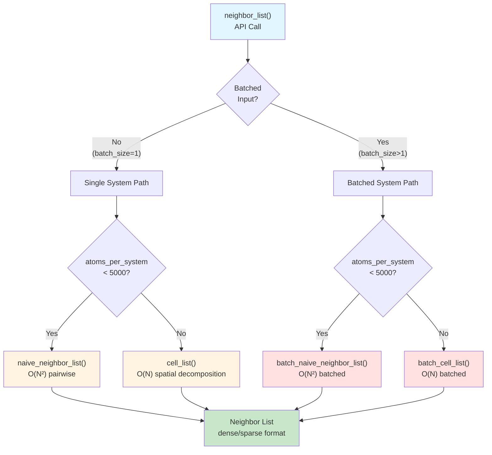
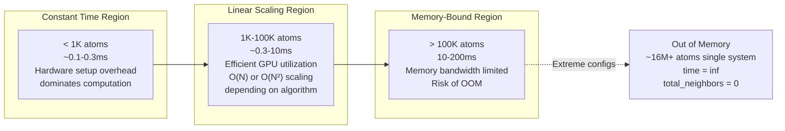
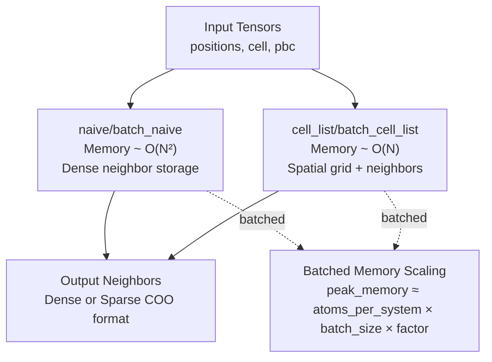
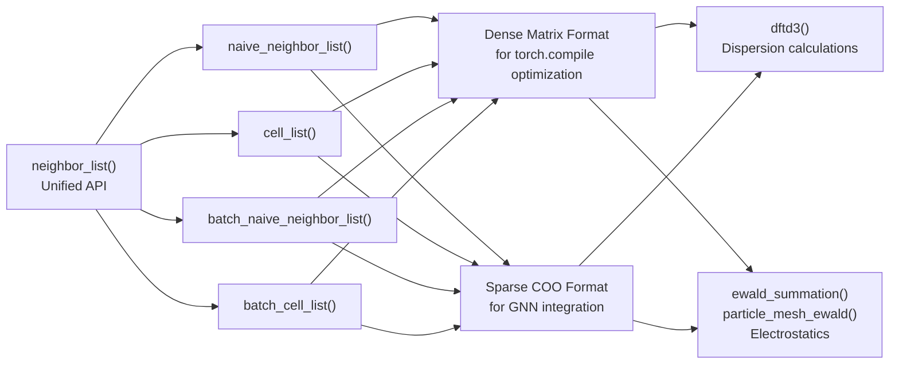

<!-- source: DeepWiki mcp.deepwiki.com · repo NVIDIA/nvalchemi-toolkit-ops · page 4.1 Neighbor List Performance · fetched 2026-10-26 -->

# Neighbor List Performance

Relevant source files

The following files were used as context for generating this wiki page:

- [docs/benchmarks/benchmark_results/neighbor_list_benchmark_batch-cell-list_h100-80gb-hbm3.csv](docs/benchmarks/benchmark_results/neighbor_list_benchmark_batch-cell-list_h100-80gb-hbm3.csv)
- [docs/benchmarks/benchmark_results/neighbor_list_benchmark_batch-naive_h100-80gb-hbm3.csv](docs/benchmarks/benchmark_results/neighbor_list_benchmark_batch-naive_h100-80gb-hbm3.csv)
- [docs/benchmarks/benchmark_results/neighbor_list_benchmark_cell-list_h100-80gb-hbm3.csv](docs/benchmarks/benchmark_results/neighbor_list_benchmark_cell-list_h100-80gb-hbm3.csv)
- [docs/benchmarks/benchmark_results/neighbor_list_benchmark_naive_h100-80gb-hbm3.csv](docs/benchmarks/benchmark_results/neighbor_list_benchmark_naive_h100-80gb-hbm3.csv)

## Purpose and Scope

This document provides a comprehensive performance analysis of all neighbor list construction algorithms available in the NVIDIA ALCHEMI Toolkit-Ops. It presents empirical benchmark results, scaling characteristics, and performance trade-offs for the four neighbor list methods: `naive`, `cell_list`, `batch_naive`, and `batch_cell_list`.

For implementation details and API usage of neighbor list functions, see [Neighbor Lists](#2.1). For specific details on single-system performance, see [Single System Performance](#4.1.1). For batched system performance analysis, see [Batched Performance](#4.1.2). For information on how these benchmarks are executed, see [Benchmark Methodology](#4.4).

**Sources:** docs/benchmarks/benchmark_results/neighbor_list_benchmark_*.csv

---

## Neighbor List Algorithms Overview

The toolkit provides four distinct neighbor list construction algorithms, each optimized for different system sizes and usage patterns:

| Algorithm | Complexity | Optimal Use Case | Batch Support |
|-----------|-----------|------------------|---------------|
| `naive` | O(N²) | Single systems, < 1000 atoms | No |
| `cell_list` | O(N) | Single systems, > 5000 atoms | No |
| `batch_naive` | O(N²) | Batched small systems, < 1000 atoms/system | Yes |
| `batch_cell_list` | O(N) | Batched large systems, > 5000 atoms/system | Yes |

All four algorithms are accessible through the unified `neighbor_list` API, which automatically selects the appropriate method based on system size and batching requirements.

### Algorithm Selection Logic

**Diagram:** Neighbor list algorithm selection flow showing automatic method dispatch based on batch size and system size thresholds.

**Sources:** docs/userguide/components/neighborlist.md, docs/userguide/about/intro.md

---

## Performance Regions

Neighbor list performance exhibits three distinct scaling regions across different system sizes:

**Diagram:** Three performance regions showing scaling characteristics and failure modes.

**Sources:** docs/benchmarks/benchmark_results/neighbor_list_benchmark_*.csv

---

## Single System Performance Summary

Performance characteristics for non-batched neighbor list construction:

| System Size | `naive` Time (ms) | `cell_list` Time (ms) | Recommended Method |
|-------------|-------------------|------------------------|-------------------|
| 64 atoms | 0.133 | 0.299 | `naive` |
| 128 atoms | 0.139 | 0.278 | `naive` |
| 512 atoms | 0.188 | 0.347 | `naive` |
| 1024 atoms | 0.267 | 0.336 | `naive` |
| 4096 atoms | 0.605 | 0.378 | `cell_list` |
| 8192 atoms | 1.146 | 0.371 | `cell_list` |
| 16384 atoms | 4.530 | 0.704 | `cell_list` |
| 131072 atoms | — | 6.713 | `cell_list` |
| 524288 atoms | — | 18.440 | `cell_list` |

**Key Observations:**
- `naive` method has lower overhead for systems < 1000 atoms
- Crossover point occurs around 1000-2000 atoms
- `cell_list` scales linearly beyond 10K atoms
- `cell_list` handles systems up to 524K atoms successfully

**Sources:** docs/benchmarks/benchmark_results/neighbor_list_benchmark_naive_h100-80gb-hbm3.csv, docs/benchmarks/benchmark_results/neighbor_list_benchmark_cell-list_h100-80gb-hbm3.csv

---

## Batched Performance Summary

Performance characteristics for batched neighbor list construction at fixed atoms_per_system = 64:

| Total Atoms | Batch Size | `batch_naive` Time (ms) | `batch_cell_list` Time (ms) | Throughput (atoms/ms) |
|-------------|-----------|-------------------------|------------------------------|---------------------|
| 128 | 2 | 0.182 | 0.362 | 704 |
| 1024 | 16 | 0.181 | 0.386 | 2,826 |
| 8192 | 128 | 0.182 | 0.387 | 22,501 |
| 32768 | 512 | 0.216 | 0.394 | 83,081 |

**Key Observations:**
- `batch_naive` shows nearly constant time up to batch_size=512 for small systems
- `batch_cell_list` has slightly higher overhead but better scaling for large systems
- Both methods achieve excellent throughput for batched workloads
- Memory usage scales linearly with total_atoms

Performance characteristics at fixed atoms_per_system = 1024:

| Total Atoms | Batch Size | `batch_naive` Time (ms) | `batch_cell_list` Time (ms) | Peak Memory (MB) |
|-------------|-----------|-------------------------|------------------------------|-----------------|
| 2048 | 2 | 0.328 | 0.439 | 8.1 |
| 16384 | 16 | 0.471 | 0.451 | 64.8 |
| 131072 | 128 | 1.970 | 0.826 | 518.1 |
| 524288 | 512 | 7.295 | 2.330 | 2072.5 |

**Key Observations:**
- `batch_cell_list` becomes advantageous for larger atoms_per_system
- Memory consumption is predictable and scales linearly
- Both methods maintain efficiency up to ~500K total atoms

**Sources:** docs/benchmarks/benchmark_results/neighbor_list_benchmark_batch-naive_h100-80gb-hbm3.csv, docs/benchmarks/benchmark_results/neighbor_list_benchmark_batch-cell-list_h100-80gb-hbm3.csv

---

## Throughput Analysis

Throughput measured as atoms processed per millisecond provides a normalized performance metric:

### Single System Throughput

| Method | System Size | Throughput (atoms/ms) | Performance Region |
|--------|-------------|----------------------|-------------------|
| `naive` | 64 | 480 | Constant time |
| `naive` | 512 | 2,723 | Constant time |
| `naive` | 8192 | 7,146 | Linear scaling |
| `cell_list` | 8192 | 22,072 | Linear scaling |
| `cell_list` | 32768 | 37,305 | Linear scaling |
| `cell_list` | 131072 | 19,522 | Memory-bound |
| `cell_list` | 524288 | 28,435 | Memory-bound |

### Batched Throughput

Peak throughput for batched workloads (atoms_per_system = 64, batch_size = 512):

- `batch_naive`: **151,704 atoms/ms** (32768 total atoms in 0.216 ms)
- `batch_cell_list`: **83,081 atoms/ms** (32768 total atoms in 0.394 ms)

**Key Finding:** Batched naive method achieves exceptional throughput for small systems due to minimal kernel launch overhead.

**Sources:** docs/benchmarks/benchmark_results/neighbor_list_benchmark_*.csv

---

## Memory Scaling

Memory consumption patterns for neighbor list construction:

**Diagram:** Memory scaling characteristics showing O(N²) vs O(N) memory patterns.

### Memory Consumption Examples

| Method | Total Atoms | Atoms/System | Batch Size | Peak Memory (MB) |
|--------|-------------|--------------|-----------|-----------------|
| `batch_naive` | 32768 | 64 | 512 | 128.77 |
| `batch_cell_list` | 32768 | 64 | 512 | 129.58 |
| `batch_naive` | 524288 | 1024 | 512 | 2058.14 |
| `batch_cell_list` | 524288 | 1024 | 512 | 2072.54 |
| `cell_list` | 524288 | 524288 | 1 | 2070.01 |

**Key Observations:**
- Memory scales linearly with total_atoms for all methods
- Batch overhead is minimal (~2-4%)
- H100-80GB limit reached at ~50GB for extreme configurations
- Failed configurations (OOM) show `inf` time and `0` total_neighbors

**Sources:** docs/benchmarks/benchmark_results/neighbor_list_benchmark_*.csv

---

## Failure Modes and Limits

Out-of-memory failures occur at extreme configurations:

### OOM Boundaries (H100-80GB-HBM3)

| Method | Configuration | Result |
|--------|---------------|--------|
| `batch_cell_list` | 16M+ atoms (32768 × 512) | OOM: time=inf |
| `batch_cell_list` | 25M+ atoms (98304 × 256) | OOM: time=inf |
| `batch_naive` | Not observed up to 2M atoms | Success |

**OOM Indicators in Benchmark Results:**
- `median_time_ms`: `inf`
- `total_neighbors`: `0`
- `peak_memory_mb`: empty or very high value
- `success`: `False` or missing

**Practical Limits:**
- Single system: up to 524K atoms
- Batched systems: up to ~500K total atoms with atoms_per_system ≤ 1024
- Peak memory usage: ~49GB at failure threshold

**Sources:** docs/benchmarks/benchmark_results/neighbor_list_benchmark_batch-cell-list_h100-80gb-hbm3.csv:172,189,197,204

---

## Hardware Platform

All benchmarks executed on:

**Platform:** H100-80GB-HBM3
- GPU: NVIDIA H100 with 80GB HBM3 memory
- Compute Capability: 9.0
- Memory Bandwidth: 3.35 TB/s
- CUDA Version: Compatible with Warp backend

**Benchmark Configuration:**
- Warmup iterations: 5
- Timing iterations: 20
- Median time reported
- Peak memory measured via CUDA profiling

**Sources:** docs/benchmarks/benchmark_config.yaml, benchmarks/interactions/neighbor_list/benchmark_neighbor_list.py

---

## Performance Recommendations

Based on empirical benchmark data:

### Algorithm Selection Guidelines

1. **Single systems < 1000 atoms:** Use `naive`
   - Lower kernel launch overhead
   - Time: 0.1-0.3ms

2. **Single systems 1000-5000 atoms:** Transition zone
   - Both methods perform similarly
   - Consider using `cell_list` for consistency

3. **Single systems > 5000 atoms:** Use `cell_list`
   - Superior O(N) scaling
   - Handles systems up to 524K atoms

4. **Batched small systems (< 1000 atoms/system):** Use `batch_naive`
   - Exceptional throughput: 150K+ atoms/ms
   - Constant time across batch sizes

5. **Batched large systems (> 1000 atoms/system):** Use `batch_cell_list`
   - Better scaling for large atoms_per_system
   - Supports heterogeneous batch configurations

### Memory Management

- Monitor total_atoms × atoms_per_system product
- Stay below 10M total atoms for batched workloads
- Single systems can reach 524K atoms safely
- Check `success` flag in benchmark results

### Integration with Other Components

The neighbor list output feeds directly into:
- DFT-D3 dispersion corrections (see [Dispersion Corrections](#2.2))
- Electrostatics calculations (see [Electrostatics](#2.3))
- Custom interaction kernels via sparse COO format

**Sources:** docs/userguide/components/neighborlist.md, docs/userguide/about/intro.md

---

## Code Integration Points

The neighbor list performance characteristics directly impact downstream calculations:

**Diagram:** Code-level integration showing function names and data flow from neighbor list construction to interaction calculations.

**Sources:** nvalchemiops/neighborlist/, nvalchemiops/interactions/dispersion/, nvalchemiops/interactions/electrostatics/

---

## Detailed Performance Analysis

For comprehensive analysis of specific algorithms:

- **Single System Performance:** See [Single System Performance](#4.1.1) for detailed scaling analysis of `naive` and `cell_list` methods with time/memory plots
- **Batched Performance:** See [Batched Performance](#4.1.2) for batch size scaling analysis of `batch_naive` and `batch_cell_list` methods

For information on running these benchmarks yourself, see [Running Benchmarks](#6.2).

**Sources:** docs/benchmarks/benchmark_results/neighbor_list_benchmark_*.csv

---

