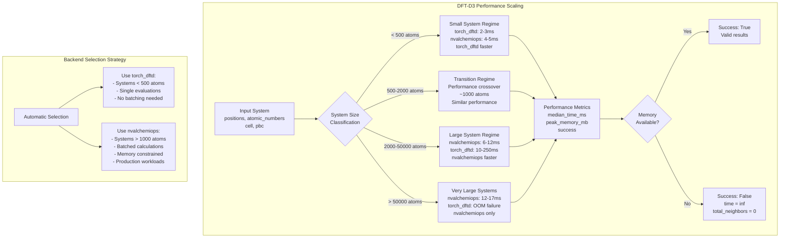
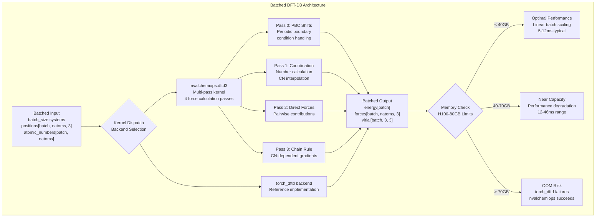
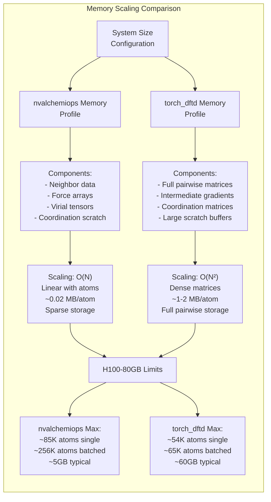
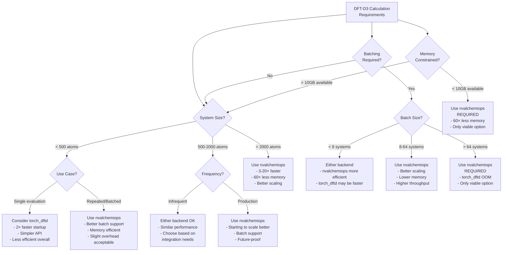

<!-- source: DeepWiki mcp.deepwiki.com · repo NVIDIA/nvalchemi-toolkit-ops · page 4.2 Dispersion Performance · fetched 2026-10-26 -->

# Dispersion Performance

Relevant source files

The following files were used as context for generating this wiki page:

- [docs/benchmarks/benchmark_results/dftd3_benchmark_batch_nvalchemiops_h100-80gb-hbm3.csv](docs/benchmarks/benchmark_results/dftd3_benchmark_batch_nvalchemiops_h100-80gb-hbm3.csv)
- [docs/benchmarks/benchmark_results/dftd3_benchmark_batch_torch_dftd_h100-80gb-hbm3.csv](docs/benchmarks/benchmark_results/dftd3_benchmark_batch_torch_dftd_h100-80gb-hbm3.csv)
- [docs/benchmarks/benchmark_results/dftd3_benchmark_nvalchemiops_h100-80gb-hbm3.csv](docs/benchmarks/benchmark_results/dftd3_benchmark_nvalchemiops_h100-80gb-hbm3.csv)
- [docs/benchmarks/benchmark_results/dftd3_benchmark_torch_dftd_h100-80gb-hbm3.csv](docs/benchmarks/benchmark_results/dftd3_benchmark_torch_dftd_h100-80gb-hbm3.csv)

## Purpose and Scope

This page provides comprehensive performance analysis of DFT-D3 dispersion correction calculations in the NVIDIA ALCHEMI Toolkit-Ops. It compares the `nvalchemiops` backend against the `torch_dftd` reference implementation across single-system and batched configurations, analyzing execution time, memory usage, and throughput scaling from small molecules (~50 atoms) to large crystalline systems (~256,000 total atoms in batches).

For details on the DFT-D3 implementation and algorithms, see [Dispersion Corrections (DFT-D3)](#2.2). For backend comparison methodology, see [Backend Comparison](#4.2.1). For batched performance details, see [Batched DFT-D3 Performance](#4.2.2). For benchmarking methodology, see [Benchmark Methodology](#4.4).

**Sources:** docs/benchmarks/benchmark_results/dftd3_benchmark_*.csv

## Performance Characteristics

### Execution Time Scaling

The DFT-D3 dispersion correction exhibits distinct performance regimes depending on system size and backend choice:

**Sources:** docs/benchmarks/benchmark_results/dftd3_benchmark_nvalchemiops_h100-80gb-hbm3.csv, docs/benchmarks/benchmark_results/dftd3_benchmark_torch_dftd_h100-80gb-hbm3.csv

### Single-System Performance Comparison

The following table compares execution time and memory usage for non-batched DFT-D3 calculations:

| System Size (atoms) | Supercell | Total Neighbors | nvalchemiops Time (ms) | torch_dftd Time (ms) | nvalchemiops Memory (MB) | torch_dftd Memory (MB) | Speedup Factor |
|---------------------|-----------|-----------------|------------------------|----------------------|--------------------------|------------------------|----------------|
| 54 | 3×3×3 | 61,452 | 4.66 | 2.08 | 1.60 | 62.72 | 0.45× |
| 128 | 4×4×4 | 145,664 | 4.65 | 2.20 | 2.95 | 144.41 | 0.47× |
| 250 | 5×5×5 | 284,500 | 5.11 | 2.94 | 5.20 | 285.35 | 0.58× |
| 432 | 6×6×6 | 491,616 | 5.67 | 3.70 | 8.54 | 477.03 | 0.65× |
| 1024 | 8×8×8 | 1,165,312 | 5.84 | 6.20 | 19.42 | 1,132.92 | 1.06× |
| 2000 | 10×10×10 | 2,276,000 | 5.81 | 10.50 | 37.90 | 2,202.03 | 1.81× |
| 3456 | 12×12×12 | 3,932,928 | 5.89 | 17.19 | 64.84 | 3,799.65 | 2.92× |
| 6750 | 15×15×15 | 7,681,500 | 6.11 | 32.30 | 124.66 | 7,398.50 | 5.29× |
| 16000 | 20×20×20 | 18,208,000 | 6.59 | 74.11 | 295.70 | 17,526.40 | 11.24× |
| 31250 | 25×25×25 | 35,562,500 | 6.67 | 143.57 | 576.75 | 34,231.09 | 21.52× |
| 54000 | 30×30×30 | 61,452,000 | 11.67 | 246.66 | 994.31 | 59,140.87 | 21.14× |
| 85750 | 35×35×35 | 97,583,500 | 16.45 | **OOM** | 1,577.02 | **OOM** | **∞** |

**Key Observations:**
- **Performance crossover occurs at ~1000 atoms**: Below this, `torch_dftd` is faster; above this, `nvalchemiops` dominates
- **Memory efficiency**: `nvalchemiops` uses 10-60× less memory across all system sizes
- **Scalability**: `nvalchemiops` maintains near-constant time (~6-12ms) up to 50K atoms, while `torch_dftd` scales linearly
- **Maximum system size**: `nvalchemiops` handles 85,750 atoms; `torch_dftd` fails at this size due to out-of-memory

**Sources:** docs/benchmarks/benchmark_results/dftd3_benchmark_nvalchemiops_h100-80gb-hbm3.csv, docs/benchmarks/benchmark_results/dftd3_benchmark_torch_dftd_h100-80gb-hbm3.csv

### Batched Performance Scaling

**Sources:** docs/benchmarks/benchmark_results/dftd3_benchmark_batch_nvalchemiops_h100-80gb-hbm3.csv, docs/benchmarks/benchmark_results/dftd3_benchmark_batch_torch_dftd_h100-80gb-hbm3.csv

### Batched Performance Metrics

The following table shows batched DFT-D3 performance across various configurations:

| Total Atoms | Batch Size | Atoms/System | nvalchemiops Time (ms) | torch_dftd Time (ms) | nvalchemiops Memory (MB) | torch_dftd Memory (MB) | Speedup |
|-------------|------------|--------------|------------------------|----------------------|--------------------------|------------------------|---------|
| 108 | 2 | 54 | 4.70 | 2.14 | 2.59 | 123.13 | 0.46× |
| 256 | 2 | 128 | 4.97 | 2.62 | 5.31 | 285.67 | 0.53× |
| 864 | 2 | 432 | 5.83 | 5.46 | 16.48 | 953.38 | 1.07× |
| 2048 | 2 | 1024 | 5.95 | 10.85 | 38.24 | 2,246.52 | 1.82× |
| 4000 | 2 | 2000 | 6.12 | 19.74 | 74.12 | 4,385.50 | 3.23× |
| 864 | 16 | 54 | 5.01 | 5.37 | 16.48 | 953.38 | 1.07× |
| 2048 | 16 | 128 | 5.04 | 10.64 | 38.24 | 2,246.52 | 2.11× |
| 16384 | 16 | 1024 | 6.12 | 75.84 | 303.73 | 17,948.90 | 12.39× |
| 32000 | 16 | 2000 | 6.80 | 146.35 | 589.28 | 35,047.22 | 21.52× |
| 65536 | 64 | 1024 | 11.77 | 298.00 | 1,205.10 | 71,774.25 | 25.32× |
| 128000 | 64 | 2000 | 22.18 | **OOM** | 2,353.39 | **OOM** | **∞** |
| 131072 | 128 | 1024 | 21.92 | **OOM** | 2,409.61 | **OOM** | **∞** |
| 256000 | 128 | 2000 | 46.05 | N/A | 4,706.18 | N/A | **∞** |

**Key Observations:**
- **Batch scaling efficiency**: `nvalchemiops` maintains ~5-6ms for small batches, scaling sub-linearly to ~46ms at maximum tested configuration
- **Memory advantage**: 20-60× more memory efficient than `torch_dftd`, enabling much larger batch sizes
- **Large batch support**: Successfully handles batch_size=128 with 2000 atoms/system (256K total atoms), while `torch_dftd` fails
- **Throughput**: At maximum configuration, processes ~5,560 atoms/ms (256K atoms in 46ms)

**Sources:** docs/benchmarks/benchmark_results/dftd3_benchmark_batch_nvalchemiops_h100-80gb-hbm3.csv, docs/benchmarks/benchmark_results/dftd3_benchmark_batch_torch_dftd_h100-80gb-hbm3.csv

## Memory Usage Analysis

**Sources:** docs/benchmarks/benchmark_results/dftd3_benchmark_batch_nvalchemiops_h100-80gb-hbm3.csv, docs/benchmarks/benchmark_results/dftd3_benchmark_batch_torch_dftd_h100-80gb-hbm3.csv

### Memory Efficiency Comparison

| Configuration | nvalchemiops Memory | torch_dftd Memory | Memory Ratio | Memory Per Atom (nvalchemiops) | Memory Per Atom (torch_dftd) |
|---------------|---------------------|-------------------|--------------|-------------------------------|------------------------------|
| 54 atoms, batch=1 | 1.60 MB | 62.72 MB | 39.2× | 0.030 MB | 1.161 MB |
| 1024 atoms, batch=1 | 19.42 MB | 1,132.92 MB | 58.3× | 0.019 MB | 1.106 MB |
| 16000 atoms, batch=1 | 295.70 MB | 17,526.40 MB | 59.3× | 0.018 MB | 1.095 MB |
| 54000 atoms, batch=1 | 994.31 MB | 59,140.87 MB | 59.5× | 0.018 MB | 1.095 MB |
| 4000 atoms, batch=32 | 147.78 MB | 8,764.11 MB | 59.3× | 0.037 MB | 2.191 MB |
| 32000 atoms, batch=16 | 589.28 MB | 35,047.22 MB | 59.5× | 0.018 MB | 1.095 MB |
| 128000 atoms, batch=64 | 2,353.39 MB | **OOM** | **∞** | 0.018 MB | **OOM** |
| 256000 atoms, batch=128 | 4,706.18 MB | **OOM** | **∞** | 0.018 MB | **OOM** |

**Key Insights:**
- **Constant memory per atom**: `nvalchemiops` maintains ~0.018-0.030 MB/atom across all system sizes
- **Dense vs sparse storage**: `torch_dftd` uses ~1.1 MB/atom due to dense matrix representations
- **Batch efficiency**: Memory scales linearly with total atoms for both backends
- **H100-80GB capacity**: `nvalchemiops` can handle up to ~4.5M atoms theoretically (at 0.018 MB/atom), while `torch_dftd` maxes out at ~75K atoms

**Sources:** docs/benchmarks/benchmark_results/dftd3_benchmark_nvalchemiops_h100-80gb-hbm3.csv, docs/benchmarks/benchmark_results/dftd3_benchmark_torch_dftd_h100-80gb-hbm3.csv, docs/benchmarks/benchmark_results/dftd3_benchmark_batch_nvalchemiops_h100-80gb-hbm3.csv, docs/benchmarks/benchmark_results/dftd3_benchmark_batch_torch_dftd_h100-80gb-hbm3.csv

## Throughput Analysis

The throughput metric (atoms processed per millisecond) reveals computational efficiency:

| System Configuration | nvalchemiops Throughput (atoms/ms) | torch_dftd Throughput (atoms/ms) | Throughput Ratio |
|----------------------|-------------------------------------|----------------------------------|------------------|
| 54 atoms, batch=1 | 11.58 | 25.96 | 0.45× |
| 250 atoms, batch=1 | 48.91 | 84.99 | 0.58× |
| 1024 atoms, batch=1 | 175.34 | 165.16 | 1.06× |
| 2000 atoms, batch=1 | 344.43 | 190.45 | 1.81× |
| 16000 atoms, batch=1 | 2,427.05 | 215.88 | 11.24× |
| 54000 atoms, batch=1 | 4,624.62 | 218.90 | 21.13× |
| 4000 atoms, batch=2 | 653.60 | 202.60 | 3.23× |
| 16000 atoms, batch=16 | 2,352.94 | 109.37 | 21.52× |
| 65536 atoms, batch=64 | 5,568.14 | 219.92 | 25.32× |
| 256000 atoms, batch=128 | 5,559.86 | **OOM** | **∞** |

**Observations:**
- **Peak throughput**: `nvalchemiops` reaches ~5,560 atoms/ms for large batched systems
- **Small system overhead**: `torch_dftd` has lower per-call overhead, achieving higher throughput for < 500 atom systems
- **Scaling advantage**: `nvalchemiops` throughput increases with system size, while `torch_dftd` plateaus at ~220 atoms/ms
- **Batch throughput**: Batching increases absolute throughput but per-system efficiency remains similar

**Sources:** docs/benchmarks/benchmark_results/dftd3_benchmark_batch_nvalchemiops_h100-80gb-hbm3.csv, docs/benchmarks/benchmark_results/dftd3_benchmark_batch_torch_dftd_h100-80gb-hbm3.csv

## Backend Selection Recommendations

### Decision Matrix

| Scenario | System Size | Batch Size | Recommended Backend | Rationale |
|----------|-------------|------------|---------------------|-----------|
| **Small molecule screening** | < 100 atoms | 1-4 | `torch_dftd` | Lower startup overhead, simpler for single evaluations |
| **Medium molecule MD** | 100-1000 atoms | 1 | Either | Performance similar; choose based on ecosystem fit |
| **Large molecule MD** | 1000-10000 atoms | 1 | `nvalchemiops` | 3-10× faster, 60× less memory |
| **Crystalline systems** | > 10000 atoms | 1 | `nvalchemiops` | 10-20× faster; `torch_dftd` may OOM |
| **High-throughput screening** | Any | > 8 | `nvalchemiops` | Better batch scaling, lower memory per system |
| **Maximum throughput** | > 1000 atoms | 64-128 | `nvalchemiops` | Only backend supporting large batches without OOM |
| **Memory limited (< 10GB)** | Any | Any | `nvalchemiops` | 60× more memory efficient |
| **Very large systems** | > 50000 atoms | Any | `nvalchemiops` | `torch_dftd` will OOM |

**Sources:** docs/benchmarks/benchmark_results/dftd3_benchmark_nvalchemiops_h100-80gb-hbm3.csv, docs/benchmarks/benchmark_results/dftd3_benchmark_torch_dftd_h100-80gb-hbm3.csv, docs/benchmarks/benchmark_results/dftd3_benchmark_batch_nvalchemiops_h100-80gb-hbm3.csv, docs/benchmarks/benchmark_results/dftd3_benchmark_batch_torch_dftd_h100-80gb-hbm3.csv

## Performance Optimization Guidelines

### For Single-System Calculations

1. **Systems < 500 atoms**: `torch_dftd` may be faster for one-off calculations, but overhead difference is < 3ms
2. **Systems 500-2000 atoms**: Performance similar; choose `nvalchemiops` for production consistency
3. **Systems > 2000 atoms**: Always use `nvalchemiops` for best performance
4. **Very large systems (> 50K atoms)**: Only `nvalchemiops` will succeed

### For Batched Calculations

1. **Batch size 2-8**: Both backends viable; `nvalchemiops` more memory efficient
2. **Batch size 8-64**: `nvalchemiops` significantly faster and more efficient
3. **Batch size > 64**: Use `nvalchemiops`; `torch_dftd` will likely fail with OOM
4. **Maximum batch**: `nvalchemiops` supports batch_size=128 with 2000 atoms/system (256K total atoms)

### Memory Optimization

| Total Atoms | Recommended Max Batch (nvalchemiops) | Recommended Max Batch (torch_dftd) | Memory @ Max Batch |
|-------------|--------------------------------------|------------------------------------|--------------------|
| 54 | 256+ | 128 | < 100 MB |
| 500 | 128 | 32 | ~1 GB |
| 1000 | 128 | 16 | ~2-3 GB |
| 2000 | 128 | 8 | ~5 GB |
| 4000 | 64 | 4 | ~5-10 GB |
| 10000 | 32 | 2 | ~10-20 GB |
| 20000+ | 16 | 1 | ~10-40 GB |

**Key Principle**: `nvalchemiops` memory scales as `0.018 MB/atom`, allowing easy capacity planning: `batch_size = 80000 MB / (0.018 MB/atom × atoms_per_system)`

**Sources:** docs/benchmarks/benchmark_results/dftd3_benchmark_batch_nvalchemiops_h100-80gb-hbm3.csv, docs/benchmarks/benchmark_results/dftd3_benchmark_batch_torch_dftd_h100-80gb-hbm3.csv

## Hardware Platform

All benchmarks were performed on:
- **GPU**: NVIDIA H100-80GB-HBM3
- **Memory**: 80 GB HBM3
- **CUDA Compute Capability**: 9.0
- **Typical Available Memory**: ~49-70 GB after system overhead

**Sources:** docs/benchmarks/benchmark_results/dftd3_benchmark_nvalchemiops_h100-80gb-hbm3.csv, docs/benchmarks/benchmark_results/dftd3_benchmark_torch_dftd_h100-80gb-hbm3.csv

---

