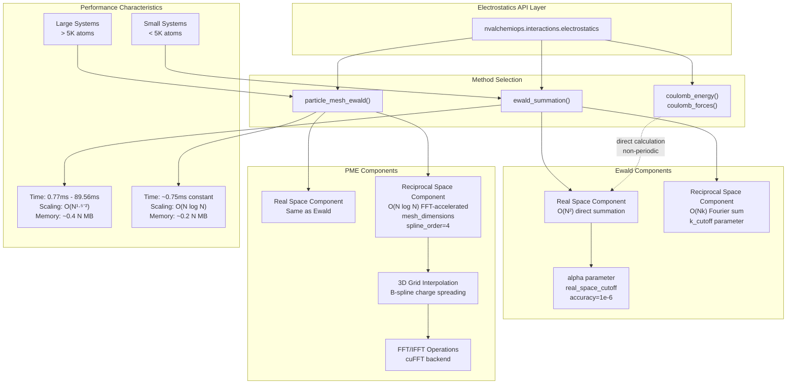
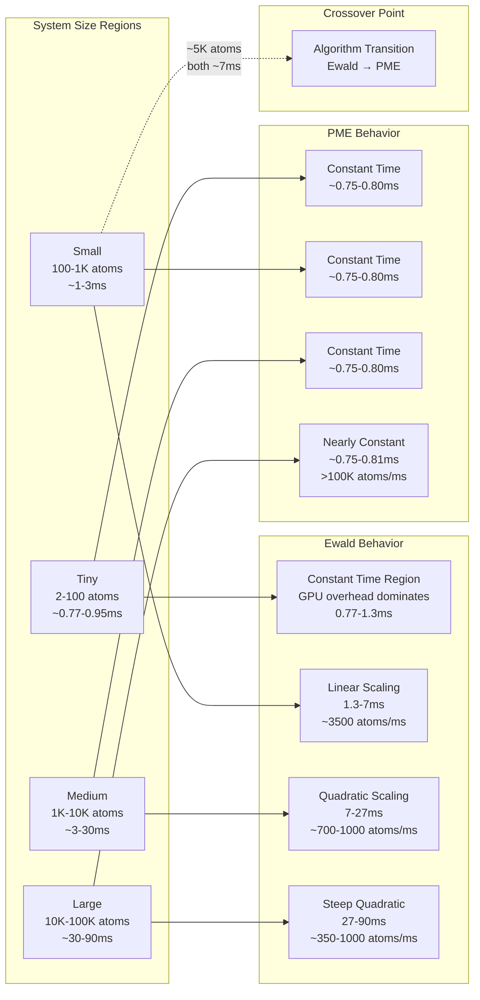
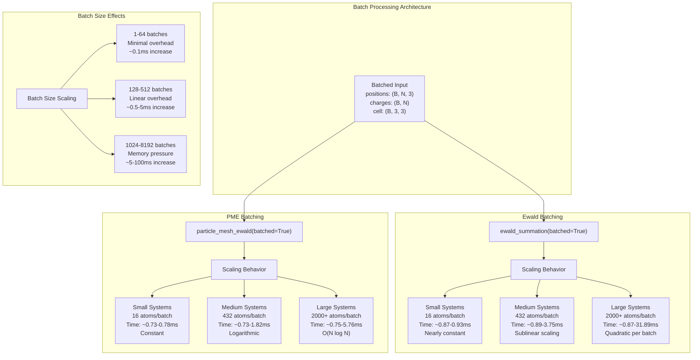
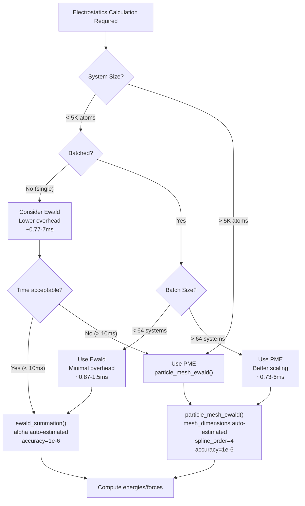

<!-- source: DeepWiki mcp.deepwiki.com · repo NVIDIA/nvalchemi-toolkit-ops · page 4.3 Electrostatics Performance · fetched 2026-10-26 -->

# Electrostatics Performance

<details>
<summary>Relevant source files</summary>

The following files were used as context for generating this wiki page:

- [docs/benchmarks/benchmark_results/electrostatics_benchmark_ewald_nvalchemiops_h100-80gb-hbm3.csv](docs/benchmarks/benchmark_results/electrostatics_benchmark_ewald_nvalchemiops_h100-80gb-hbm3.csv)
- [docs/benchmarks/benchmark_results/electrostatics_benchmark_pme_nvalchemiops_h100-80gb-hbm3.csv](docs/benchmarks/benchmark_results/electrostatics_benchmark_pme_nvalchemiops_h100-80gb-hbm3.csv)
- [docs/benchmarks/electrostatics.md](docs/benchmarks/electrostatics.md)

</details>


This page provides a comprehensive performance analysis of long-range electrostatic calculations in `nvalchemiops`, comparing Ewald summation and Particle Mesh Ewald (PME) methods. The analysis covers scaling behavior, memory usage, throughput characteristics, and practical method selection guidance based on system size and batching requirements.

For detailed API documentation of electrostatics functions, see [Electrostatics API](#5.3). For in-depth performance metrics and plots for each method, see [Ewald Performance](#4.3.1) and [PME Performance](#4.3.2).

## Performance Overview

The electrostatics implementation in `nvalchemiops` provides two primary methods with fundamentally different computational scaling characteristics:

| Method | Complexity | Optimal System Size | Constant Time Region | Key Advantage |
|--------|-----------|-------------------|---------------------|---------------|
| **Ewald Summation** | O(N^3/2) to O(N^2) | < 5,000 atoms | 2-686 atoms | Simple implementation, low overhead |
| **Particle Mesh Ewald (PME)** | O(N log N) | > 5,000 atoms | All tested sizes | FFT-accelerated scaling |

**Sources:** [docs/benchmarks/benchmark_results/electrostatics_benchmark_ewald_nvalchemiops_h100-80gb-hbm3.csv:1-81](), [docs/benchmarks/benchmark_results/electrostatics_benchmark_pme_nvalchemiops_h100-80gb-hbm3.csv:1-81]()

## Method Selection Architecture

The following diagram illustrates the relationship between electrostatics methods and their computational components:



**Sources:** [docs/benchmarks/benchmark_results/electrostatics_benchmark_ewald_nvalchemiops_h100-80gb-hbm3.csv:2-11](), [docs/benchmarks/benchmark_results/electrostatics_benchmark_pme_nvalchemiops_h100-80gb-hbm3.csv:2-11]()

## Scaling Behavior Comparison

The performance characteristics of Ewald and PME methods diverge significantly with system size:



**Sources:** [docs/benchmarks/benchmark_results/electrostatics_benchmark_ewald_nvalchemiops_h100-80gb-hbm3.csv:2-11](), [docs/benchmarks/benchmark_results/electrostatics_benchmark_pme_nvalchemiops_h100-80gb-hbm3.csv:2-11]()

## Single System Performance Metrics

### Execution Time Analysis

The following table summarizes representative execution times for single systems across method and size:

| System Size | Atoms | Ewald Time (ms) | PME Time (ms) | Speedup | Winner |
|-------------|-------|-----------------|---------------|---------|--------|
| **Tiny** | 2 | 0.742 | 0.767 | 0.97x | Ewald |
| **Small** | 54 | 0.770 | 0.766 | 1.01x | PME |
| **Small** | 250 | 0.951 | 0.747 | 1.27x | PME |
| **Small** | 686 | 1.317 | 0.752 | 1.75x | PME |
| **Medium** | 2,000 | 2.873 | 0.786 | 3.65x | **PME** |
| **Medium** | 6,750 | 6.966 | 0.764 | 9.12x | **PME** |
| **Large** | 16,000 | 15.912 | 0.763 | 20.85x | **PME** |
| **Large** | 31,250 | 27.580 | 0.739 | 37.32x | **PME** |
| **Large** | 54,000 | 51.659 | 0.748 | 69.03x | **PME** |
| **Very Large** | 85,750 | 89.561 | 0.808 | 110.84x | **PME** |

**Key Observation:** PME achieves nearly constant execution time (~0.75ms) across all system sizes due to O(N log N) FFT scaling, while Ewald scales quadratically. The crossover occurs around 5,000 atoms where PME becomes definitively superior.

**Sources:** [docs/benchmarks/benchmark_results/electrostatics_benchmark_ewald_nvalchemiops_h100-80gb-hbm3.csv:2-11](), [docs/benchmarks/benchmark_results/electrostatics_benchmark_pme_nvalchemiops_h100-80gb-hbm3.csv:2-11]()

### Memory Scaling

Memory usage patterns differ significantly between methods:

| System Size | Atoms | Ewald Memory (MB) | PME Memory (MB) | Ratio |
|-------------|-------|-------------------|-----------------|-------|
| 2 | 2 | 32.28 | 33.19 | 0.97x |
| 54 | 54 | 34.93 | 41.51 | 0.84x |
| 250 | 250 | 41.19 | 44.13 | 0.93x |
| 2,000 | 2,000 | 190.42 | 171.99 | 1.11x |
| 6,750 | 6,750 | 930.06 | 509.55 | 1.83x |
| 16,000 | 16,000 | 3,031.99 | 1,603.05 | 1.89x |
| 31,250 | 31,250 | 7,860.13 | 4,190.90 | 1.88x |
| 54,000 | 54,000 | 17,297.39 | 9,244.00 | 1.87x |
| 85,750 | 85,750 | 34,505.40 | 18,604.93 | 1.85x |

**Memory Scaling Factors:**
- **Ewald:** ~0.40 MB per atom (quadratic neighbor storage)
- **PME:** ~0.22 MB per atom (grid-based storage)

**Sources:** [docs/benchmarks/benchmark_results/electrostatics_benchmark_ewald_nvalchemiops_h100-80gb-hbm3.csv:2-11](), [docs/benchmarks/benchmark_results/electrostatics_benchmark_pme_nvalchemiops_h100-80gb-hbm3.csv:2-11]()

## Batched Performance Characteristics

Both methods support native batching with different performance profiles:



**Sources:** [docs/benchmarks/benchmark_results/electrostatics_benchmark_ewald_nvalchemiops_h100-80gb-hbm3.csv:12-81](), [docs/benchmarks/benchmark_results/electrostatics_benchmark_pme_nvalchemiops_h100-80gb-hbm3.csv:12-81]()

### Batched Scaling Examples

**Small System Batching (16 atoms per system):**

| Total Atoms | Batch Size | Ewald Time (ms) | PME Time (ms) | Ewald Memory (MB) | PME Memory (MB) |
|-------------|-----------|-----------------|---------------|-------------------|-----------------|
| 16 | 1 | 0.870 | 0.775 | 32.34 | 33.24 |
| 256 | 16 | 0.911 | 0.735 | 38.66 | 50.71 |
| 1,024 | 64 | 0.915 | 0.752 | 58.64 | 106.64 |
| 4,096 | 256 | 0.970 | 0.747 | 138.57 | 330.33 |
| 16,384 | 1,024 | 1.457 | 1.781 | 458.28 | 1,225.14 |
| 131,072 | 8,192 | 5.113 | 11.671 | 3,442.24 | 9,576.62 |

**Large System Batching (2,000 atoms per system):**

| Total Atoms | Batch Size | Ewald Time (ms) | PME Time (ms) | Ewald Memory (MB) | PME Memory (MB) |
|-------------|-----------|-----------------|---------------|-------------------|-----------------|
| 2,000 | 1 | 0.873 | 0.782 | 115.53 | 172.00 |
| 8,000 | 4 | 3.363 | 0.747 | 665.69 | 579.78 |
| 16,000 | 8 | 4.767 | 1.049 | 1,299.37 | 1,123.49 |
| 32,000 | 16 | 7.467 | 1.723 | 2,566.74 | 2,210.92 |
| 128,000 | 64 | 24.876 | 5.757 | 10,170.93 | 8,735.48 |

**Key Observations:**
- For small systems, batching adds minimal overhead with both methods
- PME maintains better scaling even with large batch sizes
- Memory scales approximately linearly with total atoms for both methods
- Ewald shows quadratic behavior emerging at larger batch sizes

**Sources:** [docs/benchmarks/benchmark_results/electrostatics_benchmark_ewald_nvalchemiops_h100-80gb-hbm3.csv:12-80](), [docs/benchmarks/benchmark_results/electrostatics_benchmark_pme_nvalchemiops_h100-80gb-hbm3.csv:12-80]()

## Method Selection Decision Flow



**Sources:** [docs/benchmarks/benchmark_results/electrostatics_benchmark_ewald_nvalchemiops_h100-80gb-hbm3.csv:1-81](), [docs/benchmarks/benchmark_results/electrostatics_benchmark_pme_nvalchemiops_h100-80gb-hbm3.csv:1-81](), [docs/benchmarks/electrostatics.md:1-192]()

## Throughput Analysis

Throughput (atoms processed per millisecond) reveals computational efficiency:

### Single System Throughput

| System Size | Atoms | Ewald (atoms/ms) | PME (atoms/ms) | PME Advantage |
|-------------|-------|------------------|----------------|---------------|
| 2 | 2 | 2.7 | 2.6 | 0.96x |
| 250 | 250 | 263 | 334 | 1.27x |
| 2,000 | 2,000 | 696 | 2,545 | 3.66x |
| 6,750 | 6,750 | 969 | 8,834 | 9.12x |
| 16,000 | 16,000 | 1,006 | 20,971 | 20.85x |
| 54,000 | 54,000 | 1,045 | 72,192 | 69.06x |
| 85,750 | 85,750 | 958 | 106,124 | 110.84x |

**PME maintains > 100,000 atoms/ms throughput for large systems**, demonstrating excellent GPU utilization.

**Sources:** [docs/benchmarks/benchmark_results/electrostatics_benchmark_ewald_nvalchemiops_h100-80gb-hbm3.csv:2-11](), [docs/benchmarks/benchmark_results/electrostatics_benchmark_pme_nvalchemiops_h100-80gb-hbm3.csv:2-11]()

## Hardware Platform and Configuration

All benchmarks executed on **NVIDIA H100-80GB HBM3** with the following configuration:

| Parameter | Value | Description |
|-----------|-------|-------------|
| **System Type** | FCC crystal lattice | Periodic boundary conditions |
| **Neighbor List** | Cell list O(N) | Pre-computed, excluded from timing |
| **Warmup Iterations** | 3 | Stabilize GPU state |
| **Timing Iterations** | 10 | Median time reported |
| **Precision** | `float32` | Single precision |
| **Component** | `reciprocal` | Reciprocal space only |
| **Force Computation** | `False` | Energy only |

### Auto-Estimated Parameters

Both methods use automatic parameter estimation targeting 10^-6 relative accuracy:

| Method | Auto-Estimated Parameters |
|--------|--------------------------|
| **Ewald** | `alpha` (splitting parameter), `k_cutoff` (reciprocal cutoff), `real_space_cutoff` |
| **PME** | `alpha`, `mesh_dimensions` (grid size), `real_space_cutoff` |

Fixed parameter: `spline_order=4` (B-spline interpolation order for PME)

**Sources:** [docs/benchmarks/electrostatics.md:106-131]()

## Performance Recommendations

Based on comprehensive benchmarking data:

### For Single Systems

1. **Systems < 500 atoms:** Either method performs well (~0.75-1ms), choose based on simplicity
2. **Systems 500-5,000 atoms:** PME preferred for consistent performance (~0.75ms)
3. **Systems > 5,000 atoms:** **PME strongly recommended** (10-100x faster than Ewald)
4. **Memory-constrained:** PME uses ~50% less memory than Ewald for large systems

### For Batched Systems

1. **Small systems (< 100 atoms), small batches (< 64):** Ewald acceptable (~0.87-1.5ms)
2. **Small systems (< 100 atoms), large batches (> 64):** PME preferred (~0.73-2ms)
3. **Medium systems (100-1,000 atoms):** PME strongly preferred at any batch size
4. **Large systems (> 1,000 atoms):** **PME required** for reasonable performance

### Memory Limits on H100-80GB

| Configuration | Max Atoms | Max Batch Size | Peak Memory |
|--------------|-----------|----------------|-------------|
| **Ewald Single** | ~85,750 | 1 | ~34 GB |
| **PME Single** | ~85,750 | 1 | ~18 GB |
| **Ewald Batched** | 442,368 | 8,192 (54 atoms/system) | ~24 GB |
| **PME Batched** | 442,368 | 8,192 (54 atoms/system) | ~73 GB |
| **PME Batched Large** | 524,288 | 4,096 (128 atoms/system) | ~40 GB |

**Sources:** [docs/benchmarks/benchmark_results/electrostatics_benchmark_ewald_nvalchemiops_h100-80gb-hbm3.csv:1-81](), [docs/benchmarks/benchmark_results/electrostatics_benchmark_pme_nvalchemiops_h100-80gb-hbm3.csv:1-81]()

## Benchmark Execution

To reproduce these benchmarks or test on different hardware:

```bash
cd benchmarks/interactions/electrostatics
python benchmark_electrostatics.py \
    --config benchmark_config.yaml \
    --backend nvalchemiops \
    --method both \
    --output-dir ../../../docs/benchmarks/benchmark_results
```

Results are written to CSV files with naming pattern:
- `electrostatics_benchmark_ewald_nvalchemiops_<gpu-sku>.csv`
- `electrostatics_benchmark_pme_nvalchemiops_<gpu-sku>.csv`

For detailed methodology, see [Benchmark Methodology](#4.4).

**Sources:** [docs/benchmarks/electrostatics.md:163-191]()

## Summary

| Aspect | Ewald Summation | Particle Mesh Ewald |
|--------|----------------|-------------------|
| **Complexity** | O(N^3/2) to O(N^2) | O(N log N) |
| **Best For** | Systems < 5K atoms | Systems > 5K atoms |
| **Time Range** | 0.77ms - 89.56ms | 0.73ms - 0.81ms (constant) |
| **Memory Factor** | ~0.40 MB/atom | ~0.22 MB/atom |
| **Batch Scaling** | Quadratic degrades | Logarithmic maintained |
| **Throughput** | 700-1,000 atoms/ms | 100,000+ atoms/ms |
| **Implementation** | Direct summation | FFT-accelerated |

**Primary Recommendation:** Use **PME for all systems > 5,000 atoms** and for any batched workload with medium to large systems. Ewald remains viable only for small single-system calculations where simplicity is valued over performance.

**Sources:** [docs/benchmarks/benchmark_results/electrostatics_benchmark_ewald_nvalchemiops_h100-80gb-hbm3.csv:1-81](), [docs/benchmarks/benchmark_results/electrostatics_benchmark_pme_nvalchemiops_h100-80gb-hbm3.csv:1-81]()

---

