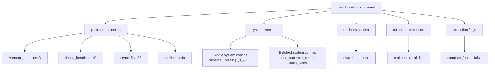
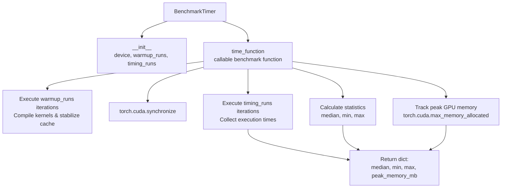
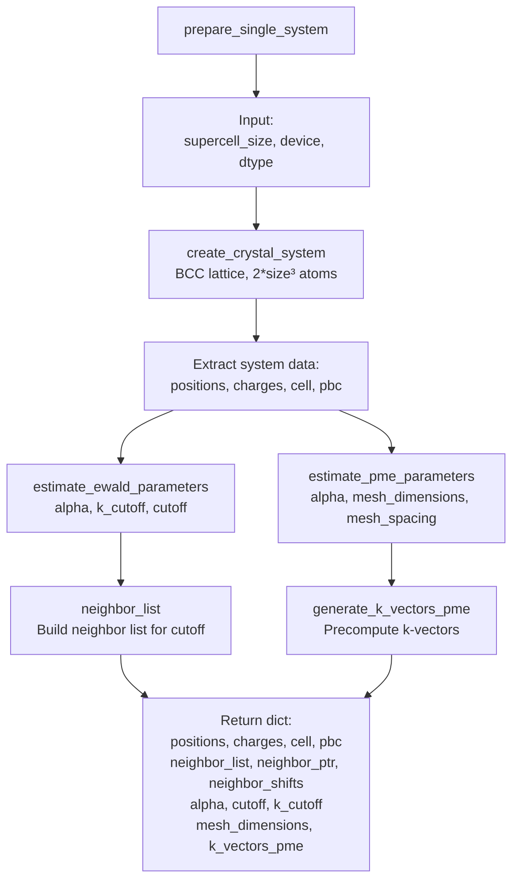
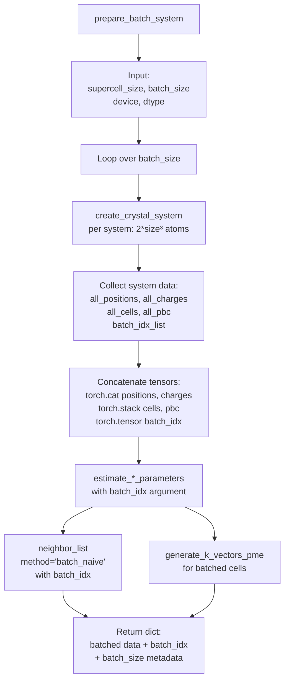
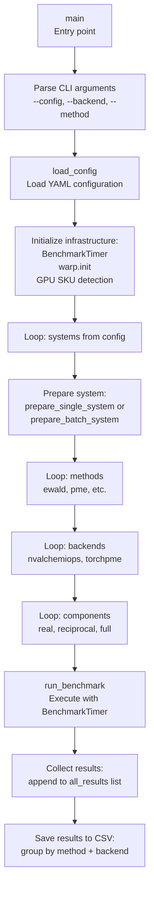
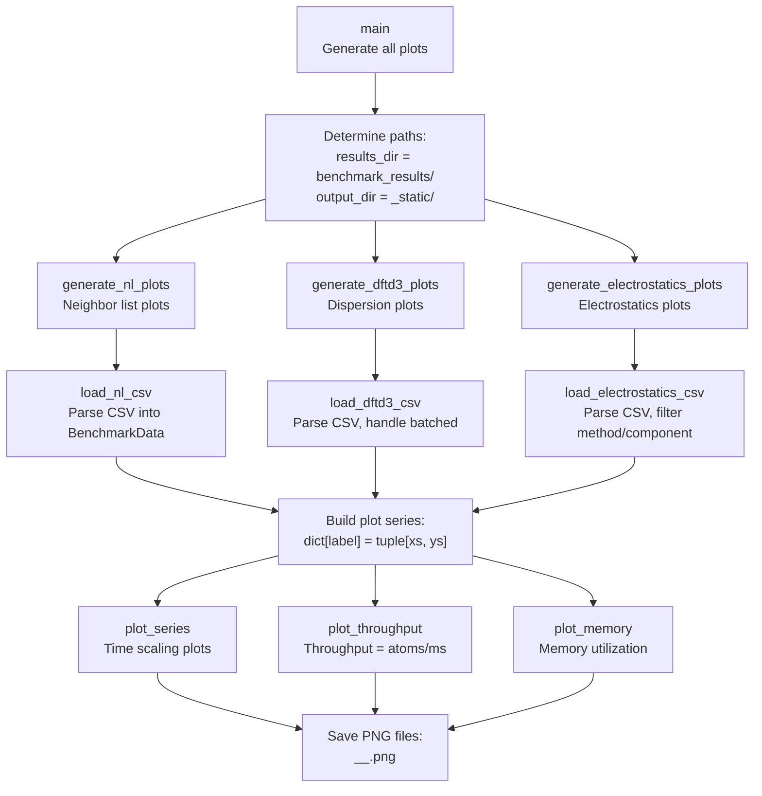

<!-- source: DeepWiki mcp.deepwiki.com · repo NVIDIA/nvalchemi-toolkit-ops · page 4.4 Benchmark Methodology · fetched 2026-10-26 -->

# Benchmark Methodology

<details>
<summary>Relevant source files</summary>

The following files were used as context for generating this wiki page:

- [benchmarks/interactions/electrostatics/benchmark_config.yaml](benchmarks/interactions/electrostatics/benchmark_config.yaml)
- [benchmarks/interactions/electrostatics/benchmark_electrostatics.py](benchmarks/interactions/electrostatics/benchmark_electrostatics.py)
- [docs/benchmarks/generate_plots.py](docs/benchmarks/generate_plots.py)
- [docs/benchmarks/index.md](docs/benchmarks/index.md)

</details>


This document explains how benchmarks are executed, measured, and visualized in the NVIDIA ALCHEMI Toolkit-Ops project. For analysis of specific benchmark results, see [Neighbor List Performance](#4.1), [Dispersion Performance](#4.2), and [Electrostatics Performance](#4.3).

## Purpose and Scope

All benchmarks in this toolkit follow a standardized methodology to ensure consistent, reproducible performance measurements. This page documents the configuration system, timing procedures, data collection methods, and visualization pipeline used across all component benchmarks.

The methodology is designed to:
- Exclude tensor allocation and preprocessing overhead from measurements
- Use multiple warm-up iterations to eliminate kernel compilation costs
- Aggregate statistical metrics (median time, peak memory, throughput)
- Handle failures gracefully (out-of-memory, runtime errors)
- Maintain consistent parameters across benchmark runs

Sources: [docs/benchmarks/index.md:18-38]()

## Configuration System

Benchmarks are configured via YAML files that define system parameters, test configurations, and execution settings. Each benchmark type (neighbor list, dispersion, electrostatics) has its own configuration file.

### Configuration File Structure



**Configuration Parameters**

| Parameter | Type | Purpose |
|-----------|------|---------|
| `warmup_iterations` | int | Number of warm-up runs to compile kernels and stabilize cache |
| `timing_iterations` | int | Number of timed runs for statistical aggregation |
| `dtype` | str | Data type for tensors (`float32` or `float64`) |
| `device` | str | Execution device (`cuda` or `cpu`) |

**System Configuration Modes**

Benchmarks support two system configuration modes:

1. **Single System Mode** (`mode: single`): Tests individual systems of varying sizes
   - Specified via `supercell_sizes` list
   - Example: `[1, 3, 5, 7, 10, 15, 20, 25]` for linear dimensions
   
2. **Batched System Mode** (`mode: batched`): Tests multiple systems processed together
   - Specified via `base_supercell_size` and `batch_sizes` list
   - Example: `base_supercell_size: 4` with `batch_sizes: [1, 4, 16, 64, 256]`

Sources: [benchmarks/interactions/electrostatics/benchmark_config.yaml:1-91]()

## Timing and Measurement

### BenchmarkTimer Class

The `BenchmarkTimer` class provides standardized timing and memory measurement across all benchmarks. It is defined in [benchmarks/utils.py]() and handles:



**Measurement Process**

1. **Warm-up Phase**: Execute benchmark function `warmup_runs` times (typically 3)
   - Ensures CUDA kernels are compiled
   - Stabilizes GPU cache state
   - Discarded from statistics

2. **Synchronization**: Call `torch.cuda.synchronize()` before and after each timed iteration
   - Ensures accurate GPU timing
   - Blocks CPU until GPU completes

3. **Timing Phase**: Execute benchmark function `timing_runs` times (typically 10)
   - Collect wall-clock execution times
   - Track peak GPU memory usage

4. **Aggregation**: Calculate statistical metrics
   - `median`: Median execution time (ms)
   - `min`/`max`: Minimum and maximum times (ms)
   - `peak_memory_mb`: Peak GPU memory allocated (MB)

Sources: [benchmarks/interactions/electrostatics/benchmark_electrostatics.py:654-750](), [docs/benchmarks/index.md:27-38]()

### Error Handling

The timing system captures and reports failures:

```python
{
    "success": False,
    "median_time_ms": float("inf"),
    "peak_memory_mb": None,
    "error": "Out of memory",
    "error_type": "OutOfMemoryError"
}
```

Common failure types:
- **OutOfMemoryError**: System exceeded GPU memory capacity
- **RuntimeError**: CUDA runtime errors
- **NotImplementedError**: Unsupported configuration (e.g., batched mode in torchpme backend)

Sources: [benchmarks/interactions/electrostatics/benchmark_electrostatics.py:685-750]()

## System Preparation

Benchmark systems are generated using standardized crystal lattice configurations. The system preparation phase creates test structures, estimates physical parameters, and constructs neighbor lists.

### Single System Preparation



Key steps in `prepare_single_system()`:

1. **Crystal Generation**: Use `create_crystal_system()` to generate BCC lattice
   - Total atoms = 2 × supercell_size³ (BCC has 2 atoms per unit cell)
   - Fixed lattice constant: 4.14 Å

2. **Parameter Estimation**: Calculate optimal physical parameters
   - Ewald parameters via `estimate_ewald_parameters()` (accuracy=1e-6)
   - PME parameters via `estimate_pme_parameters()` (accuracy=1e-6)
   - Returns `alpha`, cutoff radii, mesh dimensions

3. **Neighbor List Construction**: Build neighbor list using `neighbor_list()`
   - Uses estimated real-space cutoff
   - Returns sparse neighbor list data, pointer array, and shift vectors

4. **K-Vector Precomputation**: Generate reciprocal space vectors
   - `generate_k_vectors_pme()` for PME calculations
   - Precomputed to avoid regeneration during benchmark iterations

Sources: [benchmarks/interactions/electrostatics/benchmark_electrostatics.py:110-182]()

### Batched System Preparation



Batched preparation differs from single system:

1. **Multiple System Generation**: Create `batch_size` independent systems
   - Each system has identical size (2 × supercell_size³ atoms)
   - Different atomic positions for statistical variation

2. **Batch Index Tracking**: Build `batch_idx` tensor
   - Maps each atom to its parent system
   - Format: `[0,0,...,1,1,...,batch_size-1,...]`

3. **Batched Neighbor Lists**: Use `method="batch_naive"` 
   - Constructs neighbor lists for all systems simultaneously
   - Respects batch boundaries (no cross-system neighbors)

4. **Batched Parameters**: Pass `batch_idx` to parameter estimation
   - Returns per-system parameters (arrays of length `batch_size`)
   - Or shared parameters where appropriate

Sources: [benchmarks/interactions/electrostatics/benchmark_electrostatics.py:184-280]()

## Benchmark Execution Flow

### Execution Pipeline



The benchmark execution follows a nested loop structure:

1. **Configuration Loading**: Parse command-line arguments and load YAML config
   - Supports `--backend` selection: `nvalchemiops`, `torchpme`, or `both`
   - Supports `--method` selection: method-specific or `both`

2. **Infrastructure Initialization**:
   - Create `BenchmarkTimer` with configured warmup/timing iterations
   - Initialize Warp runtime via `wp.init()`
   - Detect GPU SKU via `get_gpu_sku()` for filename generation

3. **System Loop**: Iterate over system configurations from YAML
   - Single systems: iterate over `supercell_sizes`
   - Batched systems: iterate over `batch_sizes`

4. **Method/Backend/Component Loops**: For each system, test all combinations
   - Methods: `ewald`, `pme`, etc.
   - Backends: `nvalchemiops`, `torchpme`
   - Components: `real`, `reciprocal`, `full` (if applicable)

5. **Benchmark Execution**: Call `run_benchmark()` for each configuration
   - Wraps backend-specific function with `BenchmarkTimer.time_function()`
   - Captures success/failure status and metrics

6. **Result Collection**: Aggregate all results into list of dictionaries
   - Each entry contains: `total_atoms`, `batch_size`, `method`, `backend`, `component`, `median_time_ms`, `peak_memory_mb`, `success`

Sources: [benchmarks/interactions/electrostatics/benchmark_electrostatics.py:758-1021]()

### Backend Selection

The benchmark system supports multiple backend implementations for comparison:

| Backend | Description | Support |
|---------|-------------|---------|
| `nvalchemiops` | Native Warp-based implementation | Full (single + batched) |
| `torchpme` | Reference PyTorch implementation | Single only (no native batching) |
| `torch_dftd` | Reference DFT-D3 implementation | Single only |

Backend functions are wrapped in closures for timing:

```python
if backend == "nvalchemiops":
    def bench_fn():
        return run_nvalchemiops_ewald(system_data, component, compute_forces)
else:  # torchpme
    def bench_fn():
        return run_torchpme_ewald(system_data, compute_forces)
```

The closure captures all necessary context (`system_data`, `component`, `compute_forces`) while presenting a clean interface to `BenchmarkTimer`.

Sources: [benchmarks/interactions/electrostatics/benchmark_electrostatics.py:660-703]()

## Result Storage

### CSV File Format

Benchmark results are stored as CSV files with standardized naming conventions and schema.

**Naming Convention**

```
<component>_benchmark_<method>_<backend>_<gpu_sku>.csv
```

Examples:
- `electrostatics_benchmark_ewald_nvalchemiops_h100-80gb-hbm3.csv`
- `neighbor_list_benchmark_cell-list_h100-80gb-hbm3.csv`
- `dftd3_benchmark_batch_nvalchemiops_h100-80gb-hbm3.csv`

**GPU SKU Detection**

The `get_gpu_sku()` function automatically detects hardware:

```python
def get_gpu_sku() -> str:
    """Get GPU SKU name for filename generation."""
    gpu_name = torch.cuda.get_device_name(0)
    # Clean: "NVIDIA H100 80GB HBM3" -> "h100-80gb-hbm3"
    sku = gpu_name.replace(" ", "-").replace("_", "-")
    sku = sku.replace("NVIDIA-", "").replace("GeForce-", "")
    return sku.lower()
```

This ensures results are uniquely identified by hardware platform.

Sources: [benchmarks/interactions/electrostatics/benchmark_electrostatics.py:83-96](), [benchmarks/interactions/electrostatics/benchmark_electrostatics.py:989-1017]()

### CSV Schema

Each CSV file contains the following columns:

| Column | Type | Description |
|--------|------|-------------|
| `total_atoms` | int | Total number of atoms in system |
| `batch_size` | int | Batch size (1 for single systems) |
| `method` | str | Calculation method (e.g., `ewald`, `pme`) |
| `backend` | str | Implementation backend |
| `component` | str | Component tested (`real`, `reciprocal`, `full`) |
| `compute_forces` | bool | Whether forces were computed |
| `median_time_ms` | float | Median execution time (ms) |
| `peak_memory_mb` | float | Peak GPU memory (MB) |
| `success` | bool | Whether benchmark succeeded |
| `error` | str | Error message (if failed) |
| `error_type` | str | Error class name (if failed) |
| `supercell_size` | int | Linear supercell dimension |
| `mode` | str | `single` or `batched` |

Failed benchmarks have `median_time_ms = inf` and `success = False`.

Sources: [benchmarks/interactions/electrostatics/benchmark_electrostatics.py:724-750]()

## Visualization Pipeline

### Plot Generation System

The `generate_plots.py` script reads CSV files and produces standardized visualizations.



**Plot Types Generated**

For each benchmark configuration, three plot types are generated:

1. **Time Scaling Plots**: `<prefix>_scaling_<config>.png`
   - X-axis: Number of atoms (log scale)
   - Y-axis: Median time in ms (log scale)
   - Shows execution time vs. system size

2. **Throughput Plots**: `<prefix>_throughput_<config>.png`
   - X-axis: Number of atoms (log scale)
   - Y-axis: Throughput (atoms/ms, log scale)
   - Calculated as `total_atoms / median_time_ms`

3. **Memory Plots**: `<prefix>_memory_<config>.png`
   - X-axis: Number of atoms (log scale)
   - Y-axis: Peak memory (MB, log scale)
   - Shows GPU memory consumption

Sources: [docs/benchmarks/generate_plots.py:999-1022]()

### Plot Rendering

The `plot_series()` function uses matplotlib with consistent styling:

**Visual Properties**
- Log-log scale for all axes
- YlGn sequential colormap (avoiding very light colors)
- Marker size: 6.0 points with black edge
- Line width: 2.5 points
- Grid: Major (solid, 0.8 alpha) and minor (dotted, 0.2 alpha)

**Data Handling**
- NaN values are automatically skipped by matplotlib (creates gaps in lines)
- Infinite values converted to NaN during CSV loading
- Failed benchmarks appear as gaps in plot lines

**Legend Placement**
- ≤4 series: Inside upper left corner
- \>4 series: Outside to the right (`bbox_to_anchor=(1.02, 0.5)`)

Sources: [docs/benchmarks/generate_plots.py:107-236]()

### BenchmarkData Container

Results are loaded into a typed container for type safety:

```python
class BenchmarkData(NamedTuple):
    """Container for benchmark data series."""
    total_atoms: np.ndarray
    median_time_ms: np.ndarray
    peak_memory_mb: np.ndarray
```

This structure ensures consistent data access patterns across all plot generation functions.

Sources: [docs/benchmarks/generate_plots.py:20-26]()

## Summary

The benchmark methodology provides a robust, reproducible framework for performance evaluation:

1. **Configuration**: YAML-based system with flexible parameter specification
2. **Measurement**: Standardized `BenchmarkTimer` with warm-up, synchronization, and statistical aggregation
3. **System Preparation**: Automated crystal lattice generation with physical parameter estimation
4. **Execution**: Nested loop structure testing all method/backend/component combinations
5. **Storage**: CSV files with GPU-specific naming and comprehensive metadata
6. **Visualization**: Automated plot generation with consistent styling and multiple metric types

This methodology ensures that performance comparisons are fair, failures are documented, and results are easily reproducible across different hardware platforms.

Sources: [docs/benchmarks/index.md:18-38](), [benchmarks/interactions/electrostatics/benchmark_electrostatics.py:1-1025](), [docs/benchmarks/generate_plots.py:1-1023]()

---

