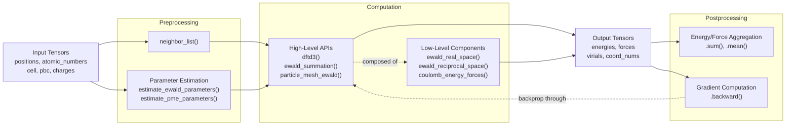
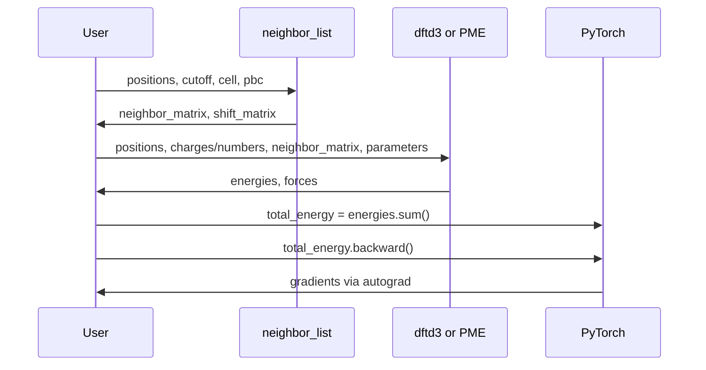

<!-- source: DeepWiki mcp.deepwiki.com · repo NVIDIA/nvalchemi-toolkit-ops · page 5 API Reference · fetched 2026-10-26 -->

# API Reference

<details>
<summary>Relevant source files</summary>

The following files were used as context for generating this wiki page:

- [README.md](README.md)
- [docs/modules/electrostatics.rst](docs/modules/electrostatics.rst)
- [docs/modules/index.md](docs/modules/index.md)

</details>


This page provides an overview of the NVIDIA ALCHEMI Toolkit-Ops API structure and common patterns across all modules. The complete technical API documentation is organized into three main modules corresponding to the toolkit's core computational primitives. For detailed function signatures, parameters, and examples, refer to the module-specific pages:

- For neighbor list construction functions, see [Neighbor List API](#5.1)
- For DFT-D3 dispersion correction functions, see [Dispersion API](#5.2)
- For electrostatic calculation functions, see [Electrostatics API](#5.3)

## Module Structure

The `nvalchemiops` package is organized into three primary modules that correspond to the computational primitives described in [Core Components](#2). The diagram below maps the package structure to actual Python modules and their key functions.

**Module Hierarchy and Key Functions**

```mermaid
graph TB
    ROOT["nvalchemiops"]
    
    subgraph NL_MOD["nvalchemiops.neighborlist"]
        NL_MAIN["neighbor_list()"]
        NL_CELL["cell_list()"]
        NL_NAIVE["naive_neighbor_list()"]
        NL_BATCH_CELL["batch_cell_list()"]
        NL_BATCH_NAIVE["batch_naive_neighbor_list()"]
    end
    
    subgraph DISP_MOD["nvalchemiops.interactions.dispersion"]
        DISP_MAIN["dftd3()"]
        DISP_PARAMS["D3Parameters"]
        DISP_UTILS["D3 utility functions"]
    end
    
    subgraph ELEC_MOD["nvalchemiops.interactions.electrostatics"]
        subgraph ELEC_EWALD["electrostatics.ewald"]
            EWALD_SUM["ewald_summation()"]
            EWALD_REAL["ewald_real_space()"]
            EWALD_RECIP["ewald_reciprocal_space()"]
        end
        
        subgraph ELEC_PME["electrostatics.pme"]
            PME_MAIN["particle_mesh_ewald()"]
            PME_RECIP["pme_reciprocal_space()"]
        end
        
        subgraph ELEC_COUL["electrostatics.coulomb"]
            COUL_E["coulomb_energy()"]
            COUL_F["coulomb_forces()"]
            COUL_EF["coulomb_energy_forces()"]
        end
        
        subgraph ELEC_PARAMS["electrostatics.parameters"]
            EST_EWALD["estimate_ewald_parameters()"]
            EST_PME["estimate_pme_parameters()"]
            EWALD_PARAMS["EwaldParameters"]
            PME_PARAMS["PMEParameters"]
        end
        
        subgraph ELEC_UTILS["electrostatics.k_vectors"]
            K_EWALD["generate_k_vectors_ewald_summation()"]
            K_PME["generate_k_vectors_pme()"]
        end
    end
    
    subgraph SPLINE_MOD["nvalchemiops.spline"]
        SPLINE_SPREAD["spline_spread()"]
        SPLINE_GATHER["spline_gather()"]
        SPLINE_GATHER_VEC["spline_gather_vec3()"]
        SPLINE_GRAD["spline_gather_gradient()"]
    end
    
    ROOT --> NL_MOD
    ROOT --> DISP_MOD
    ROOT --> ELEC_MOD
    ROOT --> SPLINE_MOD
    
    NL_MAIN -.->|dispatches to| NL_CELL
    NL_MAIN -.->|dispatches to| NL_NAIVE
    NL_MAIN -.->|dispatches to| NL_BATCH_CELL
    NL_MAIN -.->|dispatches to| NL_BATCH_NAIVE
    
    EWALD_SUM -.->|calls| EWALD_REAL
    EWALD_SUM -.->|calls| EWALD_RECIP
    
    PME_MAIN -.->|calls| COUL_EF
    PME_MAIN -.->|calls| PME_RECIP
    PME_MAIN -.->|uses| SPLINE_SPREAD
    PME_MAIN -.->|uses| SPLINE_GATHER
    
    EST_EWALD -.->|returns| EWALD_PARAMS
    EST_PME -.->|returns| PME_PARAMS
    
    EWALD_RECIP -.->|uses| K_EWALD
    PME_RECIP -.->|uses| K_PME
```



**Sources:** [docs/modules/index.md:1-14](), [docs/modules/electrostatics.rst:1-93](), [README.md:57-176]()

## Common API Patterns

All APIs in `nvalchemiops` follow consistent design patterns to ensure ease of use and composability. The table below summarizes the common patterns across all three modules.

| Pattern | Description | Example Modules |
|---------|-------------|-----------------|
| **High-level entry points** | Single function for common use cases with automatic parameter selection | `neighbor_list()`, `dftd3()`, `particle_mesh_ewald()` |
| **Low-level functions** | Direct access to specific algorithms for custom workflows | `cell_list()`, `naive_neighbor_list()`, `ewald_real_space()` |
| **PyTorch tensor interface** | All functions accept and return `torch.Tensor` objects | All modules |
| **Automatic differentiation** | Full autograd support for gradient computation | Dispersion, Electrostatics |
| **Batched operations** | Native support for heterogeneous batches via `batch_idx`, `batch_ptr` | All modules |
| **Parameter dataclasses** | Structured parameter objects for complex configurations | `D3Parameters`, `EwaldParameters`, `PMEParameters` |
| **Utility functions** | Helper functions for parameter estimation and preprocessing | `estimate_ewald_parameters()`, `estimate_pme_parameters()` |

**Sources:** [README.md:46-177](), [docs/modules/electrostatics.rst:8-93]()

## Function Categories

The API functions can be categorized by their purpose and usage patterns. This diagram shows how different function types relate to typical workflow stages.

**API Function Categories and Workflow Integration**



**Sources:** [README.md:57-176](), [docs/modules/electrostatics.rst:8-93]()

## Module Organization

The three main API modules are organized hierarchically and documented separately for clarity:

### Neighbor List Module

Located in `nvalchemiops.neighborlist`, this module provides functions for constructing neighbor lists with automatic algorithm selection based on system size and batching requirements.

**Key Functions:**
- `neighbor_list()` - High-level API with automatic algorithm dispatch
- `cell_list()` - O(N) spatial decomposition for large systems
- `naive_neighbor_list()` - O(N²) pairwise for small systems
- `batch_cell_list()` - Batched spatial decomposition
- `batch_naive_neighbor_list()` - Batched pairwise for small batches

**Complete documentation:** [Neighbor List API](#5.1)

**Sources:** [README.md:57-91]()

### Dispersion Module

Located in `nvalchemiops.interactions.dispersion`, this module implements DFT-D3 dispersion corrections with Becke-Johnson damping, including coordination-dependent C6 coefficient interpolation.

**Key Functions:**
- `dftd3()` - Main DFT-D3 calculation function
- `D3Parameters` - Dataclass containing reference C6 coefficients and atomic properties

**Complete documentation:** [Dispersion API](#5.2)

**Sources:** [README.md:94-139]()

### Electrostatics Module

Located in `nvalchemiops.interactions.electrostatics`, this module provides multiple methods for computing long-range electrostatic interactions, organized into submodules by method type.

**Submodules:**
- `electrostatics.ewald` - Ewald summation for small-to-medium systems (<5000 atoms)
- `electrostatics.pme` - Particle Mesh Ewald for large systems (>5000 atoms)
- `electrostatics.coulomb` - Direct Coulomb interactions
- `electrostatics.parameters` - Parameter estimation utilities
- `electrostatics.k_vectors` - Reciprocal space vector generation

**Complete documentation:** [Electrostatics API](#5.3)

**Sources:** [docs/modules/electrostatics.rst:1-93](), [README.md:141-176]()

## Input/Output Conventions

All API functions follow consistent input/output conventions for tensor shapes and types.

| Parameter | Shape | Type | Description |
|-----------|-------|------|-------------|
| `positions` | `[num_atoms, 3]` | `torch.Tensor` | Atomic coordinates in Cartesian space |
| `atomic_numbers` or `numbers` | `[num_atoms]` | `torch.Tensor` | Atomic numbers (integers) |
| `cell` | `[num_systems, 3, 3]` or `[3, 3]` | `torch.Tensor` | Simulation cell lattice vectors |
| `pbc` | `[num_systems, 3]` or `[3]` | `torch.Tensor` | Periodic boundary conditions (boolean) |
| `batch_idx` | `[num_atoms]` | `torch.Tensor` | System index for each atom in batch |
| `batch_ptr` | `[num_systems + 1]` | `torch.Tensor` | Pointer array for batch indexing |
| `neighbor_matrix` | `[num_atoms, max_neighbors]` | `torch.Tensor` | Dense neighbor indices |
| `neighbor_matrix_shifts` | `[num_atoms, max_neighbors, 3]` | `torch.Tensor` | PBC shift vectors for neighbors |
| `charges` | `[num_atoms]` | `torch.Tensor` | Atomic partial charges |

**Return Tensors:**

| Return Value | Shape | Type | Description |
|--------------|-------|------|-------------|
| `energies` | `[num_atoms]` or `[num_systems]` | `torch.Tensor` | Per-atom or per-system energies |
| `forces` | `[num_atoms, 3]` | `torch.Tensor` | Forces on each atom |
| `virials` | `[num_systems, 3, 3]` | `torch.Tensor` | Virial stress tensors |
| `coord_nums` | `[num_atoms]` | `torch.Tensor` | Coordination numbers (DFT-D3 only) |
| `edge_index` | `[2, num_edges]` | `torch.Tensor` | COO format edge list (neighbor lists) |
| `neighbor_ptr` | `[num_atoms + 1]` | `torch.Tensor` | CSR format pointer (neighbor lists) |

**Sources:** [README.md:57-176](), [docs/modules/electrostatics.rst:20-48]()

## Batching Conventions

The APIs support two distinct batching modes for handling multiple systems simultaneously:

**Automatic Batching (Concatenated Systems)**

Systems are concatenated into single tensors with `batch_idx` and `batch_ptr` for indexing:

```python
# batch_idx maps each atom to its system
batch_idx = torch.tensor([0, 0, 0, 1, 1, 2, 2, 2, 2])  # 3 systems
# batch_ptr defines start/end indices for each system
batch_ptr = torch.tensor([0, 3, 5, 9])  # system 0: atoms 0-2, system 1: atoms 3-4, etc.
```

**Per-System Parameters**

Some parameters like `cell` and `pbc` can be provided per-system:
- Shape `[num_systems, ...]` for heterogeneous parameters
- Shape `[...]` for homogeneous parameters (broadcast to all systems)

**Sources:** [README.md:94-139]()

## Common Workflows

**Typical Workflow Pattern**



**Sources:** [README.md:46-177]()

## Parameter Estimation Utilities

Both Ewald summation and PME provide automatic parameter estimation functions that determine optimal computational parameters based on desired accuracy:

| Function | Returns | Purpose |
|----------|---------|---------|
| `estimate_ewald_parameters()` | `EwaldParameters` | Determines `alpha`, `cutoff`, and `k_max` for Ewald summation |
| `estimate_pme_parameters()` | `PMEParameters` | Determines `alpha`, `cutoff`, mesh dimensions, and spline order for PME |
| `estimate_pme_mesh_dimensions()` | `Tuple[int, int, int]` | Computes mesh grid dimensions from cell and accuracy |
| `mesh_spacing_to_dimensions()` | `Tuple[int, int, int]` | Converts target mesh spacing to grid dimensions |

These utilities implement standard algorithms for balancing real-space and reciprocal-space computational costs while achieving the specified accuracy tolerance.

**Sources:** [docs/modules/electrostatics.rst:50-72]()

## Supporting Utilities

### K-Vector Generation

Functions for generating reciprocal-space wave vectors:

- `generate_k_vectors_ewald_summation()` - Generates k-vectors for traditional Ewald summation
- `generate_k_vectors_pme()` - Generates k-vectors for PME reciprocal space calculations

These functions are typically called internally but are exposed for advanced users implementing custom electrostatics methods.

**Sources:** [docs/modules/electrostatics.rst:76-82]()

### B-Spline Functions

Located in `nvalchemiops.spline`, these functions implement B-spline charge spreading and force gathering for PME:

- `spline_spread()` - Spreads atomic charges onto mesh grid
- `spline_gather()` - Gathers scalar values from mesh to atoms
- `spline_gather_vec3()` - Gathers vector values from mesh to atoms
- `spline_gather_gradient()` - Gathers gradients from mesh for force calculation

These are low-level utilities primarily used internally by `particle_mesh_ewald()` but available for custom implementations.

**Sources:** [docs/modules/electrostatics.rst:84-92]()

## Error Handling and Validation

All API functions perform input validation and provide descriptive error messages for common issues:

- **Shape mismatches:** Ensures consistent tensor dimensions across related parameters
- **Device mismatches:** All tensors must reside on the same device (CPU or GPU)
- **Dtype consistency:** Checks for compatible floating-point types
- **Parameter bounds:** Validates that physical parameters (cutoffs, accuracies) are in valid ranges
- **Batch consistency:** Ensures `batch_idx` and `batch_ptr` are consistent with atom counts

**Sources:** [README.md:46-203]()

## Further Documentation

For detailed information on specific APIs:

- **Neighbor list algorithms and output formats:** [Neighbor List API](#5.1)
- **DFT-D3 parameters, force calculation, and coordination numbers:** [Dispersion API](#5.2)  
- **Ewald, PME, and Coulomb function signatures:** [Electrostatics API](#5.3)

For conceptual overviews and usage examples:

- **Algorithm selection and performance characteristics:** [Core Components](#2)
- **Installation and basic usage:** [Quick Start Guide](#1.2)
- **Performance guidelines and benchmarks:** [Performance and Benchmarks](#4)

**Sources:** [docs/modules/index.md:1-14]()

---

