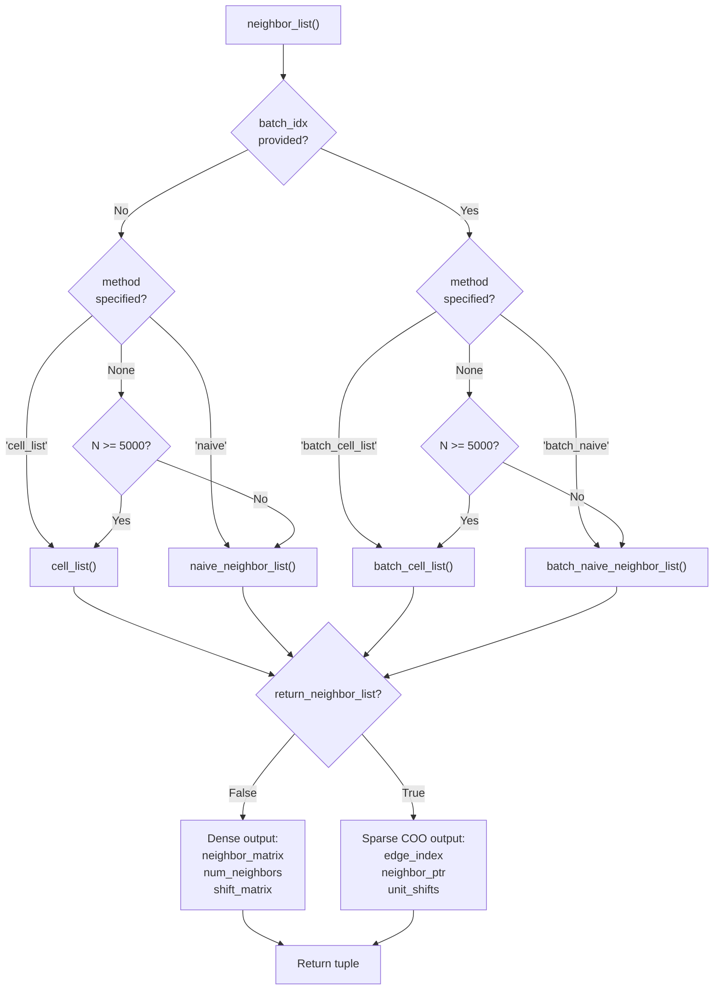
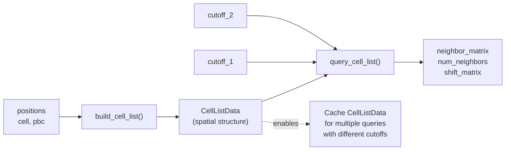
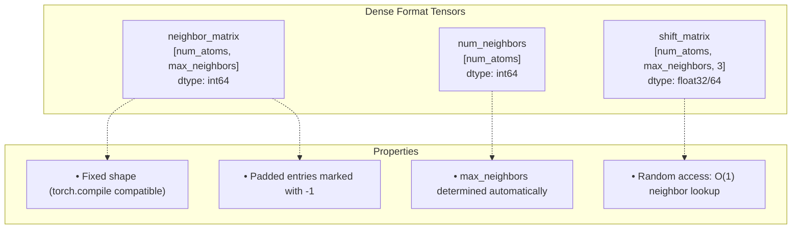
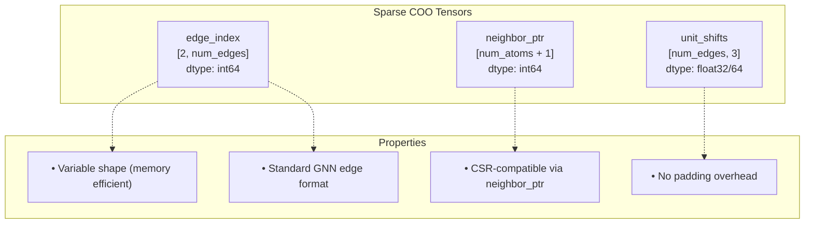
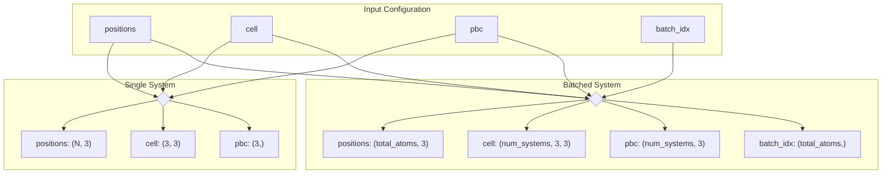

<!-- source: DeepWiki mcp.deepwiki.com · repo NVIDIA/nvalchemi-toolkit-ops · page 5.1 Neighbor List API · fetched 2026-10-26 -->

# Neighbor List API

<details>
<summary>Relevant source files</summary>

The following files were used as context for generating this wiki page:

- [README.md](README.md)
- [docs/userguide/about/faq.md](docs/userguide/about/faq.md)
- [docs/userguide/about/intro.md](docs/userguide/about/intro.md)

</details>


This page provides complete API reference documentation for neighbor list construction functions in `nvalchemiops.neighborlist`. Neighbor lists identify pairs of atoms within a cutoff distance and are fundamental for calculating short-range interactions in atomistic simulations.

**Scope**: This page covers function signatures, parameters, return values, and algorithm-specific details. For conceptual discussion of algorithm selection and performance characteristics, see [Algorithm Selection](#2.1.1) and [Neighbor List Performance](#4.1). For integration examples, see [Quick Start Guide](#1.2).

## Unified Neighbor List Interface

The `neighbor_list()` function provides automatic algorithm selection and output format control for both single-system and batched computations.

### Function: `neighbor_list`

**Module**: `nvalchemiops.neighborlist`

**Purpose**: Construct neighbor lists with automatic algorithm selection based on system size and batching mode.



**Algorithm Selection Flow**

Sources: [README.md:57-90](), [docs/userguide/about/intro.md:58-149]()

#### Parameters

| Parameter | Type | Description | Required | Default |
|-----------|------|-------------|----------|---------|
| `positions` | `torch.Tensor` | Atomic positions with shape `(num_atoms, 3)` | Yes | - |
| `cutoff` | `float` | Cutoff radius for neighbor search | Yes | - |
| `cell` | `torch.Tensor` | Simulation cell vectors. Shape `(3, 3)` for single system or `(num_systems, 3, 3)` for batched | No | `None` |
| `pbc` | `torch.Tensor` | Periodic boundary conditions as boolean tensor with shape `(3,)` or `(num_systems, 3)` | No | `None` |
| `method` | `str` | Algorithm selection: `"cell_list"`, `"naive"`, `"batch_cell_list"`, or `"batch_naive"`. If `None`, automatic selection based on system size | No | `None` |
| `return_neighbor_list` | `bool` | If `True`, return sparse COO format. If `False`, return dense matrix format | No | `False` |
| `batch_idx` | `torch.Tensor` | System assignment for each atom with shape `(num_atoms,)`. Required for batched methods | No | `None` |
| `batch_ptr` | `torch.Tensor` | Starting indices for each system with shape `(num_systems + 1,)`. Used with `batch_idx` | No | `None` |

#### Return Values

**Dense Format** (`return_neighbor_list=False`):

| Output | Type | Shape | Description |
|--------|------|-------|-------------|
| `neighbor_matrix` | `torch.Tensor` | `(num_atoms, max_neighbors)` | Neighbor atom indices. Padded with `-1` for atoms with fewer neighbors |
| `num_neighbors` | `torch.Tensor` | `(num_atoms,)` | Number of valid neighbors for each atom |
| `shift_matrix` | `torch.Tensor` | `(num_atoms, max_neighbors, 3)` | PBC shift vectors for each neighbor pair |

**Sparse COO Format** (`return_neighbor_list=True`):

| Output | Type | Shape | Description |
|--------|------|-------|-------------|
| `edge_index` | `torch.Tensor` | `(2, num_edges)` | COO edge indices. First row is source atoms, second row is neighbor atoms |
| `neighbor_ptr` | `torch.Tensor` | `(num_atoms + 1,)` | CSR-style pointer indicating edge range for each atom |
| `unit_shifts` | `torch.Tensor` | `(num_edges, 3)` | PBC shift vectors in unit cell coordinates |

Sources: [README.md:57-90](), [docs/userguide/about/intro.md:58-62]()

---

## Algorithm-Specific Functions

These functions provide direct access to specific neighbor list algorithms without automatic selection logic.

### Function: `cell_list`

**Purpose**: O(N) neighbor list construction using spatial decomposition for single large systems.

**Recommended for**: Systems with ≥5000 atoms where the cutoff is small relative to cell dimensions.

#### Parameters

| Parameter | Type | Description | Required |
|-----------|------|-------------|----------|
| `positions` | `torch.Tensor` | Atomic positions `(num_atoms, 3)` | Yes |
| `cutoff` | `float` | Cutoff radius | Yes |
| `cell` | `torch.Tensor` | Cell vectors `(3, 3)` | No |
| `pbc` | `torch.Tensor` | Periodic boundaries `(3,)` | No |

**Complexity**: O(N) where N is the number of atoms.

**Algorithm**: Divides simulation box into spatial cells with size ≥ cutoff. Only atoms in neighboring cells are checked for distances.

Sources: [docs/userguide/about/faq.md:32-43](), [docs/userguide/about/intro.md:76-88]()

---

### Function: `naive_neighbor_list`

**Purpose**: O(N²) neighbor list construction via all-pairs distance calculation for single small systems.

**Recommended for**: Systems with <5000 atoms where overhead dominates.

#### Parameters

| Parameter | Type | Description | Required |
|-----------|------|-------------|----------|
| `positions` | `torch.Tensor` | Atomic positions `(num_atoms, 3)` | Yes |
| `cutoff` | `float` | Cutoff radius | Yes |
| `cell` | `torch.Tensor` | Cell vectors `(3, 3)` | No |
| `pbc` | `torch.Tensor` | Periodic boundaries `(3,)` | No |

**Complexity**: O(N²) where N is the number of atoms.

**Algorithm**: Computes all pairwise distances and applies cutoff threshold. Lower kernel launch overhead than cell list for small systems.

Sources: [docs/userguide/about/faq.md:32-43](), [docs/userguide/about/intro.md:91-106]()

---

### Function: `batch_cell_list`

**Purpose**: O(N) batched neighbor list construction for multiple large systems processed simultaneously.

**Recommended for**: Batches of systems with ≥5000 atoms each.

#### Parameters

| Parameter | Type | Description | Required |
|-----------|------|-------------|----------|
| `positions` | `torch.Tensor` | Concatenated atomic positions `(total_atoms, 3)` | Yes |
| `cutoff` | `float` | Cutoff radius | Yes |
| `cell` | `torch.Tensor` | Cell vectors per system `(num_systems, 3, 3)` | No |
| `pbc` | `torch.Tensor` | Periodic boundaries per system `(num_systems, 3)` | No |
| `batch_idx` | `torch.Tensor` | System assignment `(total_atoms,)` | Yes |
| `batch_ptr` | `torch.Tensor` | System start indices `(num_systems + 1,)` | No |

**Batching Behavior**: Each system maintains independent spatial decomposition. Heterogeneous system sizes and cell parameters are supported.

Sources: [docs/userguide/about/intro.md:108-123]()

---

### Function: `batch_naive_neighbor_list`

**Purpose**: O(N²) batched neighbor list construction for multiple small systems.

**Recommended for**: Batches of systems with <5000 atoms each.

#### Parameters

| Parameter | Type | Description | Required |
|-----------|------|-------------|----------|
| `positions` | `torch.Tensor` | Concatenated atomic positions `(total_atoms, 3)` | Yes |
| `cutoff` | `float` | Cutoff radius | Yes |
| `cell` | `torch.Tensor` | Cell vectors per system `(num_systems, 3, 3)` | No |
| `pbc` | `torch.Tensor` | Periodic boundaries per system `(num_systems, 3)` | No |
| `batch_idx` | `torch.Tensor` | System assignment `(total_atoms,)` | Yes |
| `batch_ptr` | `torch.Tensor` | System start indices `(num_systems + 1,)` | No |

**Batching Behavior**: All-pairs distances computed within each system independently. Suitable for high-throughput screening with small molecules.

Sources: [docs/userguide/about/intro.md:125-143]()

---

## Advanced Workflows

For applications requiring repeated queries with static atomic positions or multi-range potentials, these functions provide lower-level control.



**Advanced Workflow: Caching Spatial Decomposition**

### Function: `build_cell_list`

**Purpose**: Construct spatial data structure without computing neighbor list.

**Use case**: Cache cell list for multiple queries with different cutoffs or for incremental neighbor list updates.

#### Parameters

| Parameter | Type | Description | Required |
|-----------|------|-------------|----------|
| `positions` | `torch.Tensor` | Atomic positions `(num_atoms, 3)` | Yes |
| `cell` | `torch.Tensor` | Cell vectors `(3, 3)` | No |
| `pbc` | `torch.Tensor` | Periodic boundaries `(3,)` | No |

#### Returns

| Output | Type | Description |
|--------|------|-------------|
| `cell_list_data` | Object | Opaque spatial data structure for use with `query_cell_list()` |

---

### Function: `query_cell_list`

**Purpose**: Query pre-built cell list with specified cutoff to generate neighbor list.

#### Parameters

| Parameter | Type | Description | Required |
|-----------|------|-------------|----------|
| `cell_list_data` | Object | Output from `build_cell_list()` | Yes |
| `cutoff` | `float` | Cutoff radius for this query | Yes |

**Dual-Cutoff Support**: Variants accepting `cutoff_inner` and `cutoff_outer` parameters exist for potentials requiring two interaction ranges.

Sources: [docs/userguide/about/intro.md:151-154]()

---

## Rebuild Detection

For molecular dynamics workflows, these functions minimize expensive cell list reconstructions by tracking atomic displacements.

### Function: `cell_list_needs_rebuild`

**Purpose**: Determine if cell list must be rebuilt based on atomic displacements since last build.

#### Parameters

| Parameter | Type | Description | Required |
|-----------|------|-------------|----------|
| `positions` | `torch.Tensor` | Current atomic positions `(num_atoms, 3)` | Yes |
| `reference_positions` | `torch.Tensor` | Positions at last cell list build `(num_atoms, 3)` | Yes |
| `skin_distance` | `float` | Maximum allowed displacement before rebuild | Yes |
| `cell` | `torch.Tensor` | Cell vectors `(3, 3)` | No |
| `pbc` | `torch.Tensor` | Periodic boundaries `(3,)` | No |

#### Returns

| Output | Type | Description |
|--------|------|-------------|
| `needs_rebuild` | `bool` | `True` if any atom has moved more than `skin_distance` |

**Typical Usage Pattern**:

1. Build cell list with `cutoff + 2*skin_distance`
2. Check rebuild condition every MD step with `cell_list_needs_rebuild()`
3. Rebuild only when function returns `True`

**Skin Distance Selection**: Larger skin distances reduce rebuild frequency but increase neighbor list size and per-step computation cost. Typical values: 0.5-1.0 Å.

Sources: [docs/userguide/about/intro.md:156-161]()

---

## Output Formats

### Dense Matrix Format

**Structure**: Fixed-size neighbor array with padding.



**Dense Format Structure**

**Access Pattern**:
```python
# Get neighbors of atom i
valid_neighbors = neighbor_matrix[i, :num_neighbors[i]]
valid_shifts = shift_matrix[i, :num_neighbors[i], :]
```

**Advantages**:
- Compatible with `torch.compile` (requires static shapes)
- O(1) neighbor access by atom index
- Vectorized operations over fixed-size dimension

**Disadvantages**:
- Memory overhead from padding
- Wastes computation on padded entries in downstream kernels

**Typical Use**: DFT-D3 dispersion corrections, compiled training loops, applications requiring fixed tensor shapes.

---

### Sparse COO Format

**Structure**: Compressed edge list representation.



**Sparse COO Format Structure**

**Access Pattern**:
```python
# Get neighbors of atom i (CSR-style indexing)
start_idx = neighbor_ptr[i]
end_idx = neighbor_ptr[i + 1]
neighbor_atoms = edge_index[1, start_idx:end_idx]
neighbor_shifts = unit_shifts[start_idx:end_idx, :]
```

**Advantages**:
- Minimal memory footprint
- Native format for graph neural networks
- No wasted computation on padding

**Disadvantages**:
- Variable shapes may cause `torch.compile` graph breaks
- Requires indirection for neighbor access

**Typical Use**: GNN training pipelines, large-scale screening, memory-constrained applications.

Sources: [docs/userguide/about/intro.md:58-62](), [docs/userguide/about/faq.md:45-56]()

---

## Parameter Reference

### Common Parameter Patterns



**Parameter Shapes: Single vs Batched Systems**

### Position Coordinates

**Units**: Arbitrary, but must be consistent with cutoff. Atomic units (Bohr) recommended for interatomic potentials.

**Shape**: `(num_atoms, 3)` for single systems or concatenated batch.

**Device**: Must match other tensor arguments. CPU and CUDA supported.

**Dtype**: `float32` or `float64`. Mixed precision supported but all tensors must match.

### Simulation Cell

**Format**: Cell vectors as row vectors. Standard crystallographic convention: `cell[i, :]` is the i-th lattice vector.

**Shape**: 
- Single system: `(3, 3)`
- Batched: `(num_systems, 3, 3)`

**Non-periodic systems**: Omit `cell` parameter or pass `None`.

**Triclinic cells**: Fully supported. No restrictions on cell angles.

### Periodic Boundary Conditions

**Format**: Boolean tensor indicating periodicity in x, y, z directions.

**Shape**:
- Single system: `(3,)`
- Batched: `(num_systems, 3)`

**Mixed periodicity**: Supported. Example: `[True, True, False]` for 2D slab.

**Default behavior**: If `pbc` is `None` and `cell` is provided, assumes all directions are periodic `[True, True, True]`.

### Batch Indexing

**batch_idx**: Maps each atom to its system index. Must be contiguous integers starting from 0.

**Example**:
```python
# Two systems: first with 5 atoms, second with 3 atoms
batch_idx = torch.tensor([0, 0, 0, 0, 0, 1, 1, 1])
```

**batch_ptr**: CSR-style pointer indicating atom ranges. Shape `(num_systems + 1,)`.

**Example**:
```python
# Same two systems as above
batch_ptr = torch.tensor([0, 5, 8])  # System 0: atoms [0:5], System 1: atoms [5:8]
```

**Relationship**: `batch_ptr[i]` is the starting atom index for system `i`. The last entry `batch_ptr[-1]` equals total number of atoms.

**Generation**: Can be computed from `batch_idx`:
```python
batch_ptr = torch.cat([
    torch.tensor([0], device=batch_idx.device),
    torch.cumsum(torch.bincount(batch_idx), dim=0)
])
```

Sources: [README.md:102-139](), [docs/userguide/about/intro.md:108-143]()

---

## torch.compile Compatibility

Select functions support `torch.compile` for JIT optimization with pre-allocated output tensors.

**Compatible Functions**:
- `neighbor_list()` with `return_neighbor_list=False` (dense format)
- `cell_list()`
- `naive_neighbor_list()`

**Pre-allocation Requirements**:

Dense format requires pre-allocated output tensors with correct shapes. The unified `neighbor_list()` function handles allocation automatically.

**Graph Break Sources**:
- Dynamic `max_neighbors` determination in dense format
- Variable-length outputs in sparse COO format
- Device synchronization for neighbor count queries

**Recommendation**: For compiled workflows, use dense format with fixed `max_neighbors` parameter (if exposed by lower-level functions) or wrap neighbor list construction outside compiled region.

Sources: [docs/userguide/about/faq.md:58-74]()

---

## Usage Patterns by Application

| Application | Recommended Function | Format | Rationale |
|-------------|---------------------|---------|-----------|
| GNN Training | `neighbor_list(..., return_neighbor_list=True)` | Sparse COO | Native GNN edge format, memory efficient |
| DFT-D3 Corrections | `neighbor_list(...)` | Dense | Required by `dftd3()` function API |
| MD Simulations | `build_cell_list()` + `query_cell_list()` | Dense | Amortize build cost, rebuild detection |
| High-throughput Screening | `batch_naive_neighbor_list()` | Both | Parallel processing of small molecules |
| Large-scale Simulations | `batch_cell_list()` | Dense | O(N) scaling for >5000 atom systems |
| Compiled Training Loops | `neighbor_list()` (dense) | Dense | Static shapes for `torch.compile` |

---

## Error Conditions

**Common Failures**:

| Condition | Symptom | Resolution |
|-----------|---------|------------|
| Cutoff > cell dimension with PBC | Incorrect neighbor counts | Increase cell size or disable PBC in that direction |
| Out of memory | CUDA OOM error | Reduce batch size or system size; see [Batched Performance](#4.1.2) for limits |
| Inconsistent dtypes | Type error | Ensure all tensors use same dtype (`float32` or `float64`) |
| Negative batch_idx | Index error | `batch_idx` must be non-negative contiguous integers |
| Invalid batch_ptr | Wrong neighbor counts | Ensure `batch_ptr[-1] == len(positions)` |

**Performance Warnings**:

- Systems with <1000 atoms may underutilize GPU
- Cutoff > 50 Å may produce very large neighbor lists
- Batches with heterogeneous system sizes (ratio >10×) may have load imbalance

Sources: [docs/userguide/about/faq.md:30-76]()

---

