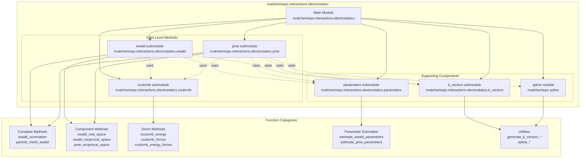
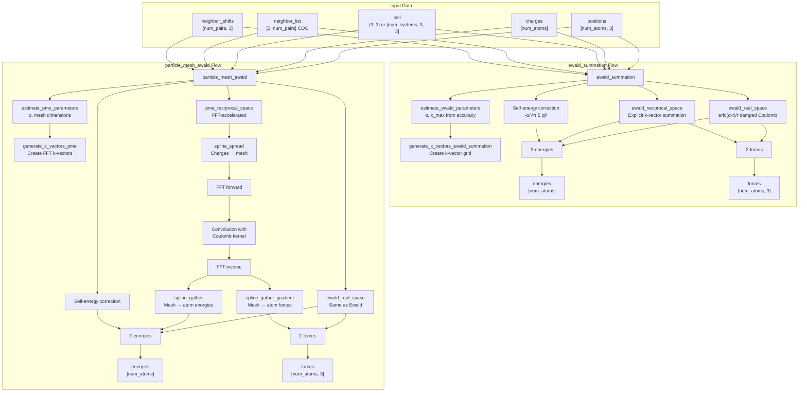
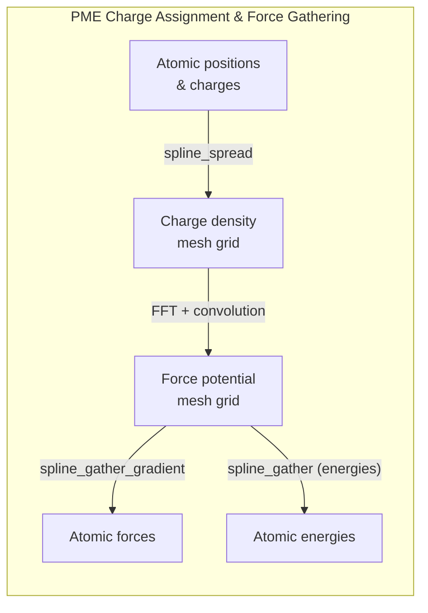
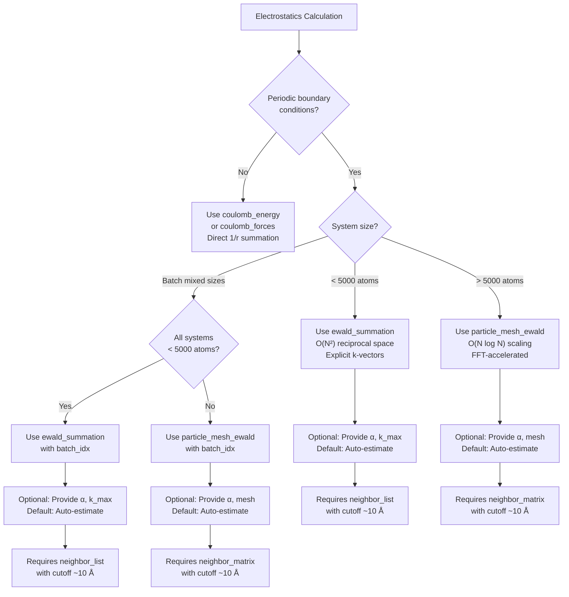

<!-- source: DeepWiki mcp.deepwiki.com · repo NVIDIA/nvalchemi-toolkit-ops · page 5.3 Electrostatics API · fetched 2026-10-26 -->

# Electrostatics API

<details>
<summary>Relevant source files</summary>

The following files were used as context for generating this wiki page:

- [README.md](README.md)
- [docs/modules/electrostatics.rst](docs/modules/electrostatics.rst)
- [docs/userguide/about/intro.md](docs/userguide/about/intro.md)

</details>


This page provides the complete API reference for the `nvalchemiops.interactions.electrostatics` module, which implements long-range Coulomb interactions using Ewald summation, Particle Mesh Ewald (PME), and direct Coulomb methods. All functions support automatic differentiation via PyTorch's autograd and operate on PyTorch tensors.

For conceptual overviews and usage patterns, see [Electrostatics](#2.3). For performance characteristics and method selection guidance, see [Electrostatics Performance](#4.3).

**Sources:** [docs/modules/electrostatics.rst:1-93]()

---

## Module Organization

The electrostatics module is organized into five submodules, each providing specialized functionality for computing long-range electrostatic interactions.



**Sources:** [docs/modules/electrostatics.rst:1-93]()

---

## High-Level Interface

The high-level interface provides end-user facing functions for computing complete electrostatic interactions. These functions handle both single-system and batched calculations via the `batch_idx` parameter and support automatic differentiation.

### Ewald Summation Functions

Complete Ewald summation combining real-space and reciprocal-space contributions. Suitable for small to medium systems (<5000 atoms) with O(N²) scaling in reciprocal space.

#### ewald_summation

**Location:** `nvalchemiops.interactions.electrostatics.ewald.ewald_summation`

Computes complete Ewald summation including real-space, reciprocal-space, and self-energy corrections.

**Parameters:**

| Parameter | Type | Description |
|-----------|------|-------------|
| `positions` | `torch.Tensor` | Atomic positions, shape `[num_atoms, 3]` |
| `charges` | `torch.Tensor` | Atomic charges, shape `[num_atoms]` |
| `cell` | `torch.Tensor` | Unit cell vectors, shape `[3, 3]` or `[num_systems, 3, 3]` |
| `neighbor_list` | `torch.Tensor` | Neighbor list in COO format, shape `[2, num_pairs]` |
| `neighbor_shifts` | `torch.Tensor` | PBC shift vectors, shape `[num_pairs, 3]` |
| `batch_idx` | `torch.Tensor` (optional) | Batch indices for multi-system calculations, shape `[num_atoms]` |
| `alpha` | `float` (optional) | Ewald splitting parameter; auto-estimated if not provided |
| `k_max` | `int` (optional) | Maximum k-vector index; auto-estimated if not provided |
| `accuracy` | `float` (optional) | Target accuracy for parameter estimation (default: 1e-6) |

**Returns:**

| Return Value | Type | Description |
|--------------|------|-------------|
| `energies` | `torch.Tensor` | Per-atom energies, shape `[num_atoms]` |
| `forces` | `torch.Tensor` | Per-atom forces, shape `[num_atoms, 3]` |

**Sources:** [docs/modules/electrostatics.rst:20-28](), [docs/userguide/about/intro.md:285-299]()

---

#### ewald_real_space

**Location:** `nvalchemiops.interactions.electrostatics.ewald.ewald_real_space`

Computes only the real-space component of Ewald summation using the complementary error function damping: `erfc(α·r)/r`.

**Parameters:**

| Parameter | Type | Description |
|-----------|------|-------------|
| `positions` | `torch.Tensor` | Atomic positions, shape `[num_atoms, 3]` |
| `charges` | `torch.Tensor` | Atomic charges, shape `[num_atoms]` |
| `neighbor_list` | `torch.Tensor` | Neighbor list in COO format, shape `[2, num_pairs]` |
| `neighbor_shifts` | `torch.Tensor` | PBC shift vectors, shape `[num_pairs, 3]` |
| `cell` | `torch.Tensor` | Unit cell vectors, shape `[3, 3]` or `[num_systems, 3, 3]` |
| `alpha` | `float` | Ewald splitting parameter |
| `batch_idx` | `torch.Tensor` (optional) | Batch indices, shape `[num_atoms]` |

**Returns:**

| Return Value | Type | Description |
|--------------|------|-------------|
| `energies` | `torch.Tensor` | Real-space per-atom energies, shape `[num_atoms]` |
| `forces` | `torch.Tensor` | Real-space per-atom forces, shape `[num_atoms, 3]` |

**Sources:** [docs/modules/electrostatics.rst:20-28]()

---

#### ewald_reciprocal_space

**Location:** `nvalchemiops.interactions.electrostatics.ewald.ewald_reciprocal_space`

Computes the reciprocal-space component of Ewald summation using explicit k-vector summation. Has O(N²) scaling with the number of k-vectors.

**Parameters:**

| Parameter | Type | Description |
|-----------|------|-------------|
| `positions` | `torch.Tensor` | Atomic positions, shape `[num_atoms, 3]` |
| `charges` | `torch.Tensor` | Atomic charges, shape `[num_atoms]` |
| `cell` | `torch.Tensor` | Unit cell vectors, shape `[3, 3]` or `[num_systems, 3, 3]` |
| `k_vectors` | `torch.Tensor` | Reciprocal-space vectors, shape `[num_k_vectors, 3]` |
| `alpha` | `float` | Ewald splitting parameter |
| `batch_idx` | `torch.Tensor` (optional) | Batch indices, shape `[num_atoms]` |

**Returns:**

| Return Value | Type | Description |
|--------------|------|-------------|
| `energies` | `torch.Tensor` | Reciprocal-space per-atom energies, shape `[num_atoms]` |
| `forces` | `torch.Tensor` | Reciprocal-space per-atom forces, shape `[num_atoms, 3]` |

**Sources:** [docs/modules/electrostatics.rst:20-28]()

---

### Particle Mesh Ewald Functions

FFT-based Ewald method achieving O(N log N) scaling. Uses B-spline interpolation for charge assignment and force gathering on a regular mesh.

#### particle_mesh_ewald

**Location:** `nvalchemiops.interactions.electrostatics.pme.particle_mesh_ewald`

Computes complete PME including real-space (via damped Coulomb), reciprocal-space (via FFT), and self-energy corrections.

**Parameters:**

| Parameter | Type | Description |
|-----------|------|-------------|
| `positions` | `torch.Tensor` | Atomic positions, shape `[num_atoms, 3]` |
| `charges` | `torch.Tensor` | Atomic charges, shape `[num_atoms]` |
| `cell` | `torch.Tensor` | Unit cell vectors, shape `[3, 3]` or `[num_systems, 3, 3]` |
| `neighbor_matrix` | `torch.Tensor` | Dense neighbor matrix, shape `[num_atoms, max_neighbors]` |
| `neighbor_matrix_shifts` | `torch.Tensor` | PBC shifts for neighbor matrix, shape `[num_atoms, max_neighbors, 3]` |
| `alpha` | `float` (optional) | Ewald splitting parameter; auto-estimated if not provided |
| `mesh_dimensions` | `tuple[int, int, int]` (optional) | FFT mesh size; auto-estimated if not provided |
| `spline_order` | `int` (optional) | B-spline interpolation order (default: 4) |
| `accuracy` | `float` (optional) | Target accuracy for parameter estimation (default: 1e-6) |

**Returns:**

| Return Value | Type | Description |
|--------------|------|-------------|
| `energies` | `torch.Tensor` | Per-atom energies, shape `[num_atoms]` |
| `forces` | `torch.Tensor` | Per-atom forces, shape `[num_atoms, 3]` |

**Sources:** [docs/modules/electrostatics.rst:30-37](), [README.md:142-176]()

---

#### pme_reciprocal_space

**Location:** `nvalchemiops.interactions.electrostatics.pme.pme_reciprocal_space`

Computes only the reciprocal-space component using FFT-accelerated convolution. Performs charge spreading, FFT-based convolution with the modified Coulomb kernel, and force gathering.

**Parameters:**

| Parameter | Type | Description |
|-----------|------|-------------|
| `positions` | `torch.Tensor` | Atomic positions, shape `[num_atoms, 3]` |
| `charges` | `torch.Tensor` | Atomic charges, shape `[num_atoms]` |
| `cell` | `torch.Tensor` | Unit cell vectors, shape `[3, 3]` or `[num_systems, 3, 3]` |
| `alpha` | `float` | Ewald splitting parameter |
| `mesh_dimensions` | `tuple[int, int, int]` | FFT mesh size `(nx, ny, nz)` |
| `spline_order` | `int` (optional) | B-spline interpolation order (default: 4) |
| `batch_idx` | `torch.Tensor` (optional) | Batch indices, shape `[num_atoms]` |

**Returns:**

| Return Value | Type | Description |
|--------------|------|-------------|
| `energies` | `torch.Tensor` | Reciprocal-space per-atom energies, shape `[num_atoms]` |
| `forces` | `torch.Tensor` | Reciprocal-space per-atom forces, shape `[num_atoms, 3]` |

**Sources:** [docs/modules/electrostatics.rst:30-37]()

---

### Direct Coulomb Functions

Direct pairwise Coulomb interactions supporting both undamped (1/r) and damped (erfc(α·r)/r) potentials. Useful for isolated systems or as the real-space component of Ewald/PME.

#### coulomb_energy

**Location:** `nvalchemiops.interactions.electrostatics.coulomb.coulomb_energy`

Computes pairwise Coulomb energies with optional damping.

**Parameters:**

| Parameter | Type | Description |
|-----------|------|-------------|
| `positions` | `torch.Tensor` | Atomic positions, shape `[num_atoms, 3]` |
| `charges` | `torch.Tensor` | Atomic charges, shape `[num_atoms]` |
| `neighbor_list` | `torch.Tensor` | Neighbor list in COO format, shape `[2, num_pairs]` |
| `neighbor_shifts` | `torch.Tensor` (optional) | PBC shift vectors, shape `[num_pairs, 3]` |
| `cell` | `torch.Tensor` (optional) | Unit cell vectors, shape `[3, 3]` or `[num_systems, 3, 3]` |
| `alpha` | `float` (optional) | Damping parameter; if provided, uses `erfc(α·r)/r` |
| `batch_idx` | `torch.Tensor` (optional) | Batch indices, shape `[num_atoms]` |

**Returns:**

| Return Value | Type | Description |
|--------------|------|-------------|
| `energies` | `torch.Tensor` | Per-atom Coulomb energies, shape `[num_atoms]` |

**Sources:** [docs/modules/electrostatics.rst:39-48]()

---

#### coulomb_forces

**Location:** `nvalchemiops.interactions.electrostatics.coulomb.coulomb_forces`

Computes pairwise Coulomb forces with optional damping.

**Parameters:**

| Parameter | Type | Description |
|-----------|------|-------------|
| `positions` | `torch.Tensor` | Atomic positions, shape `[num_atoms, 3]` |
| `charges` | `torch.Tensor` | Atomic charges, shape `[num_atoms]` |
| `neighbor_list` | `torch.Tensor` | Neighbor list in COO format, shape `[2, num_pairs]` |
| `neighbor_shifts` | `torch.Tensor` (optional) | PBC shift vectors, shape `[num_pairs, 3]` |
| `cell` | `torch.Tensor` (optional) | Unit cell vectors, shape `[3, 3]` or `[num_systems, 3, 3]` |
| `alpha` | `float` (optional) | Damping parameter; if provided, uses `erfc(α·r)/r` |
| `batch_idx` | `torch.Tensor` (optional) | Batch indices, shape `[num_atoms]` |

**Returns:**

| Return Value | Type | Description |
|--------------|------|-------------|
| `forces` | `torch.Tensor` | Per-atom Coulomb forces, shape `[num_atoms, 3]` |

**Sources:** [docs/modules/electrostatics.rst:39-48]()

---

#### coulomb_energy_forces

**Location:** `nvalchemiops.interactions.electrostatics.coulomb.coulomb_energy_forces`

Computes both pairwise Coulomb energies and forces in a single pass, which is more efficient than calling `coulomb_energy` and `coulomb_forces` separately.

**Parameters:**

| Parameter | Type | Description |
|-----------|------|-------------|
| `positions` | `torch.Tensor` | Atomic positions, shape `[num_atoms, 3]` |
| `charges` | `torch.Tensor` | Atomic charges, shape `[num_atoms]` |
| `neighbor_list` | `torch.Tensor` | Neighbor list in COO format, shape `[2, num_pairs]` |
| `neighbor_shifts` | `torch.Tensor` (optional) | PBC shift vectors, shape `[num_pairs, 3]` |
| `cell` | `torch.Tensor` (optional) | Unit cell vectors, shape `[3, 3]` or `[num_systems, 3, 3]` |
| `alpha` | `float` (optional) | Damping parameter; if provided, uses `erfc(α·r)/r` |
| `batch_idx` | `torch.Tensor` (optional) | Batch indices, shape `[num_atoms]` |

**Returns:**

| Return Value | Type | Description |
|--------------|------|-------------|
| `energies` | `torch.Tensor` | Per-atom Coulomb energies, shape `[num_atoms]` |
| `forces` | `torch.Tensor` | Per-atom Coulomb forces, shape `[num_atoms, 3]` |

**Sources:** [docs/modules/electrostatics.rst:39-48]()

---

## Computational Flow

The following diagram illustrates how the complete Ewald and PME methods compose their component calculations.



**Sources:** [docs/modules/electrostatics.rst:20-37](), [docs/userguide/about/intro.md:264-326]()

---

## Parameter Estimation

Automatic parameter estimation functions that determine optimal Ewald splitting parameters, k-vector cutoffs, and mesh dimensions based on target accuracy.

### Ewald Parameter Estimation

#### estimate_ewald_parameters

**Location:** `nvalchemiops.interactions.electrostatics.parameters.estimate_ewald_parameters`

Estimates optimal Ewald splitting parameter `α` and reciprocal-space cutoff `k_max` to achieve target accuracy.

**Parameters:**

| Parameter | Type | Description |
|-----------|------|-------------|
| `cell` | `torch.Tensor` | Unit cell vectors, shape `[3, 3]` or `[num_systems, 3, 3]` |
| `accuracy` | `float` | Target relative error in force/energy (default: 1e-6) |
| `cutoff` | `float` (optional) | Real-space cutoff distance; estimated from cell if not provided |

**Returns:**

| Return Value | Type | Description |
|--------------|------|-------------|
| `params` | `EwaldParameters` | Dataclass containing `alpha`, `k_max`, `cutoff` |

**Algorithm:**

The function balances real-space and reciprocal-space convergence:
- `α` is chosen such that real-space erfc(α·r)/r decays to `accuracy` at `cutoff`
- `k_max` is chosen such that reciprocal-space exp(-k²/4α²) terms are below `accuracy`

**Sources:** [docs/modules/electrostatics.rst:50-61]()

---

#### EwaldParameters

**Location:** `nvalchemiops.interactions.electrostatics.parameters.EwaldParameters`

Dataclass holding complete Ewald parameters.

**Attributes:**

| Attribute | Type | Description |
|-----------|------|-------------|
| `alpha` | `float` | Ewald splitting parameter (inverse length units) |
| `k_max` | `int` | Maximum k-vector index in each direction |
| `cutoff` | `float` | Real-space cutoff distance |

**Sources:** [docs/modules/electrostatics.rst:59-61]()

---

### PME Parameter Estimation

#### estimate_pme_parameters

**Location:** `nvalchemiops.interactions.electrostatics.parameters.estimate_pme_parameters`

Estimates optimal PME parameters including `α`, mesh dimensions, and spline order.

**Parameters:**

| Parameter | Type | Description |
|-----------|------|-------------|
| `cell` | `torch.Tensor` | Unit cell vectors, shape `[3, 3]` or `[num_systems, 3, 3]` |
| `accuracy` | `float` | Target relative error (default: 1e-6) |
| `cutoff` | `float` (optional) | Real-space cutoff; estimated if not provided |
| `spline_order` | `int` (optional) | B-spline interpolation order (default: 4) |

**Returns:**

| Return Value | Type | Description |
|--------------|------|-------------|
| `params` | `PMEParameters` | Dataclass containing `alpha`, `mesh_dimensions`, `spline_order`, `cutoff` |

**Algorithm:**

1. Estimate `α` similar to Ewald based on real-space convergence
2. Estimate mesh spacing such that aliasing error is below `accuracy`
3. Convert mesh spacing to dimensions using `mesh_spacing_to_dimensions`

**Sources:** [docs/modules/electrostatics.rst:63-71]()

---

#### estimate_pme_mesh_dimensions

**Location:** `nvalchemiops.interactions.electrostatics.parameters.estimate_pme_mesh_dimensions`

Estimates optimal FFT mesh dimensions for a given `α` and accuracy target.

**Parameters:**

| Parameter | Type | Description |
|-----------|------|-------------|
| `cell` | `torch.Tensor` | Unit cell vectors, shape `[3, 3]` |
| `alpha` | `float` | Ewald splitting parameter |
| `accuracy` | `float` | Target relative error |
| `spline_order` | `int` (optional) | B-spline interpolation order (default: 4) |

**Returns:**

| Return Value | Type | Description |
|--------------|------|-------------|
| `mesh_dimensions` | `tuple[int, int, int]` | FFT mesh size `(nx, ny, nz)` |

**Sources:** [docs/modules/electrostatics.rst:63-71]()

---

#### mesh_spacing_to_dimensions

**Location:** `nvalchemiops.interactions.electrostatics.parameters.mesh_spacing_to_dimensions`

Converts desired mesh spacing to discrete mesh dimensions, ensuring good FFT performance (typically powers of 2 or small prime factors).

**Parameters:**

| Parameter | Type | Description |
|-----------|------|-------------|
| `cell` | `torch.Tensor` | Unit cell vectors, shape `[3, 3]` |
| `mesh_spacing` | `float` | Desired mesh spacing |

**Returns:**

| Return Value | Type | Description |
|--------------|------|-------------|
| `mesh_dimensions` | `tuple[int, int, int]` | FFT mesh size `(nx, ny, nz)` |

**Sources:** [docs/modules/electrostatics.rst:63-71]()

---

#### PMEParameters

**Location:** `nvalchemiops.interactions.electrostatics.parameters.PMEParameters`

Dataclass holding complete PME parameters.

**Attributes:**

| Attribute | Type | Description |
|-----------|------|-------------|
| `alpha` | `float` | Ewald splitting parameter (inverse length units) |
| `mesh_dimensions` | `tuple[int, int, int]` | FFT mesh size `(nx, ny, nz)` |
| `spline_order` | `int` | B-spline interpolation order (typically 4) |
| `cutoff` | `float` | Real-space cutoff distance |

**Sources:** [docs/modules/electrostatics.rst:69-71]()

---

## Utility Functions

Low-level utility functions for k-vector generation and B-spline interpolation used internally by Ewald and PME methods.

### K-Vector Generation

#### generate_k_vectors_ewald_summation

**Location:** `nvalchemiops.interactions.electrostatics.k_vectors.generate_k_vectors_ewald_summation`

Generates the reciprocal-space k-vectors for Ewald summation by creating a grid in reciprocal space up to `k_max` in each direction.

**Parameters:**

| Parameter | Type | Description |
|-----------|------|-------------|
| `cell` | `torch.Tensor` | Unit cell vectors, shape `[3, 3]` |
| `k_max` | `int` | Maximum k-vector index in each direction |

**Returns:**

| Return Value | Type | Description |
|--------------|------|-------------|
| `k_vectors` | `torch.Tensor` | Reciprocal-space vectors, shape `[num_k_vectors, 3]` |

**Notes:**

- Generates vectors for `kx, ky, kz ∈ [-k_max, k_max]`
- Excludes the origin `(0, 0, 0)`
- Number of vectors is approximately `(2·k_max + 1)³ - 1`

**Sources:** [docs/modules/electrostatics.rst:76-82]()

---

#### generate_k_vectors_pme

**Location:** `nvalchemiops.interactions.electrostatics.k_vectors.generate_k_vectors_pme`

Generates k-vectors for FFT-based PME calculations. These are used to construct the Coulomb kernel in Fourier space.

**Parameters:**

| Parameter | Type | Description |
|-----------|------|-------------|
| `cell` | `torch.Tensor` | Unit cell vectors, shape `[3, 3]` |
| `mesh_dimensions` | `tuple[int, int, int]` | FFT mesh size `(nx, ny, nz)` |

**Returns:**

| Return Value | Type | Description |
|--------------|------|-------------|
| `k_vectors` | `torch.Tensor` | Reciprocal-space vectors for FFT mesh, shape `[nx, ny, nz, 3]` |

**Notes:**

- Generates vectors compatible with FFT layout
- Handles Hermitian symmetry of real-space FFTs

**Sources:** [docs/modules/electrostatics.rst:76-82]()

---

### B-Spline Interpolation

B-spline functions provide high-order interpolation for charge spreading (particles → mesh) and force gathering (mesh → particles) in PME. All functions use the modified B-spline basis optimized for periodic grids.



**Sources:** [docs/modules/electrostatics.rst:84-92]()

---

#### spline_spread

**Location:** `nvalchemiops.spline.spline_spread`

Spreads atomic charges onto a regular mesh grid using B-spline interpolation. This is the "assignment" step in PME that converts point charges to a continuous charge density.

**Parameters:**

| Parameter | Type | Description |
|-----------|------|-------------|
| `positions` | `torch.Tensor` | Atomic positions, shape `[num_atoms, 3]` |
| `charges` | `torch.Tensor` | Atomic charges, shape `[num_atoms]` |
| `cell` | `torch.Tensor` | Unit cell vectors, shape `[3, 3]` |
| `mesh_dimensions` | `tuple[int, int, int]` | Mesh size `(nx, ny, nz)` |
| `spline_order` | `int` | B-spline order (typically 4) |

**Returns:**

| Return Value | Type | Description |
|--------------|------|-------------|
| `charge_mesh` | `torch.Tensor` | Charge density on mesh, shape `[nx, ny, nz]` |

**Sources:** [docs/modules/electrostatics.rst:84-92]()

---

#### spline_gather

**Location:** `nvalchemiops.spline.spline_gather`

Gathers scalar values from mesh to atomic sites using B-spline interpolation. Used for interpolating potential energies.

**Parameters:**

| Parameter | Type | Description |
|-----------|------|-------------|
| `positions` | `torch.Tensor` | Atomic positions, shape `[num_atoms, 3]` |
| `mesh` | `torch.Tensor` | Scalar mesh values, shape `[nx, ny, nz]` |
| `cell` | `torch.Tensor` | Unit cell vectors, shape `[3, 3]` |
| `spline_order` | `int` | B-spline order (typically 4) |

**Returns:**

| Return Value | Type | Description |
|--------------|------|-------------|
| `values` | `torch.Tensor` | Interpolated values at atomic sites, shape `[num_atoms]` |

**Sources:** [docs/modules/electrostatics.rst:84-92]()

---

#### spline_gather_vec3

**Location:** `nvalchemiops.spline.spline_gather_vec3`

Gathers vector values from mesh to atomic sites using B-spline interpolation. Used for interpolating electric field components.

**Parameters:**

| Parameter | Type | Description |
|-----------|------|-------------|
| `positions` | `torch.Tensor` | Atomic positions, shape `[num_atoms, 3]` |
| `mesh` | `torch.Tensor` | Vector mesh values, shape `[nx, ny, nz, 3]` |
| `cell` | `torch.Tensor` | Unit cell vectors, shape `[3, 3]` |
| `spline_order` | `int` | B-spline order (typically 4) |

**Returns:**

| Return Value | Type | Description |
|--------------|------|-------------|
| `values` | `torch.Tensor` | Interpolated vectors at atomic sites, shape `[num_atoms, 3]` |

**Sources:** [docs/modules/electrostatics.rst:84-92]()

---

#### spline_gather_gradient

**Location:** `nvalchemiops.spline.spline_gather_gradient`

Gathers the gradient of a scalar mesh field to compute forces at atomic sites. This combines mesh value interpolation with spatial derivative computation.

**Parameters:**

| Parameter | Type | Description |
|-----------|------|-------------|
| `positions` | `torch.Tensor` | Atomic positions, shape `[num_atoms, 3]` |
| `mesh` | `torch.Tensor` | Scalar potential mesh, shape `[nx, ny, nz]` |
| `cell` | `torch.Tensor` | Unit cell vectors, shape `[3, 3]` |
| `spline_order` | `int` | B-spline order (typically 4) |

**Returns:**

| Return Value | Type | Description |
|--------------|------|-------------|
| `gradients` | `torch.Tensor` | Forces (negative gradients) at atomic sites, shape `[num_atoms, 3]` |

**Sources:** [docs/modules/electrostatics.rst:84-92]()

---

## Method Selection Guidance

The following decision tree helps select the appropriate electrostatics method based on system characteristics.



**Key Decision Factors:**

| Factor | Recommendation |
|--------|----------------|
| **No PBC** | Use direct Coulomb (`coulomb_energy`, `coulomb_forces`) |
| **Small periodic systems** (<5000 atoms) | Use Ewald summation (`ewald_summation`) |
| **Large periodic systems** (>5000 atoms) | Use PME (`particle_mesh_ewald`) |
| **High accuracy requirements** | Set `accuracy=1e-8` or lower; default is `1e-6` |
| **Custom parameters** | Manually specify `alpha`, `k_max`, or `mesh_dimensions` |
| **Batch processing** | All methods support `batch_idx` parameter |

**Sources:** [docs/userguide/about/intro.md:264-353](), [docs/modules/electrostatics.rst:1-93]()

---

## Usage Patterns

### Basic Ewald Summation

```python
from nvalchemiops.interactions.electrostatics import ewald_summation
from nvalchemiops.neighborlist import neighbor_list

# Build neighbor list for real-space component
neighbor_list_coo, _, shifts = neighbor_list(
    positions, 
    cutoff=10.0,  # Real-space cutoff in appropriate units
    cell=cell, 
    pbc=pbc,
    return_neighbor_list=True
)

# Compute electrostatics with automatic parameter estimation
energies, forces = ewald_summation(
    positions=positions,
    charges=charges,
    cell=cell,
    neighbor_list=neighbor_list_coo,
    neighbor_shifts=shifts,
    accuracy=1e-6  # Target relative error
)

total_energy = energies.sum()
```

**Sources:** [docs/userguide/about/intro.md:285-299]()

---

### Basic PME Calculation

```python
from nvalchemiops.interactions.electrostatics import particle_mesh_ewald
from nvalchemiops.neighborlist import neighbor_list

# Build neighbor matrix for real-space component
neighbor_matrix, _, shift_matrix = neighbor_list(
    positions, 
    cutoff=10.0,
    cell=cell, 
    pbc=pbc,
    method="cell_list"  # PME requires dense matrix format
)

# Compute electrostatics with automatic parameter estimation
energies, forces = particle_mesh_ewald(
    positions=positions,
    charges=charges,
    cell=cell,
    neighbor_matrix=neighbor_matrix,
    neighbor_matrix_shifts=shift_matrix,
    accuracy=1e-6,
    spline_order=4  # B-spline interpolation order
)

total_energy = energies.sum()
```

**Sources:** [README.md:142-176](), [docs/userguide/about/intro.md:309-324]()

---

### Manual Parameter Control

```python
from nvalchemiops.interactions.electrostatics import (
    ewald_summation,
    estimate_ewald_parameters
)

# Explicitly estimate parameters for inspection
ewald_params = estimate_ewald_parameters(
    cell=cell,
    accuracy=1e-6,
    cutoff=10.0
)

print(f"Ewald alpha: {ewald_params.alpha}")
print(f"k_max: {ewald_params.k_max}")

# Use pre-estimated parameters
energies, forces = ewald_summation(
    positions=positions,
    charges=charges,
    cell=cell,
    neighbor_list=neighbor_list_coo,
    neighbor_shifts=shifts,
    alpha=ewald_params.alpha,
    k_max=ewald_params.k_max
)
```

**Sources:** [docs/modules/electrostatics.rst:50-61]()

---

### Batched Calculation

```python
from nvalchemiops.interactions.electrostatics import ewald_summation
from nvalchemiops.neighborlist import neighbor_list

# Build batched neighbor list
# positions: [total_atoms, 3] concatenated across systems
# batch_idx: [total_atoms] indicating which system each atom belongs to
neighbor_list_coo, _, shifts = neighbor_list(
    positions,
    cutoff=10.0,
    cell=cells,  # [num_systems, 3, 3]
    pbc=pbc,     # [num_systems, 3]
    batch_idx=batch_idx,
    return_neighbor_list=True
)

# Batched electrostatics
energies, forces = ewald_summation(
    positions=positions,
    charges=charges,
    cell=cells,
    neighbor_list=neighbor_list_coo,
    neighbor_shifts=shifts,
    batch_idx=batch_idx,
    accuracy=1e-6
)

# Sum energies per system
import torch
system_energies = torch.zeros(num_systems, device=positions.device)
system_energies.index_add_(0, batch_idx, energies)
```

**Sources:** [docs/userguide/about/intro.md:329-350]()

---

### Component-Level Access

```python
from nvalchemiops.interactions.electrostatics import (
    ewald_real_space,
    ewald_reciprocal_space,
    estimate_ewald_parameters,
    generate_k_vectors_ewald_summation
)

# Estimate parameters
params = estimate_ewald_parameters(cell=cell, accuracy=1e-6, cutoff=10.0)

# Generate k-vectors
k_vectors = generate_k_vectors_ewald_summation(
    cell=cell,
    k_max=params.k_max
)

# Compute components separately
real_energies, real_forces = ewald_real_space(
    positions=positions,
    charges=charges,
    neighbor_list=neighbor_list_coo,
    neighbor_shifts=shifts,
    cell=cell,
    alpha=params.alpha
)

recip_energies, recip_forces = ewald_reciprocal_space(
    positions=positions,
    charges=charges,
    cell=cell,
    k_vectors=k_vectors,
    alpha=params.alpha
)

# Self-energy correction
self_energy = -(params.alpha / torch.sqrt(torch.tensor(torch.pi))) * (charges ** 2).sum()

# Combine components
total_energies = real_energies + recip_energies + self_energy
total_forces = real_forces + recip_forces
```

**Sources:** [docs/modules/electrostatics.rst:20-28]()

---

## Performance Considerations

### Neighbor List Requirements

| Method | Format | Typical Cutoff |
|--------|--------|----------------|
| `ewald_summation` | COO sparse (`neighbor_list`) | ~10 Å (depends on `alpha`) |
| `particle_mesh_ewald` | Dense matrix (`neighbor_matrix`) | ~10 Å (depends on `alpha`) |
| `coulomb_*` | COO sparse (`neighbor_list`) | System-dependent |

The cutoff for real-space calculations is automatically determined during parameter estimation but can be manually specified. Longer cutoffs improve accuracy at the cost of more neighbor pairs.

### Memory Scaling

| Method | Reciprocal Space Memory | Notes |
|--------|-------------------------|-------|
| Ewald | O(k_max³) for k-vectors | Typically <1 MB for `k_max ~ 10` |
| PME | O(nx·ny·nz) for FFT mesh | Typically 10-100 MB for `mesh ~ (64, 64, 64)` |

PME requires larger memory but scales better with system size due to FFT efficiency.

### Computational Scaling

| Method | Real Space | Reciprocal Space | Total |
|--------|------------|------------------|-------|
| Ewald | O(N·num_neighbors) | O(N·k_max³) | O(N²) for large N |
| PME | O(N·num_neighbors) | O(N·log N) | O(N·log N) |

For systems with >5000 atoms, PME's O(N log N) scaling provides significant performance advantages.

**Sources:** [docs/userguide/about/intro.md:264-275]()

---

## Related Pages

- [Electrostatics](#2.3) - Conceptual overview and usage guide
- [Ewald Summation](#2.3.1) - Detailed Ewald method documentation
- [Particle Mesh Ewald (PME)](#2.3.2) - Detailed PME method documentation
- [Electrostatics Performance](#4.3) - Performance benchmarks and scaling analysis
- [Neighbor List API](#5.1) - Neighbor list construction for real-space calculations

**Sources:** [docs/modules/electrostatics.rst:1-93]()

---

