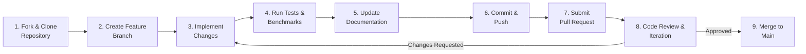
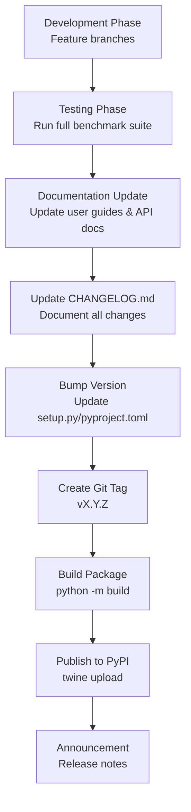

<!-- source: DeepWiki mcp.deepwiki.com · repo NVIDIA/nvalchemi-toolkit-ops · page 6 Development and Contributing · fetched 2026-10-26 -->

# Development and Contributing

<details>
<summary>Relevant source files</summary>

The following files were used as context for generating this wiki page:

- [CHANGELOG.md](CHANGELOG.md)
- [benchmarks/benchmark-requires.txt](benchmarks/benchmark-requires.txt)

</details>


This page provides a comprehensive guide for developers and contributors to the NVIDIA ALCHEMI Toolkit-Ops project. It covers development environment setup, project structure, development workflows, testing procedures, and contribution guidelines. For information about running and adding benchmarks, see [Running Benchmarks](#6.2). For the complete version history, see [Changelog](#6.1).

---

## Purpose and Scope

This document is intended for:
- **Core Contributors**: Developers working on extending the toolkit's computational primitives
- **Feature Developers**: Contributors adding new methods or optimizations
- **Bug Reporters**: Users who encounter issues and want to report them
- **Documentation Writers**: Contributors improving documentation and examples

The page covers the practical aspects of setting up a development environment, understanding the codebase structure, making changes, testing, and submitting contributions. It does not cover usage of the toolkit itself (see [Quick Start Guide](#1.2)) or detailed API documentation (see [API Reference](#5)).

---

## Development Environment Setup

### Prerequisites

The development environment requires:
- **CUDA-capable GPU**: Compute capability 8.0+ (Ampere or newer recommended)
- **Python**: 3.8 or higher
- **CUDA Toolkit**: 11.0 or higher
- **Git**: For version control

### Installing from Source

To set up a development environment:

```bash
# Clone the repository
git clone https://github.com/NVIDIA/nvalchemi-toolkit-ops.git
cd nvalchemi-toolkit-ops

# Create and activate virtual environment
python -m venv venv
source venv/bin/activate  # On Windows: venv\Scripts\activate

# Install in editable mode with development dependencies
pip install -e .

# Install benchmark dependencies (optional)
pip install -r benchmarks/benchmark-requires.txt
```

The `-e` flag installs the package in editable mode, allowing changes to the source code to be immediately reflected without reinstalling.

### Development Dependencies

**Benchmark Dependencies** [benchmarks/benchmark-requires.txt:1-11]():
- `torch-dftd` - Reference implementation for DFT-D3 comparison
- `torch-pme` - Reference implementation for PME comparison
- `pymatgen` - Crystal structure handling
- `rdkit` - Molecular structure processing
- `periodictable` - Atomic data
- `loguru` - Logging utilities
- `nvtx` - NVIDIA profiling markers
- `pyyaml` - Configuration file parsing
- `requests` - HTTP utilities
- `click` - Command-line interfaces

Sources: [benchmarks/benchmark-requires.txt:1-11]()

---

## Project Structure

The following diagram maps the repository structure to the actual directory layout and key files:

```mermaid
graph TB
    ROOT["nvalchemi-toolkit-ops/"]
    
    subgraph "Core Package"
        PKG["nvalchemiops/"]
        PKG --> NL_MOD["neighbor_list/"]
        PKG --> DISP_MOD["dispersion/"]
        PKG --> ELEC_MOD["electrostatics/"]
        PKG --> UTILS["utils/"]
        
        NL_MOD --> NL_IMPL["cell_list.py<br/>naive_neighbor_list.py<br/>batch_cell_list.py<br/>batch_naive_neighbor_list.py"]
        
        DISP_MOD --> DISP_IMPL["dftd3.py<br/>parameters.py<br/>coordination.py"]
        
        ELEC_MOD --> ELEC_IMPL["ewald.py<br/>pme.py<br/>coulomb.py<br/>math_utils.py"]
        
        UTILS --> UTILS_IMPL["benchmark_timer.py<br/>estimate_max_neighbors.py"]
    end
    
    subgraph "Benchmarking"
        BENCH["benchmarks/"]
        BENCH --> BENCH_NL["neighbor_list/"]
        BENCH --> BENCH_DISP["interactions/dispersion/"]
        BENCH --> BENCH_ELEC["interactions/electrostatics/"]
        
        BENCH_NL --> BENCH_NL_SCRIPTS["benchmark_neighbor_list.py<br/>benchmark_batch_neighbor_list.py"]
        
        BENCH_DISP --> BENCH_DISP_SCRIPTS["benchmark_dftd3.py<br/>benchmark_dftd3_batched.py"]
        
        BENCH_ELEC --> BENCH_ELEC_SCRIPTS["benchmark_electrostatics.py"]
        
        BENCH --> BENCH_CONFIG["benchmark_config.yaml"]
        BENCH --> BENCH_REQ["benchmark-requires.txt"]
    end
    
    subgraph "Documentation"
        DOCS["docs/"]
        DOCS --> DOCS_USER["userguide/"]
        DOCS --> DOCS_API["modules/"]
        DOCS --> DOCS_BENCH["benchmarks/benchmark_results/"]
        DOCS --> DOCS_GEN["benchmarks/generate_plots.py"]
    end
    
    subgraph "Examples"
        EX["examples/"]
        EX --> EX_NL["neighbor_list/"]
        EX --> EX_DISP["dispersion/"]
        EX --> EX_ELEC["electrostatics/"]
    end
    
    subgraph "Project Files"
        PROJ["Project Configuration"]
        PROJ --> SETUP["setup.py / pyproject.toml"]
        PROJ --> README["README.md"]
        PROJ --> CHANGELOG["CHANGELOG.md"]
        PROJ --> LICENSE["LICENSE"]
    end
    
    ROOT --> PKG
    ROOT --> BENCH
    ROOT --> DOCS
    ROOT --> EX
    ROOT --> PROJ
```



**Key Directory Responsibilities:**

| Directory | Purpose | Key Files |
|-----------|---------|-----------|
| `nvalchemiops/` | Core library implementation | Python modules with Warp kernels |
| `nvalchemiops/neighbor_list/` | Neighbor list algorithms | `cell_list.py`, `naive_neighbor_list.py`, batched variants |
| `nvalchemiops/dispersion/` | DFT-D3 implementation | `dftd3.py`, `parameters.py` |
| `nvalchemiops/electrostatics/` | Electrostatics methods | `ewald.py`, `pme.py`, `coulomb.py` |
| `benchmarks/` | Performance measurement suite | Benchmark scripts, configuration |
| `docs/` | Documentation source | User guides, API docs, benchmark results |
| `examples/` | Usage examples | Demonstration scripts for each component |

Sources: Repository structure analysis, [benchmarks/benchmark-requires.txt:1-11]()

---

## Code Architecture and Entry Points

Understanding where to make changes requires mapping the high-level computational primitives to specific code modules:

```mermaid
graph TB
    subgraph "Neighbor List Entry Points"
        NL_API["neighbor_list()<br/>nvalchemiops.neighbor_list"]
        NL_API --> CL_FUNC["cell_list()<br/>neighbor_list.cell_list"]
        NL_API --> NAIVE_FUNC["naive_neighbor_list()<br/>neighbor_list.naive_neighbor_list"]
        NL_API --> BCL_FUNC["batch_cell_list()<br/>neighbor_list.batch_cell_list"]
        NL_API --> BN_FUNC["batch_naive_neighbor_list()<br/>neighbor_list.batch_naive_neighbor_list"]
    end
    
    subgraph "Dispersion Entry Points"
        D3_API["dftd3()<br/>nvalchemiops.dispersion.dftd3"]
        D3_PARAMS["D3Parameters<br/>dispersion.parameters"]
        D3_CN["compute_coordination_number()<br/>dispersion.coordination"]
        
        D3_API --> D3_KERNELS["Warp Kernels:<br/>_dftd3_kernel<br/>_dftd3_forces_pass0<br/>_dftd3_forces_pass1<br/>_dftd3_forces_pass2<br/>_dftd3_forces_pass3"]
    end
    
    subgraph "Electrostatics Entry Points"
        EWALD_API["ewald_summation()<br/>electrostatics.ewald"]
        PME_API["particle_mesh_ewald()<br/>electrostatics.pme"]
        COULOMB_API["coulomb_energy()<br/>coulomb_forces()<br/>electrostatics.coulomb"]
        
        EWALD_API --> EWALD_KERNELS["Warp Kernels:<br/>_ewald_real_space<br/>_ewald_reciprocal_space"]
        
        PME_API --> PME_KERNELS["Warp Kernels:<br/>_pme_real_space<br/>_pme_charge_spread<br/>_pme_force_gather"]
        
        PME_API --> FFT["PyTorch FFT:<br/>torch.fft.fftn<br/>torch.fft.ifftn"]
    end
    
    subgraph "Utilities"
        TIMER["BenchmarkTimer<br/>utils.benchmark_timer"]
        EST["estimate_max_neighbors()<br/>utils.estimate_max_neighbors"]
    end
    
    subgraph "Testing and Validation"
        BENCH_SCRIPTS["Benchmark Scripts:<br/>benchmarks/neighbor_list/<br/>benchmarks/interactions/"]
        EXAMPLES["Example Scripts:<br/>examples/neighbor_list/<br/>examples/dispersion/<br/>examples/electrostatics/"]
    end
    
    BENCH_SCRIPTS --> NL_API
    BENCH_SCRIPTS --> D3_API
    BENCH_SCRIPTS --> EWALD_API
    BENCH_SCRIPTS --> PME_API
    BENCH_SCRIPTS --> TIMER
    
    EXAMPLES --> NL_API
    EXAMPLES --> D3_API
    EXAMPLES --> EWALD_API
    EXAMPLES --> PME_API
```



Sources: Repository structure analysis, high-level system diagrams

---

## Development Workflow

### Making Changes

The typical development workflow follows this process:



**Detailed Steps:**

1. **Fork & Clone**: Create a fork of the repository and clone it locally
2. **Create Feature Branch**: `git checkout -b feature/your-feature-name`
3. **Implement Changes**: Make modifications to the relevant modules
4. **Run Tests**: Execute relevant benchmark scripts to validate functionality
5. **Update Documentation**: Add/update docstrings, user guides, and examples
6. **Commit & Push**: Use clear, descriptive commit messages
7. **Submit Pull Request**: Open a PR with a detailed description of changes
8. **Code Review**: Address reviewer feedback iteratively
9. **Merge**: Once approved, changes are merged to the main branch

### Testing Changes

Testing depends on the component being modified:

**For Neighbor List Changes:**
```bash
# Run single-system neighbor list benchmarks
python benchmarks/neighbor_list/benchmark_neighbor_list.py

# Run batched neighbor list benchmarks
python benchmarks/neighbor_list/benchmark_batch_neighbor_list.py
```

**For Dispersion Changes:**
```bash
# Run single-system DFT-D3 benchmarks
python benchmarks/interactions/dispersion/benchmark_dftd3.py

# Run batched DFT-D3 benchmarks
python benchmarks/interactions/dispersion/benchmark_dftd3_batched.py
```

**For Electrostatics Changes:**
```bash
# Run electrostatics benchmarks (Ewald and PME)
python benchmarks/interactions/electrostatics/benchmark_electrostatics.py
```

### Validation Checklist

Before submitting a pull request, ensure:

- [ ] Code runs without errors on the target hardware
- [ ] Benchmark scripts complete successfully
- [ ] Performance is comparable or improved relative to baseline
- [ ] Memory usage is within acceptable bounds (< 80GB for H100)
- [ ] Numerical accuracy is maintained (compare outputs with reference implementations)
- [ ] Documentation is updated (docstrings, user guides, examples)
- [ ] CHANGELOG.md is updated with a description of changes
- [ ] Code follows existing style conventions
- [ ] No unnecessary dependencies are introduced

Sources: Development workflow analysis

---

## Contributing Guidelines

### Bug Reports

When reporting a bug, include:

1. **Environment Information**:
   - Python version
   - PyTorch version
   - CUDA version
   - GPU model
   - Operating system

2. **Minimal Reproducible Example**:
   - Simplest code that demonstrates the issue
   - Input data or parameters used
   - Expected vs. actual behavior

3. **Error Messages**:
   - Complete stack traces
   - Warning messages
   - Any relevant log output

### Feature Requests

Feature requests should include:

1. **Use Case**: Clear description of the problem being solved
2. **Proposed Solution**: High-level description of the approach
3. **Alternatives Considered**: Other approaches evaluated
4. **Implementation Details**: Technical considerations, if applicable

### Pull Request Guidelines

**PR Title Format:**
- `feat: Add new feature description`
- `fix: Fix bug description`
- `docs: Update documentation description`
- `perf: Performance improvement description`
- `refactor: Code restructuring description`

**PR Description Template:**
```markdown
## Description
Brief summary of the changes

## Motivation
Why this change is needed

## Changes Made
- Bullet points of specific changes
- Modified files and their purposes

## Testing
- How the changes were tested
- Benchmark results (if applicable)

## Performance Impact
- Timing comparisons (before/after)
- Memory usage changes
- Scaling characteristics

## Breaking Changes
- Any API changes that affect existing users

## Documentation
- Updated docstrings
- Modified user guides
- New examples
```

### Code Style Conventions

**Python Code:**
- Follow PEP 8 style guidelines
- Use type hints for function signatures
- Maximum line length: 100 characters
- Use descriptive variable names

**Warp Kernels:**
- Prefix kernel names with underscore: `_kernel_name`
- Document kernel launch parameters
- Use `wp.tid()` for thread indexing
- Ensure proper bounds checking

**Documentation:**
- Use NumPy-style docstrings
- Include parameter types and descriptions
- Provide usage examples
- Document edge cases and limitations

Sources: Development best practices analysis

---

## Version History and Release Process

### Recent Releases

From [CHANGELOG.md:1-33]():

**Version 0.2.0 (2025-12-19):**
- **Added**: Electrostatics methods including direct Coulomb, Ewald summation, and particle mesh Ewald
- **Added**: Supporting math routines for spherical harmonics, spline evaluation, and Gaussian basis
- **Added**: New example scripts in `examples/electrostatics/`
- **Changed**: Default `estimate_max_neighbors` behavior - `atomic_density` changed from 0.5 to 0.35
- **Changed**: Rounding behavior changed from power-of-2 to multiple-of-16 for more realistic neighbor counts
- **Fixed**: Issues #2 and #3 - duplicate neighbors in cell and batched cell lists

**Version 0.1.0 (2025-12-05):**
- Initial release of the package
- Neighbor list algorithms (cell list, naive, batched variants)
- DFT-D3 dispersion corrections with Becke-Johnson damping
- PyTorch integration and `torch.compile` support
- Comprehensive benchmarking infrastructure

### Release Workflow



**Versioning Scheme:**
- **Major (X.0.0)**: Breaking API changes, major architectural changes
- **Minor (0.X.0)**: New features, backward-compatible additions
- **Patch (0.0.X)**: Bug fixes, performance improvements, documentation updates

Sources: [CHANGELOG.md:1-33]()

---

## Development Tools and Utilities

### BenchmarkTimer

The `BenchmarkTimer` utility class provides standardized performance measurement:

**Key Features:**
- Median timing over multiple iterations
- Peak memory tracking
- Throughput calculations (atoms/ms)
- Success/failure status tracking
- Automatic warmup iterations

**Usage Pattern:**
```python
from nvalchemiops.utils.benchmark_timer import BenchmarkTimer

timer = BenchmarkTimer(warmup=5, timing_iterations=20)
result = timer.benchmark(
    func=your_function,
    *args,
    **kwargs
)

print(f"Median time: {result['median_time_ms']:.3f} ms")
print(f"Peak memory: {result['peak_memory_mb']:.1f} MB")
print(f"Throughput: {result['throughput_atoms_per_ms']:.1f} atoms/ms")
```

### Estimate Max Neighbors

The `estimate_max_neighbors()` function provides automatic estimation for neighbor list buffer sizing:

**Recent Changes** [CHANGELOG.md:16-23]():
- Default `atomic_density` changed from 0.5 to 0.35
- Rounding changed from power-of-2 to multiple-of-16
- Significantly reduces memory overhead while maintaining safety margins

### NVTX Profiling

For detailed GPU profiling, benchmark scripts support NVTX markers (requires `nvtx` package):

```bash
# Install NVTX support
pip install nvtx

# Run with profiling
nsys profile -o profile.qdrep python benchmarks/neighbor_list/benchmark_neighbor_list.py

# View in NVIDIA Nsight Systems
nsys-ui profile.qdrep
```

### Benchmark Configuration

Benchmarks are configured via YAML files (`benchmark_config.yaml`):

```yaml
# Example configuration structure
warmup_iterations: 5
timing_iterations: 20
dtypes:
  - float32
  - float64
devices:
  - cuda:0
batch_sizes:
  - 1
  - 16
  - 64
  - 128
```

Sources: [benchmarks/benchmark-requires.txt:1-11](), [CHANGELOG.md:16-23](), benchmark infrastructure analysis

---

## Common Development Tasks

### Adding a New Computational Primitive

To add a new computational primitive (e.g., three-body interactions):

1. **Create Module Structure**:
   - `nvalchemiops/three_body/` directory
   - `__init__.py` with public API
   - Implementation files for different algorithms

2. **Implement Warp Kernels**:
   - Define `@wp.kernel` decorated functions
   - Handle both single-system and batched cases
   - Implement force calculations with proper chain rule

3. **Add PyTorch Wrapper**:
   - Create Python function with PyTorch tensor inputs
   - Convert to Warp arrays
   - Launch kernels
   - Convert results back to PyTorch tensors
   - Support autograd if applicable

4. **Create Benchmarks**:
   - Add `benchmarks/interactions/three_body/` directory
   - Implement benchmark scripts
   - Add to benchmark suite

5. **Write Documentation**:
   - Add user guide page
   - Document API reference
   - Create example scripts
   - Update main documentation index

6. **Update CHANGELOG**:
   - Add entry under "Added" section

### Optimizing Performance

Performance optimization workflow:

1. **Profile Current Implementation**:
   ```bash
   nsys profile -o baseline.qdrep python your_benchmark.py
   ```

2. **Identify Bottlenecks**:
   - Memory bandwidth limitations
   - Kernel launch overhead
   - Synchronization points
   - Algorithm complexity

3. **Apply Optimizations**:
   - Increase work per thread
   - Optimize memory access patterns
   - Use shared memory where applicable
   - Batch operations

4. **Measure Impact**:
   ```bash
   nsys profile -o optimized.qdrep python your_benchmark.py
   # Compare baseline vs optimized
   ```

5. **Document Performance Changes**:
   - Update benchmark results
   - Add plots showing improvements
   - Document optimization techniques used

### Fixing Bugs

Example: The duplicate neighbors bug fix [CHANGELOG.md:27]():

1. **Identify the Issue**: Duplicate neighbors appearing in cell and batched cell lists (Issues #2, #3)
2. **Locate the Code**: Find neighbor list construction kernels in `neighbor_list/cell_list.py` and `neighbor_list/batch_cell_list.py`
3. **Develop Fix**: Modify kernel logic to ensure uniqueness
4. **Test Thoroughly**: Run all neighbor list benchmarks and examples
5. **Verify Performance**: Ensure fix doesn't degrade performance
6. **Document**: Update CHANGELOG.md with fix description
7. **Submit PR**: Include test cases that would catch regression

Sources: [CHANGELOG.md:27](), bug fixing workflow analysis

---

## Next Steps

After reading this guide:

- **To run benchmarks and add new ones**: See [Running Benchmarks](#6.2)
- **To understand version history**: See [Changelog](#6.1)
- **To understand the system architecture**: See [System Architecture](#3)
- **To learn about specific components**: See [Core Components](#2)
- **For usage examples**: See [Quick Start Guide](#1.2)
- **For API details**: See [API Reference](#5)

## Contact and Support

- **Repository**: https://github.com/NVIDIA/nvalchemi-toolkit-ops
- **Issues**: Report bugs and feature requests via GitHub Issues
- **Discussions**: Use GitHub Discussions for questions and community interaction

---

Sources: [CHANGELOG.md:1-33](), [benchmarks/benchmark-requires.txt:1-11](), repository structure analysis, high-level system diagrams

---

