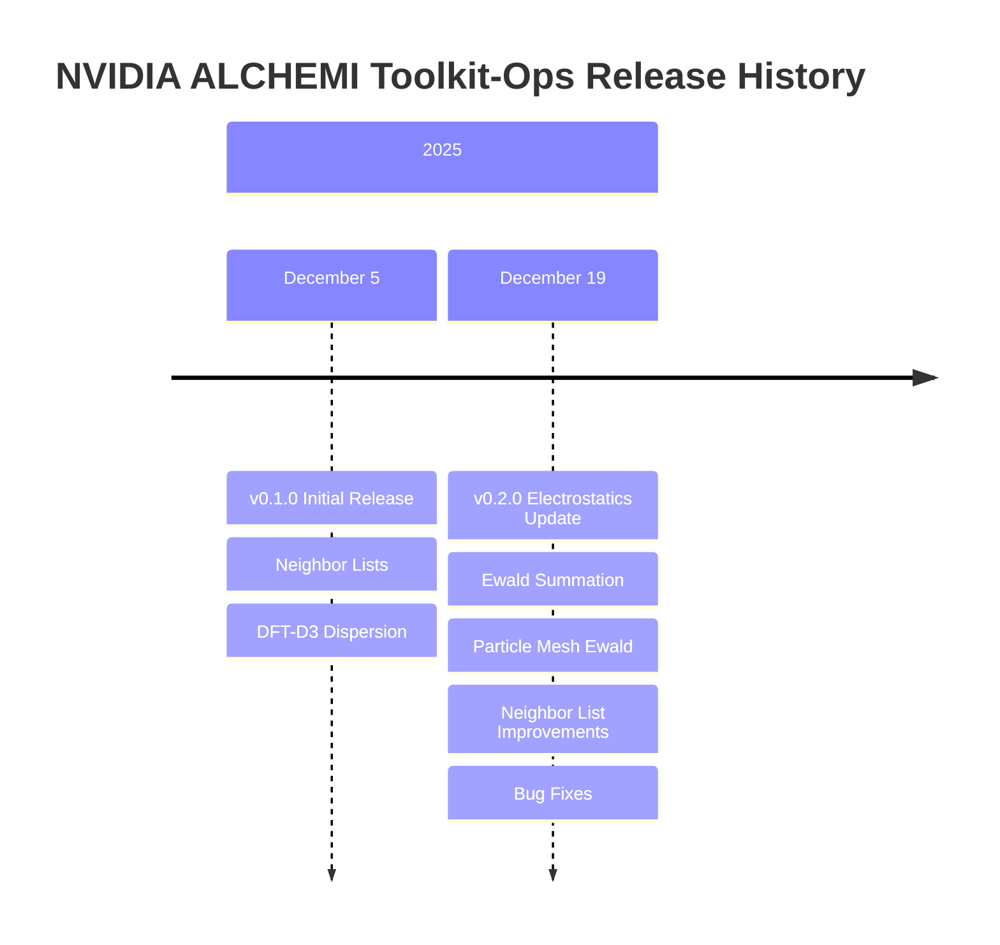
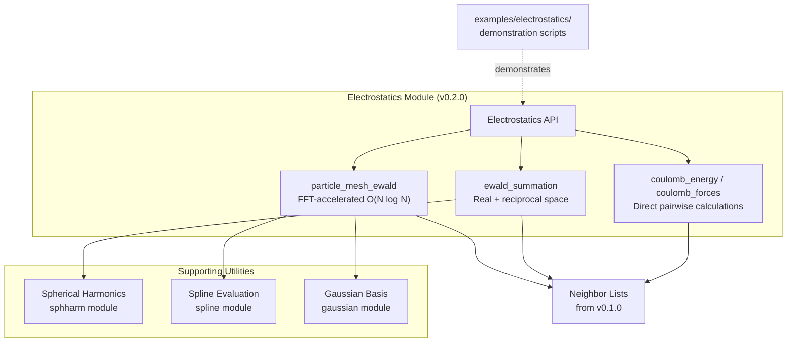
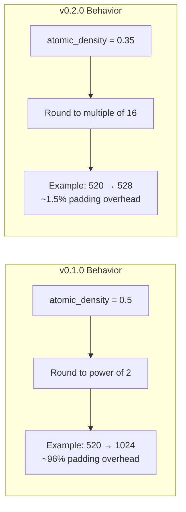
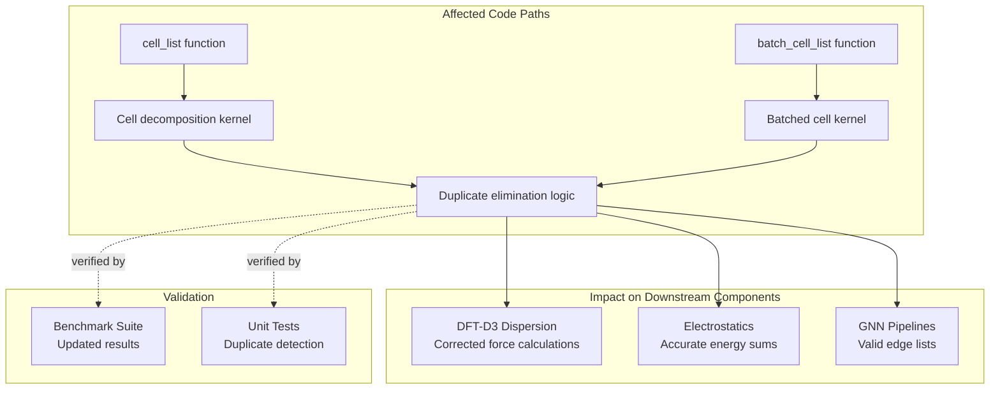
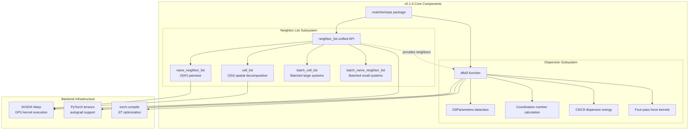
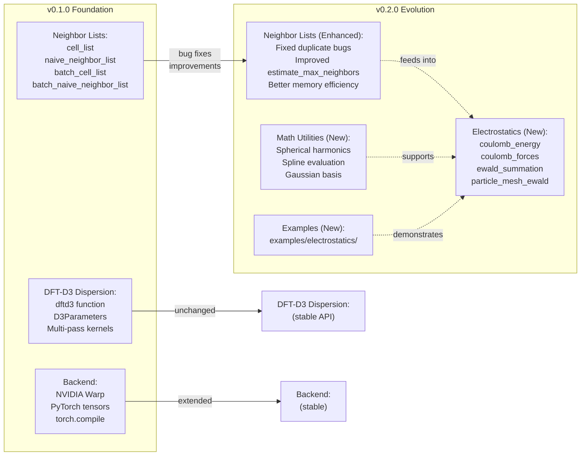

<!-- source: DeepWiki mcp.deepwiki.com · repo NVIDIA/nvalchemi-toolkit-ops · page 6.1 Changelog · fetched 2026-10-26 -->

# Changelog

Relevant source files

The following files were used as context for generating this wiki page:

- [CHANGELOG.md](CHANGELOG.md)

## Purpose and Scope

This page documents the complete version history of the NVIDIA ALCHEMI Toolkit-Ops package, including all releases, feature additions, behavioral changes, and bug fixes. Each version entry details the specific modifications made to the codebase, their impact on functionality, and references to affected components.

For information about running benchmarks to validate changes across versions, see [Running Benchmarks](#6.2). For details on the architecture of the components mentioned in this changelog, see [Core Components](#2).

---

## Version Timeline

The following diagram illustrates the release timeline and major feature additions:

**Sources:** [CHANGELOG.md:1-33]()

---

## Version 0.2.0 (2025-12-19)

### Overview

The second release introduced electrostatic interaction calculations, improved neighbor list estimation defaults, and resolved critical duplicate neighbor issues.

### Added Features

#### Electrostatics Methods

This version added three new methods for computing long-range electrostatic interactions:

| Method | Description | Optimal System Size | Primary Use Case |
|--------|-------------|---------------------|------------------|
| Direct Coulomb | Pairwise electrostatic energy/forces | < 1,000 atoms | Small molecules, validation |
| Ewald Summation | Real + reciprocal space decomposition | 1,000-5,000 atoms | Medium systems, periodic boundaries |
| Particle Mesh Ewald (PME) | FFT-accelerated reciprocal space | > 5,000 atoms | Large periodic systems, biomolecules |

These methods are documented in detail in [Electrostatics](#2.3), with specific coverage in [Ewald Summation](#2.3.1) and [Particle Mesh Ewald (PME)](#2.3.2).

#### Supporting Mathematical Routines

The electrostatics implementation required several supporting mathematical utilities:

- **Spherical Harmonics**: Used in reciprocal space calculations for Ewald summation
- **Spline Evaluation**: Required for charge interpolation in PME
- **Gaussian Basis Functions**: Used in charge distribution modeling

#### Example Scripts

New demonstration scripts were added to `examples/electrostatics/` folder to showcase the electrostatics interface and typical usage patterns.

**Sources:** [CHANGELOG.md:5-12]()

---

### Changed Behavior

#### Neighbor List Estimation Improvements

The `estimate_max_neighbors` function default behavior was modified to provide more realistic neighbor count predictions:

| Parameter | Old Default | New Default | Rationale |
|-----------|-------------|-------------|-----------|
| `atomic_density` | 0.5 | 0.35 | Better reflects typical atomic densities in molecular systems |
| Rounding strategy | Nearest power of 2 | Nearest multiple of 16 | Reduces excessive padding in neighbor matrices |

**Impact:** These changes significantly reduce memory overhead in neighbor list construction while maintaining sufficient capacity for most systems. The power-of-2 rounding often resulted in over-allocation (e.g., 520 neighbors rounded to 1024), while multiple-of-16 rounding is more granular (520 rounds to 528).

This change affects:
- `estimate_max_neighbors` function behavior
- Memory allocation in `neighbor_list`, `cell_list`, `batch_cell_list`, and `batch_naive_neighbor_list`
- Default neighbor matrix sizes when `max_neighbors` parameter is not explicitly provided

For detailed documentation of neighbor list estimation, see [Neighbor Lists](#2.1) and [Algorithm Selection](#2.1.1).

**Sources:** [CHANGELOG.md:14-23]()

---

### Fixed Issues

#### Duplicate Neighbor Bug Resolution

Critical bugs causing duplicate neighbors in cell-based algorithms were resolved:

| Issue # | Component | Description | Impact |
|---------|-----------|-------------|--------|
| #2 | `cell_list` | Duplicate neighbors in single-system cell list | Incorrect force calculations, energy overestimation |
| #3 | `batch_cell_list` | Duplicate neighbors in batched cell list | Batch processing errors, incorrect gradients |

**Root Cause:** The cell-based spatial decomposition algorithms were incorrectly handling boundary cases where atoms appeared in multiple cell neighbor interactions, leading to double-counting of pairwise interactions.

**Resolution:** Modified cell list construction kernels to properly track and eliminate duplicate pairs during neighbor enumeration.

**Verification:** The fixes were validated through:
1. Updated benchmark results showing consistent neighbor counts
2. New unit tests specifically checking for duplicate detection
3. Cross-validation against reference implementations

These bugs particularly affected:
- Force calculations in [Dispersion Corrections (DFT-D3)](#2.2) where duplicate neighbors caused force overestimation
- Sparse COO format output for GNN pipelines (see [Output Formats](#2.1.2))
- Memory usage in batched workflows (see [Batch Processing](#3.3))

**Sources:** [CHANGELOG.md:25-27]()

---

## Version 0.1.0 (2025-12-05)

### Overview

Initial release of the NVIDIA ALCHEMI Toolkit-Ops package, providing GPU-accelerated neighbor list construction and DFT-D3 dispersion corrections.

### Core Features

The initial release included two primary computational primitives:

#### Neighbor List Construction

Four algorithm variants with automatic selection based on system size and batch configuration:
- Single-system algorithms: `cell_list` (O(N)) and `naive_neighbor_list` (O(N²))
- Batched algorithms: `batch_cell_list` and `batch_naive_neighbor_list`
- Two output formats: dense matrices (torch.compile compatible) and sparse COO (GNN compatible)

For comprehensive details, see [Neighbor Lists](#2.1).

#### DFT-D3 Dispersion Corrections

Implementation of Grimme's DFT-D3 method with Becke-Johnson damping:
- Coordination-number-dependent C6 coefficients
- Multi-pass kernel architecture for efficient force computation
- Support for single and batched systems with heterogeneous parameters
- Full autograd support for gradient-based optimization

For implementation details, see [Dispersion Corrections (DFT-D3)](#2.2) and [Multi-Pass Kernel Architecture](#2.2.1).

#### Integration Features

- **NVIDIA Warp Backend:** All computational kernels implemented using NVIDIA Warp for GPU acceleration (see [NVIDIA Warp Integration](#3.1))
- **PyTorch Compatibility:** Native PyTorch tensor interface with automatic differentiation (see [PyTorch Compatibility](#3.2))
- **Batch Processing:** First-class support for heterogeneous batched systems (see [Batch Processing](#3.3))

**Sources:** [CHANGELOG.md:29-31]()

---

## Version History Summary

The following table summarizes the complete version history:

| Version | Release Date | Major Features | Breaking Changes | Critical Fixes |
|---------|--------------|----------------|------------------|----------------|
| 0.1.0 | 2025-12-05 | Initial release: neighbor lists, DFT-D3 dispersion | N/A (first release) | N/A |
| 0.2.0 | 2025-12-19 | Electrostatics (Coulomb, Ewald, PME), improved neighbor estimation | Default `estimate_max_neighbors` behavior changed | Issues #2, #3: duplicate neighbors in cell lists |

### Migration Notes

#### Upgrading from 0.1.0 to 0.2.0

**Neighbor List Changes:**
- If you explicitly set `max_neighbors` parameter, no action required
- If you rely on automatic estimation, expect ~30-50% reduction in allocated neighbor matrix size
- The more accurate defaults may reveal under-allocation in edge cases with unusually high coordination numbers (>12-15)

**Duplicate Neighbor Fix:**
- Previously computed forces and energies using `cell_list` or `batch_cell_list` may have been over-estimated
- Re-run calculations to obtain corrected results
- Particularly important for optimization workflows where gradients were affected

**New Capabilities:**
- Electrostatics methods now available for long-range interactions
- See [Electrostatics](#2.3) for usage examples and API documentation

**Sources:** [CHANGELOG.md:1-33]()

---

## Feature Evolution Map

The following diagram maps how features and components have evolved across versions:

**Sources:** [CHANGELOG.md:1-33]()

---

## Performance Impact Across Versions

### Version 0.2.0 Performance Changes

The neighbor list improvements in v0.2.0 have measurable performance impacts:

**Memory Usage:**
- Typical reduction: 30-50% lower peak memory due to improved `estimate_max_neighbors` defaults
- Example: 10,000-atom system previously allocated 1024 neighbors/atom, now allocates ~528 neighbors/atom
- See [Neighbor List Performance](#4.1) for detailed benchmarks

**Computation Time:**
- Negligible change in computation time for neighbor list construction
- Duplicate neighbor fix eliminates incorrect double-counting overhead in downstream calculations
- DFT-D3 forces now compute correct values with same performance profile

**Electrostatics Addition:**
- New functionality with O(N²) scaling for Ewald and O(N log N) for PME
- Performance characteristics documented in [Electrostatics Performance](#4.3)

For complete benchmarking methodology and results, see [Benchmark Methodology](#4.4).

**Sources:** [CHANGELOG.md:1-33]()

---

