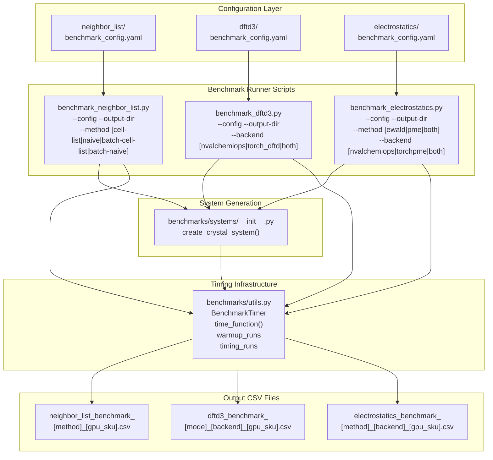
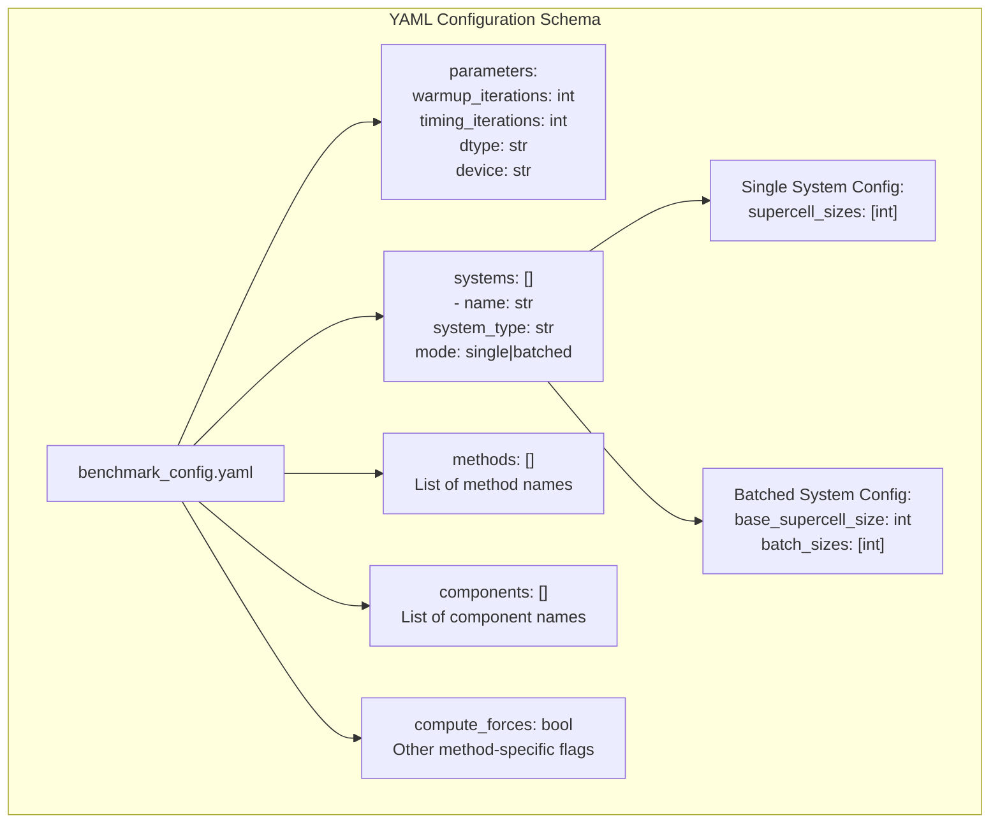
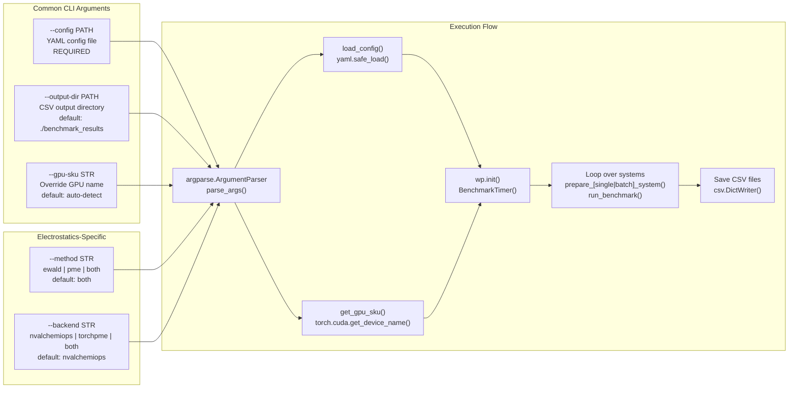
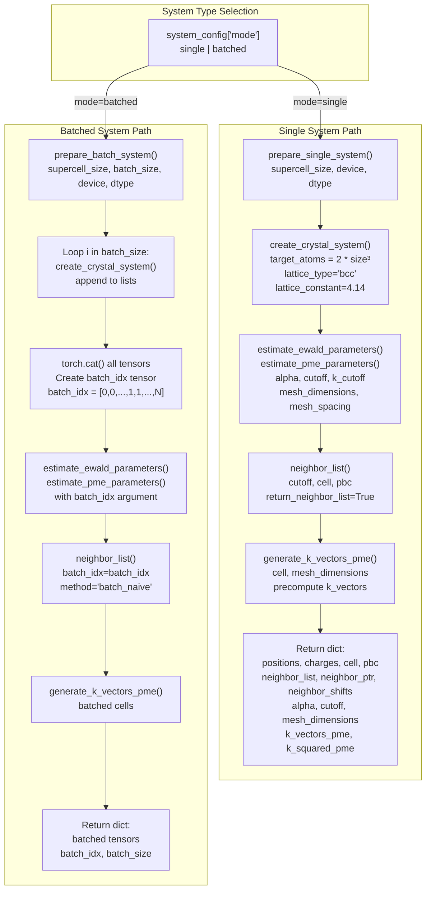
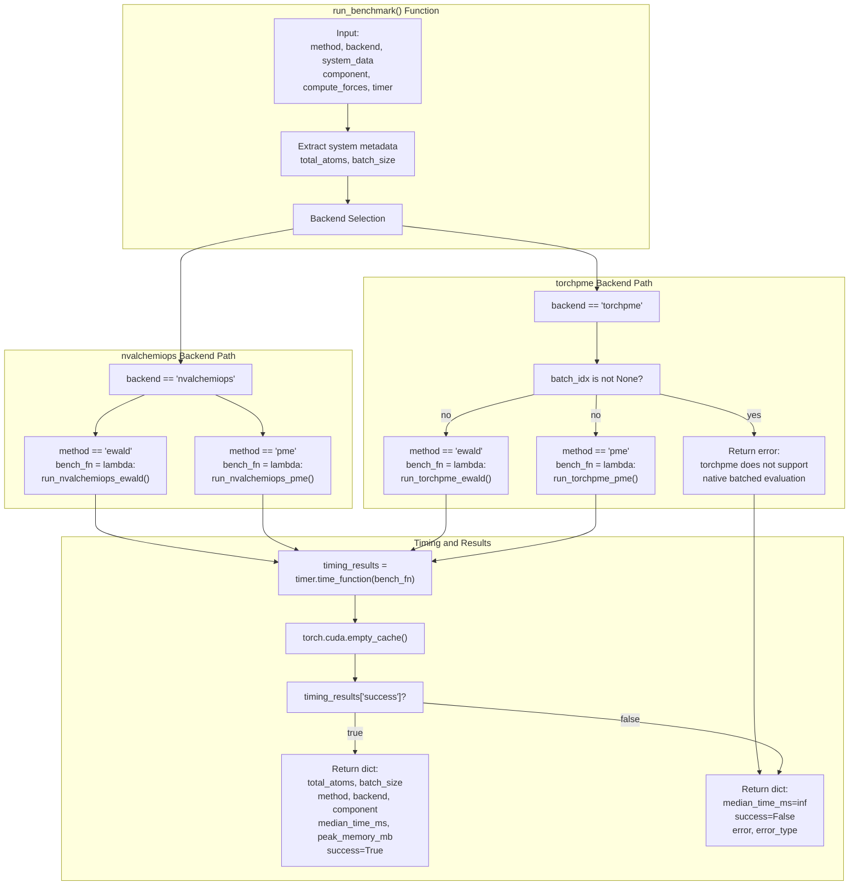
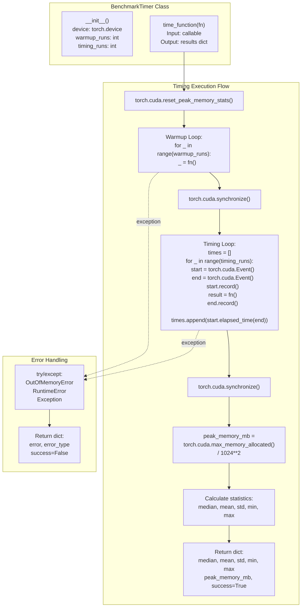
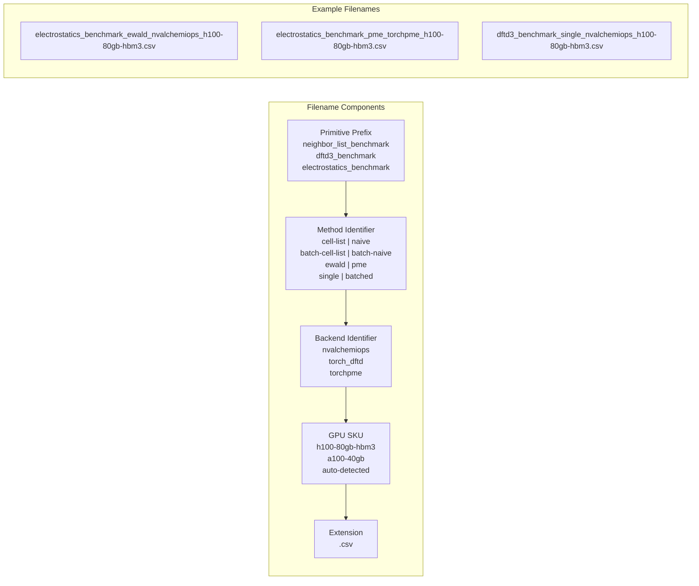
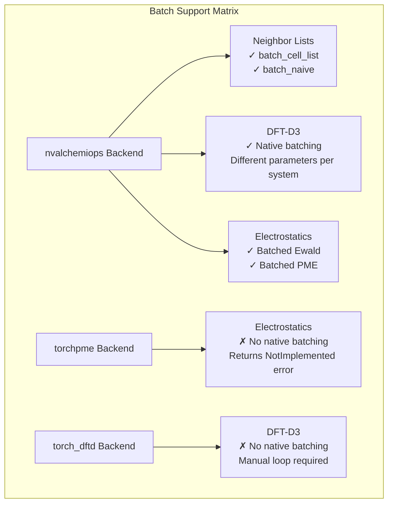

<!-- source: DeepWiki mcp.deepwiki.com · repo NVIDIA/nvalchemi-toolkit-ops · page 6.2 Running Benchmarks · fetched 2026-10-26 -->

# Running Benchmarks

<details>
<summary>Relevant source files</summary>

The following files were used as context for generating this wiki page:

- [benchmarks/benchmark-requires.txt](benchmarks/benchmark-requires.txt)
- [benchmarks/interactions/electrostatics/benchmark_config.yaml](benchmarks/interactions/electrostatics/benchmark_config.yaml)
- [benchmarks/interactions/electrostatics/benchmark_electrostatics.py](benchmarks/interactions/electrostatics/benchmark_electrostatics.py)

</details>


This guide provides instructions for running the benchmarking suite and adding new benchmark configurations. The benchmarking infrastructure measures performance characteristics of neighbor lists, DFT-D3 dispersion corrections, and electrostatics calculations across various system sizes, batch configurations, and hardware platforms.

For analysis of existing benchmark results and performance characteristics, see [Benchmark Methodology](#4.4). For specific performance analysis of each component, see [Neighbor List Performance](#4.1), [Dispersion Performance](#4.2), and [Electrostatics Performance](#4.3).

---

## Prerequisites

### Required Dependencies

The benchmark suite requires additional dependencies beyond the core library installation. These are specified in [benchmarks/benchmark-requires.txt:1-11]():

| Package | Purpose |
|---------|---------|
| `rdkit` | Molecular structure generation |
| `pymatgen` | Crystalline system generation |
| `periodictable` | Atomic properties and parameters |
| `loguru` | Structured logging |
| `pyyaml` | Configuration file parsing |
| `nvtx` | NVIDIA profiling markers |
| `torch-dftd` | Reference implementation for DFT-D3 backend comparison |
| `torch-pme` | Reference implementation for electrostatics backend comparison |

Install benchmark dependencies:

```bash
pip install -r benchmarks/benchmark-requires.txt
```

**Sources**: [benchmarks/benchmark-requires.txt:1-11]()

---

## Benchmark Infrastructure Overview

The benchmarking system consists of three parallel pipelines, one for each computational primitive:



**Benchmark Runner Architecture**: Each computational primitive has a dedicated benchmark script with command-line interface, configuration file, and system generation pipeline. All runners use the shared `BenchmarkTimer` class for consistent measurement methodology.

**Sources**: [benchmarks/interactions/electrostatics/benchmark_electrostatics.py:1-27](), [benchmarks/benchmark-requires.txt:1-11]()

---

## Configuration Files

Benchmark behavior is controlled via YAML configuration files located in each benchmark subdirectory. The configuration specifies system sizes, batch configurations, measurement parameters, and which methods/backends to test.

### Configuration Structure



**Configuration File Structure**: YAML files define global parameters, system configurations (single or batched), and method selection. System configurations specify either a range of supercell sizes (single mode) or base size with batch sizes (batched mode).

**Sources**: [benchmarks/interactions/electrostatics/benchmark_config.yaml:1-91]()

### Electrostatics Configuration Example

The electrostatics benchmark configuration demonstrates the full configuration schema:

| Section | Parameters | Example Values |
|---------|------------|----------------|
| `parameters` | `warmup_iterations`<br>`timing_iterations`<br>`dtype`<br>`device` | `3`<br>`10`<br>`float32`<br>`cuda` |
| `systems[i].mode=single` | `system_type`<br>`supercell_sizes` | `cscl`<br>`[1, 3, 5, 7, 10, 15, 20, 25]` |
| `systems[i].mode=batched` | `system_type`<br>`base_supercell_size`<br>`batch_sizes` | `cscl`<br>`2` (16 atoms/system)<br>`[1, 4, 16, 64, 256, 1024, 4096]` |
| `methods` | List of methods to benchmark | `[ewald, pme]` |
| `components` | List of components to isolate | `[real, reciprocal, full]` |
| `compute_forces` | Enable force calculation | `false` |

**Configuration Parameters**: [benchmarks/interactions/electrostatics/benchmark_config.yaml:5-10]() defines global timing and device settings. [benchmarks/interactions/electrostatics/benchmark_config.yaml:14-77]() defines system configurations with varying sizes and batch configurations. [benchmarks/interactions/electrostatics/benchmark_config.yaml:79-90]() defines method, component, and force calculation settings.

**Sources**: [benchmarks/interactions/electrostatics/benchmark_config.yaml:1-91]()

---

## Running Benchmarks

### Command-Line Interface

Each benchmark runner provides a command-line interface defined using `argparse`:



**Benchmark Execution Flow**: The CLI parses arguments, loads configuration, detects GPU hardware, initializes timing infrastructure, prepares systems, runs benchmarks, and saves results to CSV files with GPU-specific naming.

**Sources**: [benchmarks/interactions/electrostatics/benchmark_electrostatics.py:758-792](), [benchmarks/interactions/electrostatics/benchmark_electrostatics.py:98-102](), [benchmarks/interactions/electrostatics/benchmark_electrostatics.py:83-96]()

### Running Electrostatics Benchmarks

The electrostatics benchmark script is located at [benchmarks/interactions/electrostatics/benchmark_electrostatics.py:1-1025](). Basic usage:

```bash
# Run with default settings (both methods, nvalchemiops backend)
python benchmarks/interactions/electrostatics/benchmark_electrostatics.py \
    --config benchmarks/interactions/electrostatics/benchmark_config.yaml \
    --output-dir ./results

# Benchmark both backends for comparison
python benchmarks/interactions/electrostatics/benchmark_electrostatics.py \
    --config benchmark_config.yaml \
    --backend both \
    --method both \
    --output-dir ./results

# Benchmark only PME method with nvalchemiops backend
python benchmarks/interactions/electrostatics/benchmark_electrostatics.py \
    --config benchmark_config.yaml \
    --backend nvalchemiops \
    --method pme \
    --output-dir ./results

# Override GPU SKU name in output files
python benchmarks/interactions/electrostatics/benchmark_electrostatics.py \
    --config benchmark_config.yaml \
    --gpu-sku h100-80gb \
    --output-dir ./results
```

**CLI Implementation**: The argument parser is defined at [benchmarks/interactions/electrostatics/benchmark_electrostatics.py:760-791](), with backend selection logic at [benchmarks/interactions/electrostatics/benchmark_electrostatics.py:794-802]() and method selection at [benchmarks/interactions/electrostatics/benchmark_electrostatics.py:832-838]().

**Sources**: [benchmarks/interactions/electrostatics/benchmark_electrostatics.py:758-860]()

---

## System Preparation

Benchmarks require generating test systems with varying sizes and batch configurations. The system preparation functions create crystalline systems and compute necessary parameters.

### System Preparation Pipeline



**System Preparation Functions**: Single systems use `prepare_single_system()` which generates one system with specified supercell size. Batched systems use `prepare_batch_system()` which generates multiple systems and concatenates them with batch indexing. Both paths precompute neighbor lists and k-vectors to avoid regenerating them during timing runs.

**Sources**: [benchmarks/interactions/electrostatics/benchmark_electrostatics.py:110-182](), [benchmarks/interactions/electrostatics/benchmark_electrostatics.py:184-280]()

### Key System Preparation Details

| Aspect | Implementation | Code Reference |
|--------|---------------|----------------|
| Crystal system generation | `create_crystal_system(target_atoms, lattice_type="bcc", lattice_constant=4.14)` | [benchmarks/interactions/electrostatics/benchmark_electrostatics.py:125-131]() |
| Atom count calculation | BCC lattice: `2 * supercell_size³` | [benchmarks/interactions/electrostatics/benchmark_electrostatics.py:124]() |
| Parameter estimation | `estimate_ewald_parameters()`, `estimate_pme_parameters()` with `accuracy=1e-6` | [benchmarks/interactions/electrostatics/benchmark_electrostatics.py:139-150]() |
| Neighbor list method | Single: auto-select; Batched: `method="batch_naive"` | [benchmarks/interactions/electrostatics/benchmark_electrostatics.py:247-255]() |
| K-vector precomputation | `generate_k_vectors_pme(cell, mesh_dimensions)` to avoid regeneration | [benchmarks/interactions/electrostatics/benchmark_electrostatics.py:161]() |
| Batch indexing | `batch_idx = [i] * n_atoms` for each system i | [benchmarks/interactions/electrostatics/benchmark_electrostatics.py:228]() |

**Sources**: [benchmarks/interactions/electrostatics/benchmark_electrostatics.py:110-280]()

---

## Benchmark Execution

The `run_benchmark()` function orchestrates individual benchmark measurements and error handling:



**Benchmark Orchestration**: The `run_benchmark()` function selects the appropriate backend implementation, wraps it in a lambda for timing, executes via `BenchmarkTimer`, and returns structured results. Torchpme backend explicitly checks for batched systems and returns an error since it doesn't support native batching.

**Sources**: [benchmarks/interactions/electrostatics/benchmark_electrostatics.py:648-751]()

### Backend Implementation Functions

The runner calls backend-specific functions that invoke the actual computation methods:

| Backend | Method | Function | Key Operations |
|---------|--------|----------|----------------|
| `nvalchemiops` | Ewald | `run_nvalchemiops_ewald()` | Calls `ewald_real_space()`, `ewald_reciprocal_space()`, or `ewald_summation()` based on component |
| `nvalchemiops` | PME | `run_nvalchemiops_pme()` | Calls `ewald_real_space()` (real), `pme_reciprocal_space()` (reciprocal), or `particle_mesh_ewald()` (full) |
| `torchpme` | Ewald | `run_torchpme_ewald()` | Creates `EwaldCalculator`, calls `forward()`, computes forces via autograd if needed |
| `torchpme` | PME | `run_torchpme_pme()` | Creates `PMECalculator`, calls `forward()`, computes forces via autograd if needed |

**Backend Functions**: [benchmarks/interactions/electrostatics/benchmark_electrostatics.py:287-379]() implements `run_nvalchemiops_ewald()`, [benchmarks/interactions/electrostatics/benchmark_electrostatics.py:381-486]() implements `run_nvalchemiops_pme()`, [benchmarks/interactions/electrostatics/benchmark_electrostatics.py:530-584]() implements `run_torchpme_ewald()`, and [benchmarks/interactions/electrostatics/benchmark_electrostatics.py:586-641]() implements `run_torchpme_pme()`.

**Sources**: [benchmarks/interactions/electrostatics/benchmark_electrostatics.py:287-641]()

---

## Timing Infrastructure

The `BenchmarkTimer` class provides consistent measurement methodology across all benchmarks:



**BenchmarkTimer Measurement Protocol**: The timer performs warmup iterations to stabilize GPU kernel compilation and caching, then measures timing runs using CUDA events for precise GPU timing. Memory tracking captures peak allocation during execution. All operations are synchronized to ensure accurate measurement.

**Sources**: [benchmarks/utils.py]() (referenced but not provided - inferred from usage at [benchmarks/interactions/electrostatics/benchmark_electrostatics.py:47]())

---

## Output Files and Results

Benchmark results are saved as CSV files with GPU-specific naming to enable cross-platform comparison.

### Output File Naming Convention



**Output Filename Structure**: Filenames follow the pattern `{primitive}_{method}_{backend}_{gpu_sku}.csv` to enable easy identification and comparison across different configurations and hardware.

**Sources**: [benchmarks/interactions/electrostatics/benchmark_electrostatics.py:1000-1003](), [benchmarks/interactions/electrostatics/benchmark_electrostatics.py:83-96]()

### CSV File Schema

Output CSV files contain the following columns:

| Column | Type | Description |
|--------|------|-------------|
| `total_atoms` | int | Total number of atoms in the system (single) or batch (batched) |
| `batch_size` | int | Number of systems in batch (1 for single systems) |
| `supercell_size` | int | Linear dimension of supercell (e.g., 5 for 5³ unit cells) |
| `mode` | str | `"single"` or `"batched"` |
| `method` | str | Method name: `"ewald"`, `"pme"`, `"cell-list"`, etc. |
| `backend` | str | Backend name: `"nvalchemiops"`, `"torchpme"`, `"torch_dftd"` |
| `component` | str | Component tested: `"real"`, `"reciprocal"`, `"full"` (electrostatics only) |
| `compute_forces` | bool | Whether forces were computed |
| `median_time_ms` | float | Median execution time in milliseconds (`inf` if failed) |
| `peak_memory_mb` | float | Peak GPU memory usage in megabytes |
| `success` | bool | Whether benchmark completed successfully |
| `error` | str | Error message (if `success=False`) |
| `error_type` | str | Exception type (if `success=False`) |

**CSV Output Format**: Results are written using `csv.DictWriter` at [benchmarks/interactions/electrostatics/benchmark_electrostatics.py:1004-1007](). Each row represents one benchmark configuration with timing statistics and metadata.

**Sources**: [benchmarks/interactions/electrostatics/benchmark_electrostatics.py:724-750](), [benchmarks/interactions/electrostatics/benchmark_electrostatics.py:1004-1007]()

---

## Adding New Benchmark Configurations

To add new benchmark cases, modify the YAML configuration file for the relevant component.

### Adding Single System Configurations

To test additional system sizes in single-system mode:

1. Locate the relevant system configuration in the YAML file (e.g., [benchmarks/interactions/electrostatics/benchmark_config.yaml:14-17]())
2. Add new supercell sizes to the `supercell_sizes` list:

```yaml
systems:
  - name: cscl_single
    system_type: cscl
    mode: single
    supercell_sizes: [1, 3, 5, 7, 10, 15, 20, 25, 30, 35]  # Added 30, 35
```

**Note**: For BCC lattices, total atoms = `2 * supercell_size³`. Ensure the sizes don't exceed GPU memory limits.

### Adding Batched System Configurations

To test new batch sizes or atoms-per-system configurations:

1. Add a new system configuration block:

```yaml
systems:
  # New: Large systems (4000 atoms each)
  - name: cscl_batched_size12
    system_type: cscl
    mode: batched
    base_supercell_size: 12  # 2*12³ = 3456 atoms per system
    batch_sizes: [1, 2, 4, 8]
```

2. Choose appropriate batch sizes based on memory constraints
3. Ensure `base_supercell_size` creates systems relevant to your use case

**Sources**: [benchmarks/interactions/electrostatics/benchmark_config.yaml:22-77]()

### Adding New Methods or Components

To benchmark additional methods or isolate different components:

1. Modify the `methods` list to add new methods:

```yaml
methods:
  - ewald
  - pme
  - custom_method  # Must be implemented in benchmark script
```

2. Modify the `components` list to test specific parts:

```yaml
components:
  - full
  - real
  - reciprocal
```

3. If adding a new method, implement the corresponding handler in the benchmark script:
   - Add a new function similar to `run_nvalchemiops_ewald()` at [benchmarks/interactions/electrostatics/benchmark_electrostatics.py:287-379]()
   - Update the method selection logic in `run_benchmark()` at [benchmarks/interactions/electrostatics/benchmark_electrostatics.py:664-677]()

**Sources**: [benchmarks/interactions/electrostatics/benchmark_config.yaml:79-87]()

### Modifying Global Parameters

To change warmup/timing iterations or precision:

```yaml
parameters:
  warmup_iterations: 5  # Increased from 3 for more stable GPU compilation
  timing_iterations: 20  # Increased from 10 for better statistics
  dtype: float64  # Changed from float32 for higher precision
  device: cuda
```

**Sources**: [benchmarks/interactions/electrostatics/benchmark_config.yaml:5-10]()

---

## Batch Processing Limitations

The benchmark infrastructure has specific handling for batched systems:



**Batch Support**: The nvalchemiops backend provides native batching support for all primitives with heterogeneous parameters. Reference implementations (torchpme, torch_dftd) do not support native batching. The benchmark script detects this and returns appropriate error messages at [benchmarks/interactions/electrostatics/benchmark_electrostatics.py:678-691]().

**Sources**: [benchmarks/interactions/electrostatics/benchmark_electrostatics.py:678-691](), [benchmarks/interactions/electrostatics/benchmark_electrostatics.py:527]()

---

## Best Practices

### System Size Selection

| Atom Count Range | Recommended Configuration | Rationale |
|------------------|---------------------------|-----------|
| 1 - 1,000 | `supercell_sizes: [1, 2, 3, 4, 5, 6]` | Tests constant-time region and overhead |
| 1,000 - 10,000 | `supercell_sizes: [7, 10, 12, 15, 20]` | Tests linear scaling region |
| 10,000 - 100,000 | `supercell_sizes: [25, 30, 35, 40, 45]` | Tests large-scale performance |
| > 100,000 | `supercell_sizes: [50, 55, 60]` | Tests near-memory limits |

**Note**: System sizes approaching GPU memory limits may encounter out-of-memory (OOM) errors. Monitor `peak_memory_mb` in results to identify limits.

### Batch Size Selection

For batched benchmarks, choose batch sizes to explore throughput scaling:

```yaml
# Small atoms per system (16 atoms): High batch counts
base_supercell_size: 2
batch_sizes: [1, 4, 16, 64, 256, 1024, 4096]

# Medium atoms per system (250 atoms): Moderate batch counts
base_supercell_size: 5
batch_sizes: [1, 4, 16, 64, 256]

# Large atoms per system (2000 atoms): Low batch counts
base_supercell_size: 10
batch_sizes: [1, 4, 16]
```

This explores the trade-off between atoms-per-system and batch size while staying within memory constraints.

### Measurement Parameters

| Parameter | Development | Publication-Quality |
|-----------|-------------|---------------------|
| `warmup_iterations` | 2-3 | 5-10 |
| `timing_iterations` | 5-10 | 20-50 |
| Purpose | Quick iteration | Statistically robust |

Warmup iterations ensure GPU kernel compilation and caching are complete. Timing iterations provide statistical confidence in median values.

**Sources**: Inferred from [benchmarks/interactions/electrostatics/benchmark_config.yaml:6-7]() and standard GPU benchmarking practices

---

## Troubleshooting

### Common Issues

| Issue | Symptom | Solution |
|-------|---------|----------|
| **Out of Memory** | `median_time_ms = inf`<br>`error_type = "OutOfMemoryError"` | Reduce `supercell_sizes`, reduce `batch_sizes`, or use smaller `base_supercell_size` |
| **torchpme batch error** | `error: "torchpme does not support native batched evaluation"` | Expected behavior. Use `--backend nvalchemiops` for batched benchmarks |
| **Missing dependencies** | `ImportError: No module named 'rdkit'` | Install benchmark dependencies: `pip install -r benchmarks/benchmark-requires.txt` |
| **GPU not detected** | `Device: cpu` in output | Check CUDA installation and `torch.cuda.is_available()` |
| **Incorrect CSV columns** | Missing columns or malformed data | Check that all system configurations use same fields (all single or all batched) |

### Memory Limit Estimation

Monitor `peak_memory_mb` values to estimate maximum system sizes:

```python
# From benchmark results
atoms_16k = 16000
memory_16k = 5000  # MB from peak_memory_mb column

# Estimate for target atoms
atoms_target = 50000
estimated_memory = memory_16k * (atoms_target / atoms_16k) ** 1.5  # ~34 GB

# Check against GPU capacity
gpu_capacity = 80000  # H100-80GB
if estimated_memory < gpu_capacity * 0.8:  # Leave 20% headroom
    print("Configuration should fit")
```

Memory scales superlinearly with atom count due to neighbor list size growth.

**Sources**: Inferred from OOM handling at [benchmarks/interactions/electrostatics/benchmark_electrostatics.py:736-750]()

### Debugging Failed Benchmarks

When benchmarks fail, check the CSV file for diagnostic information:

1. Look for `success = False` rows
2. Check `error` column for exception message
3. Check `error_type` column for exception class
4. Common failure modes:
   - `"OutOfMemoryError"`: Reduce system size or batch size
   - `"RuntimeError"`: Check parameter validity (e.g., cutoff < cell size)
   - `"NotImplementedError"`: Backend limitation (e.g., torchpme batching)

The benchmark script uses try/except blocks at [benchmarks/interactions/electrostatics/benchmark_electrostatics.py:736-750]() to capture all errors and save them to CSV for post-analysis.

**Sources**: [benchmarks/interactions/electrostatics/benchmark_electrostatics.py:736-750](), [benchmarks/interactions/electrostatics/benchmark_electrostatics.py:1010-1016]()

---

