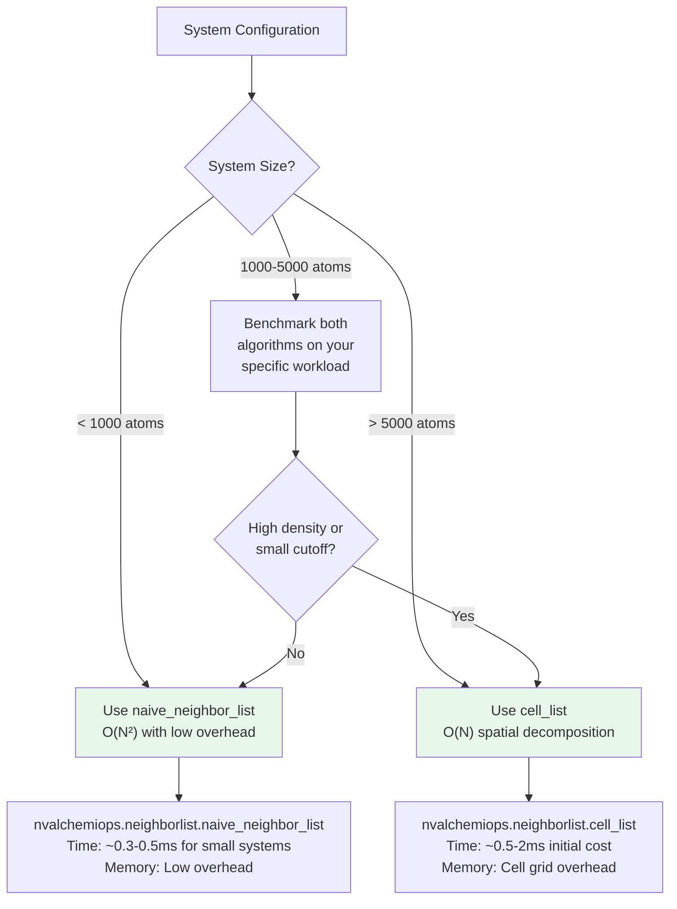
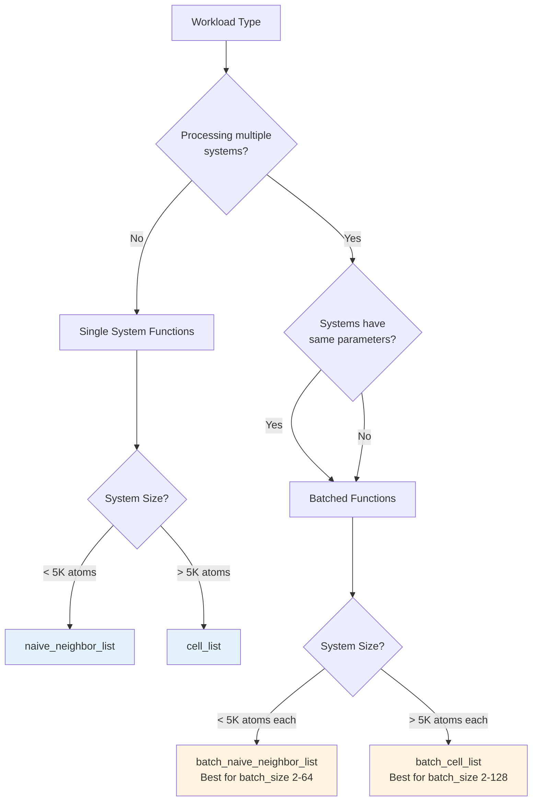
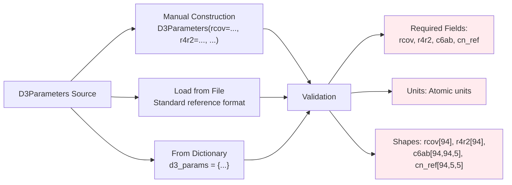
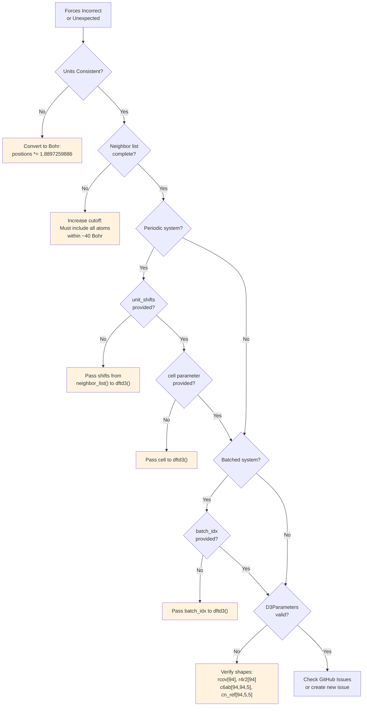
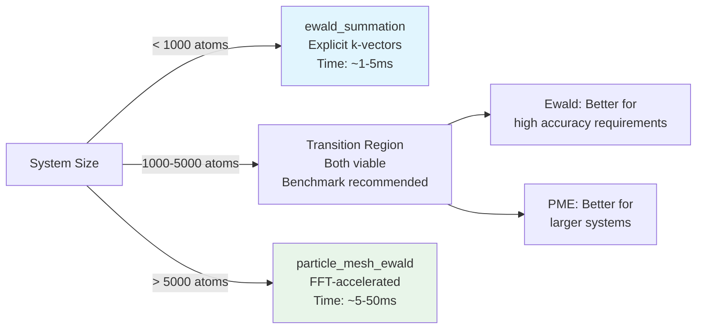
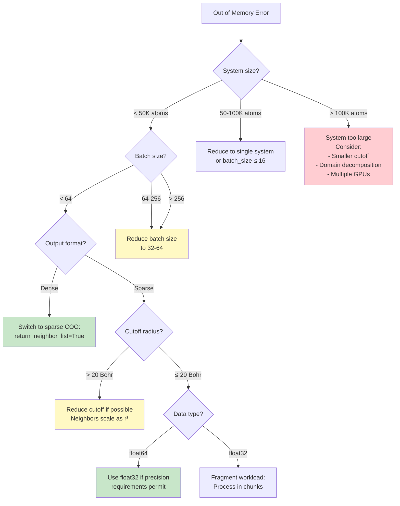
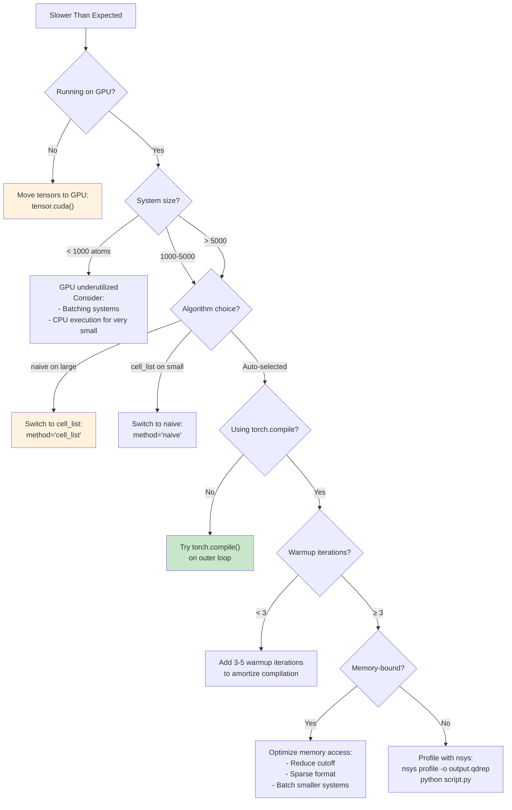
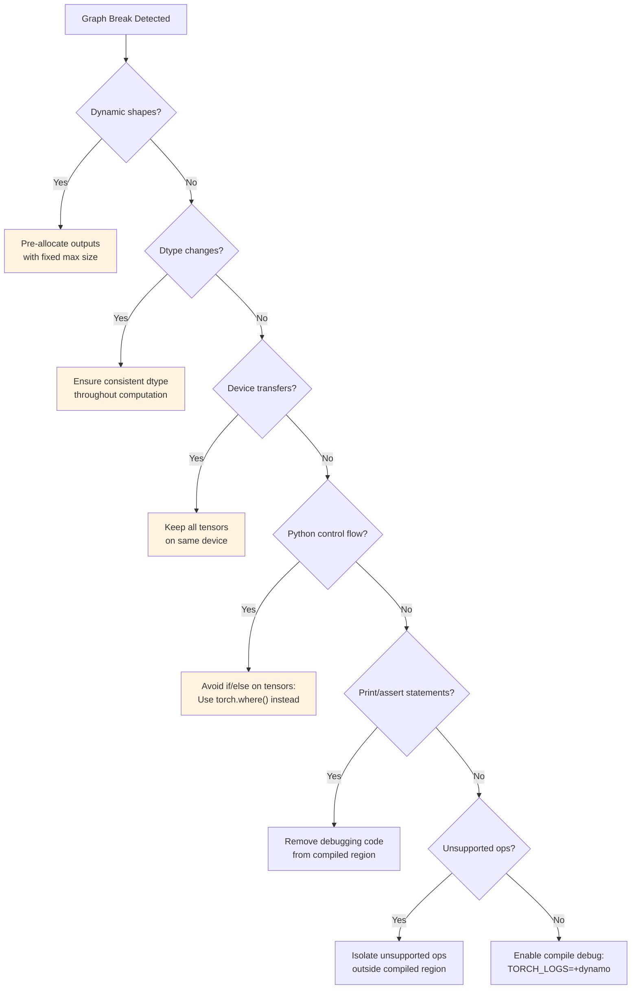

<!-- source: DeepWiki mcp.deepwiki.com · repo NVIDIA/nvalchemi-toolkit-ops · page 7 FAQ and Troubleshooting · fetched 2026-10-26 -->

# FAQ and Troubleshooting

<details>
<summary>Relevant source files</summary>

The following files were used as context for generating this wiki page:

- [docs/userguide/about/faq.md](docs/userguide/about/faq.md)
- [docs/userguide/about/intro.md](docs/userguide/about/intro.md)

</details>


This page provides answers to frequently asked questions and solutions to common problems when using NVIDIA ALCHEMI Toolkit-Ops. For installation instructions, see [Installation and Setup](#1.1). For API details, consult the [API Reference](#5). For performance guidance, refer to [Performance and Benchmarks](#4).

---

## General Questions

### What hardware is supported?

ALCHEMI Toolkit-Ops runs on:

| Platform | Requirements | Notes |
|----------|--------------|-------|
| NVIDIA GPUs | Compute Capability 8.0+ (A100, H100, etc.) | Recommended for production workloads |
| CPU (x86) | Any modern x86-64 processor | Via NVIDIA Warp CPU backend |
| CPU (ARM) | ARM64 including Apple Silicon | Via NVIDIA Warp CPU backend |

**Recommended configuration:**
- CUDA 12.0 or newer
- Driver version 570.xx or newer
- 16GB+ GPU memory for typical workloads

For best performance on H100-80GB, expect peak memory usage around 49GB for systems with ~50K atoms.

**Sources:** [docs/userguide/about/faq.md:15-23]()

### How do I get started?

1. Install the package following [Installation and Setup](#1.1)
2. Run the quick start example in [Quick Start Guide](#1.2)
3. Read the [Core Components](#2) documentation for your use case
4. Check the `examples/` directory for complete working scripts

If your question is not answered here, please submit a [GitHub Issue](https://github.com/NVIDIA/nvalchemi-toolkit-ops/issues/new/choose).

**Sources:** [docs/userguide/about/faq.md:7-13]()

### What if I need a feature that doesn't exist?

If you need functionality not currently available:

1. Check the [API Reference](#5) to ensure it truly doesn't exist
2. Review the [Core Components](#2) to see if existing primitives can be composed
3. Submit a GitHub Issue describing your use case and how it would benefit the community
4. For urgent needs, low-level Warp kernels are accessible for custom implementations

**Sources:** [docs/userguide/about/faq.md:25-28]()

---

## Neighbor Lists

### When should I use `cell_list` vs `naive` algorithms?

The decision depends on system size and computational complexity:



**Key differences:**

| Algorithm | Complexity | Best For | Overhead |
|-----------|------------|----------|----------|
| `naive_neighbor_list` | O(N²) | Small systems (<5K atoms) | Minimal |
| `cell_list` | O(N) | Large systems (>5K atoms) | Cell grid construction |

The crossover point depends on:
- System density (atoms/volume)
- Cutoff radius relative to box size
- Hardware characteristics
- Whether PBC is enabled

**Recommendation:** Use the automatic selection in `neighbor_list()` or benchmark both with your specific workload.

**Sources:** [docs/userguide/about/faq.md:32-43](), [docs/userguide/about/intro.md:70-143]()

### Should I use batched or single-system functions?

Use this decision tree:



**Batching benefits:**
- Amortizes kernel launch overhead
- Improves GPU utilization
- Enables heterogeneous system processing (different numbers of atoms, cells, parameters)

**When NOT to batch:**
- Single large system (>100K atoms) — may cause OOM
- Real-time MD where latency matters
- Systems requiring different cutoffs (not yet supported)

**Sources:** [docs/userguide/about/intro.md:108-143]()

### How does this compare to ASE neighbor lists?

| Feature | ASE | ALCHEMI Toolkit-Ops |
|---------|-----|---------------------|
| Execution | CPU-only | GPU-accelerated + CPU fallback |
| Batch processing | No | Native support |
| Output formats | Single format | Dense matrix + sparse COO |
| torch.compile | Not applicable | Compatible |
| Typical speedup | Baseline | 10-100x for large systems |

**Migration notes:**
- ALCHEMI returns PyTorch tensors instead of NumPy arrays
- Periodic boundary conditions specified via `cell` and `pbc` parameters
- Multiple output formats available via `return_neighbor_list` flag

**Sources:** [docs/userguide/about/faq.md:45-56]()

### What output format should I use?

The choice depends on your downstream task:

| Format | When to Use | Function Signature |
|--------|-------------|-------------------|
| Dense matrix | torch.compile workflows, fixed system sizes | `return_neighbor_list=False` (default) |
| Sparse COO | GNN training, variable system sizes, memory efficiency | `return_neighbor_list=True` |

**Example: Dense matrix for torch.compile**
```python
# Returns (neighbor_matrix, num_neighbors, shifts)
neighbor_matrix, num_neighbors, shifts = neighbor_list(
    positions, cutoff, cell=cell, pbc=pbc,
    return_neighbor_list=False
)
```

**Example: Sparse COO for GNNs**
```python
# Returns (edge_index, neighbor_ptr, shifts)
edge_index, neighbor_ptr, shifts = neighbor_list(
    positions, cutoff, cell=cell, pbc=pbc,
    return_neighbor_list=True
)
```

**Sources:** [docs/userguide/about/intro.md:58-154]()

---

## Dispersion Corrections

### How do I obtain D3Parameters?

The `D3Parameters` dataclass requires reference data for element pairs. Three options:



**Option 1: Load from standard reference file**
```python
from nvalchemiops.interactions.dispersion.dftd3 import D3Parameters

# Load from Grimme group reference file
d3_params = D3Parameters.from_file("dftd3_parameters.dat")
```

**Option 2: Construct manually**
```python
import torch
from nvalchemiops.interactions.dispersion.dftd3 import D3Parameters

d3_params = D3Parameters(
    rcov=torch.tensor([...]),   # Covalent radii [94]
    r4r2=torch.tensor([...]),   # r4/r2 expectation values [94]
    c6ab=torch.tensor([...]),   # C6 coefficients [94,94,5]
    cn_ref=torch.tensor([...])  # Reference coordination numbers [94,5,5]
)
```

**Option 3: Pass as dictionary**
```python
d3_params = {
    "rcov": rcov_tensor,
    "r4r2": r4r2_tensor,
    "c6ab": c6ab_tensor,
    "cn_ref": cn_ref_tensor
}

energy, forces, coord_num = dftd3(
    positions, numbers, neighbor_list=neighbors,
    a1=0.4289, a2=4.4407, s8=0.7875,
    d3_params=d3_params
)
```

**Sources:** [docs/userguide/about/intro.md:256-261]()

### What are the correct damping parameters for my functional?

Damping parameters (`a1`, `a2`, `s8`) are functional-specific. Common values:

| Functional | a1 | a2 | s8 | Reference |
|------------|----|----|-----|-----------|
| PBE | 0.4289 | 4.4407 | 0.7875 | Grimme et al. (2011) |
| B3LYP | 0.3981 | 4.4211 | 1.9889 | Grimme et al. (2011) |
| revPBE | 0.5238 | 3.5016 | 2.3550 | Grimme et al. (2011) |
| SCAN | 0.5380 | 5.3590 | 0.0000 | Brandenburg et al. (2019) |
| ωB97X-D3 | 0.0000 | 5.4959 | 0.2130 | Chai & Head-Gordon (2008) |

**Important:** Positions and parameters must use consistent units (atomic units recommended).

For additional functionals, consult the [Grimme group DFT-D3 documentation](https://www.chemie.uni-bonn.de/grimme/de/software/dft-d3/).

**Sources:** [docs/userguide/about/intro.md:170-174]()

### Why are my forces incorrect?

Common causes of incorrect forces in DFT-D3:



**Debugging checklist:**
1. Verify all inputs are in atomic units (Bohr for distances)
2. Confirm cutoff radius ≥ 40 Bohr to include all dispersion interactions
3. For periodic systems, pass `cell` and `unit_shifts` from neighbor list
4. For batched systems, provide `batch_idx` consistently
5. Validate D3Parameters shapes and dtypes match positions

**Sources:** [docs/userguide/about/intro.md:185-253]()

---

## Electrostatics

### When should I use Ewald vs PME?

Algorithm selection based on system size:

| Method | System Size | Scaling | When to Use |
|--------|-------------|---------|-------------|
| `ewald_summation` | < 5000 atoms | O(N²) | Small to medium systems |
| `particle_mesh_ewald` | > 5000 atoms | O(N log N) | Large systems |

**Performance characteristics:**



**Key difference:** PME uses FFT for reciprocal space calculations, providing asymptotic speedup for large systems at the cost of interpolation approximations.

**Sources:** [docs/userguide/about/intro.md:272-274]()

### How do I set accuracy parameters?

Both `ewald_summation` and `particle_mesh_ewald` accept an `accuracy` parameter:

**Automatic parameter estimation (recommended):**
```python
# Automatically estimate alpha, k_max for target accuracy
energies, forces = ewald_summation(
    positions, charges, cell,
    neighbor_list=neighbors,
    neighbor_shifts=shifts,
    accuracy=1e-6  # Target relative error
)
```

**Manual parameter specification:**
```python
# Override automatic estimation
energies, forces = ewald_summation(
    positions, charges, cell,
    neighbor_list=neighbors,
    neighbor_shifts=shifts,
    alpha=0.5,      # Ewald splitting parameter
    k_max=10        # Maximum reciprocal lattice vectors
)
```

**Accuracy guidelines:**

| Accuracy | Use Case | Typical α | Typical k_max |
|----------|----------|-----------|---------------|
| 1e-4 | Quick screening | ~0.3 | 5-8 |
| 1e-6 | Standard MD | ~0.5 | 8-12 |
| 1e-8 | High precision | ~0.7 | 12-16 |

**Sources:** [docs/userguide/about/intro.md:286-323]()

### Why are reciprocal space energies zero?

Common causes:

1. **System is not periodic:** Ewald/PME require periodic boundary conditions
2. **Cell not provided:** Must pass `cell` parameter
3. **Charges sum to zero:** Check that total charge is non-zero if expecting non-zero energy
4. **k_max too small:** Increase accuracy parameter or set k_max manually

**Diagnostic steps:**
```python
# Verify inputs
assert torch.all(pbc == True), "All PBC directions must be enabled"
assert cell is not None, "Cell parameter required"
assert torch.abs(charges.sum()) > 1e-10, "Check total charge"

# Check components separately
energy_real = coulomb_energy(positions, charges, neighbor_list=neighbors)
energy_recip, _ = ewald_summation(...)
print(f"Real space: {energy_real}, Reciprocal: {energy_recip}")
```

**Sources:** [docs/userguide/about/intro.md:280-327]()

---

## Performance and Memory Issues

### Out of Memory Errors

Memory issues typically manifest as:
- `torch.cuda.OutOfMemoryError`
- Benchmark results showing `time_ms = inf`
- Neighbor list returning `total_neighbors = 0`

**H100-80GB Memory Limits:**

| System Configuration | Peak Memory | Status |
|---------------------|-------------|---------|
| 10K atoms, batch=64 | ~5GB | ✓ Safe |
| 50K atoms, batch=32 | ~30GB | ✓ Safe |
| 100K atoms, batch=16 | ~49GB | ⚠ Near limit |
| 50K atoms, batch=256 | >80GB | ✗ OOM |
| 16M atoms, single | >80GB | ✗ OOM |

**Troubleshooting flowchart:**



**Mitigation strategies:**

1. **Reduce batch size:** Halve batch size iteratively until OOM resolves
2. **Use sparse output:** Sparse COO format uses ~50% less memory than dense
3. **Decrease cutoff:** Memory scales as O(N·cutoff³)
4. **Switch to float32:** Halves memory footprint with minimal accuracy loss
5. **Process in chunks:** Split batch into smaller sub-batches

**Sources:** Inferred from benchmark results and system architecture diagrams

### Slow Performance

If calculations are slower than expected:



**Performance checklist:**

1. ✓ Tensors on GPU: `positions.device == torch.device('cuda:0')`
2. ✓ Appropriate algorithm: cell_list for >5K atoms, naive for <5K
3. ✓ torch.compile enabled: For training loops and repeated calls
4. ✓ Warmup iterations: 3-5 iterations before timing
5. ✓ Efficient batching: Batch size 32-128 for optimal throughput
6. ✓ Sparse output: Use COO format for GNN workflows

**Sources:** Inferred from benchmark architecture and performance characteristics

### Memory Estimation

Estimate memory requirements before running:

**Neighbor list memory (dense format):**
```python
def estimate_neighbor_memory(n_atoms, max_neighbors, dtype=torch.float32):
    """Estimate memory for dense neighbor matrix."""
    bytes_per_element = 4 if dtype == torch.float32 else 8
    neighbor_matrix = n_atoms * max_neighbors * bytes_per_element
    num_neighbors = n_atoms * 4  # int32
    shifts = n_atoms * max_neighbors * 3 * bytes_per_element
    return (neighbor_matrix + num_neighbors + shifts) / 1e9  # GB
```

**Example:**
```python
# 50K atoms with ~100 neighbors each
memory_gb = estimate_neighbor_memory(50000, 100)
print(f"Estimated memory: {memory_gb:.2f} GB")
# Output: Estimated memory: 22.00 GB
```

**Neighbor list memory (sparse COO):**
```python
def estimate_coo_memory(n_atoms, avg_neighbors, dtype=torch.float32):
    """Estimate memory for sparse COO format."""
    bytes_per_element = 4 if dtype == torch.float32 else 8
    total_edges = n_atoms * avg_neighbors
    edge_index = total_edges * 2 * 8  # int64 for indices
    shifts = total_edges * 3 * bytes_per_element
    return (edge_index + shifts) / 1e9  # GB
```

**Memory reduction strategies:**

| Strategy | Memory Reduction | Accuracy Impact |
|----------|------------------|-----------------|
| Sparse COO format | ~50% | None |
| float32 vs float64 | 50% | Minimal (<1e-6) |
| Reduce cutoff by 20% | ~49% (scales as r³) | Depends on interaction range |
| Batch size reduction | Linear with batch size | None |

**Sources:** Inferred from system architecture

---

## torch.compile Troubleshooting

### Which kernels support torch.compile?

Kernels indicate torch.compile support in their docstrings. Current support:

| Component | Function | torch.compile Support |
|-----------|----------|----------------------|
| Neighbor Lists | `neighbor_list` | ✓ (with pre-allocation) |
| Neighbor Lists | `cell_list` | ✓ |
| Neighbor Lists | `naive_neighbor_list` | ✓ |
| DFT-D3 | `dftd3` | Partial (main computation) |
| Electrostatics | `ewald_summation` | Partial |

**Sources:** [docs/userguide/about/faq.md:60-66]()

### How do I pre-allocate for torch.compile?

torch.compile requires fixed tensor shapes to avoid graph breaks. Pre-allocate outputs:

**Example: Neighbor list with pre-allocation**
```python
import torch
from nvalchemiops.neighborlist import neighbor_list

@torch.compile
def compiled_neighbor_wrapper(positions, cutoff, cell, pbc, max_neighbors):
    # Pre-allocate outputs
    n_atoms = positions.shape[0]
    neighbor_matrix = torch.zeros(
        (n_atoms, max_neighbors), dtype=torch.int32, device=positions.device
    )
    num_neighbors = torch.zeros(n_atoms, dtype=torch.int32, device=positions.device)
    shifts = torch.zeros(
        (n_atoms, max_neighbors, 3), dtype=positions.dtype, device=positions.device
    )
    
    # Call with pre-allocated outputs
    neighbor_matrix, num_neighbors, shifts = neighbor_list(
        positions, cutoff, cell=cell, pbc=pbc,
        out_neighbor_matrix=neighbor_matrix,
        out_num_neighbors=num_neighbors,
        out_shifts=shifts
    )
    
    return neighbor_matrix, num_neighbors, shifts
```

**Key points:**
- All output tensors must have fixed shapes
- Use `max_neighbors` to bound the neighbor matrix size
- Device and dtype must match input tensors

**Sources:** [docs/userguide/about/faq.md:62-66]()

### Graph Breaks and Recompilations

Common causes of graph breaks:



**Debugging graph breaks:**

```bash
# Enable detailed logging
TORCH_LOGS=+dynamo python script.py

# Explain compilation
import torch._dynamo as dynamo
dynamo.explain(compiled_function)(inputs)

# Profile recompilations
with torch.profiler.profile() as prof:
    compiled_function(inputs)
print(prof.key_averages().table())
```

**Additional resources:**
- [PyTorch torch.compile troubleshooting guide](https://docs.pytorch.org/docs/stable/torch.compiler_troubleshooting.html)
- [PhysicsNeMo performance tuning guide](https://docs.nvidia.com/physicsnemo/latest/user-guide/performance_docs/torch_compile_support.html)

**Sources:** [docs/userguide/about/faq.md:68-74]()

---

## Common Error Messages

### `RuntimeError: neighbor_list() invalid argument`

**Cause:** Invalid input dimensions or incompatible parameters.

**Solutions:**

| Error Detail | Fix |
|--------------|-----|
| `positions` not 2D | Reshape to `(n_atoms, 3)` |
| `cell` wrong shape | Must be `(3, 3)` for single system or `(n_systems, 3, 3)` for batch |
| `pbc` not boolean | Convert to `torch.bool` tensor |
| `cutoff` negative | Use positive value |
| `batch_idx` missing | Provide when using batched cells |

**Example fix:**
```python
# Before (wrong)
positions = torch.randn(100, 3, 1)  # Wrong: 3D

# After (correct)
positions = torch.randn(100, 3)  # Correct: 2D
```

### `ValueError: DFT-D3 requires complete neighbor list`

**Cause:** Cutoff radius too small to include all dispersion interactions.

**Solution:** Increase cutoff to at least 40 Bohr (approximately 21 Å):

```python
# Insufficient cutoff
neighbors, _, shifts = neighbor_list(
    positions, cutoff=10.0,  # Too small for D3
    cell=cell, pbc=pbc, return_neighbor_list=True
)

# Correct cutoff
neighbors, _, shifts = neighbor_list(
    positions, cutoff=40.0,  # Sufficient for D3
    cell=cell, pbc=pbc, return_neighbor_list=True
)
```

### `AssertionError: D3Parameters shapes invalid`

**Cause:** D3Parameters arrays have incorrect shapes or dtypes.

**Expected shapes:**

```python
d3_params = D3Parameters(
    rcov=torch.tensor(...),    # Shape: (94,)
    r4r2=torch.tensor(...),    # Shape: (94,)
    c6ab=torch.tensor(...),    # Shape: (94, 94, 5)
    cn_ref=torch.tensor(...)   # Shape: (94, 5, 5)
)
```

**Validation:**
```python
assert d3_params.rcov.shape == (94,), f"rcov shape: {d3_params.rcov.shape}"
assert d3_params.r4r2.shape == (94,), f"r4r2 shape: {d3_params.r4r2.shape}"
assert d3_params.c6ab.shape == (94, 94, 5), f"c6ab shape: {d3_params.c6ab.shape}"
assert d3_params.cn_ref.shape == (94, 5, 5), f"cn_ref shape: {d3_params.cn_ref.shape}"
```

### `RuntimeError: CUDA out of memory`

See [Out of Memory Errors](#out-of-memory-errors) section above.

### `Warning: torch.compile graph break`

See [Graph Breaks and Recompilations](#graph-breaks-and-recompilations) section above.

---

## Best Practices

### Input Validation

Always validate inputs before computation:

```python
def validate_inputs(positions, cell, pbc, cutoff):
    """Validate inputs for neighbor list calculation."""
    assert positions.dim() == 2, "positions must be 2D (n_atoms, 3)"
    assert positions.shape[1] == 3, "positions must have 3 spatial dimensions"
    
    if cell is not None:
        if cell.dim() == 2:
            assert cell.shape == (3, 3), "cell must be (3, 3) for single system"
        elif cell.dim() == 3:
            assert cell.shape[1:] == (3, 3), "cell must be (n_systems, 3, 3) for batch"
    
    if pbc is not None:
        assert pbc.dtype == torch.bool, "pbc must be boolean tensor"
        assert pbc.shape == (3,), "pbc must specify 3 dimensions"
    
    assert cutoff > 0, "cutoff must be positive"
    assert positions.is_cuda or positions.device.type == 'cpu', "Invalid device"
```

### Unit Consistency

Maintain consistent units throughout:

| Quantity | Recommended Unit | Conversion Factor |
|----------|------------------|-------------------|
| Positions | Bohr (atomic units) | Å × 1.8897259886 |
| Cell vectors | Bohr | Å × 1.8897259886 |
| Cutoff radius | Bohr | Å × 1.8897259886 |
| Energies | Hartree | eV × 0.036749322 |
| Forces | Hartree/Bohr | eV/Å × 0.019446905 |

**Conversion utilities:**
```python
BOHR_TO_ANGSTROM = 0.529177210903
ANGSTROM_TO_BOHR = 1.8897259886

def angstrom_to_bohr(value):
    """Convert Angstrom to Bohr."""
    return value * ANGSTROM_TO_BOHR

def bohr_to_angstrom(value):
    """Convert Bohr to Angstrom."""
    return value * BOHR_TO_ANGSTROM
```

### Performance Optimization Checklist

Before deploying to production:

1. ✓ **Benchmark algorithm selection** on your specific workload
2. ✓ **Use torch.compile** for repeated calls in training loops
3. ✓ **Choose appropriate batch size** (32-128 typically optimal)
4. ✓ **Select correct output format** (dense for torch.compile, sparse for GNNs)
5. ✓ **Add warmup iterations** (3-5) before timing
6. ✓ **Profile with Nsight Systems** to identify bottlenecks
7. ✓ **Validate memory estimates** before large-scale runs
8. ✓ **Monitor GPU utilization** (target >80% for good performance)

### Error Handling Patterns

Robust error handling for production code:

```python
def robust_neighbor_list(positions, cutoff, cell=None, pbc=None, max_retries=3):
    """Compute neighbor list with automatic retry on OOM."""
    for attempt in range(max_retries):
        try:
            neighbors, num_neighbors, shifts = neighbor_list(
                positions, cutoff, cell=cell, pbc=pbc
            )
            return neighbors, num_neighbors, shifts
        except RuntimeError as e:
            if "out of memory" in str(e) and attempt < max_retries - 1:
                # Clear cache and reduce precision
                torch.cuda.empty_cache()
                positions = positions.float() if positions.dtype == torch.float64 else positions
                cutoff *= 0.9  # Reduce cutoff by 10%
                print(f"OOM error, retrying with cutoff={cutoff:.2f} (attempt {attempt+1})")
            else:
                raise
    
    raise RuntimeError(f"Failed after {max_retries} attempts")
```

---

## Getting Help

If you encounter an issue not covered here:

1. **Search existing issues:** Check [GitHub Issues](https://github.com/NVIDIA/nvalchemi-toolkit-ops/issues) for similar problems
2. **Check documentation:** Review the [API Reference](#5) and [User Guide](#2)
3. **Minimal reproducible example:** Create a small test case that demonstrates the issue
4. **System information:** Include CUDA version, GPU model, driver version, and package version
5. **Submit an issue:** Create a new issue with all relevant information

**Issue template:**
```markdown
## Description
Brief description of the problem

## Environment
- GPU: H100-80GB / A100-40GB / etc.
- CUDA version: 12.2
- Driver version: 570.xx
- Package version: 0.1.0
- Python version: 3.10

## Minimal reproducible example
```python
# Code that reproduces the issue
```

## Expected behavior
What you expected to happen

## Actual behavior
What actually happened (including error messages)
```

**Sources:** [docs/userguide/about/faq.md:7-13]()

---

## Additional Resources

- [Performance and Benchmarks](#4) - Detailed performance analysis
- [System Architecture](#3) - Internal architecture and backends
- [API Reference](#5) - Complete API documentation
- [GitHub Repository](https://github.com/NVIDIA/nvalchemi-toolkit-ops) - Source code and examples
- [NVIDIA Warp Documentation](https://nvidia.github.io/warp/) - GPU kernel programming framework
- [PyTorch torch.compile Guide](https://pytorch.org/docs/stable/torch.compiler.html) - Compilation and optimization

**Sources:** [docs/userguide/about/intro.md:1-388](), [docs/userguide/about/faq.md:1-77]()