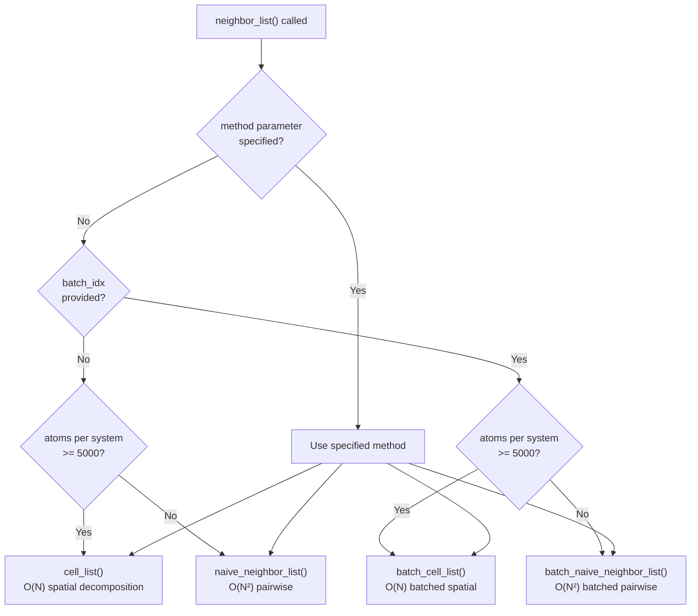
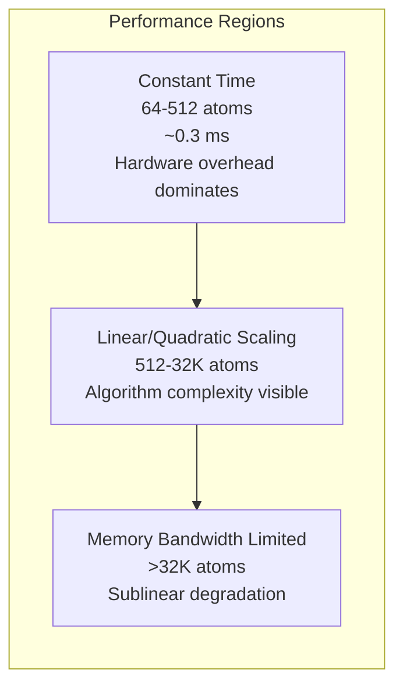
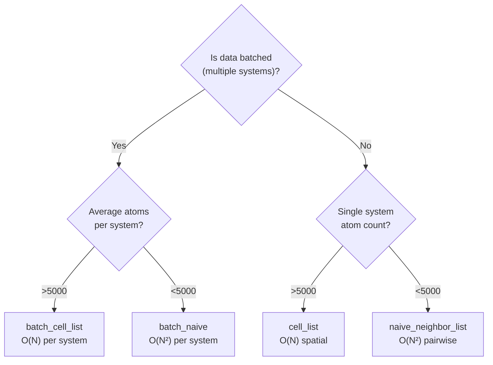
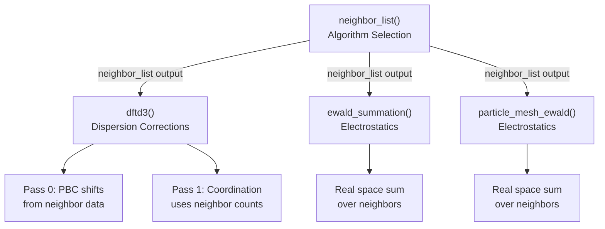

<!-- source: DeepWiki mcp.deepwiki.com · repo NVIDIA/nvalchemi-toolkit-ops · extra page Algorithm Selection · fetched 2026-10-26 -->

# Algorithm Selection

<details>
<summary>Relevant source files</summary>

The following files were used as context for generating this wiki page:

- [docs/benchmarks/benchmark_results/neighbor_list_benchmark_cell-list_h100-80gb-hbm3.csv](docs/benchmarks/benchmark_results/neighbor_list_benchmark_cell-list_h100-80gb-hbm3.csv)
- [docs/benchmarks/benchmark_results/neighbor_list_benchmark_naive_h100-80gb-hbm3.csv](docs/benchmarks/benchmark_results/neighbor_list_benchmark_naive_h100-80gb-hbm3.csv)
- [docs/userguide/about/faq.md](docs/userguide/about/faq.md)
- [docs/userguide/about/intro.md](docs/userguide/about/intro.md)

</details>


## Purpose and Scope

This page explains the algorithm selection strategy for neighbor list construction in the `nvalchemiops.neighborlist` module. It covers the four available algorithms, their computational complexity, performance characteristics, and guidelines for choosing between them based on system size and batching requirements.

For details on output formats (dense matrix vs sparse COO), see [Output Formats](#2.1.2). For complete API reference, see [Neighbor List API](#5.1). For performance benchmarks, see [Neighbor List Performance](#4.1).

## Algorithm Variants

The neighbor list system provides four distinct algorithm implementations:

| Algorithm | Function | Complexity | Best For |
|-----------|----------|------------|----------|
| `cell_list` | `cell_list()` | O(N) | Single systems >5000 atoms |
| `naive` | `naive_neighbor_list()` | O(N²) | Single systems <5000 atoms |
| `batch_cell_list` | `batch_cell_list()` | O(N) | Batched systems, large atoms/system |
| `batch_naive` | `batch_naive_neighbor_list()` | O(N²) | Batched systems, small atoms/system |

The unified `neighbor_list()` function [nvalchemiops/neighborlist/neighbor_list.py]() automatically dispatches to the appropriate implementation based on:
1. Presence of `batch_idx` parameter (batched vs single)
2. System size (atoms per system)
3. Optional explicit `method` parameter

**Sources:** docs/userguide/about/intro.md:57-144, docs/userguide/about/faq.md:32-43

## Dispatch Decision Tree

The `neighbor_list()` function follows this decision logic:



**Sources:** docs/userguide/about/intro.md:146-149

## Computational Complexity

### Cell List Algorithms

The `cell_list()` and `batch_cell_list()` implementations use spatial decomposition:

1. **Cell Construction**: Domain divided into cubic cells with side length ≥ cutoff radius
2. **Atom Assignment**: Each atom assigned to cell containing its position
3. **Neighbor Query**: Only atoms in same cell and 26 adjacent cells checked

This produces O(N) scaling when the cutoff radius is small relative to system size. The implementation uses [nvalchemiops/neighborlist/cell_list.py]() for single systems and [nvalchemiops/neighborlist/batch_cell_list.py]() for batched systems.

**Overhead Characteristics:**
- Cell grid allocation: ~0.1-0.2 ms
- Atom sorting and binning: ~0.1-0.3 ms
- Fixed startup cost dominates for small systems

### Naive Algorithms

The `naive_neighbor_list()` and `batch_naive_neighbor_list()` implementations compute all pairwise distances:

1. **Distance Calculation**: All N×(N-1)/2 pairwise distances computed
2. **Cutoff Filtering**: Pairs within cutoff retained
3. **PBC Handling**: Minimum image convention applied for periodic boundaries

This produces O(N²) scaling but has minimal overhead. The implementation uses [nvalchemiops/neighborlist/naive_neighbor_list.py]() for single systems and [nvalchemiops/neighborlist/batch_naive_neighbor_list.py]() for batched systems.

**Overhead Characteristics:**
- Direct kernel launch: ~0.05-0.1 ms
- No auxiliary data structures
- Lower fixed cost but steeper scaling

**Sources:** docs/userguide/about/faq.md:34-40

## Performance Characteristics from Benchmarks

### Single System Performance

Benchmark data from H100-80GB-HBM3 demonstrates the crossover behavior:

| Atoms | cell_list (ms) | naive (ms) | Winner |
|-------|----------------|------------|--------|
| 64 | 0.299 | 0.133 | naive (2.2×) |
| 128 | 0.278 | 0.139 | naive (2.0×) |
| 512 | 0.347 | 0.188 | naive (1.8×) |
| 1024 | 0.336 | 0.267 | naive (1.3×) |
| 2048 | 0.345 | 0.394 | cell_list (1.1×) |
| 4096 | 0.378 | 0.605 | cell_list (1.6×) |
| 8192 | 0.371 | 1.146 | cell_list (3.1×) |
| 16384 | 0.704 | 4.530 | cell_list (6.4×) |
| 32768 | 0.878 | - | cell_list (only option) |

The crossover occurs between 1024-2048 atoms in this configuration. The 5000 atom heuristic provides a conservative threshold that works across diverse system densities and cutoff radii.

**Sources:** docs/benchmarks/benchmark_results/neighbor_list_benchmark_cell-list_h100-80gb-hbm3.csv, docs/benchmarks/benchmark_results/neighbor_list_benchmark_naive_h100-80gb-hbm3.csv

### Scaling Regions

Both algorithms exhibit three distinct performance regions:



**Cell List Scaling:**
- 64-512 atoms: ~0.30 ms (constant)
- 512-32K atoms: Linear growth to ~0.88 ms
- 32K-524K atoms: Sublinear to ~18.4 ms

**Naive Scaling:**
- 64-1024 atoms: ~0.13-0.27 ms (near-constant)
- 1024-16K atoms: Quadratic growth to ~4.5 ms
- Beyond 16K atoms: Not benchmarked (expected poor performance)

**Sources:** docs/benchmarks/benchmark_results/neighbor_list_benchmark_cell-list_h100-80gb-hbm3.csv:2-15, docs/benchmarks/benchmark_results/neighbor_list_benchmark_naive_h100-80gb-hbm3.csv:2-19

## Batch vs Single System Selection

### When to Use Batched Algorithms

Batched algorithms (`batch_cell_list`, `batch_naive`) are required when:

1. **Multiple Independent Systems**: Processing datasets with heterogeneous system sizes
2. **Different Parameters**: Each system has unique cell parameters or PBC flags
3. **Batch Index Provided**: The `batch_idx` tensor assigns atoms to systems

The batched implementations accept:
- `batch_idx`: Tensor of shape `(total_atoms,)` with system indices
- `cell`: Either single `(3, 3)` tensor or batched `(num_systems, 3, 3)` tensor
- `pbc`: Either single `(3,)` tensor or batched `(num_systems, 3)` tensor

### Implementation Differences

**Single System Functions:**
```python
# cell_list() signature
neighbor_matrix, num_neighbors, shifts = cell_list(
    positions,      # (N, 3)
    cutoff,         # float
    cell=None,      # (3, 3) or None
    pbc=None        # (3,) or None
)
```

**Batched Functions:**
```python
# batch_cell_list() signature
neighbor_matrix, num_neighbors, shifts = batch_cell_list(
    positions,      # (total_atoms, 3)
    cutoff,         # float
    batch_idx,      # (total_atoms,) - required
    cell=None,      # (num_systems, 3, 3) or (3, 3)
    pbc=None        # (num_systems, 3) or (3,)
)
```

The batched versions handle per-system cell list construction and merge results into a single output tensor.

**Sources:** docs/userguide/about/intro.md:72-144

## Memory Usage Considerations

### Cell List Memory Overhead

The `cell_list` algorithms allocate:
1. **Cell Grid**: 3D array of cell indices
2. **Atom-to-Cell Mapping**: Sorted atom indices
3. **Cell Offset Arrays**: For efficient neighbor iteration

From benchmark data:

| Atoms | Memory (MB) | Per-Atom (KB) |
|-------|-------------|---------------|
| 64 | 0.26 | 4.0 |
| 1024 | 4.05 | 4.0 |
| 16384 | 64.69 | 4.0 |
| 131072 | 517.50 | 4.0 |
| 524288 | 2070.01 | 4.0 |

The per-atom memory usage is constant at ~4 KB/atom, indicating efficient data structure scaling.

### Naive Memory Overhead

The `naive` algorithms have minimal overhead:

| Atoms | Memory (MB) | Per-Atom (KB) |
|-------|-------------|---------------|
| 64 | 0.25 | 4.0 |
| 1024 | 4.02 | 4.0 |
| 16384 | 64.25 | 4.0 |

Memory usage is primarily for output neighbor matrix storage, with negligible algorithmic overhead.

**Sources:** docs/benchmarks/benchmark_results/neighbor_list_benchmark_cell-list_h100-80gb-hbm3.csv, docs/benchmarks/benchmark_results/neighbor_list_benchmark_naive_h100-80gb-hbm3.csv

## Automatic vs Manual Selection

### Using Automatic Selection

The recommended approach is to rely on automatic dispatch:

```python
from nvalchemiops.neighborlist import neighbor_list

# Single system - automatic selection based on size
neighbors, num_neighbors, shifts = neighbor_list(
    positions, cutoff=5.0, cell=cell, pbc=pbc
)

# Batched systems - automatic selection based on size
neighbors, num_neighbors, shifts = neighbor_list(
    positions, cutoff=5.0, cell=cells, pbc=pbc,
    batch_idx=batch_idx
)
```

The function inspects `positions.shape[0]` and `batch_idx` to determine system size and dispatches accordingly.

### Manual Method Override

For workload-specific optimization, explicitly specify the method:

```python
# Force cell list for medium system (may be suboptimal)
neighbors, num_neighbors, shifts = neighbor_list(
    positions, cutoff=5.0, cell=cell, pbc=pbc,
    method="cell_list"
)

# Force naive for exploratory analysis
neighbors, num_neighbors, shifts = neighbor_list(
    positions, cutoff=5.0, cell=cell, pbc=pbc,
    method="naive"
)
```

Valid method values: `"cell_list"`, `"naive"`, `"batch_cell_list"`, `"batch_naive"`

**Sources:** docs/userguide/about/intro.md:146-149

## Decision Guidelines

### Quick Reference



### Detailed Selection Matrix

| Use Case | System Type | Atoms/System | Recommended | Alternative |
|----------|-------------|--------------|-------------|-------------|
| Molecular dynamics | Single | 10K-100K | `cell_list` | - |
| Small molecule | Single | 10-100 | `naive` | - |
| Protein simulation | Single | 1K-10K | `cell_list` | `naive` (benchmark) |
| GNN training | Batch | 100-1K | `batch_naive` | `batch_cell_list` |
| High-throughput screen | Batch | 1K-10K | `batch_cell_list` | - |
| Conformer generation | Batch | <500 | `batch_naive` | - |

### When to Benchmark Both

Consider benchmarking both algorithms when:

1. **Near Crossover**: System size 2K-8K atoms
2. **Sparse Systems**: Low density or large cutoff radius
3. **Unusual Cutoffs**: Very small (<3Å) or very large (>10Å) cutoff values
4. **Custom Hardware**: Non-H100 GPUs may have different crossover points
5. **Performance Critical**: Application requires minimum possible latency

The FAQ recommends: "We recommend benchmarking both on your specific workload" for production applications.

**Sources:** docs/userguide/about/faq.md:42-43, docs/userguide/about/intro.md:64-68

## Algorithm Selection in Downstream Components

The neighbor list algorithm selection impacts downstream calculations:



Both DFT-D3 [nvalchemiops/interactions/dispersion/dftd3.py]() and electrostatics functions [nvalchemiops/interactions/electrostatics/]() accept neighbor list output directly. The algorithm choice affects:

- **Neighbor ordering**: Cell list produces spatially-coherent neighbors
- **Memory layout**: Impacts cache efficiency in downstream kernels
- **Rebuild detection**: Cell list structures enable efficient rebuild checks

For molecular dynamics workflows using `cell_list_needs_rebuild()`, the cell list algorithm is required for rebuild detection functionality.

**Sources:** docs/userguide/about/intro.md:163-261

---

