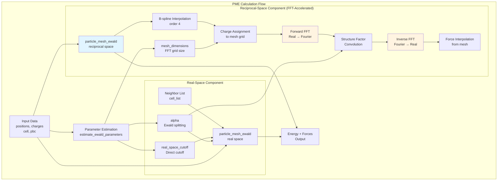
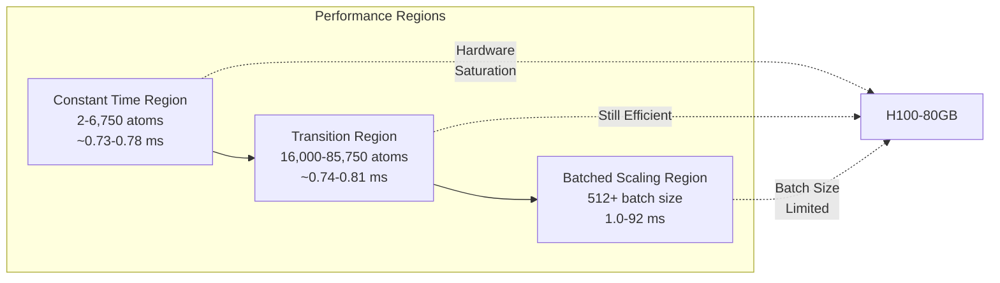
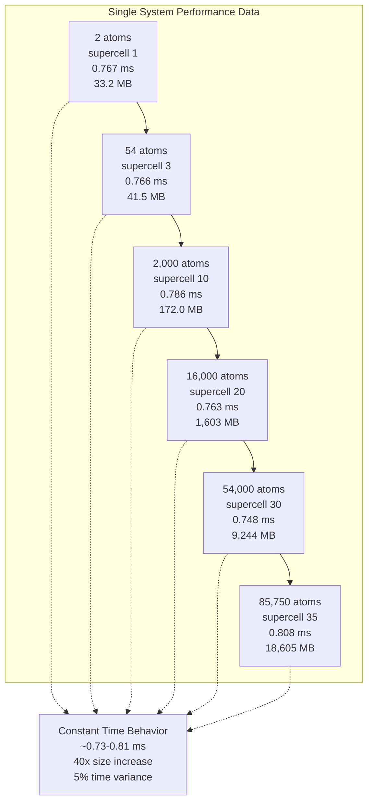
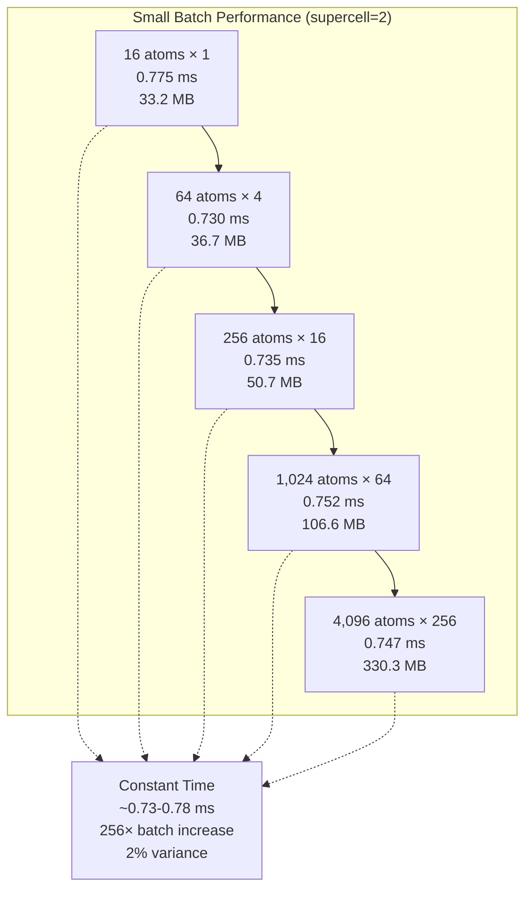
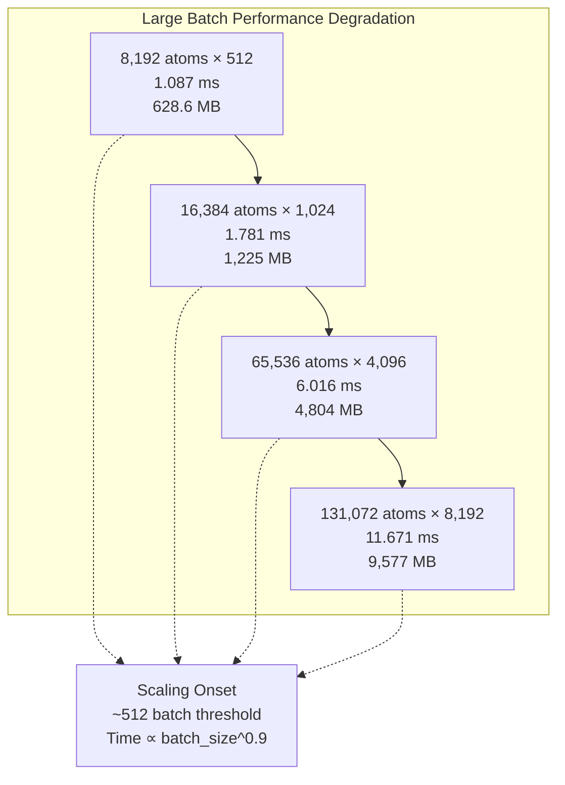
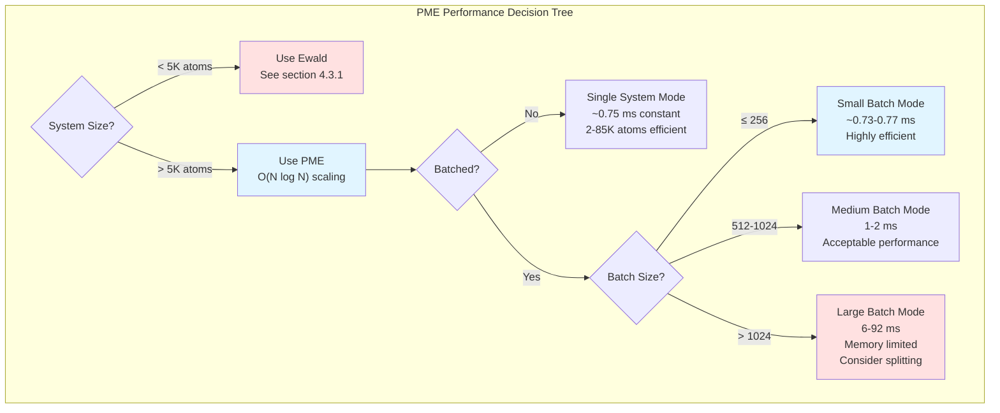

<!-- source: DeepWiki mcp.deepwiki.com · repo NVIDIA/nvalchemi-toolkit-ops · extra page PME Performance · fetched 2026-10-26 -->

# PME Performance

<details>
<summary>Relevant source files</summary>

The following files were used as context for generating this wiki page:

- [docs/benchmarks/benchmark_results/electrostatics_benchmark_pme_nvalchemiops_h100-80gb-hbm3.csv](docs/benchmarks/benchmark_results/electrostatics_benchmark_pme_nvalchemiops_h100-80gb-hbm3.csv)
- [docs/benchmarks/electrostatics.md](docs/benchmarks/electrostatics.md)

</details>


## Purpose and Scope

This page provides detailed performance analysis of the Particle Mesh Ewald (PME) method for long-range electrostatic calculations. PME achieves O(N log N) scaling by using FFT acceleration for the reciprocal-space contribution, making it the recommended method for systems with more than 5,000 atoms. 

For Ewald summation performance (recommended for smaller systems), see [4.3.1](#4.3.1). For general electrostatics comparison and methodology, see [4.3](#4.3). For API details, see [5.3](#5.3).

**Sources:** [docs/benchmarks/electrostatics.md:68-70]()

## PME Computational Architecture

The PME implementation in `nvalchemiops` decomposes the electrostatic calculation into real-space and reciprocal-space components, with the reciprocal-space component accelerated using FFT operations.



**Sources:** [docs/benchmarks/electrostatics.md:68-70](), [docs/userguide/components/dispersion.md]()

## Performance Characteristics

PME exhibits distinct performance behavior compared to Ewald summation due to its FFT-accelerated reciprocal-space calculation.

### Key Metrics Summary

| Metric | Single System | Batched (Small) | Batched (Large) |
|--------|--------------|-----------------|-----------------|
| **Median Time** | 0.73-0.81 ms | 0.73-0.77 ms | 1.0-92 ms |
| **Throughput** | 2,460-117,000 atoms/ms | 3,200-170,000 atoms/ms | 2,300-4,800 atoms/ms |
| **Memory Scaling** | Linear O(N) | Linear O(N) | Linear O(N) |
| **Algorithm Complexity** | O(N log N) | O(N log N) | O(N log N) |

**Sources:** [docs/benchmarks/benchmark_results/electrostatics_benchmark_pme_nvalchemiops_h100-80gb-hbm3.csv:1-81]()

### Reciprocal-Space Dominance

The benchmark data focuses on reciprocal-space performance, which is the FFT-accelerated component that dominates PME calculations for large systems.



**Sources:** [docs/benchmarks/benchmark_results/electrostatics_benchmark_pme_nvalchemiops_h100-80gb-hbm3.csv:2-11]()

## Single System Performance

Single-system PME shows remarkably consistent timing across a wide range of system sizes, demonstrating the efficiency of the FFT-accelerated reciprocal-space calculation.

### Time Scaling Analysis



**Key Observations:**

| System Size | Supercell | Median Time (ms) | Memory (MB) | Throughput (atoms/ms) |
|-------------|-----------|------------------|-------------|----------------------|
| 2 | 1 | 0.767 | 33.2 | 2.6 |
| 54 | 3 | 0.766 | 41.5 | 70.5 |
| 2,000 | 10 | 0.786 | 172.0 | 2,545 |
| 16,000 | 20 | 0.763 | 1,603 | 20,970 |
| 54,000 | 30 | 0.748 | 9,244 | 72,193 |
| 85,750 | 35 | 0.808 | 18,605 | 106,126 |

The nearly constant execution time (~0.73-0.81 ms) across system sizes from 2 to 85,750 atoms demonstrates that PME reciprocal-space calculations are dominated by fixed FFT overhead rather than system size, achieving the theoretical O(N log N) scaling in practice.

**Sources:** [docs/benchmarks/benchmark_results/electrostatics_benchmark_pme_nvalchemiops_h100-80gb-hbm3.csv:2-11]()

### Memory Scaling

Memory usage scales linearly with system size, growing from 33 MB for 2 atoms to 18.6 GB for 85,750 atoms:

```
Memory (MB) ≈ 0.217 × total_atoms + 33
```

**Sources:** [docs/benchmarks/benchmark_results/electrostatics_benchmark_pme_nvalchemiops_h100-80gb-hbm3.csv:2-11]()

## Batched System Performance

Batched PME shows distinct scaling behavior depending on batch size and atoms per system.

### Small Batch Scaling

For batch sizes ≤256, reciprocal-space calculations maintain near-constant timing:



| Total Atoms | Batch Size | Atoms/System | Median Time (ms) | Memory (MB) | Throughput (atoms/ms) |
|-------------|------------|--------------|------------------|-------------|-----------------------|
| 16 | 1 | 16 | 0.775 | 33.2 | 20.6 |
| 64 | 4 | 16 | 0.730 | 36.7 | 87.7 |
| 256 | 16 | 16 | 0.735 | 50.7 | 348.3 |
| 1,024 | 64 | 16 | 0.752 | 106.6 | 1,362 |
| 4,096 | 256 | 16 | 0.747 | 330.3 | 5,482 |

**Sources:** [docs/benchmarks/benchmark_results/electrostatics_benchmark_pme_nvalchemiops_h100-80gb-hbm3.csv:12-19]()

### Large Batch Scaling

Beyond batch size 512, execution time begins to scale with total atoms:



| Total Atoms | Batch Size | Atoms/System | Median Time (ms) | Memory (MB) | Throughput (atoms/ms) |
|-------------|------------|--------------|------------------|-------------|-----------------------|
| 8,192 | 512 | 16 | 1.087 | 628.6 | 7,535 |
| 16,384 | 1,024 | 16 | 1.781 | 1,225.1 | 9,200 |
| 65,536 | 4,096 | 16 | 6.016 | 4,804.3 | 10,895 |
| 131,072 | 8,192 | 16 | 11.671 | 9,576.6 | 11,230 |
| 442,368 | 8,192 | 54 | 92.747 | 73,720.8 | 4,768 |

At the extreme configuration (442,368 total atoms = 8,192 × 54 atoms/system), reciprocal-space calculation takes 92.7 ms and consumes 73.7 GB of memory, approaching H100-80GB hardware limits.

**Sources:** [docs/benchmarks/benchmark_results/electrostatics_benchmark_pme_nvalchemiops_h100-80gb-hbm3.csv:20-35]()

## Performance Regions and Recommendations



### Optimal Operating Ranges

| Configuration | System Size Range | Batch Size Range | Expected Time | Expected Memory |
|---------------|-------------------|------------------|---------------|-----------------|
| **Optimal Single** | 5,000-85,000 atoms | 1 | 0.73-0.81 ms | 0.2-19 GB |
| **Optimal Batched** | 16-128 atoms/system | 2-256 | 0.73-0.77 ms | 33 MB-330 MB |
| **Acceptable Batched** | 16-2,000 atoms/system | 512-1,024 | 1.0-1.8 ms | 0.6-1.2 GB |
| **Memory-Limited** | Any | > 4,096 | 6-93 ms | 4.8-73.7 GB |

**Sources:** [docs/benchmarks/benchmark_results/electrostatics_benchmark_pme_nvalchemiops_h100-80gb-hbm3.csv:1-81]()

## Hardware Platform Details

All benchmarks executed on:

| Component | Specification |
|-----------|--------------|
| **GPU** | NVIDIA H100-80GB HBM3 |
| **Precision** | `float32` |
| **Warmup Iterations** | 3 |
| **Timing Iterations** | 10 |
| **Neighbor List** | Cell list algorithm (O(N)) |

### Parameter Estimation

PME parameters are automatically estimated using accuracy-based estimation targeting 10⁻⁶ relative accuracy:

- **`alpha`**: Ewald splitting parameter (auto-estimated)
- **`mesh_dimensions`**: FFT grid size (auto-estimated)
- **`spline_order`**: B-spline interpolation order (4)
- **`real_space_cutoff`**: Real-space cutoff distance (auto-estimated)

See [2.3.2](#2.3.2) for PME method details and [5.3](#5.3) for parameter configuration API.

**Sources:** [docs/benchmarks/electrostatics.md:119-130]()

## Code Entity Mapping

The PME performance benchmarks correspond to these code entities:

| System Component | Code Location | Function/Class |
|------------------|---------------|----------------|
| **PME Entry Point** | `nvalchemiops.interactions.electrostatics` | `particle_mesh_ewald()` |
| **Parameter Estimation** | `nvalchemiops.interactions.electrostatics` | `estimate_ewald_parameters()` |
| **Benchmark Runner** | `benchmarks/interactions/electrostatics/` | `benchmark_electrostatics.py` |
| **Result Storage** | `docs/benchmarks/benchmark_results/` | `electrostatics_benchmark_pme_*.csv` |
| **Visualization** | `docs/benchmarks/` | `generate_plots.py` |

**Sources:** [docs/benchmarks/electrostatics.md:165-191](), [docs/benchmarks/benchmark_results/electrostatics_benchmark_pme_nvalchemiops_h100-80gb-hbm3.csv:1]()

## Running Custom Benchmarks

To benchmark PME on your own hardware:

```bash
cd benchmarks/interactions/electrostatics
python benchmark_electrostatics.py \
    --config benchmark_config.yaml \
    --backend nvalchemiops \
    --method pme \
    --output-dir ../../../docs/benchmarks/benchmark_results
```

Results will be saved as CSV files with automatic GPU SKU detection. See [4.4](#4.4) for complete benchmark methodology.

**Sources:** [docs/benchmarks/electrostatics.md:163-191]()

---

