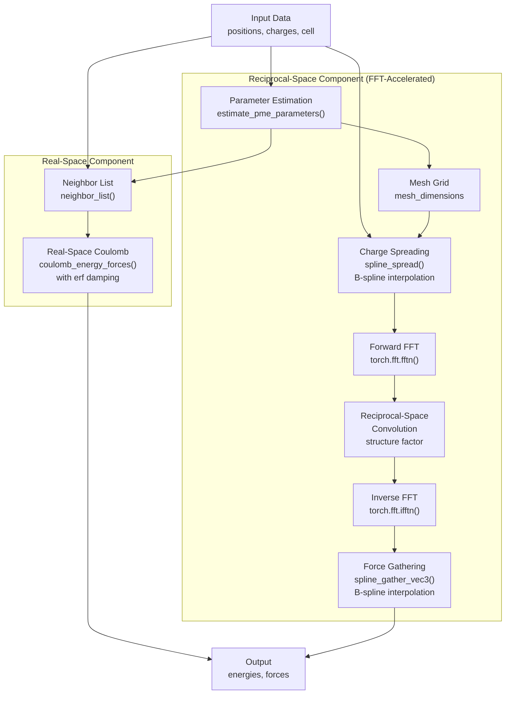
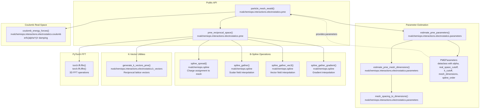
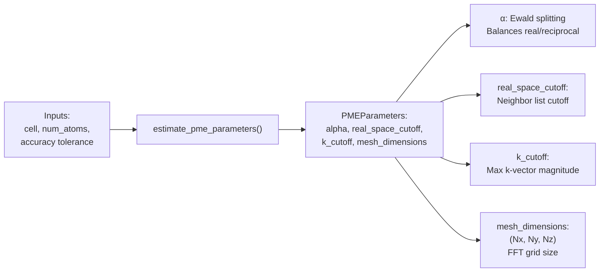
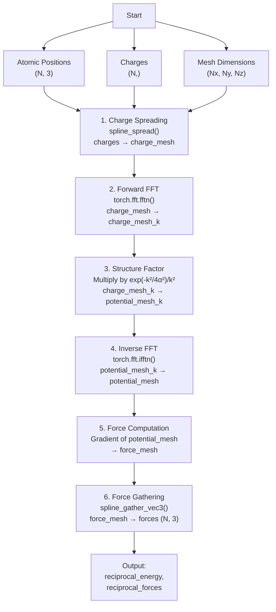
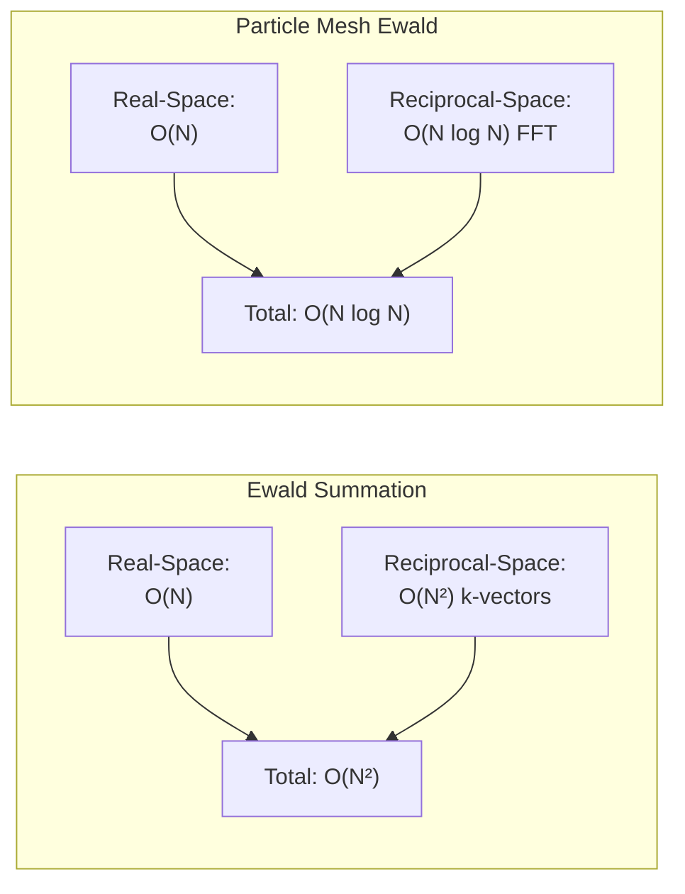

<!-- source: DeepWiki mcp.deepwiki.com · repo NVIDIA/nvalchemi-toolkit-ops · extra page Particle Mesh Ewald (PME) · fetched 2026-10-26 -->

# Particle Mesh Ewald (PME)

<details>
<summary>Relevant source files</summary>

The following files were used as context for generating this wiki page:

- [docs/benchmarks/electrostatics.md](docs/benchmarks/electrostatics.md)
- [docs/modules/electrostatics.rst](docs/modules/electrostatics.rst)
- [docs/userguide/about/intro.md](docs/userguide/about/intro.md)

</details>


## Purpose and Scope

This page documents the Particle Mesh Ewald (PME) method for computing long-range electrostatic interactions in periodic systems with **O(N log N)** complexity. PME achieves this scaling through FFT-accelerated reciprocal-space calculations, making it the recommended choice for systems with **>5000 atoms**.

For smaller systems (<5000 atoms), see [Ewald Summation](#2.3.1). For general electrostatics concepts and method selection, see [Electrostatics](#2.3). For complete API documentation, see [Electrostatics API](#5.3).

**Sources:** docs/userguide/about/intro.md:264-326, docs/benchmarks/electrostatics.md:67-103

---

## Algorithm Overview

PME splits the slowly-converging Coulomb potential into two rapidly-converging components:

1. **Real-space component**: Short-range screened interactions computed via neighbor lists (same as standard Ewald)
2. **Reciprocal-space component**: Long-range interactions computed via FFT on a regular mesh grid

The key innovation is replacing explicit k-vector summation with FFT-based convolution on a mesh, reducing reciprocal-space complexity from **O(N²)** to **O(N log N)**.

### PME Calculation Flow



**Sources:** docs/modules/electrostatics.rst:30-38, docs/userguide/about/intro.md:305-326

---

## Key Concepts

### Mesh Grid and FFT

PME discretizes the simulation cell onto a regular 3D mesh grid with dimensions `(Nx, Ny, Nz)`. Atomic charges are spread onto mesh points using B-spline interpolation, enabling FFT-based convolution in reciprocal space.

| Parameter | Description | Typical Value |
|-----------|-------------|---------------|
| `mesh_dimensions` | Grid size for FFT | Auto-estimated based on accuracy |
| `spline_order` | B-spline interpolation order | 4 (cubic B-splines) |
| `mesh_spacing` | Target mesh spacing (Å) | ~1.0-1.2 Å for accuracy=1e-6 |

### B-Spline Interpolation

PME uses B-splines for smooth charge distribution and force interpolation:

- **Order 4** (cubic B-splines) provides optimal balance between accuracy and computational cost
- **Spreading**: Distributes point charges onto nearby mesh points
- **Gathering**: Interpolates forces/fields from mesh back to atomic positions

### Ewald Splitting Parameter (α)

The parameter α controls the split between real and reciprocal space:

- **Larger α**: More weight on reciprocal space, smaller real-space cutoff
- **Smaller α**: More weight on real space, smaller FFT mesh
- **Optimal α**: Minimizes total computational cost while achieving target accuracy

**Sources:** docs/modules/electrostatics.rst:33-34, docs/benchmarks/electrostatics.md:119-131

---

## Core Functions

### particle_mesh_ewald()

The main entry point for PME calculations, combining real-space and reciprocal-space contributions.

**Location:** `nvalchemiops.interactions.electrostatics.pme.particle_mesh_ewald`

**Key Features:**
- Automatic parameter estimation based on `accuracy` tolerance
- Single-system and batched computation support
- Optional force calculation
- Returns per-atom energies and forces

**Typical Usage:**

```python
from nvalchemiops.interactions.electrostatics import particle_mesh_ewald
from nvalchemiops.neighborlist import neighbor_list

# Build neighbor list for real-space component
neighbors, _, shifts = neighbor_list(
    positions, cutoff=10.0, cell=cell, pbc=pbc, return_neighbor_list=True
)

# Compute PME electrostatics
energies, forces = particle_mesh_ewald(
    positions, charges, cell,
    neighbor_list=neighbors,
    neighbor_shifts=shifts,
    accuracy=1e-6,  # Target relative accuracy
    spline_order=4  # Cubic B-splines
)
```

**Sources:** docs/modules/electrostatics.rst:30-37, docs/userguide/about/intro.md:305-326

### pme_reciprocal_space()

Computes only the reciprocal-space contribution using FFT. Useful for custom workflows or testing.

**Location:** `nvalchemiops.interactions.electrostatics.pme.pme_reciprocal_space`

**Sources:** docs/modules/electrostatics.rst:37

---

## PME Architecture and Data Flow

This diagram shows how PME components map to code entities:



**Sources:** docs/modules/electrostatics.rst:30-92

---

## Parameter Estimation

### Automatic Parameter Selection

PME parameters are automatically estimated to achieve target accuracy:



### PMEParameters Dataclass

**Location:** `nvalchemiops.interactions.electrostatics.parameters.PMEParameters`

| Field | Type | Description |
|-------|------|-------------|
| `alpha` | `float` | Ewald splitting parameter (inverse length) |
| `real_space_cutoff` | `float` | Cutoff for real-space neighbor list |
| `k_cutoff` | `float` | Maximum k-vector magnitude for reciprocal space |
| `mesh_dimensions` | `Tuple[int, int, int]` | FFT mesh grid size (Nx, Ny, Nz) |
| `spline_order` | `int` | B-spline interpolation order (default: 4) |

### Mesh Dimension Estimation

Mesh size is estimated to achieve target accuracy:

```python
from nvalchemiops.interactions.electrostatics.parameters import (
    estimate_pme_mesh_dimensions,
    mesh_spacing_to_dimensions
)

# Estimate mesh dimensions for target accuracy
mesh_dims = estimate_pme_mesh_dimensions(
    cell, alpha, accuracy=1e-6, spline_order=4
)

# Or specify target mesh spacing
mesh_dims = mesh_spacing_to_dimensions(cell, mesh_spacing=1.0)
```

**Sources:** docs/modules/electrostatics.rst:63-71, docs/benchmarks/electrostatics.md:119-131

---

## B-Spline Operations

PME uses B-spline interpolation for smooth charge distribution and force gathering:

### Charge Spreading

**Function:** `spline_spread()`  
**Location:** `nvalchemiops.spline.spline_spread`

Distributes point charges onto the mesh grid:

```
Input: positions (N, 3), charges (N,), mesh_dimensions
Output: charge_mesh (Nx, Ny, Nz)
```

Each charge is spread over `spline_order^3` neighboring mesh points with smooth weights.

### Force Gathering

**Function:** `spline_gather_vec3()`  
**Location:** `nvalchemiops.spline.spline_gather_vec3`

Interpolates forces from the mesh back to atomic positions:

```
Input: positions (N, 3), force_mesh (Nx, Ny, Nz, 3)
Output: forces (N, 3)
```

Gathers contributions from `spline_order^3` neighboring mesh points.

### Additional Spline Functions

| Function | Purpose |
|----------|---------|
| `spline_gather()` | Interpolate scalar fields |
| `spline_gather_gradient()` | Interpolate field gradients |

**Sources:** docs/modules/electrostatics.rst:84-92

---

## Reciprocal-Space Calculation Workflow



**Sources:** docs/modules/electrostatics.rst:30-38

---

## Batched PME Computation

PME supports batched calculations for multiple systems:

```python
from nvalchemiops.interactions.electrostatics import particle_mesh_ewald
from nvalchemiops.neighborlist import neighbor_list

# Batched neighbor list
neighbors, _, shifts = neighbor_list(
    positions, cutoff=10.0, cell=cells, pbc=pbc,
    batch_idx=batch_idx, return_neighbor_list=True
)

# Batched PME
energies, forces = particle_mesh_ewald(
    positions, charges, cell=cells,
    neighbor_list=neighbors,
    neighbor_shifts=shifts,
    batch_idx=batch_idx,
    accuracy=1e-6
)
```

Each system in the batch can have:
- Different cell dimensions
- Different number of atoms
- Different charge distributions

**Sources:** docs/userguide/about/intro.md:328-353

---

## Performance Characteristics

### Scaling Behavior

| System Size | Time Complexity | Real-Space | Reciprocal-Space |
|-------------|-----------------|------------|-------------------|
| Small (<5K) | Use Ewald | O(N) neighbor | O(N²) k-vectors |
| Medium (5K-50K) | **O(N log N)** | O(N) neighbor | **O(N log N) FFT** |
| Large (>50K) | **O(N log N)** | O(N) neighbor | **O(N log N) FFT** |

### Algorithm Comparison



### Benchmark Results

From H100-80GB-HBM3 benchmarks:

| System Size | PME Time (ms) | Memory (MB) | Throughput (atoms/ms) |
|-------------|---------------|-------------|------------------------|
| 1,024 atoms | ~0.5 | ~50 | ~2,000 |
| 10,240 atoms | ~2.0 | ~200 | ~5,000 |
| 102,400 atoms | ~20 | ~1,500 | ~5,000 |

**Key Observations:**
- FFT-accelerated reciprocal space dominates for large systems
- Near-constant throughput indicates efficient GPU utilization
- Memory scales approximately linearly with system size

**Sources:** docs/benchmarks/electrostatics.md:67-103

---

## Method Selection Guidelines

Choose PME when:

✅ System has **>5000 atoms**  
✅ Periodic boundary conditions are required  
✅ High accuracy (10⁻⁶ or better) is needed  
✅ Long simulation trajectories require O(N log N) scaling  

Choose Ewald when:

✅ System has **<5000 atoms**  
✅ Simpler implementation is preferred  
✅ Reciprocal-space component is small  

**Sources:** docs/userguide/about/intro.md:270-274, docs/benchmarks/electrostatics.md:28-32, docs/benchmarks/electrostatics.md:67-70

---

## Integration with PyTorch

PME is fully compatible with PyTorch:

```python
# Automatic differentiation
positions.requires_grad_(True)
energies, forces = particle_mesh_ewald(positions, charges, cell, ...)
total_energy = energies.sum()
total_energy.backward()
grad = positions.grad  # Analytical gradient

# torch.compile compatibility
pme_compiled = torch.compile(particle_mesh_ewald)
energies, forces = pme_compiled(positions, charges, cell, ...)
```

**Sources:** docs/userguide/about/intro.md:355-372

---

## K-Vector Generation for PME

**Function:** `generate_k_vectors_pme()`  
**Location:** `nvalchemiops.interactions.electrostatics.k_vectors.generate_k_vectors_pme`

Generates reciprocal lattice vectors for the mesh grid:

```
Input: cell (3, 3), mesh_dimensions (Nx, Ny, Nz)
Output: k_vectors compatible with FFT indexing
```

PME uses a regular mesh grid aligned with the cell axes, enabling efficient FFT operations.

**Sources:** docs/modules/electrostatics.rst:76-82

---

## Common Parameters

All PME functions accept these parameters:

| Parameter | Type | Description | Default |
|-----------|------|-------------|---------|
| `positions` | `Tensor (N, 3)` | Atomic positions | Required |
| `charges` | `Tensor (N,)` | Atomic charges | Required |
| `cell` | `Tensor (3, 3)` | Simulation cell vectors | Required |
| `neighbor_list` | `Tensor` | Neighbor list from `neighbor_list()` | Optional |
| `neighbor_shifts` | `Tensor` | PBC shifts from `neighbor_list()` | Optional |
| `batch_idx` | `Tensor (N,)` | Batch indices for multiple systems | Optional |
| `accuracy` | `float` | Target relative accuracy | 1e-6 |
| `alpha` | `float` | Ewald splitting parameter | Auto-estimated |
| `mesh_dimensions` | `Tuple[int, int, int]` | FFT grid size | Auto-estimated |
| `spline_order` | `int` | B-spline interpolation order | 4 |
| `compute_forces` | `bool` | Calculate forces in addition to energies | True |

**Sources:** docs/modules/electrostatics.rst:30-37, docs/benchmarks/electrostatics.md:119-131

---

