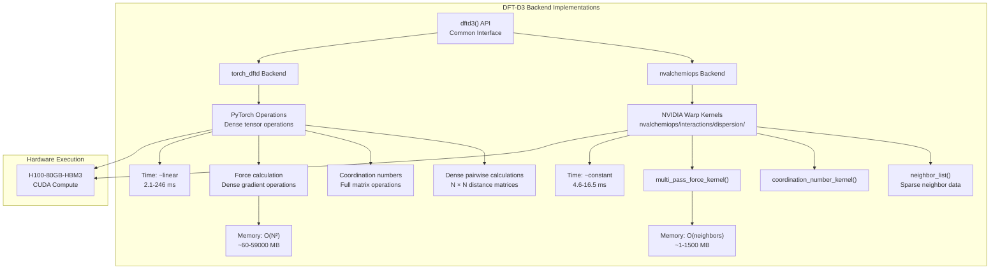
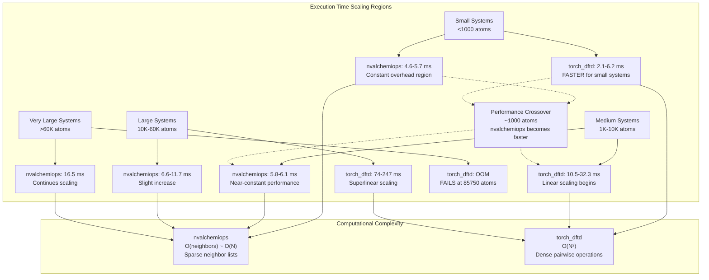
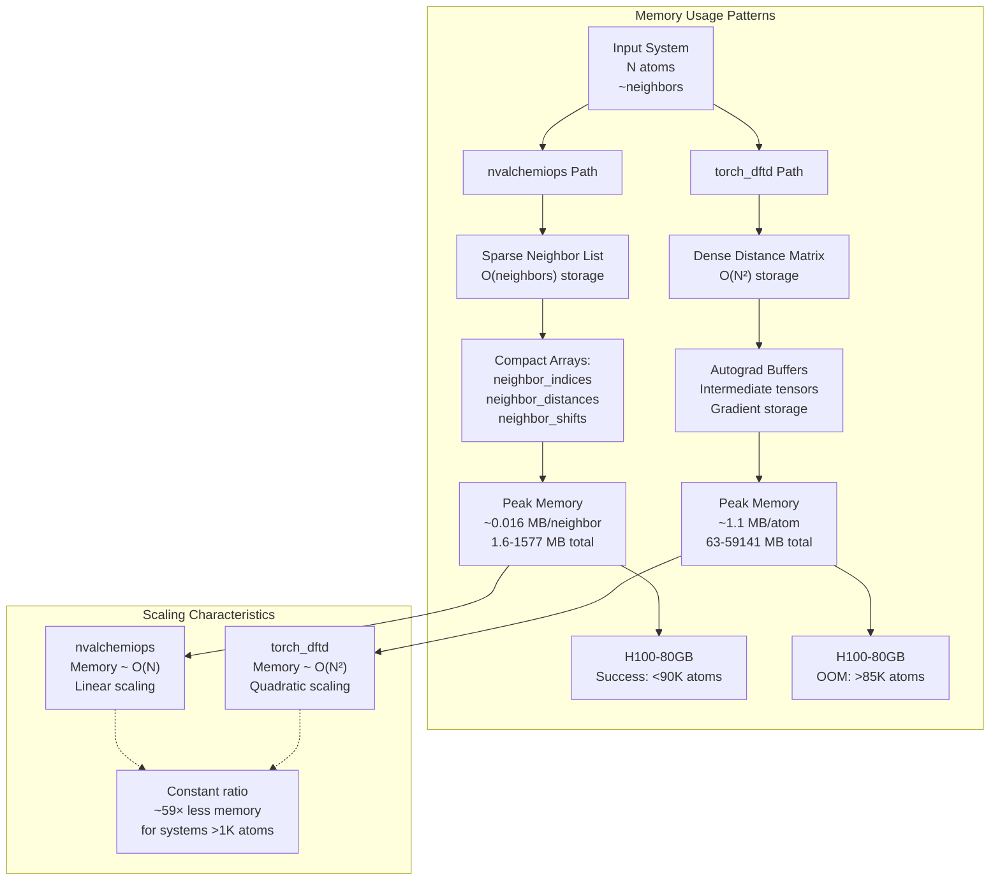
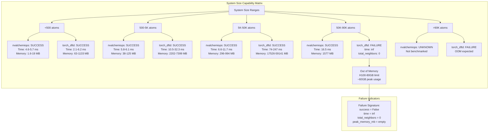
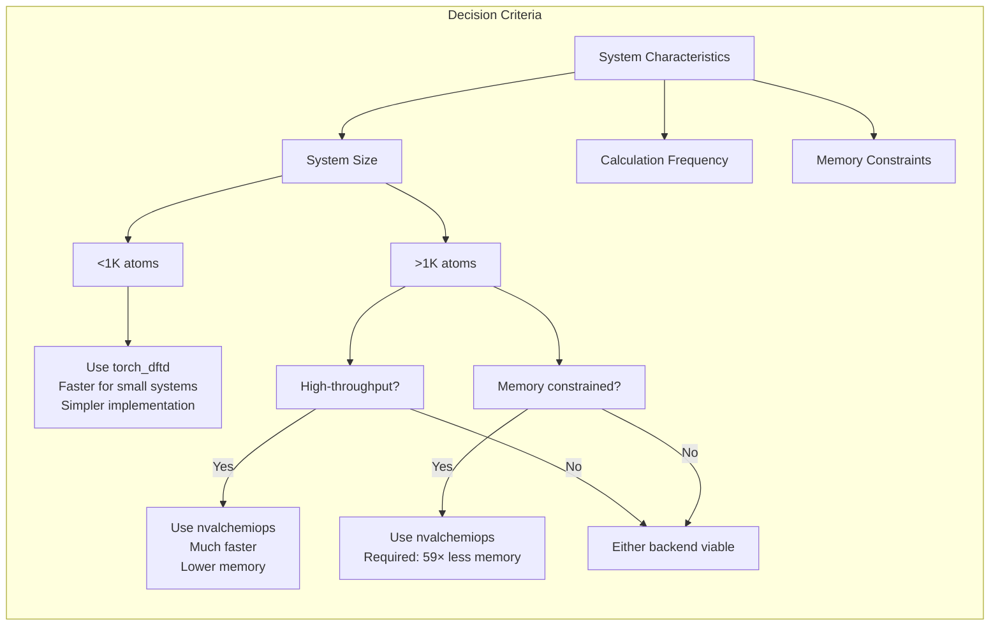

<!-- source: DeepWiki mcp.deepwiki.com · repo NVIDIA/nvalchemi-toolkit-ops · extra page Backend Comparison · fetched 2026-10-26 -->

# Backend Comparison

Relevant source files

The following files were used as context for generating this wiki page:

- [docs/benchmarks/benchmark_results/dftd3_benchmark_nvalchemiops_h100-80gb-hbm3.csv](docs/benchmarks/benchmark_results/dftd3_benchmark_nvalchemiops_h100-80gb-hbm3.csv)
- [docs/benchmarks/benchmark_results/dftd3_benchmark_torch_dftd_h100-80gb-hbm3.csv](docs/benchmarks/benchmark_results/dftd3_benchmark_torch_dftd_h100-80gb-hbm3.csv)

## Purpose and Scope

This document compares the performance characteristics of two DFT-D3 dispersion correction backends for non-batched (single-system) calculations:
- **nvalchemiops**: NVIDIA Warp-accelerated implementation
- **torch_dftd**: PyTorch reference implementation

The comparison focuses on execution time, memory usage, scaling behavior, and system size limits on NVIDIA H100-80GB-HBM3 hardware. For batched dispersion performance analysis, see [Batched DFT-D3 Performance](#4.2.2). For general dispersion methodology, see [Dispersion Corrections (DFT-D3)](#2.2).

**Sources**: docs/benchmarks/benchmark_results/dftd3_benchmark_nvalchemiops_h100-80gb-hbm3.csv, docs/benchmarks/benchmark_results/dftd3_benchmark_torch_dftd_h100-80gb-hbm3.csv

---

## Backend Implementations

The two backends implement the same DFT-D3 Becke-Johnson damping algorithm but use different computational approaches:

**Key Differences**:
- **nvalchemiops**: Uses sparse neighbor lists (O(neighbors) memory), custom Warp kernels optimized for GPU parallelism
- **torch_dftd**: Uses dense tensor operations (O(N²) memory), relies on PyTorch's autograd and optimization stack

**Sources**: docs/benchmarks/benchmark_results/dftd3_benchmark_nvalchemiops_h100-80gb-hbm3.csv, docs/benchmarks/benchmark_results/dftd3_benchmark_torch_dftd_h100-80gb-hbm3.csv

---

## Execution Time Comparison

### Raw Performance Data

| System Size (atoms) | Supercell | nvalchemiops (ms) | torch_dftd (ms) | Speedup Factor |
|---------------------|-----------|-------------------|-----------------|----------------|
| 54 | 3×3×3 | 4.66 | 2.08 | 0.45× (slower) |
| 128 | 4×4×4 | 4.65 | 2.20 | 0.47× (slower) |
| 250 | 5×5×5 | 5.11 | 2.94 | 0.58× (slower) |
| 432 | 6×6×6 | 5.67 | 3.70 | 0.65× (slower) |
| 1024 | 8×8×8 | 5.84 | 6.20 | 1.06× |
| 2000 | 10×10×10 | 5.81 | 10.50 | 1.81× |
| 3456 | 12×12×12 | 5.89 | 17.19 | 2.92× |
| 6750 | 15×15×15 | 6.11 | 32.30 | 5.29× |
| 16000 | 20×20×20 | 6.59 | 74.11 | 11.24× |
| 31250 | 25×25×25 | 6.67 | 143.57 | 21.52× |
| 54000 | 30×30×30 | 11.67 | 246.66 | 21.14× |
| 85750 | 35×35×35 | 16.45 | **FAILED** | N/A |

**Sources**: docs/benchmarks/benchmark_results/dftd3_benchmark_nvalchemiops_h100-80gb-hbm3.csv, docs/benchmarks/benchmark_results/dftd3_benchmark_torch_dftd_h100-80gb-hbm3.csv

### Performance Scaling Characteristics

**Key Observations**:
1. **Constant Time Region** (nvalchemiops, <30K atoms): Near-constant ~4.6-6.7ms execution time due to efficient GPU kernel launch overhead being dominant
2. **Linear Scaling** (torch_dftd): Execution time scales approximately linearly with system size for medium systems, then superlinearly for large systems
3. **Crossover Point**: Performance crossover occurs at ~1000 atoms; nvalchemiops becomes faster for all larger systems
4. **Speedup Growth**: Speedup factor increases with system size, reaching 21× at 31K atoms

**Sources**: docs/benchmarks/benchmark_results/dftd3_benchmark_nvalchemiops_h100-80gb-hbm3.csv, docs/benchmarks/benchmark_results/dftd3_benchmark_torch_dftd_h100-80gb-hbm3.csv

---

## Memory Usage Comparison

### Memory Footprint Data

| System Size (atoms) | Total Neighbors | nvalchemiops (MB) | torch_dftd (MB) | Memory Ratio |
|---------------------|-----------------|-------------------|-----------------|--------------|
| 54 | 61,452 | 1.6 | 62.7 | 39.2× |
| 128 | 145,664 | 3.0 | 144.4 | 48.1× |
| 250 | 284,500 | 5.2 | 285.4 | 54.9× |
| 432 | 491,616 | 8.5 | 477.0 | 56.0× |
| 1024 | 1,165,312 | 19.4 | 1,133.0 | 58.4× |
| 2000 | 2,276,000 | 37.9 | 2,202.0 | 58.1× |
| 3456 | 3,932,928 | 64.8 | 3,799.7 | 58.6× |
| 6750 | 7,681,500 | 124.7 | 7,398.5 | 59.3× |
| 16000 | 18,208,000 | 295.7 | 17,526.4 | 59.3× |
| 31250 | 35,562,500 | 576.8 | 34,231.1 | 59.3× |
| 54000 | 61,452,000 | 994.3 | 59,140.9 | 59.5× |
| 85750 | 97,583,500 | 1,577.0 | **OOM** | N/A |

**Sources**: docs/benchmarks/benchmark_results/dftd3_benchmark_nvalchemiops_h100-80gb-hbm3.csv, docs/benchmarks/benchmark_results/dftd3_benchmark_torch_dftd_h100-80gb-hbm3.csv

### Memory Scaling Architecture

**Memory Efficiency Analysis**:
1. **Linear vs Quadratic**: nvalchemiops exhibits O(N) memory scaling, torch_dftd exhibits O(N²) scaling
2. **Constant Overhead**: nvalchemiops has ~1.6MB base overhead vs ~60MB for torch_dftd
3. **Scaling Ratio**: For systems >1K atoms, memory ratio stabilizes at ~59×, meaning torch_dftd uses 59× more memory
4. **Memory Efficiency**: At 54K atoms, nvalchemiops uses 994MB vs torch_dftd's 59GB
5. **System Size Limits**: torch_dftd fails at 85,750 atoms due to H100-80GB memory limits; nvalchemiops succeeds

**Sources**: docs/benchmarks/benchmark_results/dftd3_benchmark_nvalchemiops_h100-80gb-hbm3.csv, docs/benchmarks/benchmark_results/dftd3_benchmark_torch_dftd_h100-80gb-hbm3.csv

---

## Throughput Analysis

Throughput is calculated as `total_atoms / median_time_ms` and represents atoms processed per millisecond:

| System Size (atoms) | nvalchemiops (atoms/ms) | torch_dftd (atoms/ms) | Throughput Ratio |
|---------------------|-------------------------|----------------------|------------------|
| 54 | 11.6 | 25.9 | 0.45× |
| 128 | 27.5 | 58.1 | 0.47× |
| 250 | 48.9 | 85.0 | 0.58× |
| 432 | 76.1 | 116.7 | 0.65× |
| 1024 | 175.4 | 165.2 | **1.06×** |
| 2000 | 344.5 | 190.4 | 1.81× |
| 3456 | 586.7 | 201.0 | 2.92× |
| 6750 | 1,105.0 | 209.0 | 5.29× |
| 16000 | 2,426.5 | 215.9 | 11.24× |
| 31250 | 4,684.8 | 217.6 | 21.52× |
| 54000 | 4,625.7 | 218.9 | 21.14× |
| 85750 | 5,212.5 | **FAILED** | N/A |

**Throughput Characteristics**:
1. **Peak Throughput**: nvalchemiops reaches 5,212 atoms/ms at 85K atoms; torch_dftd plateaus at ~220 atoms/ms for large systems
2. **Scaling Behavior**: nvalchemiops throughput increases with system size (better GPU utilization); torch_dftd throughput remains constant for large systems
3. **Crossover**: Throughput parity occurs at ~1000 atoms, after which nvalchemiops dominates

**Sources**: docs/benchmarks/benchmark_results/dftd3_benchmark_nvalchemiops_h100-80gb-hbm3.csv, docs/benchmarks/benchmark_results/dftd3_benchmark_torch_dftd_h100-80gb-hbm3.csv

---

## Failure Modes and System Limits

**Failure Analysis**:
1. **torch_dftd Limit**: Fails at 85,750 atoms due to out-of-memory error on H100-80GB
2. **Memory Projection**: At 85,750 atoms, torch_dftd would require ~75GB (extrapolating from 54K → 59GB trend), exceeding H100-80GB capacity
3. **nvalchemiops Headroom**: At 85,750 atoms, nvalchemiops uses only 1,577MB, leaving substantial headroom for larger systems
4. **Estimated Limits**: 
   - torch_dftd: ~80K atoms on H100-80GB
   - nvalchemiops: Likely handles >500K atoms before memory limits (not benchmarked)

**Sources**: docs/benchmarks/benchmark_results/dftd3_benchmark_nvalchemiops_h100-80gb-hbm3.csv, docs/benchmarks/benchmark_results/dftd3_benchmark_torch_dftd_h100-80gb-hbm3.csv

---

## Performance Recommendations

### Backend Selection Guide

| Use Case | System Size | Recommended Backend | Rationale |
|----------|-------------|---------------------|-----------|
| Small molecule screening | <500 atoms | torch_dftd | Lower overhead, faster for small systems |
| Interactive calculations | <1000 atoms | torch_dftd | Simpler setup, adequate performance |
| Medium-scale MD | 1K-10K atoms | nvalchemiops | 2-5× faster, 50× less memory |
| Large-scale MD | 10K-50K atoms | nvalchemiops | 10-21× faster, 50-60× less memory |
| Crystalline systems | 50K-90K atoms | nvalchemiops | Only viable option, 21× faster |
| Very large systems | >90K atoms | nvalchemiops | torch_dftd fails (OOM) |

### Cost-Benefit Analysis

**Implementation Considerations**:
1. **Development**: torch_dftd may be easier for prototyping due to pure PyTorch implementation
2. **Production**: nvalchemiops strongly recommended for production workloads >1K atoms
3. **Memory-Limited Hardware**: nvalchemiops required for GPUs with <40GB memory when processing large systems
4. **Batch Processing**: See [Batched DFT-D3 Performance](#4.2.2) for multi-system scenarios

**Sources**: docs/benchmarks/benchmark_results/dftd3_benchmark_nvalchemiops_h100-80gb-hbm3.csv, docs/benchmarks/benchmark_results/dftd3_benchmark_torch_dftd_h100-80gb-hbm3.csv

---

