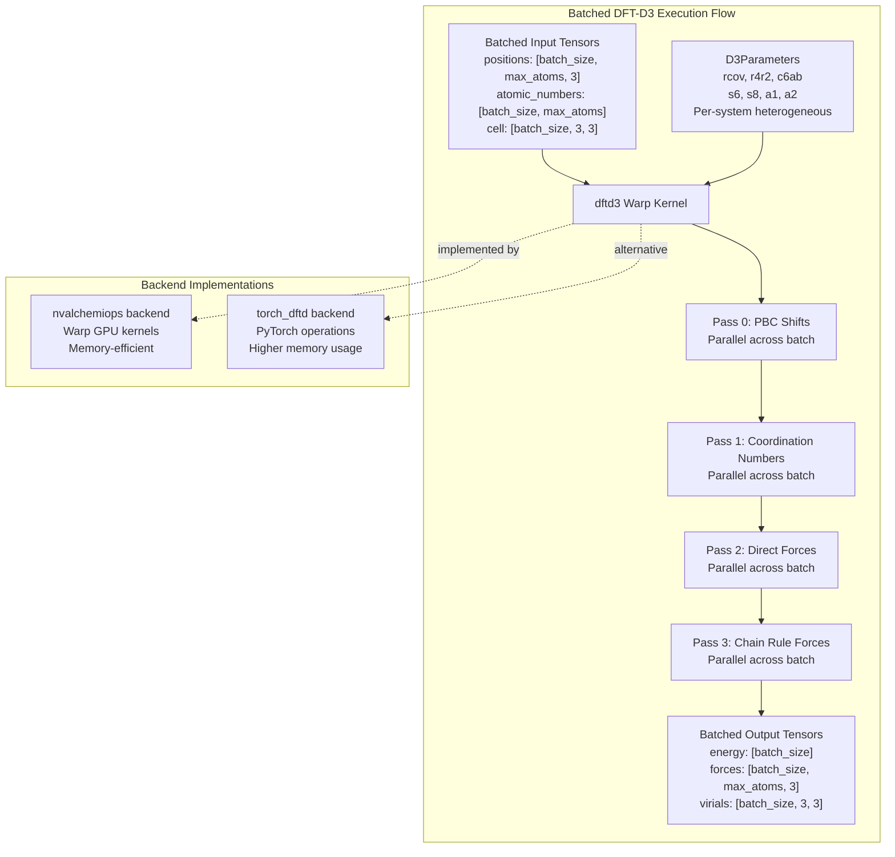
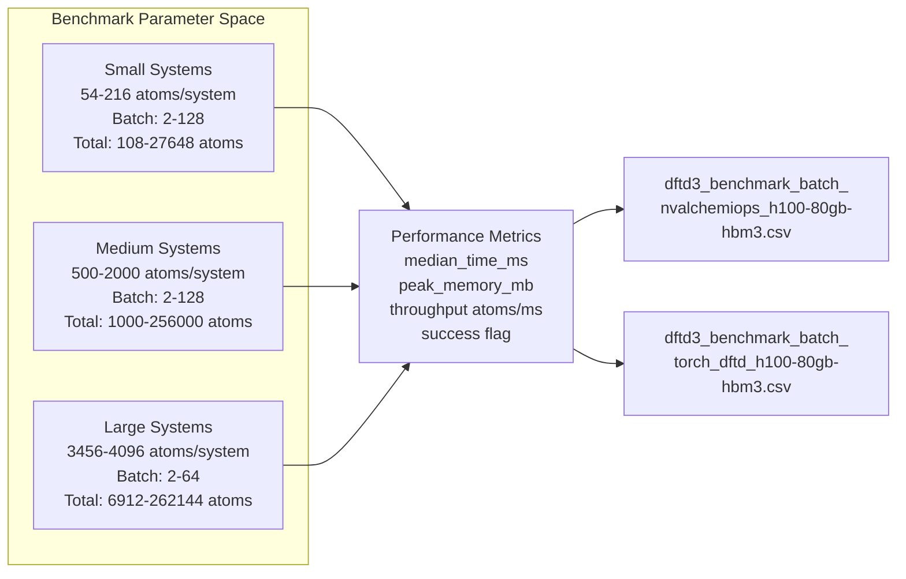
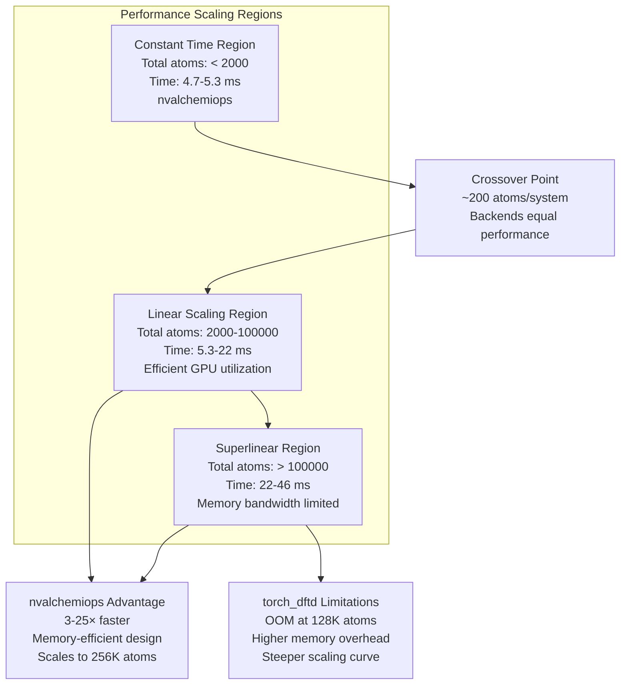
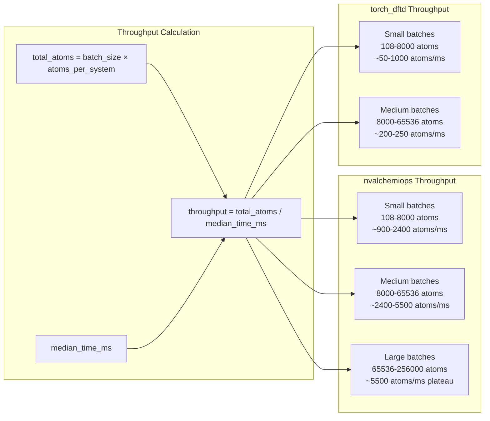
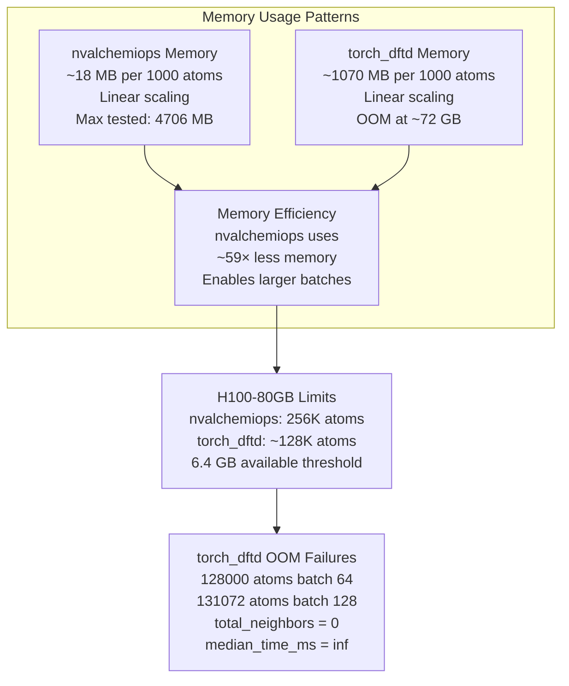
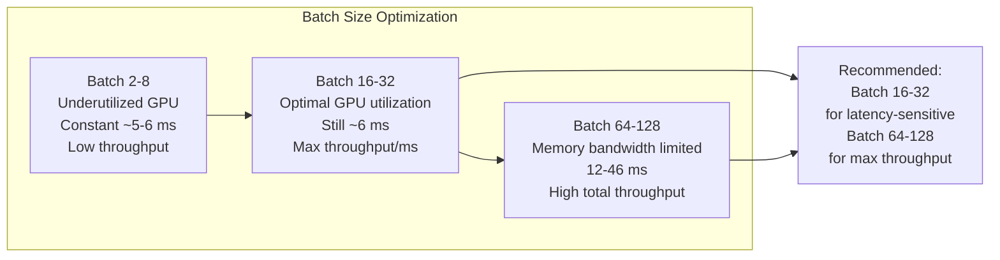
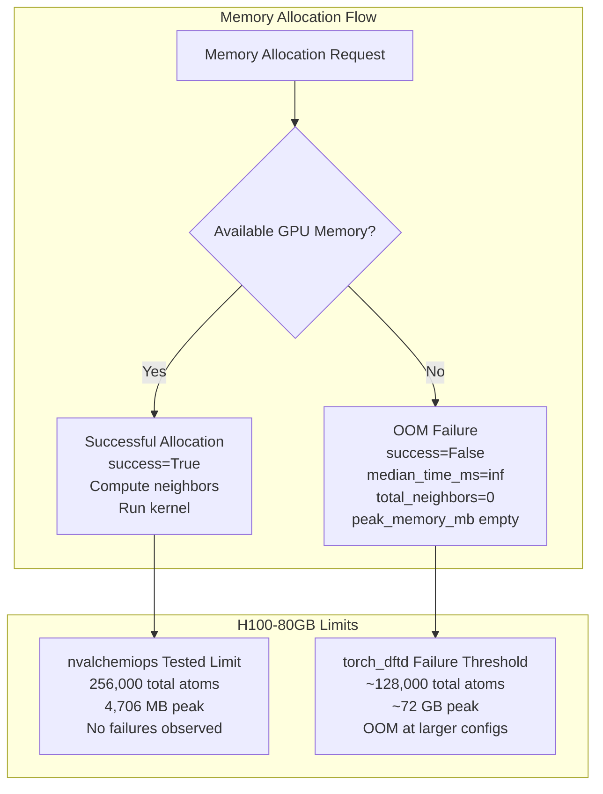
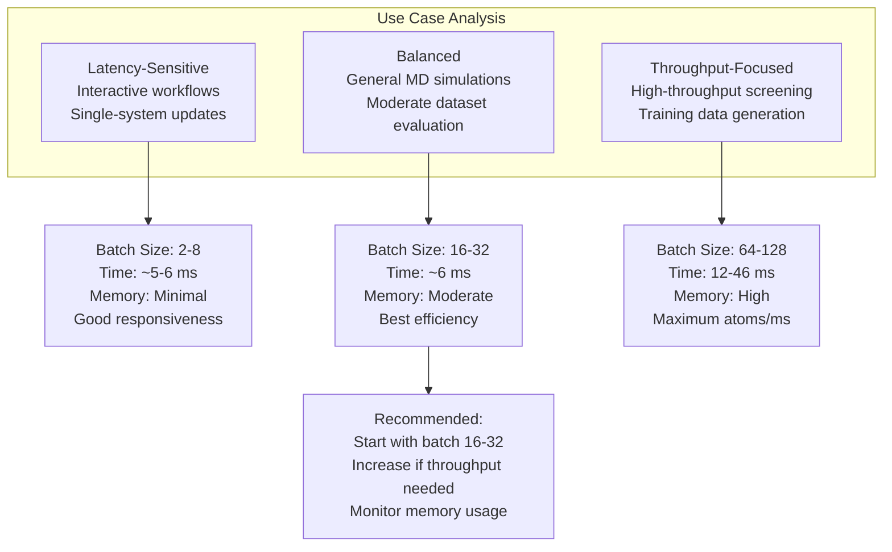

<!-- source: DeepWiki mcp.deepwiki.com · repo NVIDIA/nvalchemi-toolkit-ops · extra page Batched DFT-D3 Performance · fetched 2026-10-26 -->

# Batched DFT-D3 Performance

Relevant source files

The following files were used as context for generating this wiki page:

- [docs/benchmarks/benchmark_results/dftd3_benchmark_batch_nvalchemiops_h100-80gb-hbm3.csv](docs/benchmarks/benchmark_results/dftd3_benchmark_batch_nvalchemiops_h100-80gb-hbm3.csv)
- [docs/benchmarks/benchmark_results/dftd3_benchmark_batch_torch_dftd_h100-80gb-hbm3.csv](docs/benchmarks/benchmark_results/dftd3_benchmark_batch_torch_dftd_h100-80gb-hbm3.csv)

## Purpose and Scope

This page analyzes the performance characteristics of batched DFT-D3 dispersion correction calculations using the `nvalchemiops` toolkit. Batched calculations enable high-throughput evaluation of multiple molecular systems simultaneously, leveraging GPU parallelism to process heterogeneous systems with different atomic compositions and parameters in a single kernel launch.

This page covers:
- Performance metrics for batched DFT-D3 calculations across varying system sizes and batch dimensions
- Backend comparison between `nvalchemiops` and `torch_dftd` implementations
- Memory scaling characteristics and throughput analysis
- Failure modes and system limits on H100-80GB-HBM3 hardware

For non-batched single-system performance analysis, see [Backend Comparison](#4.2.1). For API details, see [Dispersion API](#5.2).

---

## Batched Processing Architecture

The `nvalchemiops.dftd3` function supports native batch processing where multiple independent molecular systems are evaluated in parallel. Each system in the batch may have different atomic compositions, cell parameters, and D3 functional parameters.

**Sources:** [docs/benchmarks/benchmark_results/dftd3_benchmark_batch_nvalchemiops_h100-80gb-hbm3.csv](), [docs/benchmarks/benchmark_results/dftd3_benchmark_batch_torch_dftd_h100-80gb-hbm3.csv]()

---

## Benchmark Configuration

Batched DFT-D3 benchmarks evaluate performance across a parameter space designed to stress test both small high-throughput scenarios and large-scale simulations:

| Parameter | Values |
|-----------|--------|
| **Atoms per system** | 54, 64, 125, 216, 512, 1000, 1728, 2000, 3456, 4096 |
| **Batch sizes** | 2, 4, 8, 16, 32, 64, 128 |
| **Total atoms** | 108 to 256,000 (batch_size × atoms_per_system) |
| **Supercell sizes** | 3×3×3 to 10×10×10 |
| **Backends** | `nvalchemiops`, `torch_dftd` |
| **Hardware** | NVIDIA H100-80GB-HBM3 |
| **Precision** | float32 |

Each benchmark configuration is timed over multiple iterations after warmup, with median time reported to reduce noise from GPU scheduling variations.

**Sources:** [docs/benchmarks/benchmark_results/dftd3_benchmark_batch_nvalchemiops_h100-80gb-hbm3.csv:1-44](), [docs/benchmarks/benchmark_results/dftd3_benchmark_batch_torch_dftd_h100-80gb-hbm3.csv:1-43]()

---

## Performance Results

### Execution Time Comparison

The following table summarizes key performance points comparing `nvalchemiops` and `torch_dftd` backends:

| Total Atoms | Batch Size | Atoms/System | nvalchemiops Time (ms) | torch_dftd Time (ms) | Speedup |
|-------------|------------|--------------|------------------------|---------------------|---------|
| 108 | 2 | 54 | 4.70 | 2.14 | 0.45× |
| 1,000 | 4 | 250 | 5.25 | 5.98 | 1.14× |
| 4,096 | 4 | 1,024 | 5.94 | 20.13 | 3.39× |
| 16,000 | 8 | 2,000 | 6.61 | 74.09 | 11.21× |
| 32,768 | 32 | 1,024 | 6.28 | 149.86 | 23.86× |
| 65,536 | 64 | 1,024 | 11.77 | 298.00 | 25.32× |
| 128,000 | 64 | 2,000 | 22.18 | inf (OOM) | ∞ |
| 256,000 | 128 | 2,000 | 46.05 | inf (OOM) | ∞ |

**Key Observations:**
- `torch_dftd` is faster for very small systems (<200 atoms/system) due to lower kernel launch overhead
- `nvalchemiops` achieves 3-25× speedup for medium to large systems
- `nvalchemiops` scales to 256K total atoms while `torch_dftd` fails with OOM at 128K atoms

**Sources:** [docs/benchmarks/benchmark_results/dftd3_benchmark_batch_nvalchemiops_h100-80gb-hbm3.csv:2-43](), [docs/benchmarks/benchmark_results/dftd3_benchmark_batch_torch_dftd_h100-80gb-hbm3.csv:2-42]()

---

### Scaling Characteristics

**Detailed Scaling Analysis:**

1. **Constant Time Region (< 2000 total atoms):**
   - `nvalchemiops`: 4.70-5.32 ms regardless of batch configuration
   - GPU not fully saturated, kernel launch overhead dominates
   - `torch_dftd` faster in this regime (2.14-5.98 ms)

2. **Linear Scaling Region (2000-100000 atoms):**
   - Both backends scale approximately linearly with total atoms
   - `nvalchemiops` maintains consistent ~5-6 ms base time + linear component
   - `torch_dftd` shows steeper scaling (10-150 ms range)

3. **Superlinear Region (> 100000 atoms):**
   - Memory bandwidth becomes limiting factor
   - `nvalchemiops` reaches 46 ms at 256K atoms
   - `torch_dftd` hits OOM failures before reaching this scale

**Sources:** [docs/benchmarks/benchmark_results/dftd3_benchmark_batch_nvalchemiops_h100-80gb-hbm3.csv](), [docs/benchmarks/benchmark_results/dftd3_benchmark_batch_torch_dftd_h100-80gb-hbm3.csv]()

---

## Throughput Analysis

Throughput is measured as atoms processed per millisecond, providing a hardware-independent metric of computational efficiency:

**Representative Throughput Values:**

| Backend | Total Atoms | Batch Size | Throughput (atoms/ms) |
|---------|-------------|------------|----------------------|
| nvalchemiops | 8,192 | 8 | 1,371 |
| nvalchemiops | 32,768 | 32 | 5,219 |
| nvalchemiops | 65,536 | 64 | 5,567 |
| nvalchemiops | 256,000 | 128 | 5,558 |
| torch_dftd | 8,192 | 8 | 211 |
| torch_dftd | 32,768 | 32 | 219 |
| torch_dftd | 65,536 | 64 | 220 |

The `nvalchemiops` backend achieves **~25× higher throughput** at large batch sizes, plateauing around 5,500 atoms/ms on H100 hardware.

**Sources:** [docs/benchmarks/benchmark_results/dftd3_benchmark_batch_nvalchemiops_h100-80gb-hbm3.csv:18-43](), [docs/benchmarks/benchmark_results/dftd3_benchmark_batch_torch_dftd_h100-80gb-hbm3.csv:18-42]()

---

## Memory Usage Analysis

Memory consumption is a critical factor limiting maximum batch size and system scale:

| Total Atoms | Batch Size | nvalchemiops Memory (MB) | torch_dftd Memory (MB) | Memory Ratio |
|-------------|------------|--------------------------|------------------------|--------------|
| 864 | 2 | 16.5 | 953.4 | 57.8× |
| 4,096 | 4 | 75.9 | 4,492.4 | 59.2× |
| 16,384 | 16 | 303.7 | 17,948.9 | 59.1× |
| 65,536 | 64 | 1,205.1 | 71,774.2 | 59.6× |
| 128,000 | 64 | 2,353.4 | OOM | ∞ |
| 256,000 | 128 | 4,706.2 | OOM | ∞ |

**Memory Scaling Characteristics:**

The `nvalchemiops` backend's memory efficiency stems from:
1. Direct Warp kernel implementation without intermediate PyTorch tensor allocations
2. In-place force accumulation during multi-pass calculations
3. Efficient neighbor list representation optimized for GPU memory access patterns

**Sources:** [docs/benchmarks/benchmark_results/dftd3_benchmark_batch_nvalchemiops_h100-80gb-hbm3.csv:6-43](), [docs/benchmarks/benchmark_results/dftd3_benchmark_batch_torch_dftd_h100-80gb-hbm3.csv:6-42]()

---

## Batch Size Effects

Performance behavior varies significantly with batch size for fixed per-system atom counts:

**Fixed 1,024 atoms/system, varying batch size:**

| Batch Size | Total Atoms | nvalchemiops Time (ms) | torch_dftd Time (ms) |
|------------|-------------|------------------------|---------------------|
| 2 | 2,048 | 5.95 | 10.85 |
| 4 | 4,096 | 5.94 | 20.13 |
| 8 | 8,192 | 6.10 | 38.86 |
| 16 | 16,384 | 6.12 | 75.84 |
| 32 | 32,768 | 6.28 | 149.86 |
| 64 | 65,536 | 11.77 | 298.00 |
| 128 | 131,072 | 21.92 | OOM |

**Observations:**
- `nvalchemiops` maintains near-constant ~6 ms up to batch size 32 (32,768 atoms)
- Execution time doubles at batch 64, then doubles again at batch 128
- `torch_dftd` shows strict linear scaling with batch size until OOM
- Optimal batch size for `nvalchemiops`: 16-32 for maximum throughput/time efficiency

**Sources:** [docs/benchmarks/benchmark_results/dftd3_benchmark_batch_nvalchemiops_h100-80gb-hbm3.csv:6,12,18,24,30,36,42](), [docs/benchmarks/benchmark_results/dftd3_benchmark_batch_torch_dftd_h100-80gb-hbm3.csv:6,12,18,24,30,36,42]()

---

## Failure Modes and System Limits

### Out-of-Memory Failures

The `torch_dftd` backend encounters OOM failures at large batch configurations:

| Configuration | Total Atoms | Batch Size | Result |
|--------------|-------------|------------|---------|
| 128,000 atoms | 64 | 2,000 atoms/system | `success=False`, `time=inf`, `total_neighbors=0` |
| 131,072 atoms | 128 | 1,024 atoms/system | `success=False`, `time=inf`, `total_neighbors=0` |

These failures occur when GPU memory allocation exceeds H100-80GB capacity (~80 GB). The benchmark system detects failures and reports:
- `median_time_ms = inf`
- `peak_memory_mb = <empty>`
- `success = False`
- `total_neighbors = 0`

**Sources:** [docs/benchmarks/benchmark_results/dftd3_benchmark_batch_torch_dftd_h100-80gb-hbm3.csv:37,42]()

---

## Recommendations

Based on the performance analysis, the following guidelines optimize batched DFT-D3 calculations:

### Backend Selection

| System Characteristics | Recommended Backend | Rationale |
|------------------------|---------------------|-----------|
| < 200 atoms/system, small batches | `torch_dftd` | Lower latency for very small systems |
| > 200 atoms/system | `nvalchemiops` | 3-25× faster, memory-efficient |
| Large batches (>16) | `nvalchemiops` | Only backend that scales to batch 128 |
| > 100K total atoms | `nvalchemiops` | `torch_dftd` encounters OOM |
| Memory-constrained | `nvalchemiops` | 59× more memory efficient |

### Batch Size Optimization

**Specific Recommendations:**

1. **High-throughput screening (drug discovery, materials search):**
   - Use `nvalchemiops` backend
   - Batch size: 64-128
   - Expected: 5,500 atoms/ms throughput
   - System size: 1,000-2,000 atoms/system

2. **Training GNN models:**
   - Use `nvalchemiops` backend
   - Batch size: 32 (match typical GNN batch sizes)
   - Expected: ~6 ms latency per batch
   - System size: 500-4,000 atoms/system

3. **Interactive molecular dynamics:**
   - Use `nvalchemiops` backend for systems > 200 atoms
   - Batch size: 1-4
   - Expected: 5-6 ms per evaluation
   - System size: 500-10,000 atoms/system

4. **Memory-constrained environments:**
   - Always use `nvalchemiops` backend
   - Calculate safe batch size: `batch_size_max ≈ available_memory_GB / (atoms_per_system × 0.018)`
   - Example: 20 GB available, 2000 atoms/system → batch_size_max ≈ 555

**Sources:** [docs/benchmarks/benchmark_results/dftd3_benchmark_batch_nvalchemiops_h100-80gb-hbm3.csv](), [docs/benchmarks/benchmark_results/dftd3_benchmark_batch_torch_dftd_h100-80gb-hbm3.csv]()

---

