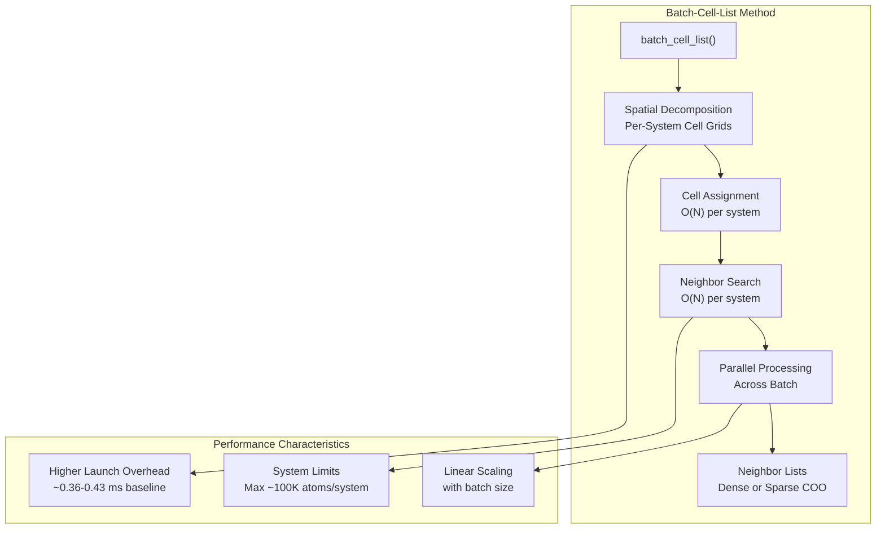
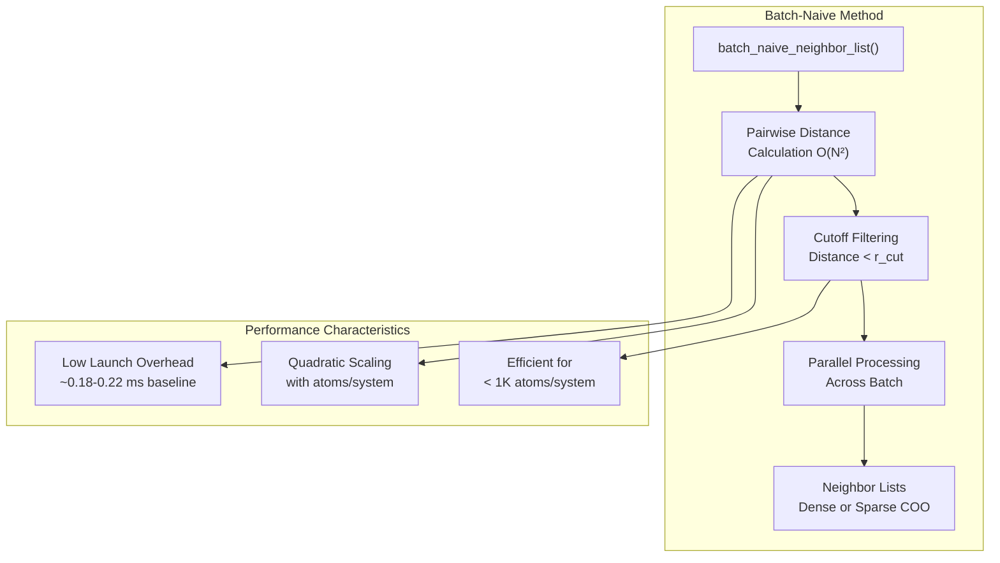
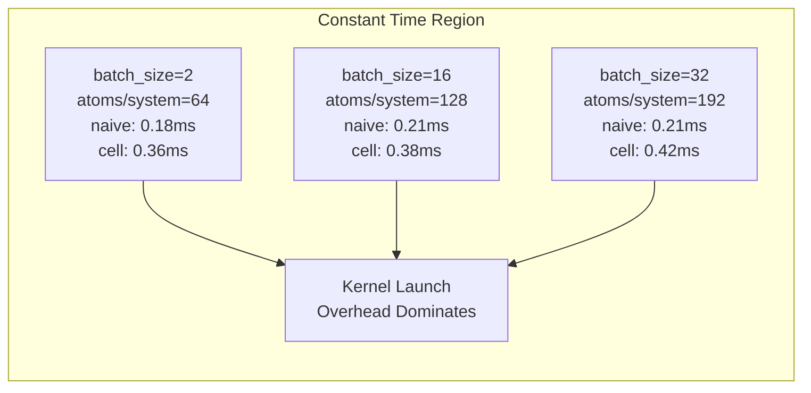
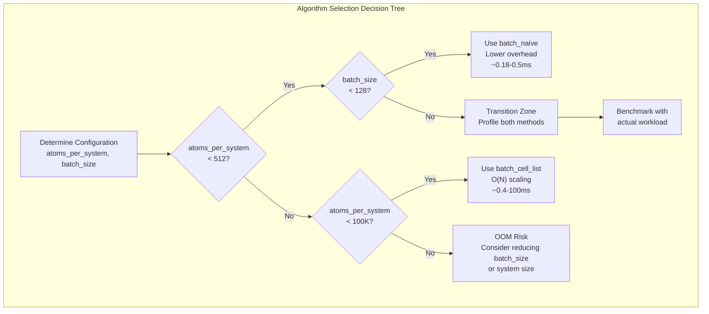
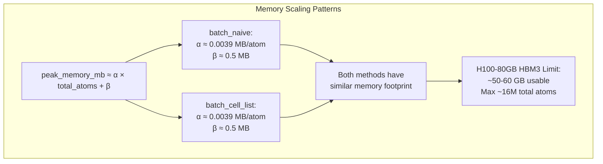
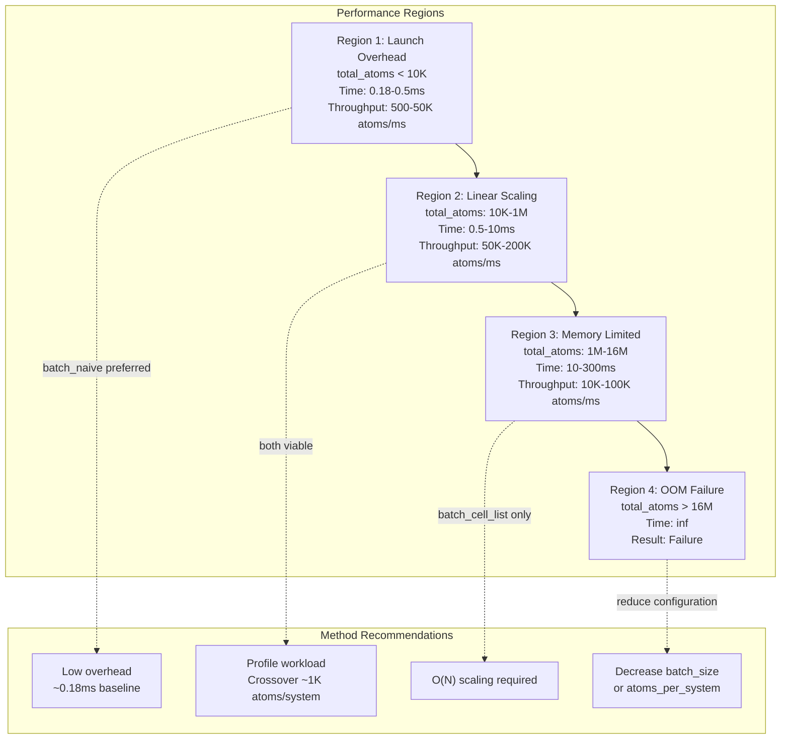

<!-- source: DeepWiki mcp.deepwiki.com · repo NVIDIA/nvalchemi-toolkit-ops · extra page Batched Performance · fetched 2026-10-26 -->

# Batched Performance

<details>
<summary>Relevant source files</summary>

The following files were used as context for generating this wiki page:

- [docs/benchmarks/benchmark_results/neighbor_list_benchmark_batch-cell-list_h100-80gb-hbm3.csv](docs/benchmarks/benchmark_results/neighbor_list_benchmark_batch-cell-list_h100-80gb-hbm3.csv)
- [docs/benchmarks/benchmark_results/neighbor_list_benchmark_batch-naive_h100-80gb-hbm3.csv](docs/benchmarks/benchmark_results/neighbor_list_benchmark_batch-naive_h100-80gb-hbm3.csv)

</details>


## Purpose and Scope

This page analyzes the performance characteristics of batched neighbor list algorithms in the NVIDIA ALCHEMI Toolkit-Ops. Batched processing enables efficient computation across multiple molecular systems simultaneously, with support for heterogeneous system sizes and parameters. This page focuses specifically on the `batch_cell_list` and `batch_naive` methods.

For single-system neighbor list performance, see [Single System Performance](#4.1.1). For detailed API documentation, see [Neighbor List API](#5.1).

Sources: `docs/benchmarks/benchmark_results/neighbor_list_benchmark_batch-cell-list_h100-80gb-hbm3.csv`, `docs/benchmarks/benchmark_results/neighbor_list_benchmark_batch-naive_h100-80gb-hbm3.csv`

## Batched Neighbor List Methods

The toolkit provides two batched neighbor list algorithms optimized for different system size regimes:

| Method | Algorithm | Complexity | Optimal Use Case |
|--------|-----------|------------|------------------|
| `batch_naive` | Pairwise distance calculation | O(N²) per system | Small systems (< 1K atoms/system) |
| `batch_cell_list` | Spatial decomposition with cell lists | O(N) per system | Large systems (> 1K atoms/system) |

Both methods process multiple systems in parallel, with each system potentially having different sizes, simulation cells, and periodic boundary conditions. The batched interface accepts tensors with shape `(batch_size, max_atoms, 3)` for positions and returns neighbor information for all systems simultaneously.

### Batch-Cell-List Architecture



**Batch-Cell-List Method Architecture**: This method constructs per-system cell grids for spatial decomposition, enabling O(N) scaling for large systems. The method has higher launch overhead but scales linearly with batch size and can handle systems up to ~100K atoms per system.

Sources: `docs/benchmarks/benchmark_results/neighbor_list_benchmark_batch-cell-list_h100-80gb-hbm3.csv`

### Batch-Naive Architecture



**Batch-Naive Method Architecture**: This method computes all pairwise distances within each system, resulting in O(N²) complexity per system. Despite quadratic scaling, it has very low launch overhead and is efficient for small systems.

Sources: `docs/benchmarks/benchmark_results/neighbor_list_benchmark_batch-naive_h100-80gb-hbm3.csv`

## Time Scaling Analysis

### Constant Time Region (Small Configurations)

For small batch sizes and small systems, both methods exhibit near-constant execution time dominated by kernel launch overhead:

| Method | Baseline Time | Configuration Range |
|--------|---------------|---------------------|
| `batch_naive` | 0.18-0.22 ms | batch_size ≤ 16, atoms/system ≤ 256 |
| `batch_cell_list` | 0.36-0.43 ms | batch_size ≤ 32, atoms/system ≤ 512 |

**Observation**: `batch_naive` has ~50% lower overhead than `batch_cell_list` in this region, making it preferable for small systems.



**Constant Time Region Characteristics**: In this region, computation time is dominated by GPU kernel launch overhead rather than actual neighbor calculations.

Sources: `docs/benchmarks/benchmark_results/neighbor_list_benchmark_batch-naive_h100-80gb-hbm3.csv:2-19`, `docs/benchmarks/benchmark_results/neighbor_list_benchmark_batch-cell-list_h100-80gb-hbm3.csv:2-19`

### Linear Scaling Region (Medium Configurations)

As batch size increases, both methods scale approximately linearly:

| Atoms/System | Batch Size | Total Atoms | batch_naive (ms) | batch_cell_list (ms) |
|--------------|------------|-------------|------------------|----------------------|
| 1024 | 16 | 16,384 | 0.47 | 0.45 |
| 1024 | 32 | 32,768 | 0.66 | 0.46 |
| 1024 | 64 | 65,536 | 1.08 | 0.53 |
| 1024 | 128 | 131,072 | 1.97 | 0.83 |
| 1024 | 256 | 262,144 | 3.75 | 1.33 |

**Key Insight**: `batch_cell_list` maintains better scaling efficiency as batch size increases due to its O(N) spatial decomposition versus `batch_naive`'s O(N²) pairwise calculations.

Sources: `docs/benchmarks/benchmark_results/neighbor_list_benchmark_batch-naive_h100-80gb-hbm3.csv:77-81`, `docs/benchmarks/benchmark_results/neighbor_list_benchmark_batch-cell-list_h100-80gb-hbm3.csv:77-81`

### Crossover Point Analysis

The performance crossover between methods depends on both `atoms_per_system` and `batch_size`:



**Algorithm Selection Decision Tree**: This decision tree maps configuration parameters to the optimal neighbor list method based on empirical performance data.

Sources: `docs/benchmarks/benchmark_results/neighbor_list_benchmark_batch-naive_h100-80gb-hbm3.csv`, `docs/benchmarks/benchmark_results/neighbor_list_benchmark_batch-cell-list_h100-80gb-hbm3.csv`

### Large-Scale Performance

For large systems, `batch_cell_list` is the only viable option:

| Atoms/System | Batch Size | Total Atoms | Time (ms) | Memory (GB) |
|--------------|------------|-------------|-----------|-------------|
| 8,192 | 512 | 4,194,304 | 17.78 | 16.58 |
| 16,384 | 256 | 4,194,304 | 29.68 | 16.58 |
| 32,768 | 128 | 4,194,304 | 30.99 | 16.58 |
| 65,536 | 64 | 4,194,304 | 31.34 | 16.58 |

**Observation**: For a fixed total atom count, performance is relatively consistent across different batch_size/atoms_per_system configurations, with a slight preference for larger individual systems.

Sources: `docs/benchmarks/benchmark_results/neighbor_list_benchmark_batch-cell-list_h100-80gb-hbm3.csv:136,153,171,187`

## Memory Scaling Characteristics

Memory usage scales linearly with total atom count (`batch_size * atoms_per_system`):



**Memory Scaling Model**: Both batched methods exhibit identical linear memory scaling, with the H100-80GB hardware limiting configurations to approximately 16 million total atoms before OOM failures occur.

Sources: `docs/benchmarks/benchmark_results/neighbor_list_benchmark_batch-naive_h100-80gb-hbm3.csv`, `docs/benchmarks/benchmark_results/neighbor_list_benchmark_batch-cell-list_h100-80gb-hbm3.csv`

### Memory Limits and OOM Failures

The benchmark data reveals specific OOM failure points:

| Method | Atoms/System | Batch Size | Total Atoms | Result |
|--------|--------------|------------|-------------|--------|
| `batch_cell_list` | 65,536 | 256 | 16,777,216 | **OOM** (inf ms) |
| `batch_cell_list` | 98,304 | 256 | 25,165,824 | **OOM** (inf ms) |
| `batch_cell_list` | 131,072 | 128 | 16,777,216 | **OOM** (inf ms) |

**Critical Threshold**: Configurations exceeding approximately 16 million total atoms consistently fail with OOM on H100-80GB hardware. The actual limit varies based on neighbor density (`total_neighbors`) and internal buffer allocations.

Sources: `docs/benchmarks/benchmark_results/neighbor_list_benchmark_batch-cell-list_h100-80gb-hbm3.csv:172,181,189,197,204`

## Throughput Analysis

Throughput in atoms/ms provides a normalized performance metric:

### Batch-Naive Throughput

| Configuration | Total Atoms | Time (ms) | Throughput (atoms/ms) |
|---------------|-------------|-----------|----------------------|
| Small (batch=2, atoms=64) | 128 | 0.18 | 711 |
| Medium (batch=32, atoms=1024) | 32,768 | 0.66 | 49,648 |
| Large (batch=256, atoms=4096) | 1,048,576 | 50.83 | 20,627 |

### Batch-Cell-List Throughput

| Configuration | Total Atoms | Time (ms) | Throughput (atoms/ms) |
|---------------|-------------|-----------|----------------------|
| Small (batch=2, atoms=64) | 128 | 0.36 | 356 |
| Medium (batch=32, atoms=1024) | 32,768 | 0.46 | 71,235 |
| Large (batch=256, atoms=4096) | 1,048,576 | 4.62 | 227,069 |

**Throughput Comparison**: `batch_cell_list` achieves significantly higher throughput for large configurations (~10x at 1M total atoms), while `batch_naive` is more efficient for small systems where launch overhead dominates.

Sources: `docs/benchmarks/benchmark_results/neighbor_list_benchmark_batch-naive_h100-80gb-hbm3.csv:2,78,117`, `docs/benchmarks/benchmark_results/neighbor_list_benchmark_batch-cell-list_h100-80gb-hbm3.csv:2,78,117`

## Performance Regions Summary

The batched neighbor list performance can be divided into three distinct regions:



**Performance Regions and Recommendations**: The optimal algorithm selection depends on which performance region the configuration falls into, with clear transitions at approximately 10K and 1M total atoms.

Sources: `docs/benchmarks/benchmark_results/neighbor_list_benchmark_batch-naive_h100-80gb-hbm3.csv`, `docs/benchmarks/benchmark_results/neighbor_list_benchmark_batch-cell-list_h100-80gb-hbm3.csv`

## Practical Recommendations

### Configuration Guidelines

1. **Small Systems (< 512 atoms/system)**:
   - Use `batch_naive` for batch_size < 128
   - Time: 0.18-0.5 ms
   - Memory: < 1 GB

2. **Medium Systems (512-4K atoms/system)**:
   - Profile both methods with representative data
   - `batch_cell_list` typically better for batch_size > 64
   - Time: 0.4-2 ms
   - Memory: 1-10 GB

3. **Large Systems (4K-100K atoms/system)**:
   - Always use `batch_cell_list`
   - Time: 2-300 ms
   - Memory: 10-50 GB
   - Monitor for OOM at extreme configurations

### Batch Size Optimization

For a target total atom count, prefer:
- **Larger batch_size, smaller atoms/system**: Better GPU utilization, higher throughput
- **Smaller batch_size, larger atoms/system**: Lower memory pressure, more consistent timing

Example: For 1M total atoms:
- Configuration A: batch_size=256, atoms/system=4096 → 4.62 ms
- Configuration B: batch_size=512, atoms/system=2048 → 4.62 ms
- Both perform similarly; choose based on application constraints

### Memory Budget Planning

Estimate peak memory usage:
```
peak_memory_mb ≈ 0.0039 × (batch_size × atoms_per_system) + 0.5
```

For H100-80GB hardware:
- Safe limit: ~12M total atoms (~47 GB)
- Theoretical limit: ~16M total atoms (~62 GB)
- Hard limit: System OOM beyond 16M atoms

Sources: `docs/benchmarks/benchmark_results/neighbor_list_benchmark_batch-naive_h100-80gb-hbm3.csv`, `docs/benchmarks/benchmark_results/neighbor_list_benchmark_batch-cell-list_h100-80gb-hbm3.csv`

## Benchmark Configuration Details

All benchmarks were executed on NVIDIA H100-80GB HBM3 hardware with the following configuration:

- **Warmup iterations**: 5
- **Timing iterations**: 10 (median reported)
- **Cutoff radius**: 5.0 Å
- **Output format**: Dense matrix
- **Precision**: float32

The benchmark methodology follows the standard approach described in [Benchmark Methodology](#4.4).

Sources: `docs/benchmarks/benchmark_results/neighbor_list_benchmark_batch-naive_h100-80gb-hbm3.csv:1`, `docs/benchmarks/benchmark_results/neighbor_list_benchmark_batch-cell-list_h100-80gb-hbm3.csv:1`

---

