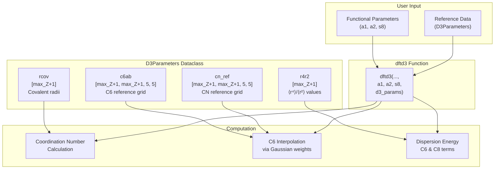
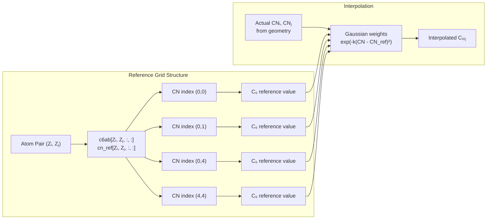
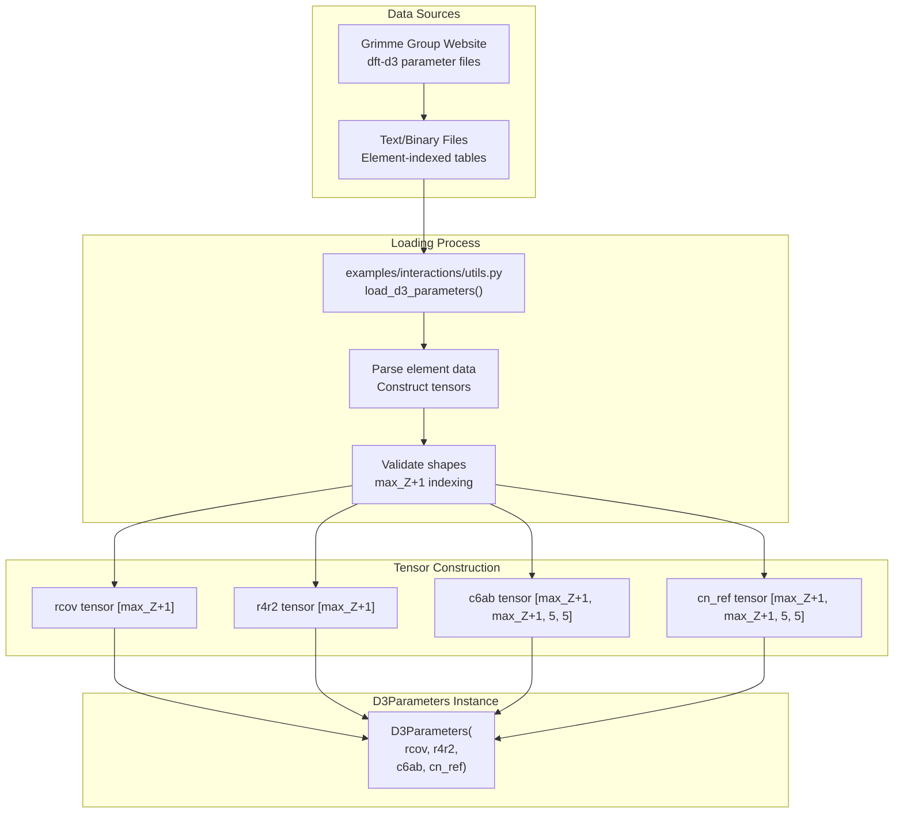
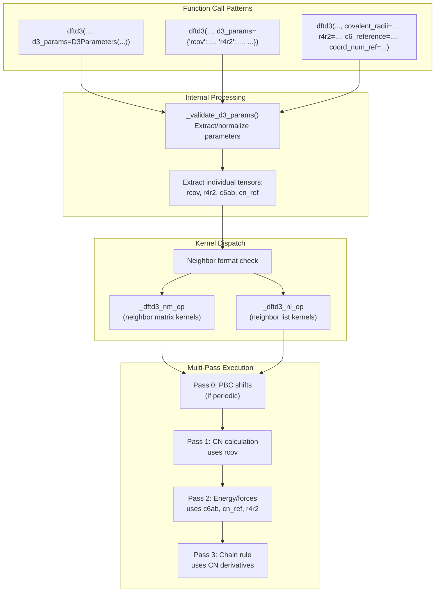

<!-- source: DeepWiki mcp.deepwiki.com · repo NVIDIA/nvalchemi-toolkit-ops · extra page D3Parameters Configuration · fetched 2026-10-26 -->

# D3Parameters Configuration

<details>
<summary>Relevant source files</summary>

The following files were used as context for generating this wiki page:

- [README.md](README.md)
- [docs/userguide/components/dispersion.md](docs/userguide/components/dispersion.md)

</details>


This page documents the `D3Parameters` dataclass and the reference parameters required for DFT-D3 dispersion correction calculations. It covers the parameter structure, configuration methods, data sources, and integration with the [`dftd3`](nvalchemiops/interactions/dispersion/dftd3.py) function.

For the theory and algorithmic implementation of the multi-pass force calculation, see [#2.2.1](#2.2.1). For complete API documentation, see [#5.2](#5.2).

**Sources:** [docs/userguide/components/dispersion.md:222-288]()

## Overview

The `D3Parameters` dataclass encapsulates the reference data required for coordination-dependent C6 coefficient interpolation in DFT-D3 calculations. These parameters are **mandatory** and must be explicitly provided by the user—no default values are shipped with the library.



**Diagram:** D3Parameters integration with the dftd3 function. Reference data enables coordination-dependent C6 interpolation.

**Sources:** [docs/userguide/components/dispersion.md:227-244](), [docs/userguide/components/dispersion.md:455-469]()

---

## Parameter Structure

The `D3Parameters` dataclass contains four required tensor fields that store element-specific reference data. All arrays are indexed by atomic number `Z`, starting from index 0.

### Field Specifications

| Field | Shape | Dtype | Unit | Description |
|-------|-------|-------|------|-------------|
| `rcov` | `[max_Z+1]` | `float32` | Bohr | Covalent radii for geometric counting function |
| `r4r2` | `[max_Z+1]` | `float32` | dimensionless | $\langle r^4 \rangle / \langle r^2 \rangle$ expectation value ratios |
| `c6ab` | `[max_Z+1, max_Z+1, 5, 5]` | `float32` | Hartree·Bohr⁶ | C6 reference coefficients for element pairs |
| `cn_ref` | `[max_Z+1, max_Z+1, 5, 5]` | `float32` | dimensionless | Coordination number reference grid |

### Grid Indexing Convention

The 4D grids `c6ab` and `cn_ref` use a double grid indexing scheme:
- Dimensions 0-1: Atomic numbers of the interacting pair (element A, element B)
- Dimensions 2-3: Reference coordination number indices (CN index for A, CN index for B)

Each element has up to 5 reference coordination environments. The interpolation algorithm uses Gaussian weighting over the 5×5 grid to compute environment-dependent C6 coefficients:



**Diagram:** C6 interpolation scheme using 5×5 reference grids. Actual coordination numbers are matched against reference values via Gaussian weighting.

**Sources:** [docs/userguide/components/dispersion.md:455-469]()

---

## Configuration Methods

Three equivalent methods are supported for providing D3 parameters. All methods produce identical results.

### Method 1: D3Parameters Dataclass (Recommended)

Create a `D3Parameters` instance with all four required fields:

```python
from nvalchemiops.interactions.dispersion.dftd3 import D3Parameters

d3_params = D3Parameters(
    rcov=covalent_radii,      # torch.Tensor [max_Z+1]
    r4r2=r4r2_values,         # torch.Tensor [max_Z+1]
    c6ab=c6_reference,        # torch.Tensor [max_Z+1, max_Z+1, 5, 5]
    cn_ref=coord_num_ref,     # torch.Tensor [max_Z+1, max_Z+1, 5, 5]
)

energy, forces, coord_num = dftd3(
    positions, numbers, neighbor_matrix,
    a1=0.3981, a2=4.4211, s8=0.7875,  # PBE functional
    d3_params=d3_params,
)
```

This is the recommended approach for type safety and clarity.

**Sources:** [docs/userguide/components/dispersion.md:227-244]()

### Method 2: Dictionary

Pass a dictionary with string keys matching the dataclass field names:

```python
d3_params = {
    "rcov": covalent_radii,
    "r4r2": r4r2_values,
    "c6ab": c6_reference,
    "cn_ref": coord_num_ref,
}

energy, forces, coord_num = dftd3(
    positions, numbers, neighbor_matrix,
    a1=0.3981, a2=4.4211, s8=0.7875,
    d3_params=d3_params,
)
```

**Sources:** [docs/userguide/components/dispersion.md:246-255]()

### Method 3: Individual Keyword Arguments

Pass each parameter array as a separate keyword argument to [`dftd3`](nvalchemiops/interactions/dispersion/dftd3.py):

```python
energy, forces, coord_num = dftd3(
    positions, numbers, neighbor_matrix,
    a1=0.3981, a2=4.4211, s8=0.7875,
    covalent_radii=covalent_radii,
    r4r2=r4r2_values,
    c6_reference=c6_reference,
    coord_num_ref=coord_num_ref,
)
```

Note the keyword argument names differ from the dataclass field names:
- `covalent_radii` (kwarg) vs `rcov` (field)
- `c6_reference` (kwarg) vs `c6ab` (field)
- `coord_num_ref` matches in both

**Sources:** [docs/userguide/components/dispersion.md:258-267]()

---

## Parameter Sources and Loading

### Official Reference Data

Reference parameters are maintained by the Grimme group at the University of Bonn. The official parameter files are available from:

https://www.chemie.uni-bonn.de/grimme/de/software/dft-d3/

The parameter files contain tabulated values for elements H (Z=1) through Pu (Z=94).

### Loading Utilities

The `examples/interactions/utils.py` script provides helper functions for loading and parsing the reference parameter files into the required tensor format. Users should adapt these utilities to their specific data sources.



**Diagram:** Parameter loading workflow from official sources to D3Parameters instance.

**Sources:** [docs/userguide/components/dispersion.md:270-274]()

---

## Functional-Specific Damping Parameters

While `D3Parameters` provides element-specific reference data, the `a1`, `a2`, and `s8` damping parameters are **functional-specific** and must be provided separately to [`dftd3`](nvalchemiops/interactions/dispersion/dftd3.py). These parameters are not part of the `D3Parameters` dataclass.

### Common DFT Functionals

| Functional | a1 | a2 (Bohr) | s8 | Notes |
|------------|----|-----------|----|-------|
| PBE | 0.3981 | 4.4211 | 0.7875 | Generalized Gradient Approximation |
| PBE0 | 0.4145 | 4.8593 | 1.2177 | Hybrid functional (25% exact exchange) |
| B3LYP | 0.3981 | 4.4211 | 1.9889 | Popular hybrid functional |

A comprehensive list of functional-specific parameters is available at:
https://www.chemie.uni-bonn.de/grimme/de/software/dft-d3/

### Usage Example

```python
# Reference parameters (element-specific, universal)
d3_params = D3Parameters(rcov=..., r4r2=..., c6ab=..., cn_ref=...)

# Functional parameters (functional-specific, passed separately)
energy_pbe, forces_pbe, cn = dftd3(
    positions, numbers, neighbor_matrix,
    a1=0.3981, a2=4.4211, s8=0.7875,  # PBE
    d3_params=d3_params,
)

energy_pbe0, forces_pbe0, cn = dftd3(
    positions, numbers, neighbor_matrix,
    a1=0.4145, a2=4.8593, s8=1.2177,  # PBE0
    d3_params=d3_params,  # Same reference data, different functional
)
```

**Sources:** [docs/userguide/components/dispersion.md:276-287]()

---

## Units and Data Types

### Unit Conventions

All reference parameters use **atomic units** (Hartree-Bohr system):

| Quantity | Unit | Conversion from SI |
|----------|------|-------------------|
| `rcov` (covalent radii) | Bohr | Ångström × 1.8897259886 |
| `r4r2` (expectation values) | dimensionless | — |
| `c6ab` (C6 coefficients) | Hartree·Bohr⁶ | — |
| `cn_ref` (coordination numbers) | dimensionless | — |

These units must be consistent with the input positions to [`dftd3`](nvalchemiops/interactions/dispersion/dftd3.py), which should also be in Bohr. See [#2.2](#2.2) for complete unit conversion guidance.

### Data Type Requirements

| Field | Required Dtype | Device | Notes |
|-------|----------------|--------|-------|
| `rcov` | `float32` | Same as positions | FP64 not required |
| `r4r2` | `float32` | Same as positions | FP64 not required |
| `c6ab` | `float32` | Same as positions | FP64 not required |
| `cn_ref` | `float32` | Same as positions | FP64 not required |

All reference parameter tensors must reside on the same device as the input positions and must use `float32` dtype. The implementation does not support `float64` reference parameters, even when positions are provided in `float64`.

**Sources:** [docs/userguide/components/dispersion.md:183-207](), [docs/userguide/components/dispersion.md:209-221]()

---

## Integration with dftd3 Function

The `dftd3` function internally extracts or validates the reference parameters and passes them to the multi-pass Warp kernels. The function signature accepts `D3Parameters` via multiple interfaces:



**Diagram:** D3Parameters flow through the dftd3 function to the multi-pass kernel architecture.

### Parameter Validation

The function performs the following checks:
1. **Mutual exclusivity**: Only one configuration method may be used per call
2. **Completeness**: All four fields must be provided (no partial parameters)
3. **Shape validation**: Tensors must match expected dimensions
4. **Device consistency**: All parameters must be on the same device as positions
5. **Dtype validation**: All parameters must be `float32`

**Sources:** [nvalchemiops/interactions/dispersion/dftd3.py]()

---

## Example: Complete Setup

```python
import torch
from nvalchemiops.interactions.dispersion.dftd3 import D3Parameters, dftd3
from nvalchemiops.neighborlist import neighbor_list

# Unit conversion constants
ANGSTROM_TO_BOHR = 1.8897259886

# Assume reference data loaded from Grimme parameter files
# via examples/interactions/utils.py
rcov = torch.tensor([...], dtype=torch.float32, device="cuda")        # [max_Z+1]
r4r2 = torch.tensor([...], dtype=torch.float32, device="cuda")        # [max_Z+1]
c6ab = torch.tensor([...], dtype=torch.float32, device="cuda")        # [max_Z+1, max_Z+1, 5, 5]
cn_ref = torch.tensor([...], dtype=torch.float32, device="cuda")      # [max_Z+1, max_Z+1, 5, 5]

# Construct D3Parameters
d3_params = D3Parameters(
    rcov=rcov,
    r4r2=r4r2,
    c6ab=c6ab,
    cn_ref=cn_ref,
)

# System setup (convert to Bohr)
positions_ang = torch.tensor([[0.0, 0.0, 0.0], [1.5, 0.0, 0.0]], device="cuda")
positions = positions_ang * ANGSTROM_TO_BOHR
numbers = torch.tensor([6, 8], dtype=torch.int32, device="cuda")  # C, O

# Build neighbor list (50 Bohr cutoff)
cell = torch.eye(3, device="cuda").unsqueeze(0) * 100.0
pbc = torch.tensor([False, False, False], device="cuda")

neighbor_matrix, num_neighbors, shifts = neighbor_list(
    positions, cutoff=50.0, cell=cell, pbc=pbc
)

# Compute DFT-D3 correction with PBE functional
energy, forces, coord_num = dftd3(
    positions=positions,
    numbers=numbers,
    neighbor_matrix=neighbor_matrix,
    a1=0.3981,      # PBE: a1
    a2=4.4211,      # PBE: a2 (Bohr)
    s8=0.7875,      # PBE: s8
    d3_params=d3_params,
)

print(f"Dispersion energy: {energy[0].item():.8f} Hartree")
print(f"Coordination numbers: {coord_num}")
```

**Sources:** [docs/userguide/components/dispersion.md:325-361]()

---

