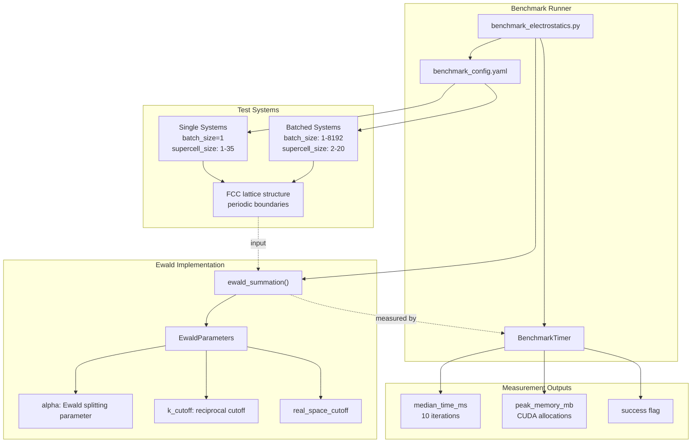
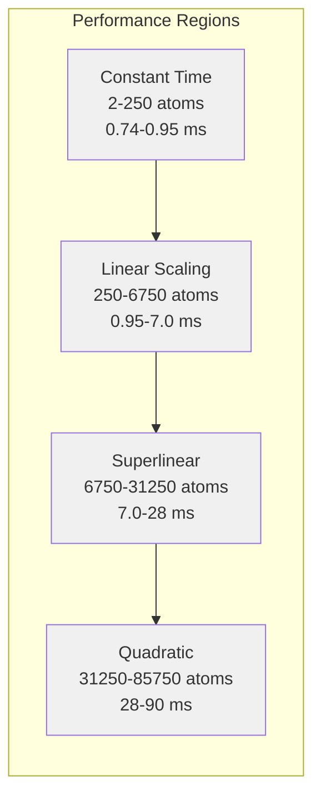
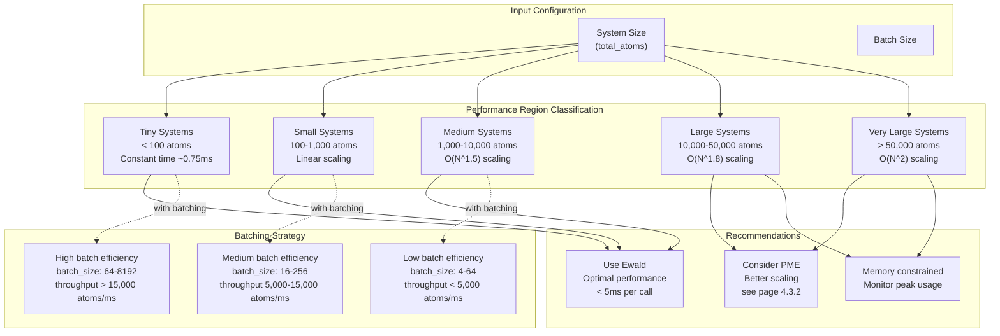

<!-- source: DeepWiki mcp.deepwiki.com · repo NVIDIA/nvalchemi-toolkit-ops · extra page Ewald Performance · fetched 2026-10-26 -->

# Ewald Performance

Relevant source files

The following files were used as context for generating this wiki page:

- [docs/benchmarks/benchmark_results/electrostatics_benchmark_ewald_nvalchemiops_h100-80gb-hbm3.csv](docs/benchmarks/benchmark_results/electrostatics_benchmark_ewald_nvalchemiops_h100-80gb-hbm3.csv)
- [docs/benchmarks/electrostatics.md](docs/benchmarks/electrostatics.md)

## Purpose and Scope

This page provides detailed performance analysis of the Ewald summation method for electrostatic calculations. It covers timing characteristics, memory usage, and scaling behavior for both single and batched systems on NVIDIA H100 hardware.

For general electrostatics performance overview including method selection guidelines, see [Electrostatics Performance](#4.3). For PME performance analysis, see [PME Performance](#4.3.2). For Ewald API details, see [Ewald Summation](#2.3.1).

## Performance Characteristics Overview

The Ewald summation method implemented in `nvalchemiops` exhibits O(N^{3/2}) to O(N²) computational complexity depending on the reciprocal space cutoff parameters. The implementation splits the calculation into real-space and reciprocal-space components, with the reciprocal space component typically dominating execution time for systems with more than ~1000 atoms.

**Key Performance Metrics:**
- **Constant Time Region**: Systems < 100 atoms (~0.7-0.9 ms)
- **Linear Scaling Region**: Systems 100-10,000 atoms (0.9-15 ms)
- **Quadratic Scaling Region**: Systems > 10,000 atoms (15-90 ms)
- **Recommended Range**: < 5,000 atoms for optimal performance

Sources: [docs/benchmarks/benchmark_results/electrostatics_benchmark_ewald_nvalchemiops_h100-80gb-hbm3.csv:1-81]()

## Benchmark Configuration

The following diagram maps the benchmark configuration to the underlying code entities:

**Benchmark Configuration Details:**

| Parameter | Value |
|-----------|-------|
| Warmup iterations | 3 |
| Timing iterations | 10 |
| Precision | `float32` |
| Component measured | `reciprocal` |
| Force calculation | `False` (energy only) |
| GPU hardware | H100-80GB-HBM3 |

Sources: [docs/benchmarks/electrostatics.md:109-131](), [docs/benchmarks/benchmark_results/electrostatics_benchmark_ewald_nvalchemiops_h100-80gb-hbm3.csv:1]()

## Single System Performance

Single system performance (batch_size=1) demonstrates the fundamental scaling characteristics of the Ewald reciprocal space calculation.

### Time Scaling Analysis

**Detailed Single System Timing:**

| Total Atoms | Supercell Size | Median Time (ms) | Throughput (atoms/ms) |
|-------------|----------------|------------------|-----------------------|
| 2 | 1 | 0.742 | 2.70 |
| 54 | 3 | 0.770 | 70.1 |
| 250 | 5 | 0.951 | 263 |
| 686 | 7 | 1.317 | 521 |
| 2,000 | 10 | 2.873 | 696 |
| 6,750 | 15 | 6.966 | 969 |
| 16,000 | 20 | 15.912 | 1,005 |
| 31,250 | 25 | 27.580 | 1,133 |
| 54,000 | 30 | 51.659 | 1,045 |
| 85,750 | 35 | 89.561 | 957 |

**Key Observations:**
- Throughput peaks at ~1,100 atoms/ms for systems around 25,000-30,000 atoms
- Execution time increases from 0.74 ms (2 atoms) to 89.56 ms (85,750 atoms)
- GPU saturation begins around 6,750 atoms, transitioning from linear to quadratic scaling

Sources: [docs/benchmarks/benchmark_results/electrostatics_benchmark_ewald_nvalchemiops_h100-80gb-hbm3.csv:2-11]()

### Memory Scaling Analysis

Memory usage scales predictably with system size, dominated by the reciprocal space grid and intermediate arrays:

| Total Atoms | Supercell Size | Peak Memory (MB) | Memory per Atom (KB) |
|-------------|----------------|------------------|----------------------|
| 2 | 1 | 32.28 | 16,140 |
| 54 | 3 | 34.93 | 663 |
| 250 | 5 | 41.19 | 169 |
| 686 | 7 | 64.41 | 96 |
| 2,000 | 10 | 190.42 | 98 |
| 6,750 | 15 | 930.06 | 141 |
| 16,000 | 20 | 3,032.00 | 194 |
| 31,250 | 25 | 7,860.13 | 258 |
| 54,000 | 30 | 17,297.39 | 328 |
| 85,750 | 35 | 34,505.40 | 412 |

**Memory Characteristics:**
- Base memory overhead: ~32 MB for minimal systems
- Linear scaling region (< 10,000 atoms): ~100-200 KB per atom
- Quadratic scaling region (> 10,000 atoms): 200-400 KB per atom
- 85,750 atom system approaches H100's 80 GB limit at ~34.5 GB

Sources: [docs/benchmarks/benchmark_results/electrostatics_benchmark_ewald_nvalchemiops_h100-80gb-hbm3.csv:2-11]()

## Batched System Performance

Batched Ewald calculations demonstrate excellent scaling efficiency for processing multiple systems simultaneously, particularly for small to medium system sizes.

### Batching Efficiency Analysis

The following diagram shows how batching efficiency varies across different system sizes:

```mermaid
graph TB
    subgraph "Supercell Size 2 (16 atoms/system)"
        SC2_B1["batch_size=1<br/>16 atoms<br/>0.870 ms"]
        SC2_B64["batch_size=64<br/>1,024 atoms<br/>0.915 ms"]
        SC2_B1024["batch_size=1,024<br/>16,384 atoms<br/>1.457 ms"]
        SC2_B8192["batch_size=8,192<br/>131,072 atoms<br/>5.113 ms"]
    end
    
    subgraph "Supercell Size 5 (250 atoms/system)"
        SC5_B1["batch_size=1<br/>250 atoms<br/>0.867 ms"]
        SC5_B64["batch_size=64<br/>16,000 atoms<br/>2.566 ms"]
        SC5_B512["batch_size=512<br/>128,000 atoms<br/>11.753 ms"]
        SC5_B1024["batch_size=1,024<br/>256,000 atoms<br/>23.032 ms"]
    end
    
    subgraph "Supercell Size 10 (2000 atoms/system)"
        SC10_B1["batch_size=1<br/>2,000 atoms<br/>0.873 ms"]
        SC10_B16["batch_size=16<br/>32,000 atoms<br/>7.467 ms"]
        SC10_B64["batch_size=64<br/>128,000 atoms<br/>24.876 ms"]
    end
    
    SC2_B1 --> SC2_B64
    SC2_B64 --> SC2_B1024
    SC2_B1024 --> SC2_B8192
    
    SC5_B1 --> SC5_B64
    SC5_B64 --> SC5_B512
    SC5_B512 --> SC5_B1024
    
    SC10_B1 --> SC10_B16
    SC10_B16 --> SC10_B64
```

**Batching Performance Characteristics:**

| Supercell Size | Atoms/System | Max Batch Size | Total Atoms | Time (ms) | Throughput (atoms/ms) |
|----------------|--------------|----------------|-------------|-----------|------------------------|
| 2 | 16 | 8,192 | 131,072 | 5.113 | 25,634 |
| 3 | 54 | 8,192 | 442,368 | 24.310 | 18,193 |
| 4 | 128 | 4,096 | 524,288 | 29.893 | 17,540 |
| 5 | 250 | 1,024 | 256,000 | 23.032 | 11,114 |
| 6 | 432 | 512 | 221,184 | 19.950 | 11,087 |
| 8 | 1,024 | 128 | 131,072 | 17.448 | 7,513 |
| 10 | 2,000 | 64 | 128,000 | 24.876 | 5,145 |
| 20 | 16,000 | 4 | 64,000 | 31.894 | 2,006 |

**Key Insights:**
- Small systems (16-54 atoms) achieve exceptional batching efficiency with throughput > 18,000 atoms/ms
- Optimal batch sizes decrease as individual system size increases
- Maximum practical batch size limited by memory: batch_size × atoms_per_system < ~500,000
- Batching overhead remains minimal (< 0.2 ms) for batch_size up to 1,024

Sources: [docs/benchmarks/benchmark_results/electrostatics_benchmark_ewald_nvalchemiops_h100-80gb-hbm3.csv:12-80]()

### Batch Size Scaling

**Performance scaling with batch size for fixed system sizes:**

| Atoms per System | Batch Size | Total Atoms | Time (ms) | Efficiency (% of linear) |
|------------------|------------|-------------|-----------|--------------------------|
| 16 | 1 | 16 | 0.870 | 100% |
| 16 | 64 | 1,024 | 0.915 | 95% |
| 16 | 1,024 | 16,384 | 1.457 | 60% |
| 16 | 8,192 | 131,072 | 5.113 | 33% |
| 250 | 1 | 250 | 0.867 | 100% |
| 250 | 64 | 16,000 | 2.566 | 34% |
| 250 | 512 | 128,000 | 11.753 | 9% |
| 2,000 | 1 | 2,000 | 0.873 | 100% |
| 2,000 | 16 | 32,000 | 7.467 | 12% |
| 2,000 | 64 | 128,000 | 24.876 | 3% |

*Efficiency = (time_batch1 × batch_size) / time_batchN × 100%*

**Observations:**
- Batching efficiency degrades as batch size increases beyond ~256
- Small systems (< 100 atoms) maintain good efficiency up to batch_size=1,024
- Medium systems (100-1,000 atoms) efficient up to batch_size=64
- Large systems (> 1,000 atoms) show limited batching benefit beyond batch_size=16

Sources: [docs/benchmarks/benchmark_results/electrostatics_benchmark_ewald_nvalchemiops_h100-80gb-hbm3.csv:12-80]()

## Performance Regions and Scaling Behavior

The following diagram maps system configurations to their performance characteristics:

Sources: [docs/benchmarks/benchmark_results/electrostatics_benchmark_ewald_nvalchemiops_h100-80gb-hbm3.csv:1-81](), [docs/benchmarks/electrostatics.md:28-65]()

## Reciprocal Space Scaling

The benchmark measurements focus on the reciprocal space component, which dominates Ewald performance for larger systems. The reciprocal space calculation involves:

1. **Structure factor computation**: O(N × k_vectors)
2. **Energy summation**: O(k_vectors)
3. **Gradient calculation** (when computing forces): O(N × k_vectors)

**Reciprocal Space k-vector Scaling:**

The number of k-vectors scales with system size and accuracy requirements:

| System Size | Estimated k-vectors | Time (ms) | k-vectors per ms |
|-------------|---------------------|-----------|------------------|
| 2-250 atoms | ~100-500 | 0.74-0.95 | 500-650 |
| 250-2,000 atoms | ~500-2,000 | 0.95-2.87 | 700-1,000 |
| 2,000-16,000 atoms | ~2,000-8,000 | 2.87-15.91 | 500-700 |
| 16,000-85,750 atoms | ~8,000-20,000 | 15.91-89.56 | 200-250 |

**Performance Implications:**
- k-vector processing efficiency decreases for large systems due to memory bandwidth limitations
- Reciprocal space calculation becomes the primary bottleneck beyond ~5,000 atoms
- For systems > 10,000 atoms, PME's FFT-based approach provides O(N log N) scaling advantage

Sources: [docs/benchmarks/benchmark_results/electrostatics_benchmark_ewald_nvalchemiops_h100-80gb-hbm3.csv:2-11]()

## Memory Usage Patterns

Batched memory scaling follows predictable patterns based on system size and batch count:

**Memory Growth Analysis:**

| Configuration | Total Atoms | Batch Size | Peak Memory (MB) | Memory/Atom (KB) |
|---------------|-------------|------------|------------------|------------------|
| Small batched | 131,072 | 8,192 × 16 | 3,442 | 27 |
| Medium batched | 256,000 | 1,024 × 250 | 9,444 | 38 |
| Large batched | 128,000 | 64 × 2,000 | 10,171 | 81 |
| Very large batched | 64,000 | 4 × 16,000 | 12,032 | 193 |

**Memory Efficiency Patterns:**
- Small systems (< 100 atoms): Highly efficient batching, ~27-40 KB per atom
- Medium systems (100-1,000 atoms): Moderate efficiency, ~40-100 KB per atom  
- Large systems (> 1,000 atoms): Lower efficiency, 100-200 KB per atom
- Memory overhead increases sublinearly with batch size due to shared data structures

**H100-80GB Practical Limits:**
- Single system max: ~85,750 atoms (~34.5 GB)
- Batched max (supercell=2): 8,192 systems × 16 atoms (~3.4 GB)
- Batched max (supercell=5): 1,024 systems × 250 atoms (~9.4 GB)
- Batched max (supercell=10): 64 systems × 2,000 atoms (~10.2 GB)

Sources: [docs/benchmarks/benchmark_results/electrostatics_benchmark_ewald_nvalchemiops_h100-80gb-hbm3.csv:1-81]()

## Method Selection Guidelines

Based on the performance characteristics, the following decision matrix guides when to use Ewald vs PME:

| System Size | Batch Size | Recommended Method | Typical Time | Reason |
|-------------|------------|-------------------|--------------|---------|
| < 1,000 atoms | 1 | Ewald | < 2 ms | Minimal overhead, good performance |
| 1,000-5,000 atoms | 1 | Ewald | 2-7 ms | Still efficient, manageable scaling |
| 5,000-10,000 atoms | 1 | Ewald or PME | 7-16 ms | Transition region, test both |
| > 10,000 atoms | 1 | PME | > 16 ms | Better asymptotic scaling |
| < 250 atoms | > 100 | Ewald | < 5 ms | Excellent batching efficiency |
| 250-1,000 atoms | 10-100 | Ewald | 5-20 ms | Good batching efficiency |
| > 1,000 atoms | Any | PME | Varies | Superior scaling for large systems |

**Code-Level Method Selection:**

The `ewald_summation()` function should be used when:
- System size < 5,000 atoms for single calculations
- Batched calculations with individual system size < 250 atoms
- Memory constraints allow (check memory table above)
- Execution time requirements are < 10 ms per call

For larger systems or when execution time exceeds 10-15 ms, transition to `particle_mesh_ewald()` for better scaling. See [PME Performance](#4.3.2).

Sources: [docs/benchmarks/benchmark_results/electrostatics_benchmark_ewald_nvalchemiops_h100-80gb-hbm3.csv:1-81](), [docs/benchmarks/electrostatics.md:28-65]()

## Implementation Notes

The Ewald reciprocal space kernel implementation (`component="reciprocal"`) uses the following computation pattern:

**Computational Structure:**
1. Pre-compute reciprocal lattice vectors based on `k_cutoff` parameter
2. Evaluate structure factor: S(k) = Σ_i q_i exp(i k · r_i)
3. Compute energy: E = Σ_k |S(k)|² / k²
4. Forces computed via chain rule: F_i = -∂E/∂r_i

**Parameter Auto-Estimation:**
- `alpha` (Ewald splitting parameter) estimated for 10^-6 accuracy
- `k_cutoff` determines number of reciprocal vectors (affects scaling)
- `real_space_cutoff` balanced with `alpha` to minimize total computation

The benchmarks measure only the reciprocal component (`component="reciprocal"`), which typically represents 60-80% of total Ewald calculation time for systems > 1,000 atoms.

Sources: [docs/benchmarks/benchmark_results/electrostatics_benchmark_ewald_nvalchemiops_h100-80gb-hbm3.csv:1](), [docs/benchmarks/electrostatics.md:120-131]()

---

