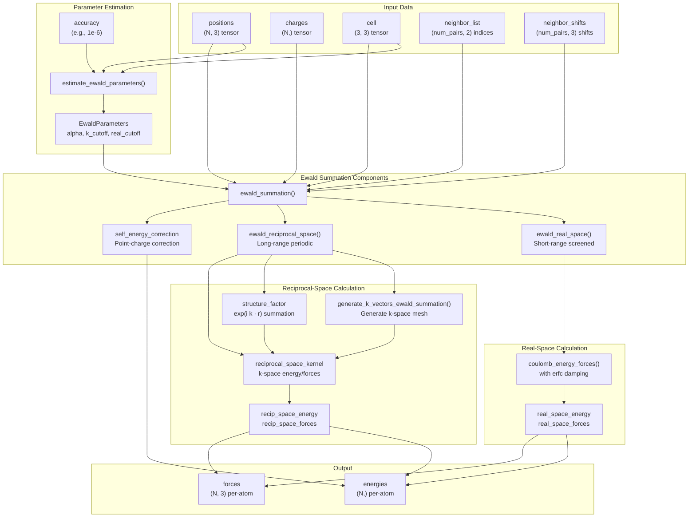
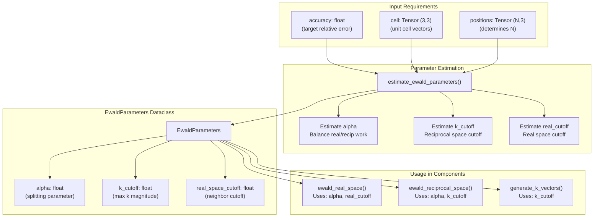
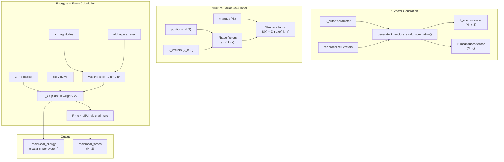
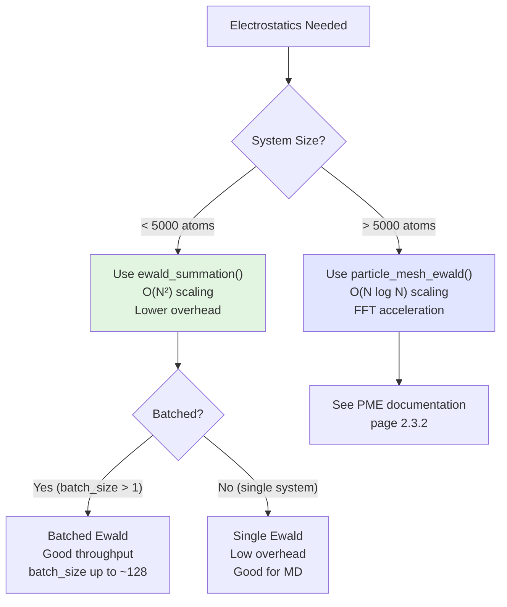

<!-- source: DeepWiki mcp.deepwiki.com · repo NVIDIA/nvalchemi-toolkit-ops · extra page Ewald Summation · fetched 2026-10-26 -->

# Ewald Summation

<details>
<summary>Relevant source files</summary>

The following files were used as context for generating this wiki page:

- [docs/benchmarks/electrostatics.md](docs/benchmarks/electrostatics.md)
- [docs/modules/electrostatics.rst](docs/modules/electrostatics.rst)
- [docs/userguide/about/intro.md](docs/userguide/about/intro.md)

</details>


This page documents the Ewald summation method for computing long-range electrostatic interactions in periodic systems. Ewald summation is recommended for small to medium systems (typically <5000 atoms) and provides O(N^(3/2)) to O(N²) scaling depending on parameter choices.

For large systems (>5000 atoms), see [Particle Mesh Ewald (PME)](#2.3.2) which achieves O(N log N) scaling. For general electrostatics concepts and method selection guidance, see [Electrostatics](#2.3). For complete API documentation, see [Electrostatics API](#5.3).

## Overview

The Ewald summation method solves the problem of computing electrostatic interactions in periodic systems where the direct $1/r$ summation converges too slowly. It splits the interaction into two rapidly-converging components:

**Real-space component**: Short-range screened interactions computed by summing over nearby atoms using neighbor lists. This uses a complementary error function (erfc) screening to dampen long-range contributions.

**Reciprocal-space component**: Long-range periodic interactions computed as a Fourier series over reciprocal lattice vectors (k-vectors). This captures the slowly-varying long-range electrostatic field.

The method is exact (within numerical precision) when properly converged, and the balance between real-space and reciprocal-space computational cost is controlled by the Ewald splitting parameter α (alpha).

**Sources**: [docs/modules/electrostatics.rst:1-93](), [docs/userguide/about/intro.md:263-353]()

## Method Components

The following diagram shows how the Ewald summation computation is decomposed into components:



**Sources**: [docs/modules/electrostatics.rst:20-28](), [nvalchemiops/interactions/electrostatics/ewald.py]()

## Core Functions

The Ewald implementation provides three primary functions that can be used individually or combined:

| Function | Purpose | Scaling | Component |
|----------|---------|---------|-----------|
| `ewald_summation()` | Complete Ewald calculation | O(N²) | Real + Reciprocal + Self |
| `ewald_real_space()` | Real-space contribution only | O(N_pairs) | Short-range screened |
| `ewald_reciprocal_space()` | Reciprocal-space contribution only | O(N × N_k) | Long-range periodic |

The complete `ewald_summation()` function combines all components and is the recommended entry point for most users. The individual component functions are useful for:
- Custom decomposition schemes
- Debugging and validation
- Profiling specific components
- Methods that modify only one component

**Sources**: [docs/modules/electrostatics.rst:20-28]()

## Parameter Selection

The following diagram shows how Ewald parameters are estimated and used:



### Automatic Parameter Estimation

The `estimate_ewald_parameters()` function automatically determines optimal parameters based on target accuracy. The accuracy parameter specifies the maximum relative error in the computed energy:

| Accuracy | Typical α (Bohr⁻¹) | k_cutoff (Bohr⁻¹) | real_cutoff (Bohr) | Use Case |
|----------|-------------------|-------------------|-------------------|----------|
| 1e-4 | ~0.2-0.3 | ~4-6 | ~15-20 | Rapid screening |
| 1e-6 | ~0.3-0.4 | ~6-8 | ~12-18 | Standard production |
| 1e-8 | ~0.4-0.5 | ~8-10 | ~10-15 | High-accuracy |

The estimation algorithm balances computational cost between real-space (neighbor list dependent) and reciprocal-space (k-vector dependent) components. Larger α shifts work to real-space; smaller α shifts work to reciprocal-space.

**Sources**: [docs/modules/electrostatics.rst:50-61](), [docs/benchmarks/electrostatics.md:119-131]()

## Real-Space Component

The real-space component computes short-range screened electrostatic interactions using the complementary error function:

$$E_{\text{real}} = \frac{1}{2} \sum_{i,j} q_i q_j \frac{\text{erfc}(\alpha r_{ij})}{r_{ij}}$$

This summation converges rapidly because erfc(αr) → 0 exponentially as r increases. Implementation details:

- Uses `coulomb_energy_forces()` with damping parameter α
- Requires neighbor list and periodic shifts for PBC
- Scales as O(N_pairs) where N_pairs = number of neighbor pairs
- Typically accounts for 30-60% of total compute time

The real-space cutoff is chosen such that erfc(α × real_cutoff) < accuracy, ensuring contributions beyond the cutoff are negligible.

**Sources**: [docs/modules/electrostatics.rst:20-28](), [nvalchemiops/interactions/electrostatics/ewald.py]()

## Reciprocal-Space Component

The reciprocal-space component computes long-range periodic interactions via Fourier summation:

$$E_{\text{recip}} = \frac{1}{2V} \sum_{\mathbf{k} \neq 0} \frac{e^{-k^2/(4\alpha^2)}}{k^2} |S(\mathbf{k})|^2$$

where $S(\mathbf{k}) = \sum_i q_i e^{i\mathbf{k} \cdot \mathbf{r}_i}$ is the structure factor.

### Implementation Flow



The reciprocal-space calculation scales as O(N × N_k) where N_k is the number of k-vectors. For typical accuracy requirements (1e-6), N_k ranges from ~1000 for small cells to ~10000 for large cells. This component typically accounts for 40-70% of total compute time.

**Sources**: [docs/modules/electrostatics.rst:76-82](), [nvalchemiops/interactions/electrostatics/k_vectors.py]()

## Usage Patterns

### Single System

For a single periodic system:

```python
# Automatic parameter estimation
from nvalchemiops.interactions.electrostatics import ewald_summation
from nvalchemiops.neighborlist import neighbor_list

# Build neighbor list (cutoff estimated automatically or provided)
neighbors, _, shifts = neighbor_list(
    positions, cutoff=12.0, cell=cell, pbc=pbc, 
    return_neighbor_list=True
)

# Compute electrostatics with automatic parameter estimation
energies, forces = ewald_summation(
    positions, charges, cell, 
    neighbor_list=neighbors,
    neighbor_shifts=shifts,
    accuracy=1e-6  # Target relative error
)
```

The function returns per-atom energies with shape `(N,)` and per-atom forces with shape `(N, 3)`.

**Sources**: [docs/userguide/about/intro.md:280-302]()

### Batched Systems

For multiple systems processed simultaneously:

```python
# Batched calculation
neighbors, _, shifts = neighbor_list(
    positions, cutoff=12.0, cell=cells, pbc=pbc,
    batch_idx=batch_idx, return_neighbor_list=True
)

energies, forces = ewald_summation(
    positions, charges, cell=cells,
    neighbor_list=neighbors,
    neighbor_shifts=shifts,
    batch_idx=batch_idx,
    accuracy=1e-6
)
```

When `batch_idx` is provided:
- `cells` has shape `(num_systems, 3, 3)`
- `energies` has shape `(total_atoms,)` with atoms grouped by system
- Per-system total energy: `scatter_add(energies, batch_idx, dim=0)`

**Sources**: [docs/userguide/about/intro.md:328-353](), [docs/modules/electrostatics.rst:20-28]()

### Manual Parameter Control

For advanced users who want explicit control over parameters:

```python
from nvalchemiops.interactions.electrostatics.parameters import (
    estimate_ewald_parameters, EwaldParameters
)

# Estimate parameters
params = estimate_ewald_parameters(
    positions, cell, accuracy=1e-6
)

# Or create manually
params = EwaldParameters(
    alpha=0.35,  # Bohr^-1
    k_cutoff=8.0,  # Bohr^-1
    real_space_cutoff=15.0  # Bohr
)

# Use in calculation
energies, forces = ewald_summation(
    positions, charges, cell,
    neighbor_list=neighbors,
    neighbor_shifts=shifts,
    alpha=params.alpha,
    k_cutoff=params.k_cutoff
)
```

**Sources**: [docs/modules/electrostatics.rst:55-61]()

## Performance Characteristics

### Scaling Behavior

The following table summarizes Ewald summation performance across system sizes based on benchmark data:

| System Size | Typical Time (ms) | Memory (MB) | Throughput (atoms/ms) | Dominant Component |
|-------------|------------------|-------------|----------------------|-------------------|
| 256 atoms | 0.3-0.5 | <100 | ~1000 | Overhead |
| 1024 atoms | 0.8-1.2 | ~200 | ~1000 | Balanced |
| 4096 atoms | 3-5 | ~500 | ~1000 | Reciprocal-space |
| 16384 atoms | 15-25 | ~2000 | ~800 | Reciprocal-space |

Key observations:
- **Constant overhead region**: <1000 atoms show constant time (~0.3-0.5ms) due to kernel launch overhead
- **Linear scaling region**: 1000-10000 atoms scale approximately linearly
- **Quadratic onset**: >10000 atoms begin showing O(N²) reciprocal-space cost

### Batched Performance

Batching provides throughput improvements for small systems:

| Batch Size | System Size | Time (ms) | Throughput vs Single |
|------------|-------------|-----------|---------------------|
| 1 (single) | 256 atoms | 0.4 | 1.0× baseline |
| 16 | 256 atoms | 1.2 | ~5× improvement |
| 64 | 256 atoms | 3.5 | ~7× improvement |
| 256 | 256 atoms | 12.0 | ~8× improvement |

Batching efficiency saturates around batch_size=64-128 due to GPU occupancy limits.

**Sources**: [docs/benchmarks/electrostatics.md:28-66]()

### Component Breakdown

Typical time distribution for a 4096-atom system:

| Component | Time (ms) | Percentage | Notes |
|-----------|-----------|------------|-------|
| Real-space | 1.5-2.0 | 35-40% | Neighbor list dependent |
| Reciprocal-space | 2.5-3.0 | 55-60% | K-vector dependent |
| Self-energy | <0.1 | <5% | O(N) correction |
| Parameter estimation | <0.1 | <5% | Amortized if reused |

The reciprocal-space component dominates for typical accuracy requirements (1e-6). Reducing accuracy shifts work to real-space.

**Sources**: [docs/benchmarks/electrostatics.md:28-66]()

## When to Use Ewald vs PME

The following decision matrix helps choose between methods:



**Ewald advantages**:
- Lower overhead for small systems (<5000 atoms)
- Simpler parameter tuning
- More predictable performance
- Better batching efficiency for small systems

**PME advantages** (see [PME](#2.3.2)):
- Scales to 100K+ atoms
- O(N log N) vs O(N²)
- Efficient for large simulations

**Sources**: [docs/userguide/about/intro.md:270-275](), [docs/benchmarks/electrostatics.md:28-32]()

## Implementation Details

### Self-Energy Correction

The Ewald summation includes a self-energy correction to remove the spurious interaction of each charge with its own periodic images:

$$E_{\text{self}} = -\frac{\alpha}{\sqrt{\pi}} \sum_i q_i^2$$

This correction is computed in O(N) time and is typically negligible (<1% of total time).

### Reciprocal-Space Force Calculation

Forces in reciprocal space are computed via the chain rule:

$$\mathbf{F}_i = -\nabla_{\mathbf{r}_i} E_{\text{recip}} = -q_i \sum_{\mathbf{k}} \frac{\partial E_k}{\partial S(\mathbf{k})} \frac{\partial S(\mathbf{k})}{\partial \mathbf{r}_i}$$

The implementation computes this efficiently by:
1. Computing energy gradient with respect to structure factor: dE/dS(k)
2. Back-propagating through phase factors: dS(k)/dr_i = i k q_i exp(i k · r_i)
3. Accumulating forces for all k-vectors

This vectorized approach is more efficient than finite differences and provides exact gradients for automatic differentiation.

**Sources**: [nvalchemiops/interactions/electrostatics/ewald.py]()

### Periodic Boundary Conditions

The real-space component handles PBC via neighbor shifts:
- `neighbor_shifts` tensor contains integer shifts (h, k, l) for each pair
- Actual displacement: $\mathbf{r}_{ij} = \mathbf{r}_j - \mathbf{r}_i + \mathbf{shifts} \cdot \mathbf{cell}$
- Forces on periodic images are accumulated correctly

The reciprocal-space component is inherently periodic and does not require special handling of shifts.

**Sources**: [docs/userguide/about/intro.md:280-302]()

## Summary

Ewald summation provides an exact method for long-range electrostatics in periodic systems:

- **Complexity**: O(N^(3/2)) to O(N²) depending on parameters
- **System size**: Optimal for <5000 atoms
- **Components**: Real-space (screened) + Reciprocal-space (Fourier) + Self-correction
- **Parameters**: Automatically estimated from target accuracy
- **Batching**: Efficient for small systems with batch_size up to ~128
- **Output**: Per-atom energies and forces compatible with autograd

For detailed API documentation, see [Electrostatics API](#5.3). For large system performance, see [PME](#2.3.2). For performance analysis, see [Ewald Performance](#4.3.1).

**Sources**: [docs/modules/electrostatics.rst:1-93](), [docs/benchmarks/electrostatics.md:28-66](), [docs/userguide/about/intro.md:263-353]()

---

