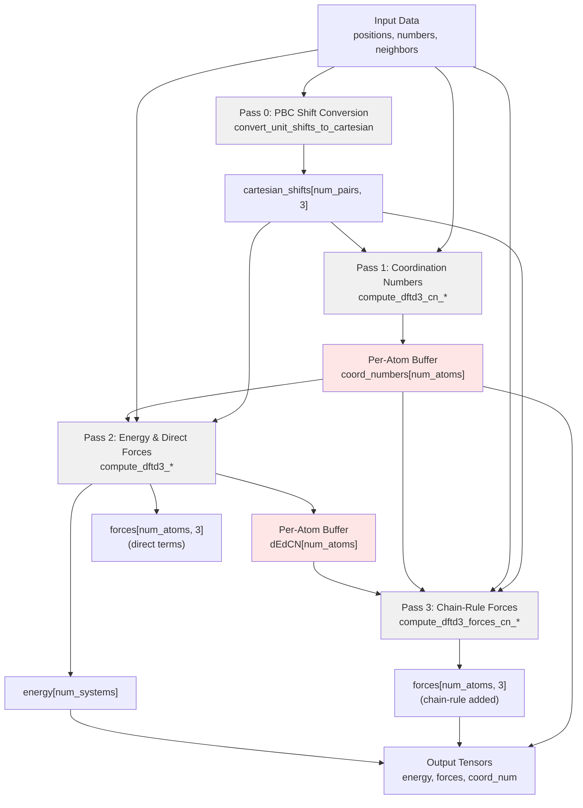
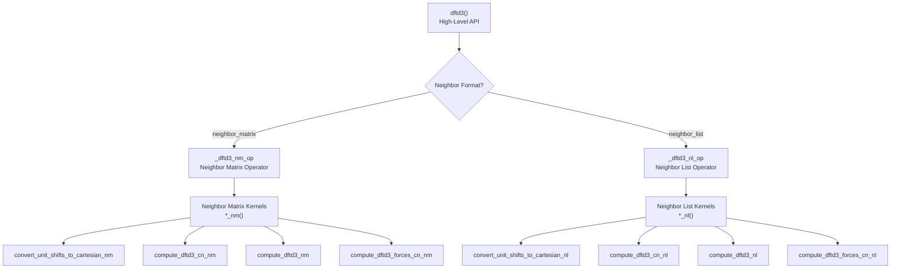

<!-- source: DeepWiki mcp.deepwiki.com · repo NVIDIA/nvalchemi-toolkit-ops · extra page Multi-Pass Kernel Architecture · fetched 2026-10-26 -->

# Multi-Pass Kernel Architecture

<details>
<summary>Relevant source files</summary>

The following files were used as context for generating this wiki page:

- [docs/userguide/about/intro.md](docs/userguide/about/intro.md)
- [docs/userguide/components/dispersion.md](docs/userguide/components/dispersion.md)

</details>


This page describes the four-pass kernel architecture used to compute DFT-D3 dispersion forces with coordination-dependent C6 coefficients. The multi-pass design is required to satisfy data dependencies in the force calculation that cannot be resolved in a single kernel pass.

For general usage of dispersion corrections, see [DFT-D3(BJ) Dispersion Correction](#2.2). For parameter configuration and reference data, see [D3Parameters Configuration](#2.2.2). For API details, see [Dispersion API](#5.2).

## Why Multi-Pass Kernels are Required

The DFT-D3 force calculation includes both direct pair contributions and chain-rule terms from coordination-dependent C6 coefficients:

```math
\mathbf{F}_i = -\sum_j \left[\left.\frac{\partial E_{ij}}{\partial \mathbf{r}_i}\right|_{\text{CN}} + \left(\sum_k \frac{\partial E_{ik}}{\partial \text{CN}_i}\right) \frac{\partial \text{CN}_i}{\partial \mathbf{r}_i}\right]
```

The chain-rule term $\left(\sum_k \partial E_{ik}/\partial \text{CN}_i\right)$ creates a critical data dependency: it must be **fully accumulated** over all neighbor pairs involving atom $i$ before computing $\partial \text{CN}_i/\partial \mathbf{r}_i$. This prevents computing direct and chain-rule forces in a single pass over the neighbor list.

The multi-pass architecture resolves this by:
1. Computing coordination numbers first (Pass 1)
2. Accumulating $\partial E/\partial \text{CN}$ into per-atom buffers during energy/force calculation (Pass 2)
3. Computing chain-rule forces using the fully accumulated buffers (Pass 3)

**Sources:** [docs/userguide/components/dispersion.md:494-508]()

## Four-Pass Execution Flow



**Pass Execution Order and Data Flow**

**Sources:** [docs/userguide/components/dispersion.md:509-526]()

### Pass 0: PBC Shift Conversion (Periodic Systems Only)

For periodic boundary conditions, neighbor lists store integer unit cell shifts as `[num_pairs, 3]` integer vectors. Pass 0 converts these to Cartesian coordinates by matrix multiplication with the lattice vectors:

```math
\mathbf{s}_{\text{cart}} = \mathbf{s}_{\text{unit}} \cdot \mathbf{L}^T
```

where $\mathbf{L}$ is the `[3, 3]` cell matrix. The resulting Cartesian shifts are reused in Passes 1, 2, and 3 for distance calculations.

For non-periodic systems or when shifts are already provided in Cartesian coordinates, this pass is skipped.

**Kernel Functions:**
- Neighbor matrix format: `convert_unit_shifts_to_cartesian_nm` 
- Neighbor list format: `convert_unit_shifts_to_cartesian_nl`

**Sources:** [docs/userguide/components/dispersion.md:510-512]()

### Pass 1: Coordination Number Calculation

Pass 1 computes coordination numbers for all atoms using the DFT-D3 geometric counting function:

```math
\text{CN}_i = \sum_{j \neq i} \frac{1}{1 + \exp\left[k_1 \left(\frac{r_{\text{cov},ij}}{r_{ij}} - 1\right)\right]}
```

where $r_{\text{cov},ij}$ is the sum of covalent radii and $k_1 = 16$ is a sharpness parameter. The coordination numbers are stored in a `[num_atoms]` buffer for use in Pass 2.

Each thread processes one neighbor pair, computing the contribution to both atoms' coordination numbers using atomic addition operations.

**Kernel Functions:**
- Neighbor matrix format: `compute_dftd3_cn_nm`
- Neighbor list format: `compute_dftd3_cn_nl`

**Sources:** [docs/userguide/components/dispersion.md:513-517](), [docs/userguide/components/dispersion.md:467-470]()

### Pass 2: Energy, Direct Forces, and ∂E/∂CN Accumulation

Pass 2 is the main computational pass that performs:

1. **C6 Interpolation:** Using the coordination numbers from Pass 1, interpolate $C_6^{ij}$ from the reference grid:
   ```math
   C_6^{ij}(\text{CN}_i, \text{CN}_j) = \frac{\sum_{pq} C_6^{\text{ref}}[p,q] \cdot L_{pq}}{\sum_{pq} L_{pq}}
   ```
   where $L_{pq}$ are Gaussian weights based on coordination number differences.

2. **Damped Dispersion Energy:** Compute the Becke-Johnson damped C6 and C8 contributions:
   ```math
   E_{ij} = -\left[\frac{s_6 C_6^{ij}}{r_{ij}^6 + f_{\text{damp},6}^6} + \frac{s_8 C_8^{ij}}{r_{ij}^8 + f_{\text{damp},8}^8}\right]
   ```

3. **Direct Forces:** Compute $\partial E_{ij}/\partial \mathbf{r}_i$ holding coordination numbers constant:
   ```math
   \mathbf{F}_{\text{direct},ij} = -\left.\frac{\partial E_{ij}}{\partial \mathbf{r}_i}\right|_{\text{CN}}
   ```

4. **∂E/∂CN Accumulation:** For each pair, compute the derivatives $\partial E_{ij}/\partial \text{CN}_i$ and $\partial E_{ij}/\partial \text{CN}_j$ and accumulate them into per-atom buffers using atomic addition:
   ```math
   \frac{\partial E}{\partial \text{CN}_i} \mathrel{+}= \sum_j \frac{\partial E_{ij}}{\partial \text{CN}_i}
   ```

The accumulated $\partial E/\partial \text{CN}$ values are stored in a `[num_atoms]` buffer for Pass 3.

**Kernel Functions:**
- Neighbor matrix format: `compute_dftd3_nm`
- Neighbor list format: `compute_dftd3_nl`

**Sources:** [docs/userguide/components/dispersion.md:518-522](), [docs/userguide/components/dispersion.md:456-463]()

### Pass 3: Chain-Rule Force Contribution

Pass 3 computes the chain-rule contribution to forces using the accumulated $\partial E/\partial \text{CN}$ values from Pass 2:

```math
\mathbf{F}_{\text{chain},i} = -\left(\sum_k \frac{\partial E_{ik}}{\partial \text{CN}_i}\right) \frac{\partial \text{CN}_i}{\partial \mathbf{r}_i}
```

The term $\partial \text{CN}_i/\partial \mathbf{r}_i$ is computed by differentiating the coordination number counting function:

```math
\frac{\partial \text{CN}_i}{\partial \mathbf{r}_i} = \sum_{j \neq i} \frac{\partial}{\partial \mathbf{r}_i} \left[\frac{1}{1 + \exp(...)}\right]
```

The chain-rule forces are **added** to the direct forces computed in Pass 2, producing the final total forces.

**Kernel Functions:**
- Neighbor matrix format: `compute_dftd3_forces_cn_nm`
- Neighbor list format: `compute_dftd3_forces_cn_nl`

**Sources:** [docs/userguide/components/dispersion.md:523-526](), [docs/userguide/components/dispersion.md:485-492]()

## Neighbor Format Dispatch

The `dftd3` function dispatches to different operator implementations based on the neighbor representation format:



**Neighbor Format Dispatch to Kernel Implementations**

Both paths execute the same four-pass algorithm and produce numerically identical results. The difference is in memory layout and indexing:

| Format | Memory Layout | Indexing Pattern | Use Case |
|--------|---------------|------------------|----------|
| Neighbor Matrix | Dense `[num_atoms, max_neighbors]` | Fixed stride, padded with `fill_value` | `torch.compile`, uniform neighbor counts |
| Neighbor List | Sparse COO `[2, num_pairs]` with CSR pointers | Variable stride, no padding | GNN integration, sparse systems |

The dispatch logic checks which neighbor format argument is provided:
- If `neighbor_matrix` is not `None`, dispatch to `_dftd3_nm_op`
- Else if `neighbor_list` is not `None`, dispatch to `_dftd3_nl_op`
- Else raise an error

**Sources:** [docs/userguide/components/dispersion.md:527-543]()

## Memory Buffers and Thread Synchronization

The multi-pass architecture requires several intermediate buffers:

| Buffer | Shape | Type | Purpose | Lifetime |
|--------|-------|------|---------|----------|
| `coord_numbers` | `[num_atoms]` | `float32` | Coordination numbers | Pass 1 → Pass 2 → Pass 3 → Output |
| `dEdCN` | `[num_atoms]` | `float32` | Accumulated $\partial E/\partial \text{CN}$ | Pass 2 → Pass 3 |
| `cartesian_shifts` | `[num_pairs, 3]` | `float32` or `float64` | PBC shift vectors | Pass 0 → Pass 1, 2, 3 |
| `energies` | `[num_systems]` | `float32` | Per-system dispersion energy | Pass 2 → Output |
| `forces` | `[num_atoms, 3]` | `float32` | Atomic forces | Pass 2 (direct) → Pass 3 (chain-rule added) → Output |

### Atomic Operations

Passes 1, 2, and 3 use atomic addition operations to accumulate contributions to shared buffers:

- **Pass 1:** Each thread adds to `coord_numbers[i]` and `coord_numbers[j]` for pair $(i, j)$
- **Pass 2:** Each thread adds to `dEdCN[i]` and `dEdCN[j]`
- **Pass 3:** Each thread adds to `forces[i]` and `forces[j]`

NVIDIA Warp provides built-in atomic operations (`wp.atomic_add`) that ensure thread-safe accumulation on GPU hardware.

**Sources:** [docs/userguide/components/dispersion.md:509-526]()

## Precision Handling

The kernels support both `float32` and `float64` input positions through Warp's overload mechanism. At module initialization, separate kernel overloads are compiled for each precision:

- **`float32` positions:** Use `wp.vec3f` for position vectors and `wp.mat33f` for cell matrices
- **`float64` positions:** Use `wp.vec3d` for position vectors and `wp.mat33d` for cell matrices

Distance vectors $\mathbf{r}_{ij}$ are computed at the input precision, but all subsequent dispersion calculations use `float32`:

1. **C6 interpolation:** Gaussian weights and interpolation are `float32`
2. **Energy calculation:** Damping functions and energy accumulation are `float32`
3. **Force calculation:** Force components and atomic additions are `float32`

All output tensors (`energies`, `forces`, `coord_numbers`) are always `float32` regardless of input precision.

**Sources:** [docs/userguide/components/dispersion.md:544-556]()

## Numerical Stability Considerations

### Log-Sum-Exp Trick for C6 Interpolation

The C6 interpolation computes a weighted average:

```math
C_6^{ij} = \frac{\sum_{pq} w_{pq} \cdot C_6^{\text{ref}}[p,q]}{\sum_{pq} w_{pq}}
```

where $w_{pq} = \exp(-\alpha \cdot \text{distance}_{pq})$ are Gaussian weights. Computing $\exp(\text{arg})$ directly risks overflow when arguments are large.

The implementation uses the **log-sum-exp trick**: compute all exponentials relative to the maximum argument:

```math
w_{pq} = \exp(\text{arg}_{pq} - \text{arg}_{\max})
```

This ensures that the largest weight is exactly 1.0, preventing overflow while maintaining numerical accuracy.

### Threshold Skipping

Contributions with very small weights ($< 10^{-12}$ relative to the maximum) are skipped entirely. This:
- Avoids accumulating negligible contributions that add rounding error
- Reduces computational work in the inner loop
- Has no measurable impact on final accuracy

### Coordination Number Smoothness

The geometric counting function includes an exponential that could produce very large arguments when $r_{\text{cov}} \gg r_{ij}$. The implementation clamps these values to prevent overflow, as the counting function saturates to 1.0 regardless.

**Sources:** [docs/userguide/components/dispersion.md:557-566]()

## Integration with torch.compile

The multi-pass architecture is compatible with `torch.compile` for JIT optimization. Each pass launches a separate Warp kernel, and PyTorch's custom operator interface treats the entire four-pass sequence as a single computational graph node.

Key considerations:
- **Fixed buffer sizes:** The intermediate buffers (`coord_numbers`, `dEdCN`) have compile-time constant shapes, allowing TorchInductor to optimize memory allocations
- **Operator registration:** Both `_dftd3_nm_op` and `_dftd3_nl_op` are registered as custom operators with proper autograd metadata
- **Graph breaks:** Variable-sized inputs (e.g., dynamic `num_systems`) should be provided explicitly to avoid recompilation

**Sources:** [docs/userguide/components/dispersion.md:297-312]()

---

