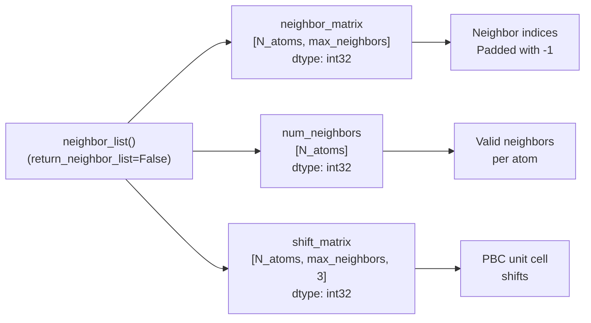
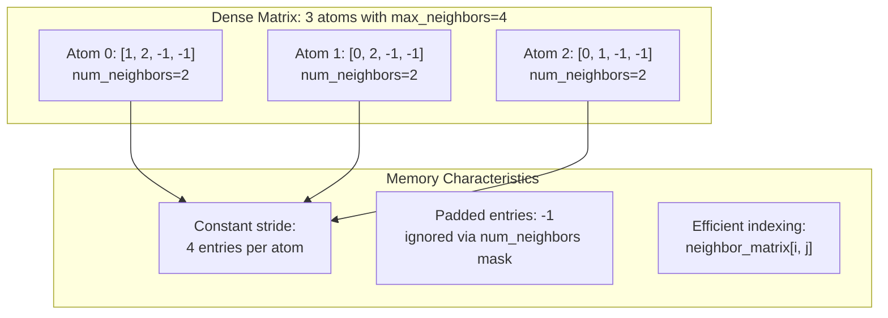
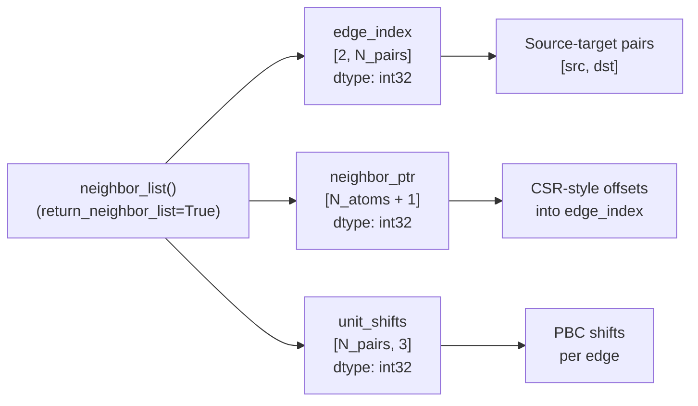
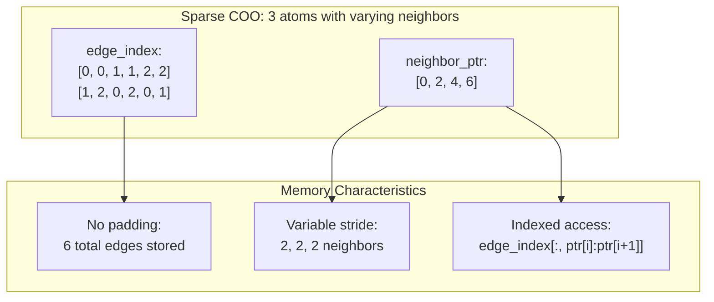
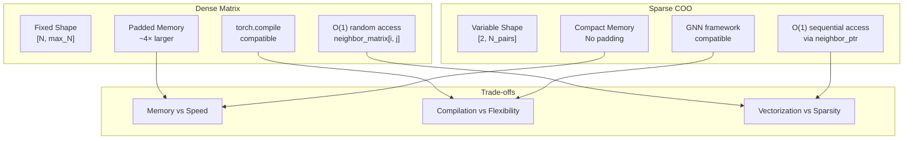
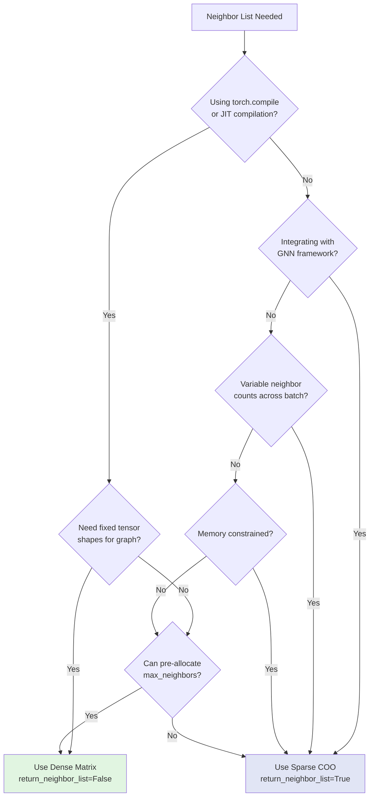

<!-- source: DeepWiki mcp.deepwiki.com · repo NVIDIA/nvalchemi-toolkit-ops · extra page Output Formats · fetched 2026-10-26 -->

# Output Formats

<details>
<summary>Relevant source files</summary>

The following files were used as context for generating this wiki page:

- [README.md](README.md)
- [docs/userguide/about/faq.md](docs/userguide/about/faq.md)
- [docs/userguide/about/intro.md](docs/userguide/about/intro.md)

</details>


This page describes the two output formats provided by the neighbor list construction algorithms: **dense matrix** representation and **sparse COO (Coordinate) list** representation. It covers the structure of each format, their intended use cases, and guidance for selecting between them.

For information about which neighbor list algorithm to use (cell list vs naive, single vs batched), see [Algorithm Selection](#2.1.1). For complete API details, see [Neighbor List API](#5.1).

## Overview

The neighbor list functions in `nvalchemiops.neighborlist` support two distinct output formats controlled by the `return_neighbor_list` parameter:

| Format | Parameter | Primary Use Case | Tensor Shape Characteristics |
|--------|-----------|-----------------|----------------------------|
| Dense Matrix | `return_neighbor_list=False` (default) | `torch.compile` workflows, fixed-shape operations | Constant shape with padding |
| Sparse COO | `return_neighbor_list=True` | GNN frameworks, dynamic graphs | Variable shape, memory-efficient |

Both formats represent the same underlying neighbor relationships but organize the data differently to optimize for distinct computational patterns.

**Sources**: [README.md:72-88](), [docs/userguide/about/intro.md:52-61](), [docs/userguide/about/faq.md:53]()

## Dense Matrix Format

### Structure

The dense matrix format returns three tensors that represent neighbors in a padded, fixed-shape matrix structure:



#### Tensor Descriptions

**`neighbor_matrix`**: `[N_atoms, max_neighbors]` tensor of `int32`
- Each row `i` contains neighbor atom indices for atom `i`
- Padded with `-1` when fewer than `max_neighbors` exist
- Maximum neighbors determined by algorithm (cell list) or pre-allocated size (naive)

**`num_neighbors`**: `[N_atoms]` tensor of `int32`
- Number of valid (non-padded) neighbors for each atom
- Values range from `0` to `max_neighbors`
- Used to mask padded entries in downstream operations

**`shift_matrix`**: `[N_atoms, max_neighbors, 3]` tensor of `int32`
- Periodic boundary condition shifts as integer multiples of cell vectors
- Each entry `[i, j, :]` gives the unit cell shift for the `j`-th neighbor of atom `i`
- Shape `[0, 0, 0]` for non-periodic directions or molecules

**Sources**: [README.md:72-78](), [nvalchemiops/neighborlist/neighborlist.py]()

### When to Use Dense Matrix Format

The dense matrix format is optimal for:

**`torch.compile` Workflows**
- Fixed tensor shapes prevent graph breaks in JIT compilation
- Padding enables efficient batched operations without dynamic shapes
- Pre-allocated output buffers support in-place updates

**Vectorized Force Calculations**
- Regular memory layout enables coalesced GPU memory access
- Padding allows SIMD operations without branching
- Compatible with matrix-based force computation kernels

**Predictable Memory Usage**
- Shape known at allocation time: `N_atoms × max_neighbors`
- No dynamic memory growth during computation
- Enables static memory planning for large-scale simulations

**Example workflow**: A molecular dynamics engine using `torch.compile` to optimize force evaluation loops would pre-allocate neighbor matrices and reuse them across timesteps, updating only when rebuild is required.

**Sources**: [docs/userguide/about/faq.md:60-66](), [docs/userguide/about/intro.md:70-88]()

### Memory Layout



The dense format stores `N_atoms × max_neighbors` integers regardless of actual neighbor count. For a system with 10,000 atoms and average 30 neighbors but `max_neighbors=100`, the matrix allocates space for 1,000,000 neighbor entries (4MB at `int32`), even if only 300,000 are valid.

**Sources**: [nvalchemiops/neighborlist/neighborlist.py]()

## Sparse COO Format

### Structure

The sparse COO (Coordinate List) format returns three tensors representing neighbors as an edge list:



#### Tensor Descriptions

**`edge_index`**: `[2, N_pairs]` tensor of `int32`
- Row 0: source atom indices
- Row 1: destination (neighbor) atom indices
- Total pairs `N_pairs` equals total number of neighbor relationships
- Standard GNN edge connectivity format (PyTorch Geometric compatible)

**`neighbor_ptr`**: `[N_atoms + 1]` tensor of `int32`
- CSR (Compressed Sparse Row) pointer structure
- Neighbors of atom `i` are `edge_index[1, neighbor_ptr[i]:neighbor_ptr[i+1]]`
- Enables efficient per-atom neighbor queries
- Final entry equals `N_pairs`

**`unit_shifts`**: `[N_pairs, 3]` tensor of `int32`
- Unit cell shift for each edge in `edge_index`
- Indexed parallel to `edge_index` columns: `unit_shifts[k]` corresponds to edge `edge_index[:, k]`
- Shape `[0, 0, 0]` for non-periodic edges

**Sources**: [README.md:79-88](), [nvalchemiops/neighborlist/neighborlist.py]()

### When to Use Sparse COO Format

The sparse COO format is optimal for:

**Graph Neural Networks**
- Standard `edge_index` format matches PyTorch Geometric, DGL, and other GNN libraries
- No padding overhead for heterogeneous graphs with varying connectivity
- Direct compatibility with message-passing operations

**Memory-Efficient Storage**
- Stores only actual neighbor pairs: no padding for unused entries
- Crucial for systems with highly variable neighbor counts
- Reduces memory footprint by 2-10× compared to dense format for typical molecular systems

**Dynamic Graph Operations**
- Variable-length neighbor lists without pre-allocated maximum
- Efficient concatenation and batching of graphs with different sizes
- Natural representation for graph algorithms (shortest path, clustering, etc.)

**Example workflow**: Training a GNN model on a molecular dataset where molecules range from 10-1000 atoms. Sparse format avoids allocating `max_neighbors` slots for small molecules while accommodating dense packing in large molecules.

**Sources**: [docs/userguide/about/intro.md:27-29](), [README.md:79-88]()

### Memory Layout



The sparse format stores exactly `2 × N_pairs` integers for `edge_index`. For the same 10,000-atom system with 300,000 neighbor pairs, this requires 600,000 integers (2.4MB at `int32`) plus 10,001 integers for `neighbor_ptr` — roughly 4× smaller than the dense format's 4MB.

**Sources**: [nvalchemiops/neighborlist/neighborlist.py]()

## Format Comparison



| Characteristic | Dense Matrix | Sparse COO |
|----------------|--------------|------------|
| **Memory scaling** | `O(N × max_neighbors)` | `O(N_pairs)` |
| **Memory overhead** | 2-10× padding for typical systems | Minimal (pointer array only) |
| **Random access** | Direct: `neighbor_matrix[i, j]` | Indirect: requires `neighbor_ptr` lookup |
| **Sequential access** | Requires masking `-1` entries | Natural iteration over `edge_index` |
| **`torch.compile`** | Fully compatible (fixed shape) | May cause graph breaks (dynamic shape) |
| **GNN frameworks** | Requires conversion | Direct compatibility |
| **Batching** | Efficient with padding | Requires concatenation |
| **Typical use cases** | MD simulations, JIT-compiled training | GNN message passing, heterogeneous graphs |

**Sources**: [docs/userguide/about/faq.md:46-56](), [docs/userguide/about/intro.md:52]()

## Format Selection Decision Tree



**Selection guidelines**:

1. **Default to dense matrix** when using `torch.compile`, as it avoids dynamic shapes that cause recompilation
2. **Default to sparse COO** when integrating with PyTorch Geometric, DGL, or other GNN frameworks
3. **Choose sparse COO** for batched systems with highly variable neighbor counts (e.g., small molecules + large proteins)
4. **Choose dense matrix** for molecular dynamics where neighbor lists are rebuilt frequently and shapes remain constant
5. **Benchmark both** if your workload doesn't clearly fit one category

**Sources**: [docs/userguide/about/intro.md:63-68](), [docs/userguide/about/faq.md:32-43]()

## Integration Patterns

### Converting Between Formats

The toolkit does not provide built-in conversion functions, but transformations are straightforward:

**Dense to Sparse**:
```python
# Given: neighbor_matrix, num_neighbors, shift_matrix
# Construct edge_index and unit_shifts by iterating valid entries
# Pseudo-code reference only - see implementation for details
```

**Sparse to Dense**:
```python
# Given: edge_index, neighbor_ptr, unit_shifts
# Allocate neighbor_matrix with max_neighbors = max(neighbor_ptr[1:] - neighbor_ptr[:-1])
# Fill entries using edge_index and pad with -1
```

Users needing both formats should call `neighbor_list()` twice with different `return_neighbor_list` values, or implement caching if neighbor relationships don't change frequently.

**Sources**: [nvalchemiops/neighborlist/neighborlist.py]()

### Usage with Downstream Operations

**Dense Matrix with DFT-D3**:
```python
# Example reference - see actual API documentation
neighbor_matrix, num_neighbors, shift_matrix = neighbor_list(
    positions, cutoff, cell=cell, pbc=pbc
)
energy, forces, coord_nums = dftd3(
    positions, numbers,
    neighbor_matrix=neighbor_matrix,
    neighbor_matrix_shifts=shift_matrix,
    # ... other parameters
)
```

**Sparse COO with DFT-D3**:
```python
# Example reference - see actual API documentation
edge_index, neighbor_ptr, unit_shifts = neighbor_list(
    positions, cutoff, cell=cell, pbc=pbc,
    return_neighbor_list=True
)
energy, forces, coord_nums = dftd3(
    positions, numbers,
    neighbor_list=edge_index,
    unit_shifts=unit_shifts,
    # ... other parameters
)
```

Both `dftd3()` and electrostatics functions accept either format via distinct parameters (`neighbor_matrix=` vs `neighbor_list=`).

**Sources**: [README.md:94-139](), [docs/userguide/about/intro.md:178-254]()

## Implementation Notes

### Batch Processing

For batched operations, both formats support heterogeneous systems:

**Dense Matrix Batching**:
- `neighbor_matrix` shape: `[total_atoms, max_neighbors_across_all_systems]`
- Padding applied per-system, then concatenated
- `batch_idx` tensor maps atoms to systems

**Sparse COO Batching**:
- `edge_index` concatenates edges from all systems
- Atom indices offset by system: system 2 indices += system 1 atom count
- `neighbor_ptr` remains per-atom, not per-system
- More memory-efficient for heterogeneous batches

**Sources**: [docs/userguide/about/intro.md:108-143]()

### Performance Characteristics

The format choice affects performance differently depending on algorithm:

| Algorithm | Dense Matrix Overhead | Sparse COO Overhead |
|-----------|----------------------|---------------------|
| `cell_list` | Padding increases memory bandwidth | Minimal - stores actual pairs |
| `naive` | Pre-allocated size avoids reallocation | Dynamic allocation per atom |
| `batch_cell_list` | Uniform max_neighbors across batch | Per-system optimization |
| `batch_naive` | Similar to single-system | Similar to single-system |

For detailed performance analysis of each algorithm, see [Neighbor List Performance](#4.1).

**Sources**: [docs/benchmarks/benchmark_results/]()

### torch.compile Compatibility

**Dense matrix format** maintains graph compatibility:
- Tensor shapes remain constant across neighbor list rebuilds (if max_neighbors unchanged)
- Padding with `-1` enables masked operations without dynamic control flow
- In-place updates possible with pre-allocated buffers

**Sparse COO format** may cause graph breaks:
- `N_pairs` varies between rebuilds, changing `edge_index` shape
- Dynamic shape triggers recompilation in `torch.compile`
- Workaround: Cache compiled graphs per shape range or use dense format

For torch.compile troubleshooting, see [FAQ: Using torch.compile](#7).

**Sources**: [docs/userguide/about/faq.md:60-74](), [docs/userguide/about/intro.md:359-363]()

---

