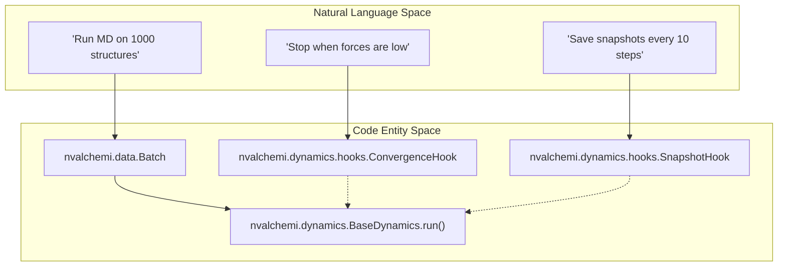
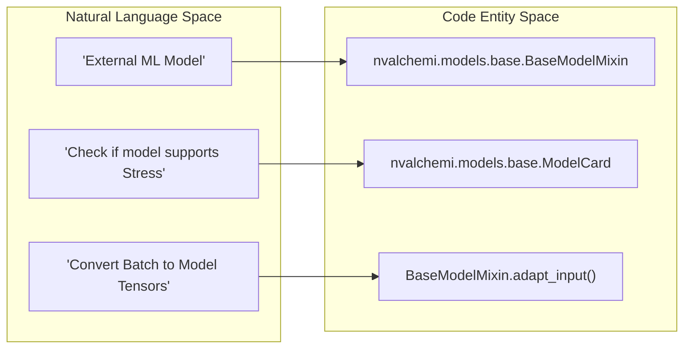

<!-- source: DeepWiki mcp.deepwiki.com · repo NVIDIA/nvalchemi-toolkit · page 1 Overview · fetched 2026-10-26 -->

# Overview

Relevant source files

The following files were used as context for generating this wiki page:

- [README.md](README.md)
- [docs/modules/dynamics/api.rst](docs/modules/dynamics/api.rst)
- [docs/modules/typing.rst](docs/modules/typing.rst)
- [docs/userguide/about/install.md](docs/userguide/about/install.md)
- [docs/userguide/about/intro.md](docs/userguide/about/intro.md)
- [docs/userguide/index.md](docs/userguide/index.md)
- [nvalchemi/__init__.py](nvalchemi/__init__.py)
- [test/__init__.py](test/__init__.py)

The **NVIDIA ALCHEMI Toolkit** (`nvalchemi`) is a GPU-first Python framework designed for high-throughput atomic simulation workflows [docs/userguide/about/intro.md:5-9](). It provides a unified interface for machine-learned interatomic potentials (MLIPs), batched molecular dynamics, and composable simulation pipelines [README.md:12-16]().

The toolkit is built on a "batch-first" philosophy, ensuring that all operations—from neighbor list generation to model inference—are performed on multiple systems in parallel to maximize GPU saturation [docs/userguide/about/intro.md:17-18]().

### System Architecture

The toolkit is organized into four primary layers that bridge the gap between high-level simulation intent and low-level GPU execution.

#### Layered Architecture Overview
| Layer | Responsibility | Key Code Entities |
| :--- | :--- | :--- |
| **Data** | Graph representation and batching | `AtomicData`, `Batch` |
| **Model** | MLIP wrapping and adaptation | `BaseModelMixin`, `ModelCard` |
| **Dynamics** | Integration and optimization | `BaseDynamics`, `Hook` |
| **I/O** | Persistence and loading | `AtomicDataZarrWriter`, `DataLoader` |

**Sources:** [docs/userguide/about/intro.md:96-143](), [README.md:18-35]()

### Core Capabilities

*   **GPU-Resident Data Structures**: Atomic systems are represented as graphs where nodes (atoms) and edges (neighbors) live on the GPU by default [docs/userguide/about/intro.md:74-77]().
*   **Model Agnosticism**: Standardized wrappers allow the use of MACE, AIMNet2, or custom models through a common interface [README.md:20-22]().
*   **Composable Pipelines**: Users can chain simulation stages (e.g., relaxation followed by MD) using Python operators. The `+` operator fuses stages on a single GPU, while the `|` operator distributes them across multiple GPUs [README.md:25-27]().
*   **Inflight Batching**: The `SizeAwareSampler` manages GPU memory by replacing converged or completed samples with new ones on the fly, keeping the pipeline full [README.md:30-31]().

### Mapping Natural Language to Code Entities

The following diagrams illustrate how high-level simulation concepts map to specific classes and protocols within the `nvalchemi` codebase.

#### Simulation Pipeline Mapping
This diagram shows how user-defined simulation logic is translated into the `nvalchemi.dynamics` execution model.

**Sources:** [docs/userguide/about/intro.md:124-132](), [README.md:81-90]()

#### Model Integration Mapping
This diagram shows how an external Machine Learning Interatomic Potential (MLIP) is integrated into the toolkit.

**Sources:** [docs/userguide/about/intro.md:112-119](), [README.md:20-22]()

### Wiki Navigation

This wiki is structured to guide you from initial setup to advanced distributed orchestration.

*   **[Getting Started: Installation and Setup](#1.1)**: Instructions for installing `nvalchemi-toolkit` via `pip` or `uv`, including GPU prerequisites and optional dependencies like `mace` or `warp-lang` [docs/userguide/about/install.md:5-30]().
*   **[Core Concepts and Architecture](#1.2)**: A deeper dive into the batching philosophy, the four-layer design, and the Domain Specific Language (DSL) for pipeline composition [docs/userguide/about/intro.md:15-27]().
*   **Data Layer**: Details on `AtomicData` and the high-performance Zarr I/O system.
*   **Model Layer**: Guide to wrapping potentials and capability negotiation.
*   **Dynamics Engine**: Reference for integrators (NVE, NVT, NPT) and the extensible `Hook` system [docs/modules/dynamics/api.rst:19-62]().
*   **Examples and Tutorials**: Walkthroughs of common workflows, from simple geometry optimization to distributed MD [README.md:44-127]().

**Sources:** [docs/userguide/index.md:25-70](), [docs/modules/dynamics/api.rst:1-99]()

---

