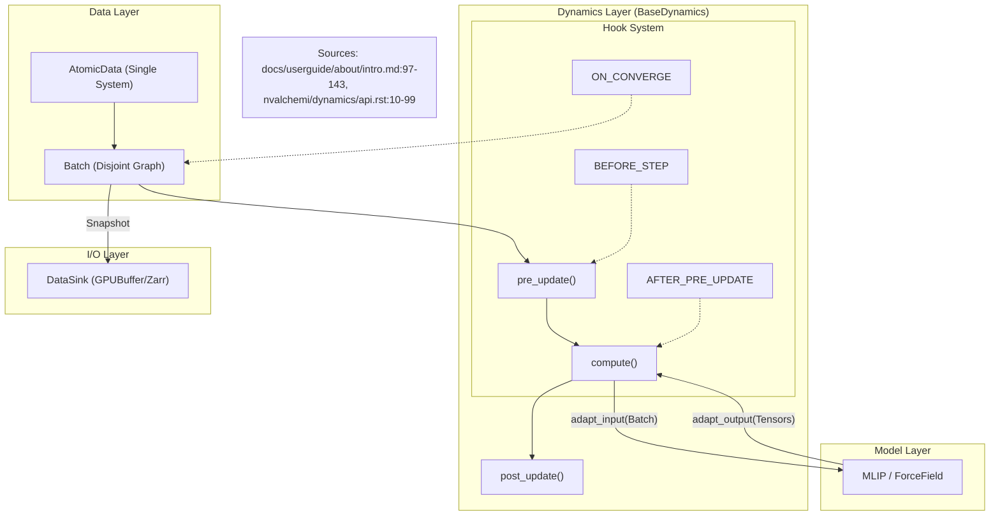
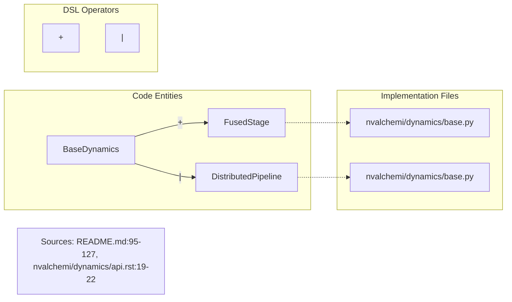

<!-- source: DeepWiki mcp.deepwiki.com · repo NVIDIA/nvalchemi-toolkit · page 1.2 Core Concepts and Architecture · fetched 2026-10-26 -->

# Core Concepts and Architecture

Relevant source files

The following files were used as context for generating this wiki page:

- [AGENTS.md](AGENTS.md)
- [README.md](README.md)
- [docs/modules/dynamics/api.rst](docs/modules/dynamics/api.rst)
- [docs/modules/dynamics/convergence.rst](docs/modules/dynamics/convergence.rst)
- [docs/modules/dynamics/implementing_dynamics.rst](docs/modules/dynamics/implementing_dynamics.rst)
- [docs/modules/typing.rst](docs/modules/typing.rst)
- [docs/userguide/about/install.md](docs/userguide/about/install.md)
- [docs/userguide/about/intro.md](docs/userguide/about/intro.md)
- [docs/userguide/index.md](docs/userguide/index.md)
- [nvalchemi/_typing.py](nvalchemi/_typing.py)
- [nvalchemi/data/datapipes/dataset.py](nvalchemi/data/datapipes/dataset.py)

This page describes the architectural foundations of the NVIDIA ALCHEMI Toolkit (`nvalchemi`). It covers the four-layer design, the batch-first execution philosophy, and the domain-specific language (DSL) used to compose complex simulation pipelines.

## Architectural Layers

The toolkit is organized into four tightly integrated layers that facilitate the transition from raw atomic data to high-throughput distributed simulations [docs/userguide/about/intro.md:97-143]().

| Layer | Responsibility | Key Entities |
| :--- | :--- | :--- |
| **Data** | Graph-based representation and batching | `AtomicData`, `Batch` |
| **Model** | Standardization of Interatomic Potentials | `BaseModelMixin`, `ModelCard` |
| **Dynamics** | Execution loops and integration | `BaseDynamics`, `Hook`, `Integrators` |
| **I/O** | Persistence and high-performance loading | `ZarrWriter`, `DataLoader`, `DataSink` |

### System Architecture Diagram
The following diagram illustrates the data flow between these layers, specifically how `Batch` objects move through the `Dynamics` engine and interact with `Models`.

"Architecture Data Flow"

Sources: [docs/userguide/about/intro.md:97-143](), [docs/modules/dynamics/api.rst:10-99]()

---

## Design Philosophies

### Batch-First Philosophy
Unlike traditional MD codes that operate on a single system at a time, `nvalchemi` is designed to process many structures in parallel to maximize GPU occupancy [docs/userguide/about/intro.md:15-18]().
*   **Amortization**: Running thousands of structures simultaneously amortizes the overhead of GPU kernel launches [docs/userguide/about/intro.md:51-55]().
*   **Inflight Batching**: The `SizeAwareSampler` allows for "graduated" samples (those that have converged) to be replaced on-the-fly, keeping the GPU fully saturated during long-running screening campaigns [README.md:30-31]().

### GPU-Resident Design
Data structures live on the GPU by default. `AtomicData` and `Batch` use device-resident tensors to minimize host-device transfers during the simulation loop [docs/userguide/about/intro.md:74-77](). High-performance primitives for neighbor lists and electrostatics are implemented via `warp-lang` in the `nvalchemi-toolkit-ops` dependency [README.md:32-35]().

### Strong Semantic Typing
The codebase utilizes `jaxtyping` and `pydantic` to provide compile-time and runtime validation of tensor shapes and physical properties [docs/userguide/about/intro.md:79-89]().

| Alias | Description | Shape |
| :--- | :--- | :--- |
| `NodePositions` | Cartesian coordinates of atoms | `[V, 3]` |
| `Forces` | Atomic forces | `[V, 3]` |
| `Energy` | Potential energy per system | `[B, 1]` |
| `LatticeVectors` | Periodic cell vectors | `[B, 3, 3]` |

Sources: [nvalchemi/_typing.py:52-100](), [docs/userguide/about/intro.md:79-89]()

---

## Pipeline Composition DSL

`nvalchemi` introduces a Pythonic DSL for composing simulation stages using the `+` and `|` operators.

### FusedStage (`+`)
The `+` operator creates a `FusedStage`. This fuses multiple dynamics objects (e.g., an Optimizer and an NVT Integrator) to run on a **single GPU** [README.md:95-109]().
*   **Shared Forward Pass**: All sub-stages share a single model evaluation per step.
*   **Masked Updates**: The `FusedStage` uses `batch.status` to determine which samples belong to which stage, applying only the relevant integrator updates to specific samples in the batch [docs/modules/dynamics/convergence.rst:165-180]().

### DistributedPipeline (`|`)
The `|` operator creates a `DistributedPipeline` for scaling across **multiple GPUs or nodes** [README.md:112-127]().
*   **Rank-Based Execution**: Each stage in the pipeline is assigned to a specific GPU rank.
*   **NCCL Communication**: Samples move between stages via asynchronous `isend`/`irecv` calls as they converge or complete their step count [docs/userguide/about/intro.md:47-49]().

"Code Entity Mapping: Composition"

Sources: [README.md:95-127](), [docs/modules/dynamics/api.rst:19-22](), [nvalchemi/dynamics/base.py]()

---

## Key Terminology

*   **Batch**: A collection of disjoint atomic graphs concatenated into a single set of tensors. Node indices are offset using `batch_ptr` [docs/userguide/about/intro.md:100-108]().
*   **Hook**: A callback mechanism with 9 lifecycle points (e.g., `BEFORE_STEP`, `ON_CONVERGE`) for extending dynamics behavior [README.md:28-29]().
*   **ModelCard**: A declarative interface where a model specifies its capabilities, such as whether it supports periodic boundary conditions (PBC) or requires autograd for forces [docs/userguide/about/intro.md:112-119]().
*   **DataSink**: An abstraction for recording trajectory data, supporting backends like `GPUBuffer` (memory) or `ZarrData` (disk) [docs/modules/dynamics/api.rst:64-77]().
*   **Convergence Criterion**: A Pydantic-backed rule (e.g., `fmax < 0.05`) used by a `ConvergenceHook` to trigger sample migration or simulation termination [docs/modules/dynamics/convergence.rst:44-68]().

Sources: [docs/userguide/about/intro.md:100-119](), [docs/modules/dynamics/convergence.rst:44-68](), [README.md:28-29]()

---

