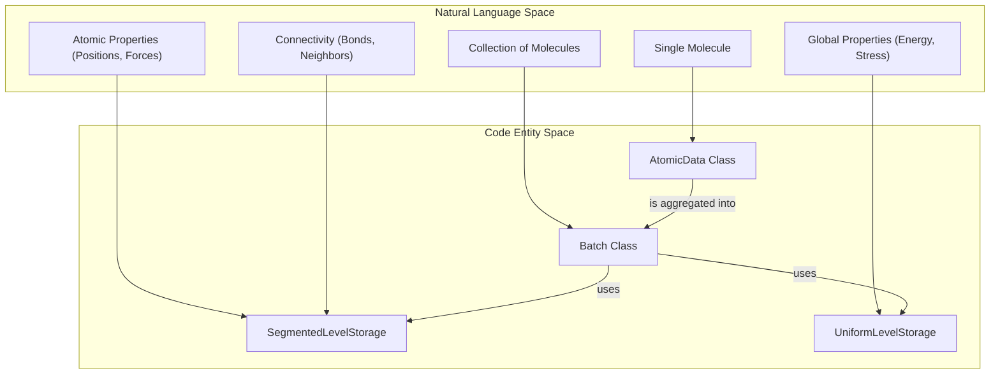
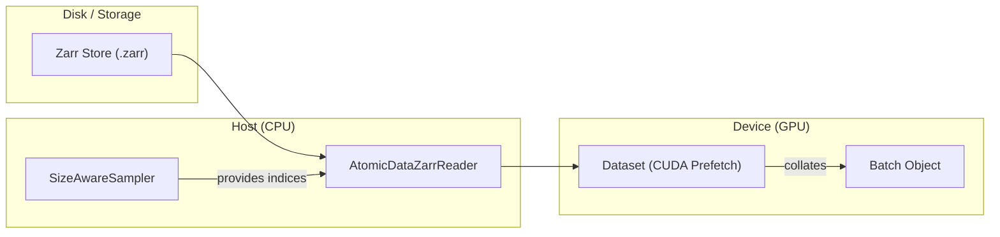

<!-- source: DeepWiki mcp.deepwiki.com · repo NVIDIA/nvalchemi-toolkit · page 2 Data Layer · fetched 2026-10-26 -->

# Data Layer

Relevant source files

The following files were used as context for generating this wiki page:

- [docs/modules/data.rst](docs/modules/data.rst)
- [docs/userguide/data.md](docs/userguide/data.md)
- [docs/userguide/dynamics_hooks.md](docs/userguide/dynamics_hooks.md)
- [docs/userguide/dynamics_simulations.md](docs/userguide/dynamics_simulations.md)
- [nvalchemi/data/__init__.py](nvalchemi/data/__init__.py)
- [nvalchemi/data/atomic_data.py](nvalchemi/data/atomic_data.py)
- [nvalchemi/data/data.py](nvalchemi/data/data.py)
- [nvalchemi/data/datapipes/__init__.py](nvalchemi/data/datapipes/__init__.py)
- [nvalchemi/data/datapipes/backends/zarr.py](nvalchemi/data/datapipes/backends/zarr.py)
- [test/data/test_zarr_datapipe.py](test/data/test_zarr_datapipe.py)

The Data Layer provides a high-performance, GPU-resident subsystem for representing and moving molecular graph data. It is built around a "batch-first" philosophy where multiple molecular systems (graphs) are concatenated into single contiguous tensors to maximize GPU utilization and minimize kernel launch overhead.

## Data Representations

The toolkit uses two primary structures to represent atomic systems:

*   **`AtomicData`**: A Pydantic-backed model representing a single molecular graph. It stores node-level (e.g., positions, atomic numbers), edge-level (e.g., neighbor indices, periodic shifts), and system-level (e.g., energy, cell vectors) properties as PyTorch tensors [nvalchemi/data/atomic_data.py:76-118]().
*   **`Batch`**: A container that aggregates multiple `AtomicData` instances into a single structure [nvalchemi/data/batch.py:104-120](). It manages the internal layout of data using different "levels" of storage to handle variable-sized graphs efficiently [docs/userguide/data.md:147-154]().

### Data Structure Mapping

The following diagram shows how high-level molecular concepts map to the internal code entities and their storage levels.

**Data Entity Mapping**

Sources: [nvalchemi/data/atomic_data.py:76-80](), [nvalchemi/data/batch.py:104-110](), [docs/userguide/data.md:149-154]()

For details on indexing, slicing, and memory layouts, see **[AtomicData and Batch Data Structures](#2.1)**.

---

## I/O and Persistence

The I/O subsystem is designed for high-throughput serialization of graph data using the Zarr format. It supports CSR-style (Compressed Sparse Row) pointer layouts to handle variable numbers of atoms and edges across different samples [nvalchemi/data/datapipes/__init__.py:35-37]().

*   **`AtomicDataZarrWriter`**: Handles bulk writes and appends of `AtomicData` or `Batch` objects to disk [nvalchemi/data/datapipes/backends/zarr.py:20-23]().
*   **`AtomicDataZarrReader`**: Provides random access to stored samples, returning them as dictionaries of tensors ready for consumption by the training pipeline [nvalchemi/data/datapipes/backends/zarr.py:24-27]().

For details on Zarr configuration, sharding, and chunking, see **[Zarr I/O: AtomicDataZarrWriter and AtomicDataZarrReader](#2.2)**.

---

## Data Loading Pipeline

The loading pipeline connects on-disk storage to the GPU-resident dynamics engine or training loop. It features a tiered architecture to ensure the GPU is never starved of data [nvalchemi/data/datapipes/__init__.py:21-34]().

1.  **`Reader`**: Low-level interface for fetching raw tensor data [nvalchemi/data/datapipes/backends/base.py:18-20]().
2.  **`Dataset`**: Orchestrates device transfers and implements **CUDA-stream prefetching** to overlap I/O with computation [nvalchemi/data/datapipes/dataset.py:34-45]().
3.  **`DataLoader`**: Combines individual samples into `Batch` objects using a `SizeAwareSampler` that performs bin-packing based on `max_atoms` or `max_edges` constraints to prevent GPU Out-of-Memory (OOM) errors [nvalchemi/data/datapipes/dataloader.py:32-40]().

### Pipeline Architecture

The diagram below illustrates the flow of data from disk to the GPU-resident batch used by models and integrators.

**Data Pipeline Flow**

Sources: [nvalchemi/data/datapipes/__init__.py:25-34](), [nvalchemi/data/datapipes/dataset.py:34-45](), [nvalchemi/data/datapipes/dataloader.py:32-40]()

For details on prefetching and the bin-packing sampler, see **[DataLoader and SizeAwareSampler](#2.3)**.

---

