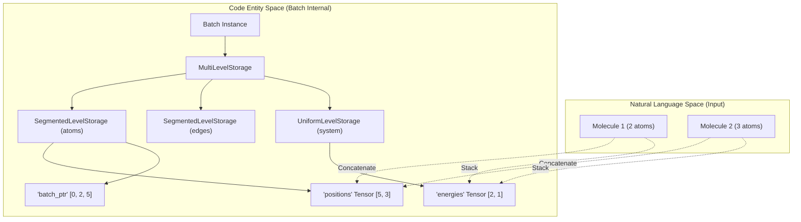
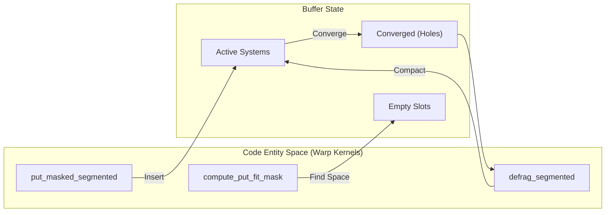

<!-- source: DeepWiki mcp.deepwiki.com · repo NVIDIA/nvalchemi-toolkit · page 2.1 AtomicData and Batch Data Structures · fetched 2026-10-26 -->

# AtomicData and Batch Data Structures

Relevant source files

The following files were used as context for generating this wiki page:

- [docs/userguide/data.md](docs/userguide/data.md)
- [docs/userguide/dynamics_hooks.md](docs/userguide/dynamics_hooks.md)
- [docs/userguide/dynamics_simulations.md](docs/userguide/dynamics_simulations.md)
- [nvalchemi/data/__init__.py](nvalchemi/data/__init__.py)
- [nvalchemi/data/atomic_data.py](nvalchemi/data/atomic_data.py)
- [nvalchemi/data/batch.py](nvalchemi/data/batch.py)
- [nvalchemi/data/buffer_kernels.py](nvalchemi/data/buffer_kernels.py)
- [nvalchemi/data/data.py](nvalchemi/data/data.py)
- [nvalchemi/data/level_storage.py](nvalchemi/data/level_storage.py)
- [nvalchemi/dynamics/_ops/__init__.py](nvalchemi/dynamics/_ops/__init__.py)
- [nvalchemi/dynamics/_ops/_bridge.py](nvalchemi/dynamics/_ops/_bridge.py)
- [nvalchemi/dynamics/_ops/fire.py](nvalchemi/dynamics/_ops/fire.py)
- [test/data/test_atomic_data.py](test/data/test_atomic_data.py)
- [test/data/test_batch.py](test/data/test_batch.py)
- [test/data/test_buffer_kernels.py](test/data/test_buffer_kernels.py)
- [test/data/test_data_mixin.py](test/data/test_data_mixin.py)
- [test/data/test_level_storage.py](test/data/test_level_storage.py)
- [test/dynamics/test_base.py](test/dynamics/test_base.py)

The NVIDIA ALCHEMI Toolkit represents molecular systems as graphs where atoms are nodes and interactions (bonds or radius-cutoff neighbors) are edges [docs/userguide/data.md:7-11](). The data layer is designed for high-performance GPU execution, using a "batch-first" philosophy where multiple systems are packed into a single contiguous memory structure to saturate GPU compute [nvalchemi/data/level_storage.py:17-20]().

## AtomicData: Single System Representation

`AtomicData` is a Pydantic-backed model representing a single molecular graph [nvalchemi/data/atomic_data.py:27-30](). It enforces schema validation while allowing flexible storage of node, edge, and system-level attributes.

### Key Components
*   **Node-level**: `positions` [N, 3] and `atomic_numbers` [N] are required [docs/userguide/data.md:17-18]().
*   **Edge-level**: `edge_index` [2, E] and `shifts` [E, 3] for periodic boundary conditions [docs/userguide/data.md:19-20]().
*   **System-level**: `energies` [1, 1], `cell` [1, 3, 3], and `pbc` [1, 3] [docs/userguide/data.md:21-22]().

`AtomicData` inherits from `DataMixin`, providing utility methods like `.to(device)` and `.clone()` [nvalchemi/data/data.py:108-112]().

Sources: [nvalchemi/data/atomic_data.py:27-50](), [docs/userguide/data.md:13-46](), [nvalchemi/data/data.py:108-125]()

---

## Batch: Multi-System GPU Container

The `Batch` class is a multi-system container that flattens a list of `AtomicData` objects into contiguous tensors [nvalchemi/data/batch.py:62-70](). Unlike standard PyTorch batching which adds a new dimension, `Batch` concatenates variable-length node and edge data to avoid padding [nvalchemi/data/batch.py:23-31]().

### Internal Storage Architecture
`Batch` delegates storage to `MultiLevelStorage`, which manages three distinct attribute groups [nvalchemi/data/batch.py:65-70]():

| Level | Storage Class | Description |
| :--- | :--- | :--- |
| **Atoms** | `SegmentedLevelStorage` | Concatenated node tensors (positions, forces) [nvalchemi/data/level_storage.py:74-77](). |
| **Edges** | `SegmentedLevelStorage` | Concatenated edge tensors (edge_index, shifts) [nvalchemi/data/level_storage.py:74-77](). |
| **System** | `UniformLevelStorage` | Stacked system tensors (energies, cell) [nvalchemi/data/level_storage.py:71-73](). |

### Logical to Physical Mapping
The following diagram illustrates how individual systems in "Natural Language Space" map to the "Code Entity Space" of the `Batch` internal storage.

**System Batching Data Flow**

Sources: [nvalchemi/data/batch.py:15-31](), [nvalchemi/data/level_storage.py:28-60](), [docs/userguide/data.md:142-166]()

---

## Level Storage Implementation

### SegmentedLevelStorage
Used for data where the number of elements varies per system (atoms, edges). It tracks boundaries using `batch_ptr` [nvalchemi/data/level_storage.py:74-77]().
*   **`batch_ptr`**: A tensor of shape `[num_graphs + 1]` where `batch_ptr[i]` is the start index of system `i` [nvalchemi/data/batch.py:172-178]().
*   **Edge Offsetting**: When batching `edge_index`, the node indices are automatically shifted by the cumulative node count of previous systems so they point to the correct rows in the flattened node array [nvalchemi/data/batch.py:29-31]().

### UniformLevelStorage
Used for system-level properties where every system has exactly one entry (e.g., total energy). Data is stored as a tensor of shape `[num_graphs, ...]` [nvalchemi/data/level_storage.py:71-73]().

Sources: [nvalchemi/data/level_storage.py:47-50](), [nvalchemi/data/batch.py:164-180]()

---

## Buffer Management: Put, Defrag, and Trim

For dynamics simulations, `Batch` acts as a pre-allocated buffer. High-performance kernels written in **NVIDIA Warp** handle the movement of systems within these buffers without CPU synchronization [nvalchemi/data/buffer_kernels.py:18-22]().

### Core Operations
*   **`index_select`**: Creates a new `Batch` by selecting specific systems. It operates directly on concatenated storage via segment selection [nvalchemi/data/batch.py:23-24]().
*   **`put`**: Inserts new systems into empty slots in a pre-allocated `Batch`. It uses `compute_put_fit_mask_segmented` to identify available space [nvalchemi/data/level_storage.py:100-108]().
*   **`defrag`**: Compacts the buffer by removing "holes" left by converged or deleted systems. It uses `defrag_segmented` (for atoms/edges) and `defrag_per_system` (for system-level) Warp kernels [nvalchemi/data/buffer_kernels.py:23-31]().
*   **`trim`**: Reduces the physical size of the underlying tensors to match the logical number of systems/nodes [nvalchemi/data/batch.py:534-540]().

**Buffer Lifecycle**

Sources: [nvalchemi/data/buffer_kernels.py:15-33](), [nvalchemi/data/level_storage.py:100-108](), [nvalchemi/data/batch.py:23-31]()

---

## Distributed Protocol: isend / irecv

The `Batch` class implements a non-blocking distributed communication protocol using `torch.distributed` for multi-GPU pipelines [nvalchemi/data/batch.py:43-44]().

### Protocol Flow
1.  **`isend(dst, group, tag)`**: Initiates an asynchronous send of the batch. It first sends a metadata header (number of graphs, nodes, edges) followed by the actual tensor data [nvalchemi/data/batch.py:686-715]().
2.  **`irecv(src, group, tag)`**: Initiates an asynchronous receive. It requires a pre-allocated or "template" batch to receive data into [nvalchemi/data/batch.py:717-748]().

This protocol enables the `DistributedPipeline` (| operator) to stream systems between GPUs while overlapping communication with computation [nvalchemi/data/batch.py:680-684]().

Sources: [nvalchemi/data/batch.py:680-748]()

---

