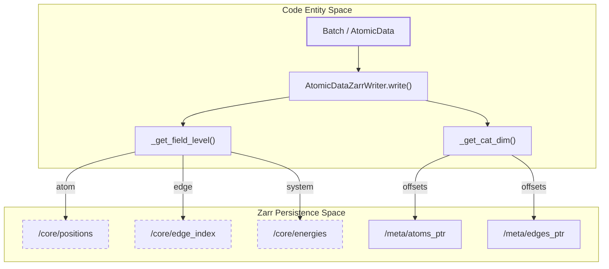
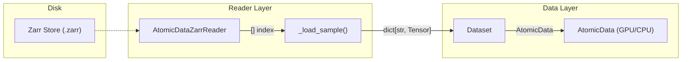

<!-- source: DeepWiki mcp.deepwiki.com · repo NVIDIA/nvalchemi-toolkit · page 2.2 Zarr I/O: AtomicDataZarrWriter and AtomicDataZarrReader · fetched 2026-10-26 -->

# Zarr I/O: AtomicDataZarrWriter and AtomicDataZarrReader

Relevant source files

The following files were used as context for generating this wiki page:

- [docs/modules/data.rst](docs/modules/data.rst)
- [docs/userguide/zarr_compression.md](docs/userguide/zarr_compression.md)
- [nvalchemi/data/datapipes/__init__.py](nvalchemi/data/datapipes/__init__.py)
- [nvalchemi/data/datapipes/backends/__init__.py](nvalchemi/data/datapipes/backends/__init__.py)
- [nvalchemi/data/datapipes/backends/base.py](nvalchemi/data/datapipes/backends/base.py)
- [nvalchemi/data/datapipes/backends/zarr.py](nvalchemi/data/datapipes/backends/zarr.py)
- [nvalchemi/data/io_test.py](nvalchemi/data/io_test.py)
- [test/data/test_zarr_datapipe.py](test/data/test_zarr_datapipe.py)

The Zarr I/O subsystem provides a high-performance persistence layer for atomic simulation data. It is designed to handle the variable-sized graph structures (varying numbers of atoms and edges per system) typical of molecular dynamics and machine learning interatomic potentials (MLIPs). By utilizing the Zarr v3 format, the toolkit achieves efficient compressed storage and fast random access for training and analysis pipelines [nvalchemi/data/datapipes/backends/zarr.py:15-29]().

## CSR-Style Data Layout

To store variable-sized systems efficiently in flat Zarr arrays, `nvalchemi` employs a Compressed Sparse Row (CSR) style layout. Instead of padding systems to a maximum size, all atom-level and edge-level data are concatenated into contiguous global arrays [test/data/test_zarr_datapipe.py:91-132]().

### Data Levels and Pointer Arrays
Data is categorized into three levels, which determines how it is indexed and stored [nvalchemi/data/datapipes/backends/zarr.py:188-201]():

| Level | Description | Examples | Indexing Mechanism |
| :--- | :--- | :--- | :--- |
| **Atom** | Per-atom properties | `positions`, `forces`, `atomic_numbers` | `atoms_ptr` defines start/end offsets |
| **Edge** | Per-bond properties | `edge_index`, `shifts` | `edges_ptr` defines start/end offsets |
| **System** | Per-structure properties | `energies`, `cell`, `pbc` | Standard 0-based integer indexing |

### Metadata and Masking
The `meta` group in the Zarr store contains the structural information required to reconstruct individual `AtomicData` objects from the concatenated core arrays:
*   `atoms_ptr`: An array of length $N_{systems} + 1$ where `atoms_ptr[i]` is the starting index of system $i$ in atom-level arrays [test/data/test_zarr_datapipe.py:107-118]().
*   `edges_ptr`: An array of length $N_{systems} + 1$ where `edges_ptr[i]` is the starting index of system $i$ in edge-level arrays [test/data/test_zarr_datapipe.py:108-118]().
*   `samples_mask`: A boolean array used for **soft-deletion**. When a sample is deleted or marked as invalid, this mask is updated without rewriting the entire data block [test/data/test_zarr_datapipe.py:197-198]().

**Sources:** [nvalchemi/data/datapipes/backends/zarr.py:188-201](), [test/data/test_zarr_datapipe.py:91-132](), [docs/userguide/zarr_compression.md:50-57]()

## Writing Data: AtomicDataZarrWriter

The `AtomicDataZarrWriter` is the primary interface for persisting data. It supports writing single `AtomicData` objects, lists of objects, or entire `Batch` objects [nvalchemi/data/datapipes/backends/zarr.py:20-22]().

### Bulk Write Pipeline
The writer is optimized for throughput by minimizing I/O transactions. When a `Batch` is passed to the `write` or `append` method, the writer performs a bulk append to the Zarr arrays [test/data/test_zarr_datapipe.py:135-165]().

### Logical Data Flow: Write Operation
The following diagram illustrates how the `AtomicDataZarrWriter` transforms high-level code entities into the persistent Zarr structure.

**Diagram: AtomicDataZarrWriter Data Transformation**

**Sources:** [nvalchemi/data/datapipes/backends/zarr.py:188-201](), [nvalchemi/data/datapipes/backends/zarr.py:35-50](), [test/data/test_zarr_datapipe.py:91-132]()

## Configuration: Sharding and Chunking

Efficient I/O depends on tuning the `ZarrWriteConfig` and `ZarrArrayConfig`. These classes allow fine-grained control over compression and storage layout [nvalchemi/data/datapipes/backends/zarr.py:58-186]().

### ZarrArrayConfig
This class defines the storage parameters for a specific array or group of arrays [nvalchemi/data/datapipes/backends/zarr.py:58-126]():
*   `compressors`: Codecs like `ZstdCodec` or `BloscCodec` [docs/userguide/zarr_compression.md:88-106]().
*   `chunk_size`: The chunk length along the first dimension (concatenated axis). For atom-level fields, this is the total number of atoms [docs/userguide/zarr_compression.md:119-125]().
*   `shard_size`: Enables Zarr v3 sharding. Multiple chunks are stored in a single storage object (shard) to improve filesystem efficiency while maintaining small read units [nvalchemi/data/datapipes/backends/zarr.py:98-107]().

### Configuration Hierarchy
The `ZarrWriteConfig` applies settings in a hierarchical manner [docs/userguide/zarr_compression.md:48-81]():
1.  **Field Overrides**: Explicit config for a specific field (e.g., `"positions"`).
2.  **Group Defaults**: Defaults for `meta`, `core`, or `custom` groups.
3.  **Zarr Defaults**: Fallback if no configuration is provided.

**Sources:** [nvalchemi/data/datapipes/backends/zarr.py:58-186](), [docs/userguide/zarr_compression.md:119-148](), [nvalchemi/data/io_test.py:194-230]()

## Reading Data: AtomicDataZarrReader

The `AtomicDataZarrReader` implements the `Reader` abstract base class to provide random access to the stored systems [nvalchemi/data/datapipes/backends/base.py:29-57]().

### Random Access Mechanism
When `reader[index]` is called, the reader performs the following steps:
1.  Consults `atoms_ptr[index:index+2]` and `edges_ptr[index:index+2]` to find the slice of the concatenated arrays [test/data/test_zarr_datapipe.py:100-118]().
2.  Reads only the required chunks from the Zarr store.
3.  Returns a dictionary of `torch.Tensor` objects on the CPU [nvalchemi/data/datapipes/backends/base.py:79-92]().

### Logical Architecture: Reader to Dataset
The reader is typically wrapped by a `Dataset` which handles the conversion from raw tensors to `AtomicData` objects and manages device transfers [nvalchemi/data/datapipes/__init__.py:21-49]().

**Diagram: Reader Pipeline Architecture**

**Sources:** [nvalchemi/data/datapipes/backends/base.py:29-57](), [nvalchemi/data/datapipes/backends/zarr.py:24-27](), [nvalchemi/data/datapipes/__init__.py:21-49]()

## Maintenance: Soft-Delete and Defragmentation

The toolkit supports a non-destructive deletion workflow to maintain high write performance [test/data/test_zarr_datapipe.py:197-198]().

*   **Soft-Delete**: Marking a sample as invalid in the `samples_mask`. This is a metadata-only operation and does not remove data from the core arrays.
*   **Defragmentation**: An offline process (often triggered during large-scale data maintenance) that reads the Zarr store, filters out soft-deleted samples, and writes a new, contiguous Zarr store. This recovers disk space and optimizes sequential read performance.

**Sources:** [test/data/test_zarr_datapipe.py:197-198](), [nvalchemi/data/datapipes/backends/zarr.py:156-162]()

---

