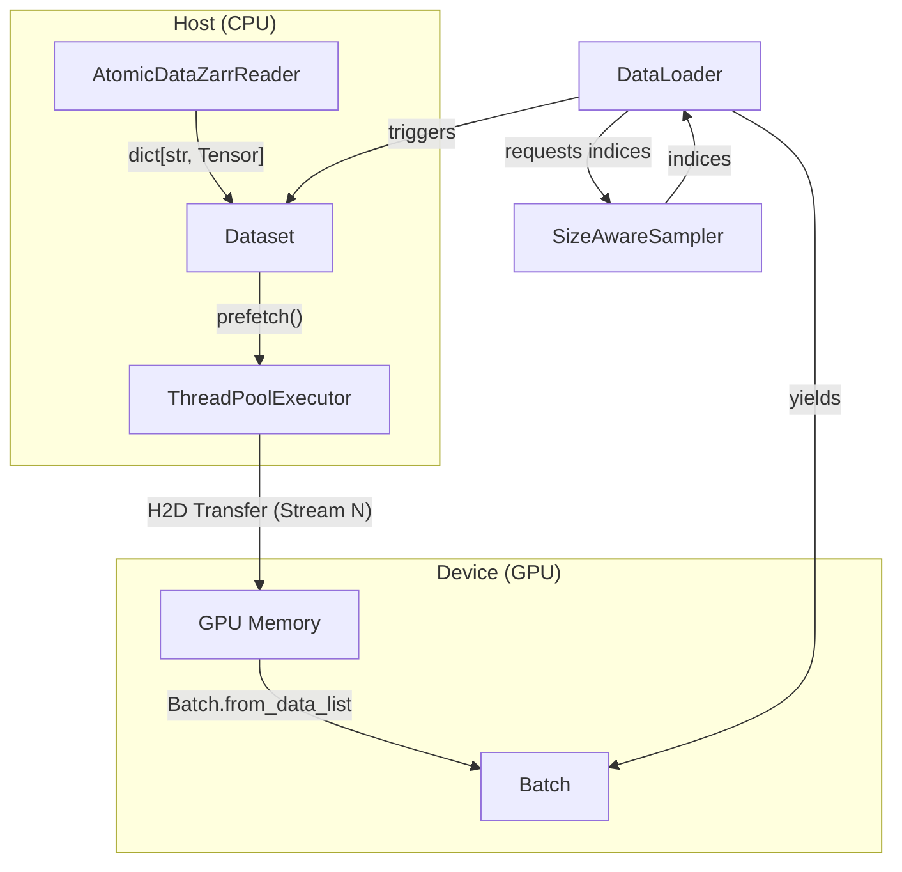
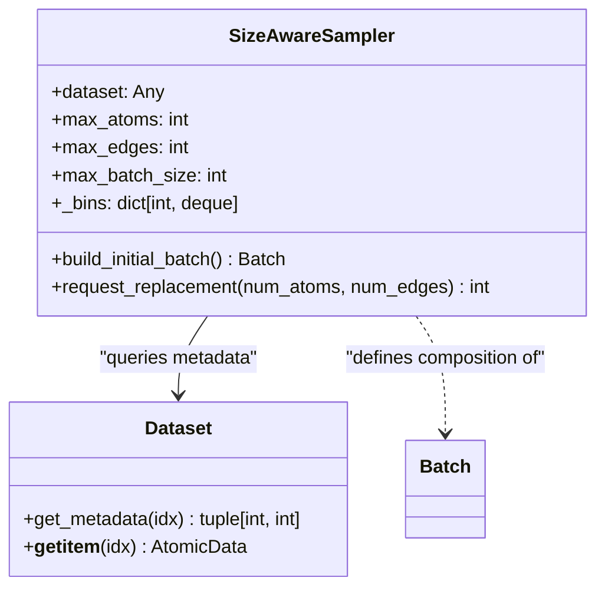

<!-- source: DeepWiki mcp.deepwiki.com · repo NVIDIA/nvalchemi-toolkit · page 2.3 DataLoader and SizeAwareSampler · fetched 2026-10-26 -->

# DataLoader and SizeAwareSampler

<details>
<summary>Relevant source files</summary>

The following files were used as context for generating this wiki page:

- [.claude/skills/nvalchemi-dynamics-api/SKILL.md](.claude/skills/nvalchemi-dynamics-api/SKILL.md)
- [docs/userguide/datapipes.md](docs/userguide/datapipes.md)
- [nvalchemi/data/datapipes/dataloader.py](nvalchemi/data/datapipes/dataloader.py)
- [nvalchemi/dynamics/sampler.py](nvalchemi/dynamics/sampler.py)
- [test/dynamics/test_demo_dynamics.py](test/dynamics/test_demo_dynamics.py)
- [test/dynamics/test_inflight.py](test/dynamics/test_inflight.py)
- [test/dynamics/test_sampler.py](test/dynamics/test_sampler.py)
- [test/dynamics/test_sinks.py](test/dynamics/test_sinks.py)

</details>


The data loading pipeline in `nvalchemi` is designed for GPU-accelerated atomistic workloads, specifically addressing the challenges of variable-sized molecular graphs and the need for high-throughput I/O. It consists of four composable layers: a **Reader** for raw tensor I/O, a **Dataset** for validation and prefetching, a **DataLoader** for batching, and a **SizeAwareSampler** for memory-safe capacity management [docs/userguide/datapipes.md:5-13]().

## DataLoader and Prefetching Pipeline

The `DataLoader` [nvalchemi/data/datapipes/dataloader.py:39-40]() serves as a drop-in replacement for `torch.utils.data.DataLoader`, specialized for emitting `Batch` objects rather than generic tensor dictionaries [nvalchemi/data/datapipes/dataloader.py:15-25]().

### CUDA Stream Prefetching
To maximize GPU utilization, the `DataLoader` implements asynchronous prefetching using multiple CUDA streams [nvalchemi/data/datapipes/dataloader.py:43-45](). This allows host-to-device (H2D) transfers to overlap with model computation [docs/userguide/datapipes.md:71-79]().

| Feature | Implementation Detail |
| :--- | :--- |
| **Async Transfers** | Uses a `ThreadPoolExecutor` in the `Dataset` to load and transfer samples ahead of time [docs/userguide/datapipes.md:57-58](). |
| **Stream Management** | Manages a pool of `torch.cuda.Stream` objects to isolate prefetch operations [nvalchemi/data/datapipes/dataloader.py:133-137](). |
| **Overlap Strategy** | Prefetches `prefetch_factor` batches ahead; synchronizes the specific stream only when the batch is yielded to the training loop [nvalchemi/data/datapipes/dataloader.py:200-206](). |

### Data Flow Architecture
The following diagram illustrates the transition from storage to GPU-resident `Batch` objects through the pipeline entities.

**Data Loading Pipeline Flow**

Sources: [nvalchemi/data/datapipes/dataloader.py:39-106](), [docs/userguide/datapipes.md:52-59](), [docs/userguide/datapipes.md:88-93]().

## SizeAwareSampler

In atomistic simulations, systems often vary significantly in size (number of atoms and edges). A fixed `batch_size` can lead to Out-of-Memory (OOM) errors if several large systems are grouped together, or poor GPU utilization if batches contain only small systems [docs/userguide/datapipes.md:123-128]().

`SizeAwareSampler` [nvalchemi/dynamics/sampler.py:36]() implements a capacity-aware bin-packing algorithm to solve this. It fills batches based on physical constraints (`max_atoms`, `max_edges`) rather than just a count of samples [nvalchemi/dynamics/sampler.py:39-42]().

### Constraints and Constraints Validation
The sampler validates every sample in the dataset during initialization to ensure it can fit within the defined limits [nvalchemi/dynamics/sampler.py:161-164]().

*   **max_atoms**: Maximum total atoms allowed in a single `Batch` [nvalchemi/dynamics/sampler.py:55-57]().
*   **max_edges**: Maximum total edges allowed in a single `Batch` [nvalchemi/dynamics/sampler.py:58-60]().
*   **max_batch_size**: Maximum number of graphs, regardless of atom/edge count [nvalchemi/dynamics/sampler.py:61-62]().
*   **GPU Memory Heuristic**: If `max_atoms` is omitted, the sampler estimates a conservative limit based on available GPU memory (default 80% fraction) [nvalchemi/dynamics/sampler.py:67-70]().

### Bin-Packing Logic
Samples are grouped into bins based on their atom count (controlled by `bin_width`) [nvalchemi/dynamics/sampler.py:63-64](). This allows the sampler to efficiently find "replacement" samples that fit into specific memory slots [nvalchemi/dynamics/sampler.py:157-160]().

**Sampler Entity Mapping**

Sources: [nvalchemi/dynamics/sampler.py:36-97](), [docs/userguide/datapipes.md:81-86]().

## Inflight Batching and Replacement

A unique feature of the `nvalchemi` pipeline is the support for **Inflight Batching**. In dynamics simulations, samples within a batch may converge at different times. Instead of waiting for the entire batch to finish, converged samples can be "graduated" and replaced by new samples from the sampler [test/dynamics/test_inflight.py:18-22]().

### The Replacement Protocol
1.  **Convergence**: A `ConvergenceHook` identifies samples that have met criteria [test/dynamics/test_inflight.py:190-191]().
2.  **Request**: The dynamics engine calls `SizeAwareSampler.request_replacement()` [nvalchemi/dynamics/sampler.py:158]().
3.  **Search**: The sampler looks for a new index whose `num_atoms` and `num_edges` are less than or equal to the "slot" vacated by the graduated sample [nvalchemi/dynamics/sampler.py:39-42]().
4.  **Refill**: The `BaseDynamics.refill_check()` method integrates the new sample into the `active_batch` without reallocating the entire batch tensor [test/dynamics/test_inflight.py:19-20]().

### Example Configuration
```python
from nvalchemi.data.datapipes import Dataset, DataLoader
from nvalchemi.dynamics.sampler import SizeAwareSampler

# 1. Initialize Dataset
dataset = Dataset(reader=reader, device="cuda:0")

# 2. Configure Sampler with constraints
sampler = SizeAwareSampler(
    dataset=dataset, 
    max_atoms=4096, 
    max_batch_size=64
)

# 3. Create DataLoader using the sampler
loader = DataLoader(
    dataset=dataset,
    sampler=sampler,
    batch_size=64, # Upper bound
    prefetch_factor=2
)
```
Sources: [docs/userguide/datapipes.md:166-182](), [nvalchemi/dynamics/sampler.py:82-87]().

| Function | Role |
| :--- | :--- |
| `get_metadata(idx)` | Returns `(num_atoms, num_edges)` without loading full tensors [docs/userguide/datapipes.md:84-86](). |
| `build_initial_batch()` | Greedy packing to fill the first batch to capacity [nvalchemi/dynamics/sampler.py:85](). |
| `request_replacement(...)` | Finds an unconsumed sample that fits in a specific atom/edge budget [nvalchemi/dynamics/sampler.py:86](). |

Sources: [nvalchemi/dynamics/sampler.py:1-172](), [nvalchemi/data/datapipes/dataloader.py:1-206](), [docs/userguide/datapipes.md:1-183](), [test/dynamics/test_inflight.py:1-213]().

---

