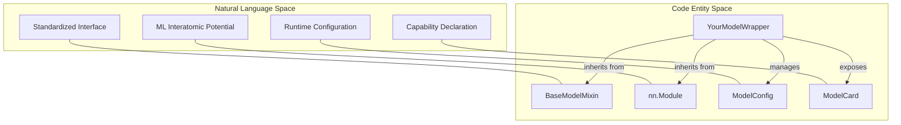
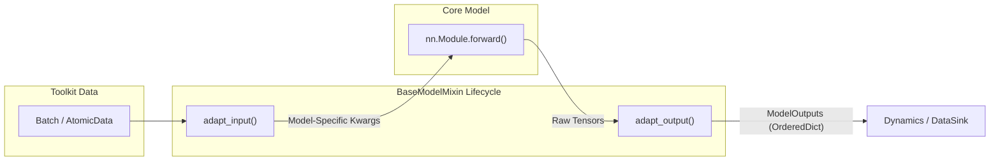

<!-- source: DeepWiki mcp.deepwiki.com · repo NVIDIA/nvalchemi-toolkit · page 3 Model Layer · fetched 2026-10-26 -->

# Model Layer

Relevant source files

The following files were used as context for generating this wiki page:

- [docs/model_card_ext.py](docs/model_card_ext.py)
- [docs/models/index.md](docs/models/index.md)
- [docs/modules/models.rst](docs/modules/models.rst)
- [docs/userguide/dynamics.md](docs/userguide/dynamics.md)
- [docs/userguide/models.md](docs/userguide/models.md)
- [examples/advanced/04_mace_nvt.py](examples/advanced/04_mace_nvt.py)
- [examples/advanced/05_custom_integrator.py](examples/advanced/05_custom_integrator.py)
- [nvalchemi/dynamics/hooks/neighbor_list.py](nvalchemi/dynamics/hooks/neighbor_list.py)
- [nvalchemi/models/__init__.py](nvalchemi/models/__init__.py)
- [nvalchemi/models/_ops/lj.py](nvalchemi/models/_ops/lj.py)

The Model Layer provides a standardized interface for integrating Machine Learning Interatomic Potentials (MLIPs) and classical force fields into the NVIDIA ALCHEMI Toolkit. By wrapping models with a consistent API, the toolkit ensures that any supported potential can be used interchangeably within dynamics simulations, data pipelines, and active learning workflows [docs/userguide/models.md:7-11]().

### Architecture Overview

The system utilizes a **multiple inheritance** pattern to wrap existing PyTorch `nn.Module` implementations [docs/userguide/models.md:38-40](). A wrapper class inherits from both the underlying model and the `BaseModelMixin`, which provides the standardized framework interface [docs/userguide/models.md:42-71]().

The following diagram illustrates how the Model Layer connects high-level concepts to specific code entities:

**Model Wrapping Entity Relationship**

Sources: [docs/userguide/models.md:38-71](), [docs/userguide/models.md:84-87](), [docs/userguide/models.md:132-134]()

### Key Components

The model system is built upon three primary building blocks:

| Component | Role | Reference |
| :--- | :--- | :--- |
| `BaseModelMixin` | The core mixin that defines the `adapt_input` and `adapt_output` lifecycle. | [docs/userguide/models.md:57-61]() |
| `ModelCard` | An immutable declaration of what a model can compute (e.g., forces, stresses) and what it requires (e.g., PBC, neighbor lists). | [docs/userguide/models.md:84-87]() |
| `ModelConfig` | A mutable runtime object that controls which properties (energies, forces, etc.) are computed during a specific forward pass. | [docs/userguide/models.md:132-135]() |

For detailed information on implementing these components, see **[BaseModelMixin and ModelCard Interface](#3.1)**.

### Execution Lifecycle

When a wrapped model's `forward` method is called, it executes a three-step pipeline to bridge the toolkit's data structures with the underlying model's requirements:

1.  **`adapt_input`**: Converts `AtomicData` or `Batch` objects into the specific keyword arguments (tensors) expected by the underlying model [docs/userguide/models.md:75-77]().
2.  **`super().forward`**: Executes the original model's logic without modification [docs/userguide/models.md:78-78]().
3.  **`adapt_output`**: Maps the raw model results back into the framework's `ModelOutputs` dictionary [docs/userguide/models.md:79-80]().

**Forward Pass Data Flow**

Sources: [docs/userguide/models.md:73-80]()

### Supported Model Wrappers

The toolkit includes several pre-built wrappers for both state-of-the-art MLIPs and classical physical models:

*   **Machine-Learned Potentials**: Includes `MACEWrapper` (supporting MACE-MP foundation models) and `AIMNet2Wrapper` [docs/userguide/models.md:27-31]().
*   **Physical/Classical Models**: Includes `LennardJonesModelWrapper`, `DFTD3ModelWrapper` for dispersion corrections, and electrostatics via `EwaldModelWrapper` and `PMEModelWrapper` [docs/modules/models.rst:46-84]().
*   **Composition**: The `ComposableModelWrapper` allows users to stack multiple potentials (e.g., MACE + DFT-D3) using the `+` operator [docs/modules/models.rst:88-95]().

For a full list of available implementations and how to use them, see **[Available Model Wrappers](#3.2)**.

### Sub-Pages
*   [BaseModelMixin and ModelCard Interface](#3.1) — Detailed reference for capability declarations, runtime toggles, and the input/output adaptation lifecycle.
*   [Available Model Wrappers](#3.2) — Reference for concrete implementations, foundation model loading, and potential composition.

Sources: [docs/userguide/models.md:1-21](), [docs/modules/models.rst:1-96](), [docs/models/index.md:1-53]()

---

