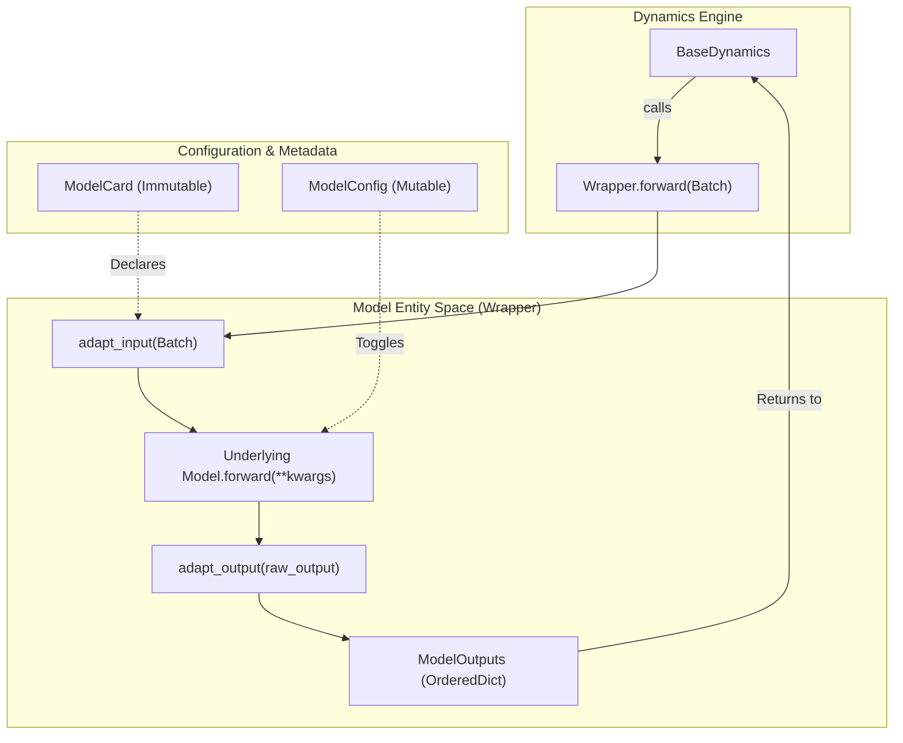
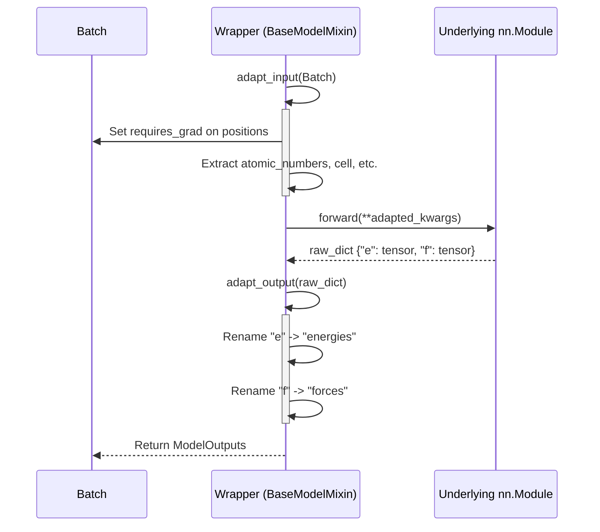

<!-- source: DeepWiki mcp.deepwiki.com · repo NVIDIA/nvalchemi-toolkit · page 3.1 BaseModelMixin and ModelCard Interface · fetched 2026-10-26 -->

# BaseModelMixin and ModelCard Interface

Relevant source files

The following files were used as context for generating this wiki page:

- [.claude/skills/nvalchemi-model-wrapping/SKILL.md](.claude/skills/nvalchemi-model-wrapping/SKILL.md)
- [docs/_static/NVIDIA-Logo-V-ForScreen-ForDarkBG.png](docs/_static/NVIDIA-Logo-V-ForScreen-ForDarkBG.png)
- [docs/_static/NVIDIA-Logo-V-ForScreen-ForLightBG.png](docs/_static/NVIDIA-Logo-V-ForScreen-ForLightBG.png)
- [docs/model_card_ext.py](docs/model_card_ext.py)
- [docs/models/index.md](docs/models/index.md)
- [docs/modules/dynamics/index.rst](docs/modules/dynamics/index.rst)
- [docs/modules/models.rst](docs/modules/models.rst)
- [docs/userguide/dynamics.md](docs/userguide/dynamics.md)
- [docs/userguide/models.md](docs/userguide/models.md)
- [nvalchemi/models/base.py](nvalchemi/models/base.py)
- [nvalchemi/models/demo.py](nvalchemi/models/demo.py)

The ALCHEMI Toolkit employs a standardized interface to bridge the gap between arbitrary Machine Learning Interatomic Potentials (MLIPs) and the framework's dynamics and data subsystems. This interface is defined by the `BaseModelMixin` class, which utilizes a "ModelCard" to declare capabilities and a "ModelConfig" to toggle runtime behaviors.

## Overview of the Mixin Pattern

The toolkit uses **multiple inheritance** to wrap models. A concrete wrapper class inherits from both the underlying `nn.Module` (the actual potential) and `BaseModelMixin` [docs/userguide/models.md:38-41]().

This architecture ensures that the original model code remains largely untouched, while the mixin provides the standardized methods required for the toolkit's lifecycle, specifically for adapting inputs from the `Batch` structure and formatting outputs into a consistent dictionary [docs/userguide/models.md:73-81]().

### Model Wrapping Data Flow

The following diagram illustrates how `BaseModelMixin` standardizes the communication between the Dynamics engine and various MLIP implementations.

**Diagram: Model Interface Architecture**

Sources: [docs/userguide/models.md:42-71](), [nvalchemi/models/base.py:152-160]()

---

## ModelCard: Capability Declarations

The `ModelCard` is an immutable Pydantic model that describes a model's physical capabilities and data requirements [nvalchemi/models/base.py:152-160](). It is accessed via the `@property` `model_card` on any wrapper [nvalchemi/models/demo.py:152-153]().

### Key Capability Fields
| Field | Type | Description |
|---|---|---|
| `forces_via_autograd` | `bool` | `True` if forces are computed by taking the gradient of energy w.r.t positions [nvalchemi/models/base.py:162-164](). |
| `supports_energies` | `bool` | Whether the model predicts total system energy [nvalchemi/models/base.py:175-177](). |
| `supports_forces` | `bool` | Whether the model can output forces (either directly or via autograd) [nvalchemi/models/base.py:178-180](). |
| `supports_stresses` | `bool` | Whether the model supports virial/stress tensor computation [nvalchemi/models/base.py:181-184](). |
| `supports_pbc` | `bool` | Whether the model logic handles Periodic Boundary Conditions [nvalchemi/models/base.py:191-194](). |

### Requirement Fields
| Field | Type | Description |
|---|---|---|
| `needs_pbc` | `bool` | `True` if the model requires `cell` and `pbc` tensors in its input [docs/userguide/models.md:109](). |
| `needs_neighborlist` | `bool` | `True` if the model requires an `edge_index` or neighbor matrix [docs/userguide/models.md:111](). |
| `neighbor_config` | `NeighborConfig` | Optional configuration for on-the-fly neighbor list construction [nvalchemi/models/base.py:54-57](). |

Sources: [nvalchemi/models/base.py:152-210](), [docs/userguide/models.md:89-112]()

---

## ModelConfig: Runtime Toggles

While the `ModelCard` is static, `ModelConfig` is a mutable attribute (`model.model_config`) that controls what the model actually computes during a specific forward pass [nvalchemi/models/base.py:93-99]().

*   **Computation Flags**: Includes `compute_forces`, `compute_stresses`, `compute_energies`, and `compute_embeddings` [nvalchemi/models/base.py:101-142]().
*   **Gradient Tracking**: The `gradient_keys` set tracks which input tensors (e.g., `"positions"`) require `requires_grad_(True)` to support autograd-based properties [nvalchemi/models/base.py:111-113]().

Sources: [nvalchemi/models/base.py:93-150](), [docs/userguide/models.md:131-148]()

---

## NeighborConfig and Formats

If a model requires a neighbor list, the `ModelCard` includes a `NeighborConfig`. This signals the `NeighborListHook` to build and cache neighbor data [nvalchemi/models/base.py:54-60]().

### NeighborListFormat
The toolkit supports two primary formats for neighbor data:
1.  **COO (Coordinate)**: Neighbors stored as an `edge_index` tensor of shape `[2, E]`. Standard for GNNs like MACE [nvalchemi/models/base.py:38-41]().
2.  **MATRIX (Dense)**: Neighbors stored as a `neighbor_matrix` of shape `[N, max_neighbors]`. Optimized for Warp-based kernels (e.g., Lennard-Jones) [nvalchemi/models/base.py:42-47]().

### Configuration Parameters
*   **cutoff**: Interaction radius [nvalchemi/models/base.py:86]().
*   **skin**: Verlet skin distance for lazy rebuilding [nvalchemi/models/base.py:89]().
*   **half_list**: If `True`, only unique pairs `(i, j)` where `i < j` are stored [nvalchemi/models/base.py:88-90]().

Sources: [nvalchemi/models/base.py:33-91](), [docs/model_card_ext.py:59-78]()

---

## Lifecycle: adapt_input and adapt_output

The `BaseModelMixin` defines a standard lifecycle for the `forward` pass.

### adapt_input
This method converts a `Batch` or `AtomicData` object into the keyword arguments (`kwargs`) expected by the underlying model's `forward` method [docs/userguide/models.md:75-77]().
*   **Validation**: It checks if the input `Batch` contains all required keys defined in the `ModelCard` [nvalchemi/models/base.py:284-290]().
*   **Gradient Setup**: It automatically calls `requires_grad_()` on tensors specified in `ModelConfig.gradient_keys` [nvalchemi/models/base.py:293-295]().

### adapt_output
This method maps the raw outputs from the underlying model back to the toolkit's `ModelOutputs` (an `OrderedDict`) [docs/userguide/models.md:79-80]().
*   **Standardization**: It ensures that energies are shape `[B, 1]` and forces are `[N, 3]` [nvalchemi/models/demo.py:231-240]().
*   **Verification**: It issues warnings if the model returns a property that wasn't requested or fails to return a requested one [nvalchemi/models/base.py:317-320]().

**Diagram: Input/Output Adaptation Lifecycle**

Sources: [nvalchemi/models/base.py:277-330](), [nvalchemi/models/demo.py:214-245]()

---

## Model Exportability

To support interoperability (e.g., using a toolkit-wrapped model in an ASE calculator), wrappers can implement `export_model` [docs/userguide/models.md:189]().

The `export_model` function typically strips the `BaseModelMixin` inheritance and returns the original `nn.Module` with the current weights [nvalchemi/models/demo.py:247-259](). This allows the model to be saved via `torch.save` without requiring the `nvalchemi` library for subsequent loading in restricted environments.

Sources: [nvalchemi/models/demo.py:247-264](), [.claude/skills/nvalchemi-model-wrapping/SKILL.md:189-203]()

---

