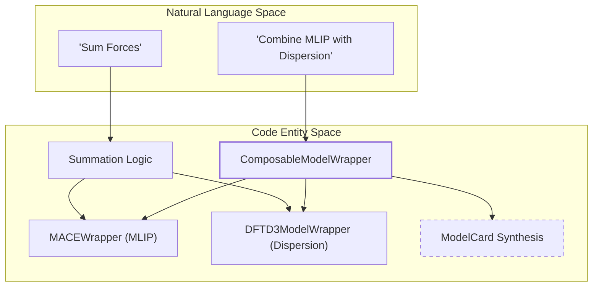
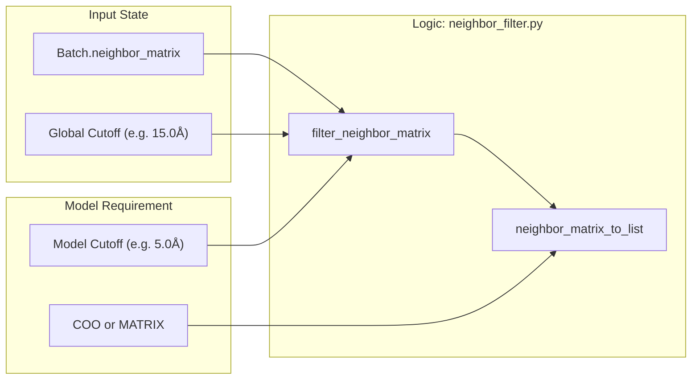

<!-- source: DeepWiki mcp.deepwiki.com · repo NVIDIA/nvalchemi-toolkit · page 3.2 Available Model Wrappers · fetched 2026-10-26 -->

# Available Model Wrappers

Relevant source files

The following files were used as context for generating this wiki page:

- [nvalchemi/models/_ops/neighbor_filter.py](nvalchemi/models/_ops/neighbor_filter.py)
- [nvalchemi/models/composable.py](nvalchemi/models/composable.py)
- [nvalchemi/models/dftd3.py](nvalchemi/models/dftd3.py)
- [nvalchemi/models/ewald.py](nvalchemi/models/ewald.py)
- [nvalchemi/models/lj.py](nvalchemi/models/lj.py)
- [nvalchemi/models/mace.py](nvalchemi/models/mace.py)
- [nvalchemi/models/pme.py](nvalchemi/models/pme.py)
- [nvalchemi/models/registry.py](nvalchemi/models/registry.py)
- [test/models/test_composable.py](test/models/test_composable.py)
- [test/models/test_mace.py](test/models/test_mace.py)
- [test/models/test_physical_models.py](test/models/test_physical_models.py)

The NVIDIA ALCHEMI Toolkit provides a suite of model wrappers that expose diverse potential energy surfaces (PES)—ranging from machine-learned interatomic potentials (MLIPs) like MACE to classical force fields and long-range electrostatics—through a unified `BaseModelMixin` interface. This standardization allows any supported model to be used interchangeably within the dynamics engine or composed into complex multi-model pipelines.

### Model Execution Flow

All model wrappers follow a structured data flow to ensure compatibility between the GPU-resident `Batch` and the specific requirements of the underlying kernel (e.g., Warp kernels, autograd-based ML models, or external libraries).

1.  **Neighbor Filtering**: Models filter the global neighbor list to their specific `cutoff` using `prepare_neighbors_for_model` [[nvalchemi/models/dftd3.py:70-70](), [nvalchemi/models/_ops/neighbor_filter.py:39-40]()].
2.  **Input Adaptation**: `adapt_input` prepares the data dictionary, handling unit conversions (e.g., Å to Bohr for D3) or tensor reshaping [[nvalchemi/models/dftd3.py:41-44](), [nvalchemi/models/mace.py:100-109]()].
3.  **Forward Pass**: The core potential is evaluated. Forces are either computed analytically within a kernel or via `torch.autograd` if `forces_via_autograd` is `True` [[nvalchemi/models/mace.py:165-165](), [nvalchemi/models/lj.py:42-43]()].
4.  **Output Adaptation**: `adapt_output` standardizes the results into a `ModelOutputs` dictionary containing `energies`, `forces`, and optionally `stresses` [[nvalchemi/models/lj.py:65-65](), [nvalchemi/models/mace.py:69-69]()].

---

## MACEWrapper

The `MACEWrapper` integrates the MACE (Higher Order Equivariant Transformers) architecture. It supports foundation models, fine-tuning, and high-performance inference via `cuEq` (CUDA Equivariant) kernels.

### Key Features
*   **Foundation Models**: Includes a factory method `from_checkpoint` to load named models (e.g., "medium-0b2") with automatic integrity verification via a SHA-256 registry [[nvalchemi/models/mace.py:24-30](), [nvalchemi/models/registry.py:15-20]()].
*   **Zero-CPU Encodings**: Atomic number one-hot encodings (`node_attrs`) are generated via a GPU lookup table (`_node_emb`) to avoid host-device synchronization during MD loops [[nvalchemi/models/mace.py:101-103](), [nvalchemi/models/mace.py:140-156]()].
*   **Autograd Forces**: Forces and stresses are computed conservatively via MACE's internal autograd path [[nvalchemi/models/mace.py:49-50](), [nvalchemi/models/mace.py:165-165]()].

### Foundation Model Registry
The toolkit maintains a registry of verified foundation model checkpoints.
| Function | Description |
| :--- | :--- |
| `list_foundation_models()` | Lists available canonical model names [[nvalchemi/models/registry.py:136-141]()]. |
| `download_and_verify()` | Atomically downloads and checks SHA-256 hashes [[nvalchemi/models/registry.py:183-213]()]. |
| `register_model()` | Allows users to add custom remote checkpoints to the registry [[nvalchemi/models/registry.py:106-124]()]. |

**Sources:** `nvalchemi/models/mace.py`, `nvalchemi/models/registry.py`, `test/models/test_mace.py`

---

## Classical Potential Wrappers

These wrappers utilize NVIDIA Warp-accelerated kernels for high-performance analytic force computations.

### Lennard-Jones (LJ)
The `LennardJonesModelWrapper` implements a standard 12-6 potential for single-species systems [[nvalchemi/models/lj.py:44-45]()].
*   **Switching Function**: Supports a C2-continuous switching region to zero out interactions smoothly at the cutoff [[nvalchemi/models/lj.py:93-95]()].
*   **Virial Stress**: Computes the physical virial `+Σ r_ij ⊗ F_ij` for NPT ensembles [[nvalchemi/models/lj.py:46-49]()].

### DFT-D3(BJ) Dispersion
The `DFTD3ModelWrapper` provides the Becke-Johnson damped dispersion correction [[nvalchemi/models/dftd3.py:15-17]()].
*   **Automatic Parameter Loading**: Downloads and parses the official Grimme group Fortran reference implementation to extract C6 coefficients and R4R2 values [[nvalchemi/models/dftd3.py:45-49](), [nvalchemi/models/dftd3.py:112-139]()].
*   **Unit Handling**: Manages internal conversion between Ångström and Bohr (atomic units) required by the D3 kernels [[nvalchemi/models/dftd3.py:89-91](), [nvalchemi/models/dftd3.py:41-44]()].

**Sources:** `nvalchemi/models/lj.py`, `nvalchemi/models/dftd3.py`, `test/models/test_physical_models.py`

---

## Electrostatics Wrappers

For systems with long-range interactions, the toolkit provides Ewald-based methods. Both require `node_charges` to be present in the `AtomicData` [[nvalchemi/models/ewald.py:40-40](), [nvalchemi/models/pme.py:39-39]()].

### EwaldModelWrapper
Implements standard Ewald summation, splitting the Coulomb interaction into real-space (damped) and reciprocal-space (structure factor) components [[nvalchemi/models/ewald.py:73-75]()].
*   **Complexity**: $O(N^{1.5})$ or $O(N^2)$ depending on k-space optimization.
*   **Caching**: Caches k-vectors and alpha parameters, invalidating them only when the unit cell changes (e.g., during NPT) [[nvalchemi/models/ewald.py:115-121]()].

### PMEModelWrapper (Particle Mesh Ewald)
Uses B-spline interpolation and FFTs to evaluate the reciprocal space contribution, achieving $O(N \log N)$ scaling [[nvalchemi/models/pme.py:42-43](), [nvalchemi/models/pme.py:74-76]()].
*   **Parameters**: Supports `mesh_spacing` for automatic grid determination or explicit `mesh_dimensions` [[nvalchemi/models/pme.py:82-88]()].
*   **Accuracy**: Uses the Kolafa-Perram formula for automatic estimation of the splitting parameter $\alpha$ [[nvalchemi/models/pme.py:92-95]()].

**Sources:** `nvalchemi/models/ewald.py`, `nvalchemi/models/pme.py`

---

## ComposableModelWrapper

The `ComposableModelWrapper` allows multiple models to be combined by summing their energies, forces, and stresses [[nvalchemi/models/composable.py:17-19]()].

### Composition Logic
*   **Operator Overloading**: Models can be composed using the `+` syntax: `combined = model_mlip + model_d3` [[nvalchemi/models/composable.py:23-25]()].
*   **Neighbor Configuration Synthesis**: The wrapper automatically calculates a "super-set" neighbor configuration, picking the maximum cutoff and the most restrictive format (e.g., if one model requires `MATRIX`, the entire composition uses `MATRIX`) [[nvalchemi/models/composable.py:34-37](), [nvalchemi/models/composable.py:162-168]()].
*   **Autograd Guard**: Currently restricts composition to a maximum of one model using `forces_via_autograd=True` to prevent memory-inefficient nested gradient graphs [[nvalchemi/models/composable.py:92-106]()].

### System Architecture: Model Composition
Title: Model Composition and Data Flow

**Sources:** `nvalchemi/models/composable.py`, `test/models/test_composable.py`

---

## Neighbor List Preparation

The `prepare_neighbors_for_model` utility acts as the bridge between the dynamics engine's neighbor list and the specific requirements of a model wrapper [[nvalchemi/models/_ops/neighbor_filter.py:39-40]()].

### Neighbor Handling Logic
Title: Neighbor List Adaptation Logic

*   **Filtering**: If the model's cutoff is smaller than the batch's neighbor list cutoff, it performs a GPU-side filter and defragmentation [[nvalchemi/models/_ops/neighbor_filter.py:129-135]()].
*   **Format Conversion**: Automatically converts between dense `MATRIX` (Warp-style) and sparse `COO` (PyTorch Geometric/MACE style) formats based on the `ModelCard` [[nvalchemi/models/_ops/neighbor_filter.py:38-39](), [nvalchemi/models/base.py:76-76]()].

**Sources:** `nvalchemi/models/_ops/neighbor_filter.py`, `nvalchemi/models/base.py`

---

