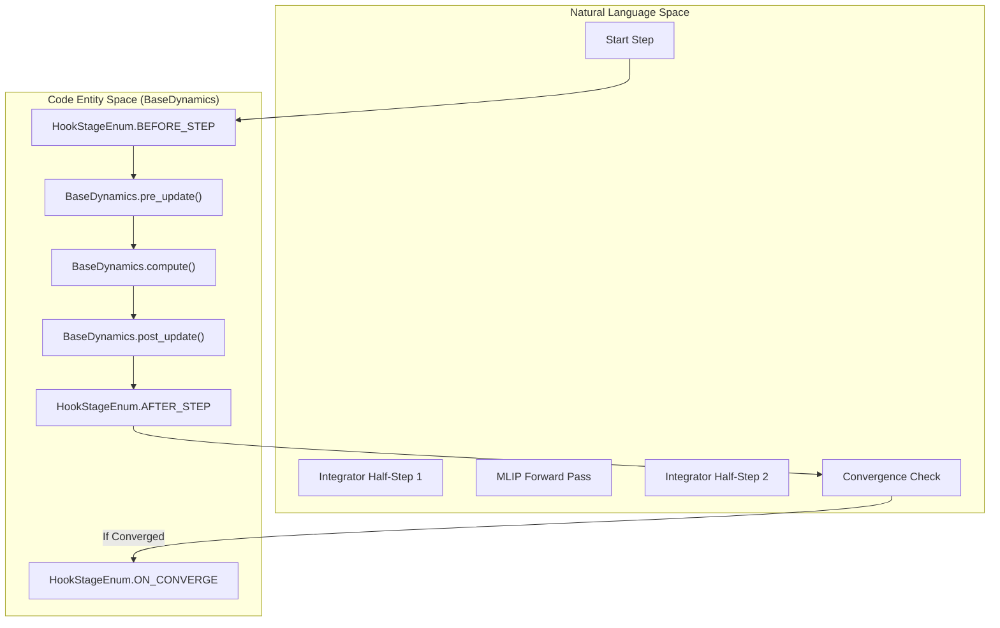
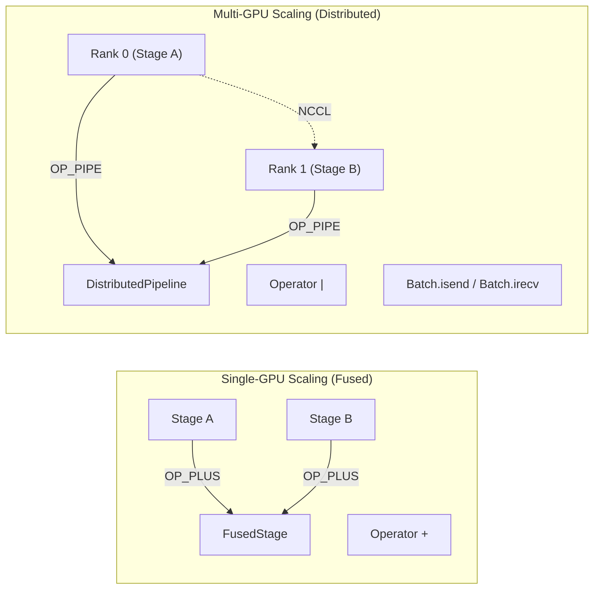

<!-- source: DeepWiki mcp.deepwiki.com · repo NVIDIA/nvalchemi-toolkit · page 4 Dynamics Engine · fetched 2026-10-26 -->

# Dynamics Engine

Relevant source files

The following files were used as context for generating this wiki page:

- [docs/modules/dynamics/distributed_pipeline.rst](docs/modules/dynamics/distributed_pipeline.rst)
- [docs/modules/dynamics/fused_stage.rst](docs/modules/dynamics/fused_stage.rst)
- [docs/modules/dynamics/overview.rst](docs/modules/dynamics/overview.rst)
- [docs/userguide/dynamics.md](docs/userguide/dynamics.md)
- [docs/userguide/models.md](docs/userguide/models.md)
- [nvalchemi/dynamics/base.py](nvalchemi/dynamics/base.py)
- [test/dynamics/test_safety_hooks.py](test/dynamics/test_safety_hooks.py)

The `nvalchemi.toolkit` dynamics engine is a high-performance, GPU-resident framework for executing batched molecular dynamics (MD) and geometry optimization. It is designed around a "batch-first" philosophy, where multiple chemical systems are evolved simultaneously in a single execution loop to maximize GPU utilization and amortize the cost of machine learning interatomic potential (MLIP) forward passes [docs/userguide/dynamics.md:7-17]().

The engine provides a unified interface for various simulation types—from simple NVE ensembles to complex NPT barostats and FIRE optimizers—all sharing a common lifecycle, hook system, and convergence logic [docs/userguide/dynamics.md:18-21]().

## Core Architecture

The architecture is built on a single base class with two primary extension points: the `pre_update` and `post_update` methods of the integrator [docs/modules/dynamics/overview.rst:14-16]().

### The BaseDynamics Lifecycle
Every simulation step in `BaseDynamics` follows a rigid sequence of stages defined by `HookStageEnum`. This allows users to inject custom logic (logging, constraints, or analysis) at any point in the integration cycle [nvalchemi/dynamics/base.py:106-144]().

**Execution Flow (Natural Language to Code):**

Sources: [nvalchemi/dynamics/base.py:106-144](), [docs/userguide/dynamics.md:25-49]()

For a deep dive into the internal loop mechanics, state synchronization, and sample masking, see **[BaseDynamics: Core Execution Loop](#4.1)**.

## Integrators and Optimizers

The toolkit implements a variety of standard MD ensembles and optimization algorithms. These classes inherit from `BaseDynamics` and implement the specific velocity and position update logic required for the ensemble [nvalchemi/dynamics/base.py:24-34]().

| Type | Implementations | Key Characteristics |
| :--- | :--- | :--- |
| **Ensembles** | NVE, NVT (Langevin/Nose-Hoover), NPT, NPH | Uses per-integrator state tensors for thermostats/barostats. |
| **Optimizers** | FIRE, FIRE2 | Convergence-driven; uses `ConvergenceHook` to signal completion. |
| **Reference** | DemoDynamics | A minimal implementation for testing and custom extensions. |

For implementation details and parameter references, see **[Integrators and Optimizers](#4.2)**.

## The Hook System

Hooks are the primary mechanism for extending dynamics behavior without modifying the core engine. A `Hook` is a protocol-compliant object that executes at a specific `HookStageEnum` with a defined `frequency` [nvalchemi/dynamics/base.py:147-185]().

**Key Hook Categories:**
*   **Safety:** `NaNDetectorHook` and `MaxForceClampHook` prevent simulation crashes [test/dynamics/test_safety_hooks.py:15-18]().
*   **I/O:** `LoggingHook` (CSV/TensorBoard) and `SnapshotHook` for trajectory saving.
*   **Physics:** `NeighborListHook`, `WrapPeriodicHook`, and `BiasedPotentialHook`.
*   **Control:** `ConvergenceHook` for evaluating termination criteria [nvalchemi/dynamics/base.py:187-210]().

For the full catalog of hooks and the Hook protocol specification, see **[Hook System](#4.3)**.

## Data Sinks and Storage

Dynamics results (trajectories, converged structures, and logs) are routed to `DataSink` implementations. This tiered storage system allows for high-throughput GPU-resident buffering before staging to CPU or disk [docs/modules/dynamics/overview.rst:124-126]().

*   **GPUBuffer:** High-performance, lazy-allocated buffer for in-memory samples.
*   **HostMemory:** CPU-side staging for large-scale analysis.
*   **ZarrData:** Persistent disk storage using the Zarr format for compressed, chunked trajectories.

For details on buffer management and Zarr integration, see **[Data Sinks: GPUBuffer, HostMemory, and ZarrData](#4.4)**.

## Pipeline Composition and Scaling

The toolkit uses an operator-based DSL to compose complex workflows and scale across multiple GPUs [docs/modules/dynamics/overview.rst:24-25]().

### FusedStage (`+` Operator)
Combines multiple dynamics stages on a **single GPU**. It uses a shared model forward pass and partitions the batch using `batch.status` codes. As samples converge, they "graduate" to the next status code within the same batch [docs/modules/dynamics/fused_stage.rst:10-16]().

### DistributedPipeline (`|` Operator)
Distributes stages across **multiple GPUs** (one stage per rank). It uses NCCL `isend`/`irecv` to move samples between ranks as they complete a stage [docs/modules/dynamics/distributed_pipeline.rst:10-15]().

**Scaling Logic (Natural Language to Code):**

Sources: [docs/modules/dynamics/fused_stage.rst:18-32](), [docs/modules/dynamics/distributed_pipeline.rst:23-53]()

For orchestration details, deadlock prevention, and `torch.compile` integration, see **[FusedStage and DistributedPipeline](#4.5)**.

---

