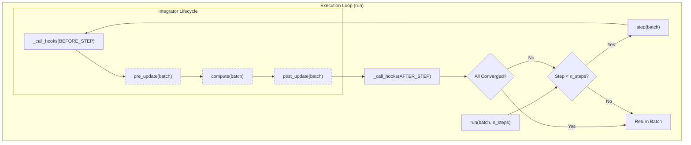
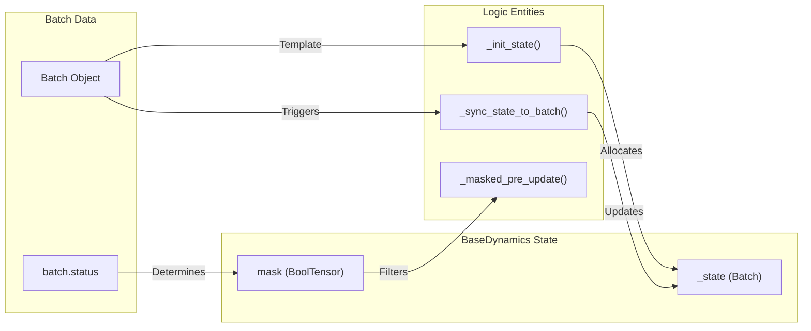

<!-- source: DeepWiki mcp.deepwiki.com · repo NVIDIA/nvalchemi-toolkit · page 4.1 BaseDynamics: Core Execution Loop · fetched 2026-10-26 -->

# BaseDynamics: Core Execution Loop

Relevant source files

The following files were used as context for generating this wiki page:

- [.github/workflows/ci.yml](.github/workflows/ci.yml)
- [docs/modules/dynamics/buffers_and_data_flow.rst](docs/modules/dynamics/buffers_and_data_flow.rst)
- [docs/userguide/dynamics.md](docs/userguide/dynamics.md)
- [docs/userguide/models.md](docs/userguide/models.md)
- [nvalchemi/data/batch.py](nvalchemi/data/batch.py)
- [nvalchemi/dynamics/base.py](nvalchemi/dynamics/base.py)
- [nvalchemi/dynamics/integrators/nph.py](nvalchemi/dynamics/integrators/nph.py)
- [nvalchemi/dynamics/integrators/npt.py](nvalchemi/dynamics/integrators/npt.py)
- [test/dynamics/test_base.py](test/dynamics/test_base.py)
- [test/dynamics/test_safety_hooks.py](test/dynamics/test_safety_hooks.py)
- [test/dynamics/test_single_loop.py](test/dynamics/test_single_loop.py)
- [test/dynamics/test_state_management.py](test/dynamics/test_state_management.py)

`BaseDynamics` is the foundational class for all molecular dynamics (MD) integrators and geometry optimizers in the NVIDIA ALCHEMI Toolkit. It provides a standardized execution lifecycle, orchestrates model evaluations, and manages per-system simulation state.

### Overview and Lifecycle

The core of `BaseDynamics` is the `step()` method, which defines a sequence of operations bracketed by hook execution points defined in `HookStageEnum` [nvalchemi/dynamics/base.py:106-143](). This design ensures that all simulation types—from simple NVE to complex NPT—share a common control flow [docs/userguide/dynamics.md:7-11]().

#### The Step Lifecycle
A single call to `step()` proceeds through the following stages:

| Stage | Code Entity | Description |
| :--- | :--- | :--- |
| **BEFORE_STEP** | `HookStageEnum.BEFORE_STEP` | Initial hooks (e.g., reset counters). |
| **PRE_UPDATE** | `pre_update(batch)` | First half-step (e.g., update velocities by $\Delta t/2$). |
| **COMPUTE** | `compute(batch)` | Model forward pass to evaluate forces/energies. |
| **POST_UPDATE** | `post_update(batch)` | Second half-step (e.g., final velocity/position update). |
| **AFTER_STEP** | `HookStageEnum.AFTER_STEP` | Final hooks (e.g., logging, convergence checks). |
| **ON_CONVERGE** | `HookStageEnum.ON_CONVERGE` | Triggered for systems meeting convergence criteria. |

Sources: [nvalchemi/dynamics/base.py:106-143](), [docs/userguide/dynamics.md:25-49]()

### Core Execution Flow

The `run()` method orchestrates the loop, calling `step()` repeatedly until the maximum number of steps is reached or all systems in the batch have converged [nvalchemi/dynamics/base.py:537-565]().

#### Natural Language to Code Entity Mapping: Execution Loop
The following diagram maps the conceptual simulation steps to the internal method calls and hook stages.

Sources: [nvalchemi/dynamics/base.py:448-518](), [nvalchemi/dynamics/base.py:537-565]()

### State Management

`BaseDynamics` manages per-system simulation state (e.g., velocities, thermostat variables) using an internal `_state` batch [nvalchemi/dynamics/base.py:317-318](). This state is initialized lazily on the first call to `step()` via `_ensure_state_initialized()` [nvalchemi/dynamics/base.py:365-377]().

#### Key Functions
*   `_init_state(batch)`: Abstract method implemented by integrators to allocate tensors like `nhc_eta` (Nosé-Hoover) or `cell_velocity` [nvalchemi/dynamics/integrators/npt.py:146-189]().
*   `_sync_state_to_batch(batch)`: Ensures the `_state` buffer matches the current `batch` size and order, particularly after systems are removed or added during inflight batching [nvalchemi/dynamics/base.py:383-426]().
*   `_make_new_state(n, template)`: Creates state for $n$ new samples when refilling a batch [nvalchemi/dynamics/base.py:428-446]().

Sources: [nvalchemi/dynamics/base.py:317-446](), [test/dynamics/test_state_management.py:134-193]()

### Inflight Batching and Refilling

To maximize GPU utilization, `BaseDynamics` supports "inflight batching." If a `SizeAwareSampler` is provided, the engine can check for available capacity and refill the batch with new samples as others converge [nvalchemi/dynamics/base.py:546-553]().

#### Refill Logic (`refill_check`)
1.  **Convergence**: `ConvergenceHook` marks systems as converged by updating their `status` [nvalchemi/dynamics/base.py:228-245]().
2.  **Removal**: Converged systems are removed from the active batch [nvalchemi/dynamics/base.py:549-550]().
3.  **Refill**: `sampler.request_replacement()` is called to fetch new `AtomicData` objects to fill the `max_atoms` or `max_systems` quota [nvalchemi/dynamics/base.py:551-553]().
4.  **Sync**: `_sync_state_to_batch` is called to align the integrator's internal tensors with the new batch composition [nvalchemi/dynamics/base.py:383-386]().

Sources: [nvalchemi/dynamics/base.py:537-565](), [test/dynamics/test_state_management.py:15-22]()

### Sample Masking and Graduated Execution

In `FusedStage` (a subclass of `BaseDynamics`), multiple integrators share the same batch. To ensure each system is updated only by its assigned integrator, `BaseDynamics` supports **masked updates** [nvalchemi/dynamics/base.py:648-655]().

#### Masking Logic
The `_masked_pre_update` and `_masked_post_update` methods receive a boolean mask indicating which systems in the batch belong to that specific stage [nvalchemi/dynamics/base.py:520-535](). This allows a single `compute()` (model forward pass) to be shared across all systems, while the integrator updates are applied selectively [docs/userguide/dynamics.md:91-97]().

#### Natural Language to Code Entity Mapping: State & Masking

Sources: [nvalchemi/dynamics/base.py:383-426](), [nvalchemi/dynamics/base.py:520-535](), [test/dynamics/test_state_management.py:15-22]()

### Hook Registration

Hooks are registered during initialization and are categorized by their `stage` and `frequency` [nvalchemi/dynamics/base.py:168-184]().

*   **Frequency Gating**: A hook with `frequency=10` only executes when `step_count % 10 == 0` [nvalchemi/dynamics/base.py:284-288]().
*   **Stage Dispatch**: During `step()`, the `_call_hooks(stage)` method iterates through all hooks assigned to that `HookStageEnum` [nvalchemi/dynamics/base.py:280-291]().

Sources: [nvalchemi/dynamics/base.py:147-184](), [nvalchemi/dynamics/base.py:280-291](), [test/dynamics/test_base.py:107-156]()

---

