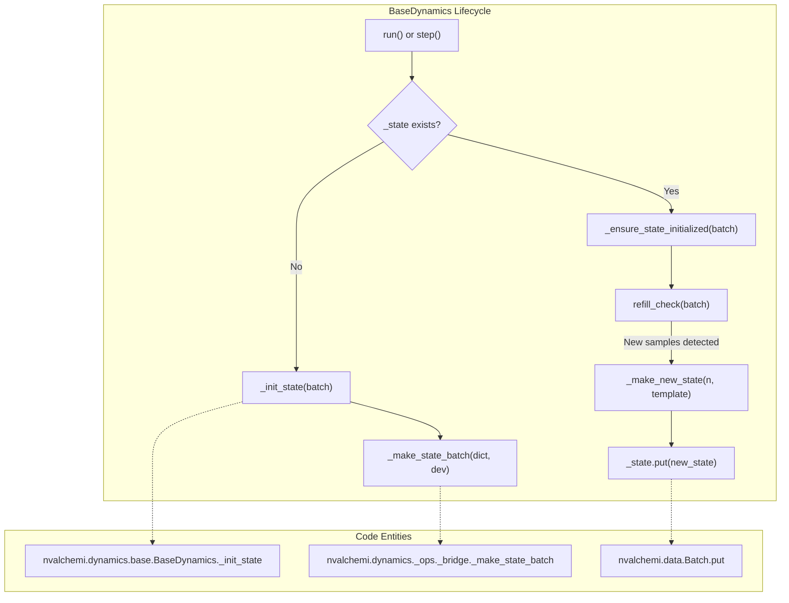
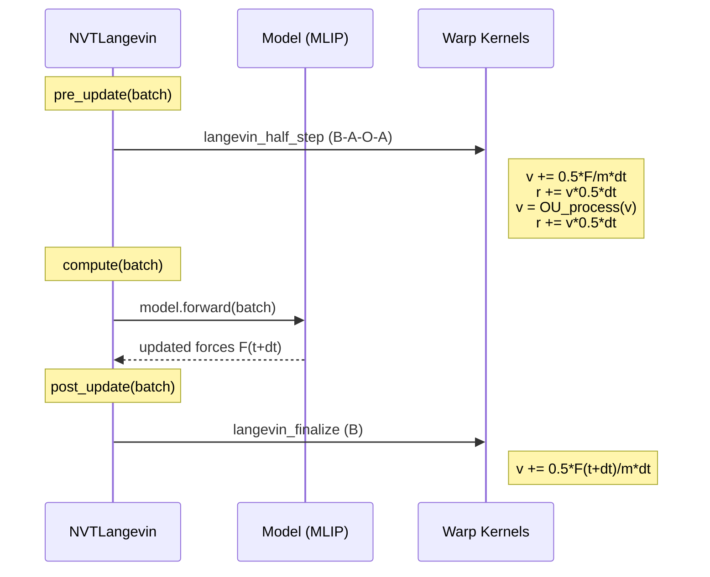

<!-- source: DeepWiki mcp.deepwiki.com · repo NVIDIA/nvalchemi-toolkit · page 4.2 Integrators and Optimizers · fetched 2026-10-26 -->

# Integrators and Optimizers

Relevant source files

The following files were used as context for generating this wiki page:

- [.github/workflows/ci.yml](.github/workflows/ci.yml)
- [Makefile](Makefile)
- [examples/advanced/06_ewald_electrostatics.py](examples/advanced/06_ewald_electrostatics.py)
- [examples/advanced/07_composable_model_composition.py](examples/advanced/07_composable_model_composition.py)
- [nvalchemi/dynamics/__init__.py](nvalchemi/dynamics/__init__.py)
- [nvalchemi/dynamics/_ops/langevin.py](nvalchemi/dynamics/_ops/langevin.py)
- [nvalchemi/dynamics/_ops/nose_hoover.py](nvalchemi/dynamics/_ops/nose_hoover.py)
- [nvalchemi/dynamics/_ops/npt_nph.py](nvalchemi/dynamics/_ops/npt_nph.py)
- [nvalchemi/dynamics/_ops/thermostat_utils.py](nvalchemi/dynamics/_ops/thermostat_utils.py)
- [nvalchemi/dynamics/_ops/velocity_verlet.py](nvalchemi/dynamics/_ops/velocity_verlet.py)
- [nvalchemi/dynamics/demo.py](nvalchemi/dynamics/demo.py)
- [nvalchemi/dynamics/integrators/__init__.py](nvalchemi/dynamics/integrators/__init__.py)
- [nvalchemi/dynamics/integrators/nph.py](nvalchemi/dynamics/integrators/nph.py)
- [nvalchemi/dynamics/integrators/npt.py](nvalchemi/dynamics/integrators/npt.py)
- [nvalchemi/dynamics/integrators/nve.py](nvalchemi/dynamics/integrators/nve.py)
- [nvalchemi/dynamics/integrators/nvt_langevin.py](nvalchemi/dynamics/integrators/nvt_langevin.py)
- [nvalchemi/dynamics/integrators/nvt_nose_hoover.py](nvalchemi/dynamics/integrators/nvt_nose_hoover.py)
- [nvalchemi/dynamics/optimizers/__init__.py](nvalchemi/dynamics/optimizers/__init__.py)
- [nvalchemi/dynamics/optimizers/fire.py](nvalchemi/dynamics/optimizers/fire.py)
- [nvalchemi/dynamics/optimizers/fire2.py](nvalchemi/dynamics/optimizers/fire2.py)
- [sonar-project.properties](sonar-project.properties)
- [test/dynamics/test_ops.py](test/dynamics/test_ops.py)
- [test/dynamics/test_state_management.py](test/dynamics/test_state_management.py)

This page provides a technical reference for all concrete dynamics implementations in the `nvalchemi-toolkit`. These classes inherit from `BaseDynamics` and implement specific physical ensembles (NVE, NVT, NPT, NPH) or optimization algorithms (FIRE, FIRE2).

All integrators follow a split-step pattern where the update logic is divided into `pre_update` and `post_update` around the model's force and stress evaluation.

## Molecular Dynamics Integrators

Molecular dynamics (MD) integrators evolve the system in time by solving Newton's equations of motion, often coupled to thermostats or barostats.

### NVE (Velocity Verlet)
The `NVE` class implements the standard Velocity Verlet algorithm, conserving the number of particles (N), volume (V), and energy (E). It is a symplectic and time-reversible integrator.

*   **Implementation**: Splits the velocity update into two half-kicks.
*   **State**: Tracks `dt`.
*   **Keys**: Needs `forces`; provides `positions`, `velocities`.

Sources: `[nvalchemi/dynamics/integrators/nve.py:1-50]()`, `[nvalchemi/dynamics/demo.py:46-106]()`

### NVT Langevin (BAOAB)
The `NVTLangevin` class implements the BAOAB splitting scheme for Langevin dynamics. It samples the canonical ensemble (NVT) using a stochastic Ornstein-Uhlenbeck process as a thermostat.

*   **Algorithm**: B (half-kick) -> A (drift) -> O (OU-process) -> A (drift) -> [Force Eval] -> B (final half-kick).
*   **Parameters**: `temperature` (K), `friction` (ps⁻¹).
*   **State**: `dt`, `temperature` (converted to eV), `friction`.

Sources: `[nvalchemi/dynamics/integrators/nvt_langevin.py:15-100]()`, `[nvalchemi/dynamics/integrators/nvt_langevin.py:115-178]()`

### NVT Nosé-Hoover (NHC)
The `NVTNoseHoover` class provides a deterministic, time-reversible thermostat using Nosé-Hoover chains (NHC). It utilizes Yoshida-Suzuki factorization for high-order integration of the chain variables.

*   **Algorithm**: NHC half-step -> Velocity half-kick -> Position full-step -> [Force Eval] -> Velocity half-kick -> NHC half-step.
*   **State**: `nhc_eta` (positions), `nhc_eta_dot` (velocities), and `nhc_Q` (masses) for the chains.
*   **Parameters**: `thermostat_time` (τ_T), `chain_length` (default 3), `yoshida_order` (3 or 5).

Sources: `[nvalchemi/dynamics/integrators/nvt_nose_hoover.py:15-101]()`, `[nvalchemi/dynamics/integrators/nvt_nose_hoover.py:132-166]()`

### NPT and NPH (MTK Barostat)
The `NPT` and `NPH` classes implement variable-cell dynamics using the Martyna-Tobias-Klein (MTK) equations.

*   **NPT**: Isothermal-isobaric ensemble. Uses two NHCs: one for particles and one for the barostat (cell) degrees of freedom.
*   **NPH**: Isenthalpic-isobaric ensemble. Omits the thermostat; temperature fluctuates while enthalpy is conserved.
*   **Pressure Coupling**: Supports `isotropic`, `anisotropic`, and `triclinic` modes.
*   **State**: Includes `cell_velocity` [M, 3, 3], `W` (barostat mass), and pressure tensors.

Sources: `[nvalchemi/dynamics/integrators/npt.py:15-109]()`, `[nvalchemi/dynamics/integrators/nph.py:15-99]()`, `[nvalchemi/dynamics/_ops/npt_nph.py:15-50]()`

## Geometry Optimizers

Optimizers are designed to find local energy minima. While they use MD-like machinery (velocities, timesteps), they include non-physical mixing or damping steps to accelerate convergence.

### FIRE (Fast Inertial Relaxation Engine)
The `FIRE` class implements the original Bitzek et al. algorithm. It adjusts the trajectory by mixing velocities with the force direction and dynamically scaling the timestep.

*   **Variants**: `FIRE` (fixed-cell) and `FIREVariableCell` (variable-cell via NPH-like propagation at zero target pressure).
*   **Logic**: If $P = F \cdot v > 0$, the system is moving downhill; increase $dt$ and decrease damping ($\alpha$). If $P < 0$, reset velocities and shrink $dt$.

Sources: `[nvalchemi/dynamics/optimizers/fire.py:15-125]()`

### FIRE2
The `FIRE2` class implements the improved version (Shuang et al., 2020) with better restart conditions and a modified velocity-mixing rule.

*   **Optimization**: The entire FIRE2 step (MD + mixing) is often fused into `pre_update` via specialized Warp kernels (`fire2_step_coord`).
*   **Parameters**: Uses `delaystep`, `dtgrow`, `dtshrink`, and `alpha0`.

Sources: `[nvalchemi/dynamics/optimizers/fire2.py:15-137]()`

## State Management and Data Flow

Integrators maintain a `_state` attribute (a `Batch` object) containing per-system parameters and persistent variables (e.g., NHC chain states).

### Dynamics State Initialization
The state is lazily initialized during the first `step()` or manually via `_init_state`.

Title: Dynamics State Initialization Flow

Sources: `[test/dynamics/test_state_management.py:134-190]()`, `[nvalchemi/dynamics/integrators/npt.py:146-171]()`, `[nvalchemi/dynamics/base.py:1-100]()`

### Split-Step Execution
The following diagram maps the mathematical integration steps to the code methods for an NVT Langevin integrator.

Title: NVT Langevin (BAOAB) Execution Mapping

Sources: `[nvalchemi/dynamics/integrators/nvt_langevin.py:143-177]()`, `[nvalchemi/dynamics/_ops/langevin.py:15-60]()`

## Technical Summary Table

| Integrator | Ensemble | Keys Needed | Per-System State Tensors |
| :--- | :--- | :--- | :--- |
| `NVE` | NVE | `forces` | `dt` |
| `NVTLangevin` | NVT | `forces` | `dt`, `temperature`, `friction` |
| `NVTNoseHoover` | NVT | `forces` | `nhc_eta`, `nhc_eta_dot`, `nhc_Q`, `nhc_ndof` |
| `NPT` | NPT | `forces`, `stresses` | `cell_velocity`, `W`, `nhc_eta`, `nhc_b_eta`, `pressure` |
| `NPH` | NPH | `forces`, `stresses` | `cell_velocity`, `W`, `pressure` |
| `FIRE` | Opt | `forces` | `dt`, `alpha`, `n_pos` |
| `FIRE2` | Opt | `forces` | `dt`, `alpha`, `nsteps_inc`, `vf` |

Sources: `[nvalchemi/dynamics/integrators/npt.py:111-112]()`, `[nvalchemi/dynamics/integrators/nph.py:97-98]()`, `[nvalchemi/dynamics/optimizers/fire.py:121-124]()`, `[nvalchemi/dynamics/optimizers/fire2.py:139-140]()`

## DemoDynamics Reference
`DemoDynamics` is a reference implementation of a Velocity Verlet integrator used for testing and debugging. It demonstrates how to handle `torch.no_grad()` contexts when updating positions to avoid interfering with autograd-based force calculations.

*   **Position Update**: $x(t+dt) = x(t) + v(t)dt + 0.5 a(t)dt^2$
*   **Velocity Update**: $v(t+dt) = v(t) + 0.5(a(t) + a(t+dt))dt$

Sources: `[nvalchemi/dynamics/demo.py:46-186]()`

---

