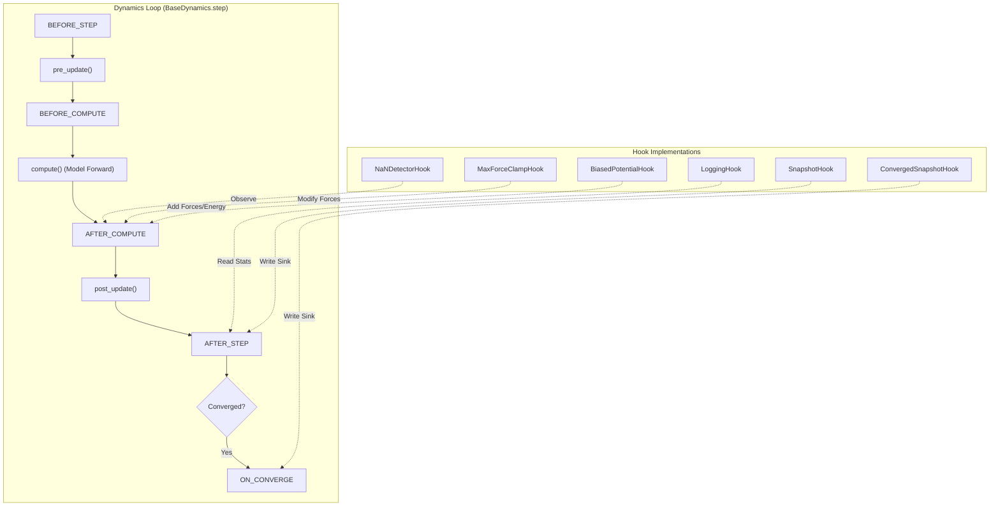
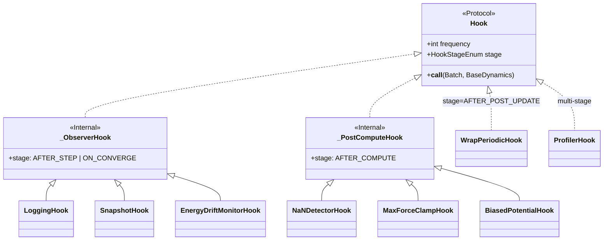

<!-- source: DeepWiki mcp.deepwiki.com · repo NVIDIA/nvalchemi-toolkit · page 4.3 Hook System · fetched 2026-10-26 -->

# Hook System

Relevant source files

The following files were used as context for generating this wiki page:

- [docs/modules/dynamics/hooks.rst](docs/modules/dynamics/hooks.rst)
- [nvalchemi/dynamics/hooks/__init__.py](nvalchemi/dynamics/hooks/__init__.py)
- [nvalchemi/dynamics/hooks/_base.py](nvalchemi/dynamics/hooks/_base.py)
- [nvalchemi/dynamics/hooks/_utils.py](nvalchemi/dynamics/hooks/_utils.py)
- [nvalchemi/dynamics/hooks/bias.py](nvalchemi/dynamics/hooks/bias.py)
- [nvalchemi/dynamics/hooks/freeze.py](nvalchemi/dynamics/hooks/freeze.py)
- [nvalchemi/dynamics/hooks/logging.py](nvalchemi/dynamics/hooks/logging.py)
- [nvalchemi/dynamics/hooks/monitors.py](nvalchemi/dynamics/hooks/monitors.py)
- [nvalchemi/dynamics/hooks/periodic.py](nvalchemi/dynamics/hooks/periodic.py)
- [nvalchemi/dynamics/hooks/profiling.py](nvalchemi/dynamics/hooks/profiling.py)
- [nvalchemi/dynamics/hooks/safety.py](nvalchemi/dynamics/hooks/safety.py)
- [nvalchemi/dynamics/hooks/snapshot.py](nvalchemi/dynamics/hooks/snapshot.py)
- [test/dynamics/test_bias_hook.py](test/dynamics/test_bias_hook.py)
- [test/dynamics/test_freeze_hook.py](test/dynamics/test_freeze_hook.py)
- [test/dynamics/test_hook_utils.py](test/dynamics/test_hook_utils.py)
- [test/dynamics/test_observer_hooks.py](test/dynamics/test_observer_hooks.py)
- [test/dynamics/test_periodic_hook.py](test/dynamics/test_periodic_hook.py)
- [test/dynamics/test_profiler_hook.py](test/dynamics/test_profiler_hook.py)

Hooks are the primary extensibility mechanism for the `nvalchemi` dynamics engine. They allow for the injection of custom logic at specific points in the integration lifecycle without requiring modifications to the core integrator classes. Hooks are used for a wide range of tasks, including data logging, numerical safety, enhanced sampling, and on-the-fly neighbor list management.

## The Hook Protocol

The toolkit utilizes a structural typing approach via a `runtime_checkable` `Protocol`. Any class or object that implements the required attributes and methods is considered a valid `Hook` [docs/modules/dynamics/hooks.rst:14-44]().

### Core Interface
*   **`frequency: int`**: Determines how often the hook fires (every `n` steps).
*   **`stage: HookStageEnum`**: Specifies the lifecycle point where the hook is executed.
*   **`__call__(batch: Batch, dynamics: BaseDynamics)`**: The execution logic. It receives the current `Batch` and the `BaseDynamics` instance.

## Hook Lifecycle (HookStageEnum)

The `HookStageEnum` defines nine insertion points that cover the entirety of a dynamics step. Hooks are dispatched by `BaseDynamics._call_hooks(stage, batch)` in their registration order [docs/modules/dynamics/hooks.rst:50-120]().

### Lifecycle Stages
| Stage | Description |
| :--- | :--- |
| `BEFORE_STEP` | Fired at the very start of the `step()` call. |
| `BEFORE_PRE_UPDATE` | Fired before the first integrator half-step (typically position update). |
| `AFTER_PRE_UPDATE` | Fired after positions are updated, but before the model forward pass. |
| `BEFORE_COMPUTE` | Fired immediately before the model forward pass. |
| `AFTER_COMPUTE` | Fired after forces/energies are written to the batch. |
| `BEFORE_POST_UPDATE` | Fired before the second integrator half-step (typically velocity update). |
| `AFTER_POST_UPDATE` | Fired after velocities are updated. |
| `AFTER_STEP` | Fired at the end of the step. |
| `ON_CONVERGE` | Special stage fired only when convergence is detected for one or more samples. |

**Sources:** [docs/modules/dynamics/hooks.rst:50-98](), [nvalchemi/dynamics/hooks/_base.py:39-47]()

## Data Flow and Code Entity Mapping

The following diagrams illustrate how hooks interact with the `BaseDynamics` loop and how specific implementations map to the codebase.

### Hook Execution Flow
"BaseDynamics" orchestrates the lifecycle, while "Hook" implementations modify or observe the "Batch".

**Sources:** [docs/modules/dynamics/hooks.rst:50-62](), [nvalchemi/dynamics/hooks/safety.py:25-27](), [nvalchemi/dynamics/hooks/snapshot.py:62-66]()

### Hook System Class Hierarchy
This diagram maps natural language categories to the internal class structures.

**Sources:** [nvalchemi/dynamics/hooks/_base.py:49-140](), [nvalchemi/dynamics/hooks/logging.py:72-78](), [nvalchemi/dynamics/hooks/safety.py:44-41](), [nvalchemi/dynamics/hooks/periodic.py:36-112]()

## Built-in Hook Implementations

### Observer Hooks
These hooks inherit from `_ObserverHook` and typically fire at `AFTER_STEP` [nvalchemi/dynamics/hooks/_base.py:49-74]().

*   **`LoggingHook`**: Logs scalar observables (energy, temperature, fmax). It uses a dedicated CUDA stream for D2H transfers and a `ThreadPoolExecutor` for asynchronous I/O to CSV or TensorBoard [nvalchemi/dynamics/hooks/logging.py:72-132]().
*   **`SnapshotHook`**: Periodically writes the full `Batch` state to a `DataSink` (e.g., `ZarrData`, `GPUBuffer`) [nvalchemi/dynamics/hooks/snapshot.py:39-83]().
*   **`ConvergedSnapshotHook`**: Specifically fires at `ON_CONVERGE` to write only the samples that have met convergence criteria [nvalchemi/dynamics/hooks/snapshot.py:117-152]().
*   **`EnergyDriftMonitorHook`**: Tracks cumulative total energy drift in NVE simulations. It can be configured to warn or raise a `RuntimeError` if drift exceeds a threshold [nvalchemi/dynamics/hooks/monitors.py:40-108]().

### Safety and Modification Hooks
These hooks modify the `Batch` in-place, usually at the `AFTER_COMPUTE` stage [nvalchemi/dynamics/hooks/_base.py:102-124]().

*   **`NaNDetectorHook`**: Inspects forces and energies for non-finite values. If detected, it halts the simulation and provides diagnostics on which graph indices failed [nvalchemi/dynamics/hooks/safety.py:44-109]().
*   **`MaxForceClampHook`**: Clamps the magnitude of per-atom forces to a user-defined maximum while preserving the force direction, preventing numerical explosions during integration [nvalchemi/dynamics/hooks/safety.py:17-23]().
*   **`BiasedPotentialHook`**: Adds an external bias potential (energy and forces) to the batch. This is the foundation for umbrella sampling, metadynamics, and harmonic restraints [nvalchemi/dynamics/hooks/bias.py:38-129]().

### Utility and Infrastructure Hooks
*   **`WrapPeriodicHook`**: Wraps atomic positions back into the unit cell based on `batch.pbc` flags. It executes at `AFTER_POST_UPDATE` using `nvalchemiops` Warp kernels for efficiency [nvalchemi/dynamics/hooks/periodic.py:36-112]().
*   **`NeighborListHook`**: Manages on-the-fly neighbor list construction. It supports `MATRIX` or `COO` formats and can use Verlet-skin buffering to avoid rebuilds on every step [docs/modules/dynamics/hooks.rst:147-150]().
*   **`FreezeAtomsHook`**: Zeroes out forces and velocities for specific atoms, effectively freezing them in place during dynamics [nvalchemi/dynamics/hooks/__init__.py:39-40]().
*   **`ProfilerHook`**: Instruments the simulation with NVTX ranges for Nsight Systems and records wall-clock timing for every stage in the lifecycle [nvalchemi/dynamics/hooks/profiling.py:54-121]().

## Implementation Details: Asynchronous Logging

The `LoggingHook` implementation is a key example of how hooks maintain performance. To avoid stalling the GPU pipeline, it performs the following:
1.  **Side Stream**: Scalar computations and `non_blocking=True` D2H transfers occur on a dedicated CUDA stream [nvalchemi/dynamics/hooks/logging.py:95-100]().
2.  **Background Thread**: A `ThreadPoolExecutor` worker waits for the stream to synchronize and then performs the actual disk/network I/O [nvalchemi/dynamics/hooks/logging.py:98-100]().
3.  **Context Management**: Using the hook as a context manager (`with LoggingHook(...) as hook`) ensures that all pending writes are flushed and the background thread is shut down correctly [nvalchemi/dynamics/hooks/logging.py:102-109]().

**Sources:** [nvalchemi/dynamics/hooks/logging.py:15-37](), [nvalchemi/dynamics/hooks/logging.py:72-114]()

---

