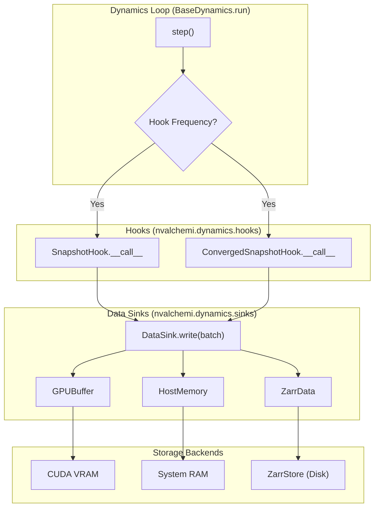
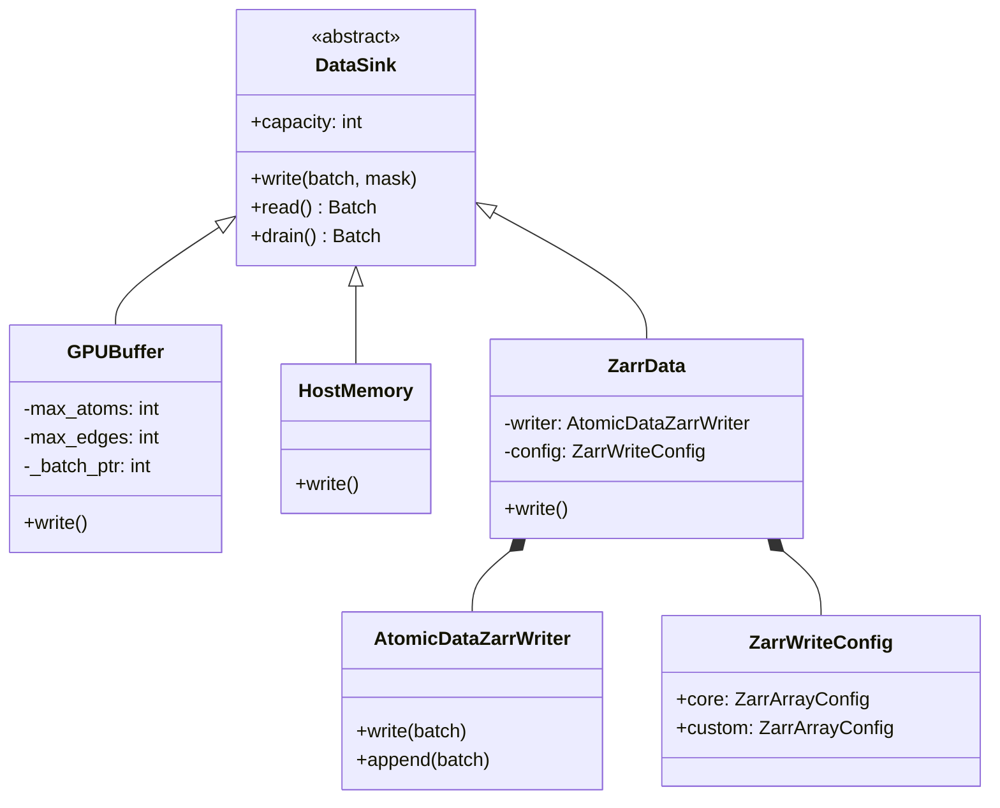

<!-- source: DeepWiki mcp.deepwiki.com · repo NVIDIA/nvalchemi-toolkit · page 4.4 Data Sinks: GPUBuffer, HostMemory, and ZarrData · fetched 2026-10-26 -->

# Data Sinks: GPUBuffer, HostMemory, and ZarrData

Relevant source files

The following files were used as context for generating this wiki page:

- [.claude/skills/README.md](.claude/skills/README.md)
- [.claude/skills/nvalchemi-data-storage/SKILL.md](.claude/skills/nvalchemi-data-storage/SKILL.md)
- [.claude/skills/nvalchemi-data-structures/SKILL.md](.claude/skills/nvalchemi-data-structures/SKILL.md)
- [.claude/skills/nvalchemi-dynamics-hooks/SKILL.md](.claude/skills/nvalchemi-dynamics-hooks/SKILL.md)
- [.claude/skills/nvalchemi-dynamics-implementation/SKILL.md](.claude/skills/nvalchemi-dynamics-implementation/SKILL.md)
- [docs/userguide/dynamics_sinks.md](docs/userguide/dynamics_sinks.md)
- [nvalchemi/dynamics/sinks.py](nvalchemi/dynamics/sinks.py)
- [pyproject.toml](pyproject.toml)
- [uv.lock](uv.lock)

Data sinks are pluggable storage backends designed to record results during dynamics simulations [docs/userguide/dynamics_sinks.md:9-10](). They provide a unified interface for storing and retrieving `Batch` snapshots, allowing users to choose between high-throughput in-memory buffers or persistent disk storage [nvalchemi/dynamics/sinks.py:43-49]().

### The DataSink Abstraction

All storage backends inherit from the `DataSink` abstract base class [nvalchemi/dynamics/sinks.py:43](). This abstraction ensures that dynamics hooks can write data without needing to know the underlying storage implementation.

| Method | Description |
| :--- | :--- |
| `write(batch, mask)` | Stores a batch, optionally filtering samples via a boolean mask [nvalchemi/dynamics/sinks.py:79-81](). |
| `read()` | Retrieves all stored samples as a single concatenated `Batch` [nvalchemi/dynamics/sinks.py:100-102](). |
| `drain()` | Atomic operation that reads all data and then clears the sink [nvalchemi/dynamics/sinks.py:162-164](). |
| `zero()` | Clears all stored data and resets internal pointers [nvalchemi/dynamics/sinks.py:117-119](). |

**Sources:** [nvalchemi/dynamics/sinks.py:43-182](), [docs/userguide/dynamics_sinks.md:14-16]()

---

### GPUBuffer: High-Performance GPU Residency

The `GPUBuffer` stores snapshots directly in CUDA device memory [nvalchemi/dynamics/sinks.py:201](). It is optimized for maximum throughput by avoiding Device-to-Host (D2H) transfers, making it ideal for inter-stage data passing in `FusedStage` pipelines [docs/userguide/dynamics_sinks.md:50-53]().

#### Implementation Details
- **Lazy Allocation**: The buffer pre-allocates memory on the first `write()` call, using the incoming batch as a template for schema and dtypes [nvalchemi/dynamics/sinks.py:204-208]().
- **Pointer Management**: It maintains an internal `_batch_ptr` to track the current write position within the pre-allocated tensors [nvalchemi/dynamics/sinks.py:201-210]().
- **Warp Integration**: It is designed to integrate with Warp-based kernels for fast data manipulation without leaving the GPU [docs/userguide/dynamics_sinks.md:50-53]().

**Sources:** [nvalchemi/dynamics/sinks.py:201-242](), [docs/userguide/dynamics_sinks.md:48-57]()

---

### HostMemory: CPU Staging

`HostMemory` moves snapshots from the GPU to host RAM [docs/userguide/dynamics_sinks.md:61](). This serves as a middle ground between the limited capacity of GPU VRAM and the latency of disk I/O [docs/userguide/dynamics_sinks.md:61-65]().

- **Use Case**: Moderate-length trajectories that exceed GPU memory but where disk writes should be deferred until after the simulation loop [docs/userguide/dynamics_sinks.md:21]().
- **Mechanism**: On `write()`, tensors are copied to the CPU. On `read()`, they are concatenated and moved back to the requested device [nvalchemi/dynamics/sinks.py:59-65]().

**Sources:** [nvalchemi/dynamics/sinks.py:18-21](), [docs/userguide/dynamics_sinks.md:59-65]()

---

### ZarrData: Persistent Disk Storage

`ZarrData` provides persistence by writing snapshots to a Zarr store on disk [nvalchemi/dynamics/sinks.py:20](). It utilizes the toolkit's high-performance `AtomicDataZarrWriter` to handle serialization [nvalchemi/dynamics/sinks.py:35-40]().

#### ZarrWriteConfig
The behavior of the disk sink is governed by `ZarrWriteConfig`, which allows fine-grained control over:
- **Compression**: Enabling codecs like `Zstd` for storage efficiency [docs/userguide/dynamics_sinks.md:91-98]().
- **Chunking**: Defining `chunk_size` for optimal read/write performance [docs/userguide/dynamics_sinks.md:96]().
- **Tiered Overrides**: Applying different settings to `core` (positions, numbers) vs `custom` fields [docs/userguide/dynamics_sinks.md:83-86]().

#### Data Persistence Flow
1. **Snapshot**: `SnapshotHook` triggers at a specific `frequency` [docs/userguide/dynamics_sinks.md:37-40]().
2. **Sink Write**: `ZarrData.write(batch)` is called [nvalchemi/dynamics/sinks.py:58-59]().
3. **Zarr Serialization**: The `AtomicDataZarrWriter` appends the batch to the `.zarr` hierarchy on disk [.claude/skills/nvalchemi-data-storage/SKILL.md:43-59]().

**Sources:** [nvalchemi/dynamics/sinks.py:35-40](), [docs/userguide/dynamics_sinks.md:67-100](), [.claude/skills/nvalchemi-data-storage/SKILL.md:34-59]()

---

### Integration with Hooks

Sinks are passive; they are driven by `SnapshotHook` or `ConvergedSnapshotHook` during the dynamics lifecycle [docs/userguide/dynamics_sinks.md:26-30]().

#### Hook-to-Sink Relationship
The following diagram illustrates how the `BaseDynamics` loop interacts with hooks and their associated sinks.

**Dynamics I/O Data Flow**

**Sources:** [docs/userguide/dynamics_sinks.md:24-46](), [.claude/skills/nvalchemi-dynamics-hooks/SKILL.md:153-162]()

---

### Tiered Storage Comparison

The toolkit provides three implementations to balance performance and persistence.

| Entity Name | Storage Layer | Performance | Persistence | Code Pointer |
| :--- | :--- | :--- | :--- | :--- |
| `GPUBuffer` | Device Memory | Ultra High | Volatile | [nvalchemi/dynamics/sinks.py:201]() |
| `HostMemory` | Host RAM | High | Volatile | [nvalchemi/dynamics/sinks.py:19]() |
| `ZarrData` | Disk | Moderate | Persistent | [nvalchemi/dynamics/sinks.py:20]() |

#### Code Entity Mapping
This diagram maps the high-level storage concepts to the specific classes and configurations in the codebase.

**Sink Architecture and Dependencies**

**Sources:** [nvalchemi/dynamics/sinks.py:43-242](), [docs/userguide/dynamics_sinks.md:18-22](), [nvalchemi/data/datapipes/backends/zarr.py:35-40]() (referenced in sinks.py)

---

