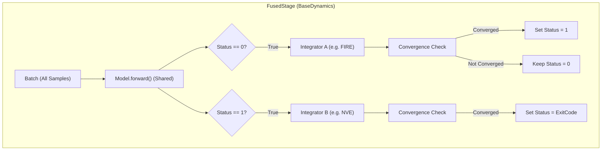
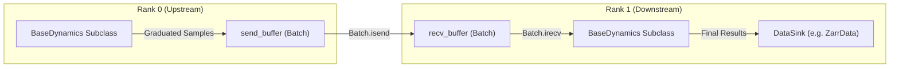

<!-- source: DeepWiki mcp.deepwiki.com · repo NVIDIA/nvalchemi-toolkit · page 4.5 FusedStage and DistributedPipeline · fetched 2026-10-26 -->

# FusedStage and DistributedPipeline

Relevant source files

The following files were used as context for generating this wiki page:

- [docs/modules/dynamics/buffers_and_data_flow.rst](docs/modules/dynamics/buffers_and_data_flow.rst)
- [docs/modules/dynamics/distributed_pipeline.rst](docs/modules/dynamics/distributed_pipeline.rst)
- [docs/modules/dynamics/fused_stage.rst](docs/modules/dynamics/fused_stage.rst)
- [docs/modules/dynamics/overview.rst](docs/modules/dynamics/overview.rst)
- [docs/userguide/dynamics.md](docs/userguide/dynamics.md)
- [docs/userguide/models.md](docs/userguide/models.md)
- [examples/distributed/README.rst](examples/distributed/README.rst)
- [nvalchemi/dynamics/base.py](nvalchemi/dynamics/base.py)
- [test/dynamics/test_pipeline_stage.py](test/dynamics/test_pipeline_stage.py)
- [test/dynamics/test_safety_hooks.py](test/dynamics/test_safety_hooks.py)
- [test/dynamics/test_single_loop.py](test/dynamics/test_single_loop.py)

The NVIDIA ALCHEMI Toolkit provides two primary scaling strategies for composing dynamics workflows: **FusedStage** and **DistributedPipeline**. These strategies allow users to transition from simple single-stage simulations to complex, multi-stage, and multi-GPU production workloads using a consistent operator-based DSL (`+` and `|`).

## 1. FusedStage: Single-GPU Orchestration

A `FusedStage` (created via the `+` operator) composes multiple dynamics sub-stages on a **single GPU**. Its primary purpose is to eliminate redundant model forward passes when a simulation involves multiple phases (e.g., Energy Minimization followed by NVT Molecular Dynamics) [nvalchemi/dynamics/base.py:22-22]().

### Key Implementation Details
- **Shared Forward Pass**: Regardless of the number of sub-stages, only one model forward pass is executed per step for the entire batch [docs/modules/dynamics/fused_stage.rst:73-74]().
- **Status-Based Masking**: Each sub-stage is assigned a unique `status` code. The `FusedStage` uses a `batch.status` tensor to determine which samples are updated by which integrator during the `masked_update` phase [docs/modules/dynamics/fused_stage.rst:53-56]().
- **Automatic Migration**: `FusedStage` automatically inserts `ConvergenceHook` instances between adjacent stages. When a sample converges in stage $N$, its status is incremented to $N+1$, and it is processed by the next integrator in the subsequent step [docs/modules/dynamics/fused_stage.rst:81-82]().

### FusedStage Data Flow
The following diagram illustrates how `FusedStage` partitions a single `Batch` across multiple integrators.

**Diagram: FusedStage Masked Execution**

Sources: [nvalchemi/dynamics/base.py:2025-2080](), [docs/modules/dynamics/fused_stage.rst:57-71]()

---

## 2. DistributedPipeline: Multi-GPU Execution

A `DistributedPipeline` (created via the `|` operator) maps **one dynamics stage per GPU rank**. It uses point-to-point communication (NCCL `isend`/`irecv`) to move converged samples from upstream ranks to downstream ranks [docs/modules/dynamics/distributed_pipeline.rst:10-12]().

### Communication Infrastructure
- **BufferConfig**: Every rank must define a `BufferConfig` (specifying `num_systems`, `num_nodes`, and `num_edges`) to pre-allocate GPU memory for NCCL transfers [nvalchemi/dynamics/base.py:76-93]().
- **CommMode**:
    - `sync`: Blocking receives; simplest for debugging.
    - `async_recv`: (Default) Posts `irecv` at the start of a step and waits only when the data is needed, allowing compute/comm overlap [docs/modules/dynamics/distributed_pipeline.rst:178-183]().
    - `fully_async`: Both sends and receives are deferred for maximum throughput [docs/modules/dynamics/distributed_pipeline.rst:184-188]().
- **Deadlock Prevention**: Ranks unconditionally send their `send_buffer` every step, even if empty. This ensures that downstream `irecv` calls always find a matching `isend` [docs/modules/dynamics/distributed_pipeline.rst:153-156]().

### Distributed Pipeline Architecture
The diagram below shows the mapping between the high-level pipeline and the underlying `_CommunicationMixin` entities.

**Diagram: DistributedPipeline and NCCL Buffers**

Sources: [nvalchemi/dynamics/base.py:126-140](), [docs/modules/dynamics/distributed_pipeline.rst:125-138](), [docs/modules/dynamics/buffers_and_data_flow.rst:41-54]()

---

## 3. Implementation Details

### Buffer Management
Communication buffers are lazily initialized on the first simulation step. The toolkit uses `Batch.empty()` to create a container with the correct schema (keys/dtypes) based on the first available data batch [docs/modules/dynamics/buffers_and_data_flow.rst:82-86]().

| Function | Role | Source |
| :--- | :--- | :--- |
| `_prestep_sync_buffers` | Posts `irecv` and zeros the `send_buffer`. | [nvalchemi/dynamics/base.py:476-476]() |
| `_complete_pending_recv` | Waits on NCCL handles and moves data into `active_batch`. | [nvalchemi/dynamics/base.py:530-530]() |
| `_poststep_sync_buffers` | Populates `send_buffer` with converged samples and calls `isend`. | [nvalchemi/dynamics/base.py:575-575]() |
| `_sync_done_flags` | Uses `dist.all_reduce` to determine if all ranks have finished. | [nvalchemi/dynamics/base.py:734-734]() |

### Back-Pressure and Overflow
To prevent GPU memory exhaustion, the pipeline implements back-pressure. If the `active_batch` is full, incoming samples from `recv_buffer` are diverted to `DataSink` objects (overflow sinks) like `GPUBuffer` or `HostMemory`. These samples are backfilled into the simulation as slots become available [docs/modules/dynamics/buffers_and_data_flow.rst:138-142]().

### Summary Table: Scaling Strategies

| Feature | FusedStage (`+`) | DistributedPipeline (`|`) |
| :--- | :--- | :--- |
| **Hardware** | Single GPU | Multiple GPUs |
| **Forward Pass** | Shared (One per step) | Independent per Rank |
| **Communication** | In-memory pointer masking | NCCL `isend` / `irecv` |
| **Scaling Limit** | GPU Memory | Network Bandwidth / Rank Count |
| **Termination** | Local Convergence | Global `all_reduce` |

Sources: [docs/userguide/dynamics.md:74-134](), [docs/modules/dynamics/overview.rst:100-133](), [nvalchemi/dynamics/base.py:24-34]()

---

