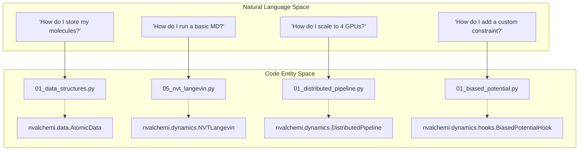
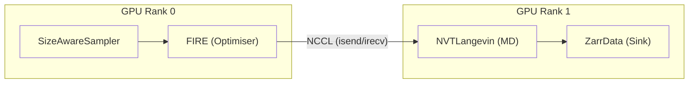

<!-- source: DeepWiki mcp.deepwiki.com · repo NVIDIA/nvalchemi-toolkit · page 5 Examples and Tutorials · fetched 2026-10-26 -->

# Examples and Tutorials

<details>
<summary>Relevant source files</summary>

The following files were used as context for generating this wiki page:

- [docs/conf.py](docs/conf.py)
- [docs/sg_execution_times.rst](docs/sg_execution_times.rst)
- [examples/README.rst](examples/README.rst)
- [examples/advanced/01_biased_potential.py](examples/advanced/01_biased_potential.py)
- [examples/advanced/02_custom_hook.py](examples/advanced/02_custom_hook.py)
- [examples/advanced/03_custom_convergence.py](examples/advanced/03_custom_convergence.py)
- [examples/advanced/README.rst](examples/advanced/README.rst)
- [examples/basic/01_data_structures.py](examples/basic/01_data_structures.py)
- [examples/basic/02_geometry_optimization.py](examples/basic/02_geometry_optimization.py)
- [examples/basic/03_ase_integration.py](examples/basic/03_ase_integration.py)
- [examples/basic/04_nve_energy_conservation.py](examples/basic/04_nve_energy_conservation.py)
- [examples/basic/05_nvt_langevin.py](examples/basic/05_nvt_langevin.py)
- [examples/basic/README.rst](examples/basic/README.rst)
- [examples/distributed/01_distributed_pipeline.py](examples/distributed/01_distributed_pipeline.py)
- [examples/distributed/02_distributed_monitoring.py](examples/distributed/02_distributed_monitoring.py)
- [examples/distributed/README.rst](examples/distributed/README.rst)
- [examples/intermediate/01_multistage_pipeline.py](examples/intermediate/01_multistage_pipeline.py)
- [examples/intermediate/02_trajectory_zarr_io.py](examples/intermediate/02_trajectory_zarr_io.py)
- [examples/intermediate/03_npt_variable_cell.py](examples/intermediate/03_npt_variable_cell.py)
- [examples/intermediate/04_inflight_batching.py](examples/intermediate/04_inflight_batching.py)
- [examples/intermediate/05_safety_and_monitoring.py](examples/intermediate/05_safety_and_monitoring.py)
- [examples/intermediate/README.rst](examples/intermediate/README.rst)

</details>


The `nvalchemi-toolkit` provides a comprehensive gallery of examples designed to guide users from basic data manipulation to complex, multi-GPU distributed simulation pipelines. These examples are organized into four complexity tiers, ensuring a progressive learning curve for researchers and engineers.

All examples are provided as self-contained Python scripts in the `examples/` directory [examples/README.rst:1-7](). They are compatible with **Sphinx-Gallery**, which automatically executes them to generate a visual documentation build with plots and execution times [docs/conf.py:139-153]().

### Example Tiers Overview

The toolkit categorizes its tutorials into the following levels of sophistication:

| Tier | Focus Area | Key Components Demonstrated |
| :--- | :--- | :--- |
| **Basic** | Core API & Single-system MD | `AtomicData`, `Batch`, `FIRE`, `NVTLangevin`, `NVE` |
| **Intermediate** | Scaling & Production I/O | `FusedStage`, `ZarrData`, `NPT`, `SizeAwareSampler` |
| **Advanced** | Framework Extension | Custom `Hook`, `BaseDynamics` subclassing, Biased MD |
| **Distributed** | Multi-GPU Orchestration | `DistributedPipeline`, `BufferConfig`, NCCL communication |

### Example Organization and Execution

The examples are structured to be both readable as code and executable as a test suite. The `docs/conf.py` file defines the gallery order and filtering logic [docs/conf.py:146-154]().

#### Natural Language to Code Entity Mapping

The following diagram illustrates how high-level simulation concepts translate into specific example files and toolkit classes.

**Simulation Concept Mapping**

Sources: [examples/README.rst:14-41](), [examples/basic/01_data_structures.py:26-36](), [examples/basic/05_nvt_langevin.py:64-67](), [examples/advanced/01_biased_potential.py:55-59](), [examples/distributed/01_distributed_pipeline.py:55-66]()

### Basic and Intermediate Examples

The **Basic** tier is suitable for users transitioning from tools like ASE. It introduces the fundamental `AtomicData` and `Batch` structures [examples/basic/01_data_structures.py:19-22](), geometry optimization with `FIRE`, and standard ensembles like `NVE` and `NVT` using the Langevin thermostat [examples/basic/05_nvt_langevin.py:24-34]().

The **Intermediate** tier focuses on production-grade features. This includes:
* **Multi-stage Pipelines**: Using `FusedStage` to chain different dynamics (e.g., Minimized -> NVT) [examples/README.rst:23-27]().
* **High-performance I/O**: Persisting trajectories using the `ZarrData` sink [examples/intermediate/02_trajectory_zarr_io.py]().
* **Inflight Batching**: Managing GPU memory with `SizeAwareSampler` to pack variable-sized systems efficiently [examples/intermediate/04_inflight_batching.py]().

For details, see [Basic and Intermediate Examples](#5.1).

### Advanced and Distributed Examples

The **Advanced** tier demonstrates how to extend the toolkit's logic. It covers writing custom `Hook` implementations for structural analysis (like RDF) [examples/advanced/02_custom_hook.py:25-35](), implementing custom integrators by subclassing `BaseDynamics` [examples/advanced/README.rst:19-22](), and multi-criteria convergence logic [examples/advanced/03_custom_convergence.py:24-30]().

The **Distributed** tier provides the blueprint for multi-GPU simulations. Using `DistributedPipeline`, users can map different simulation stages to specific GPU ranks [examples/distributed/01_distributed_pipeline.py:154-158](). These examples utilize NCCL for high-speed tensor transfer between ranks [examples/distributed/README.rst:16-18]().

**Distributed Pipeline Topology**

Sources: [examples/distributed/README.rst:20-32](), [examples/distributed/01_distributed_pipeline.py:27-34]()

For details, see [Advanced and Distributed Examples](#5.2).

### Running the Examples

Most examples can be run directly with a standard Python interpreter:
```bash
python examples/basic/01_data_structures.py
```

However, **Distributed** examples require `torchrun` to initialize the process group across multiple GPUs [examples/distributed/README.rst:49-57]():
```bash
torchrun --nproc_per_node=4 examples/distributed/01_distributed_pipeline.py
```

Sources:
- [docs/conf.py:139-170]()
- [examples/README.rst:1-41]()
- [examples/basic/README.rst:1-19]()
- [examples/intermediate/README.rst:1-27]()
- [examples/advanced/README.rst:1-22]()
- [examples/distributed/README.rst:1-78]()

---

