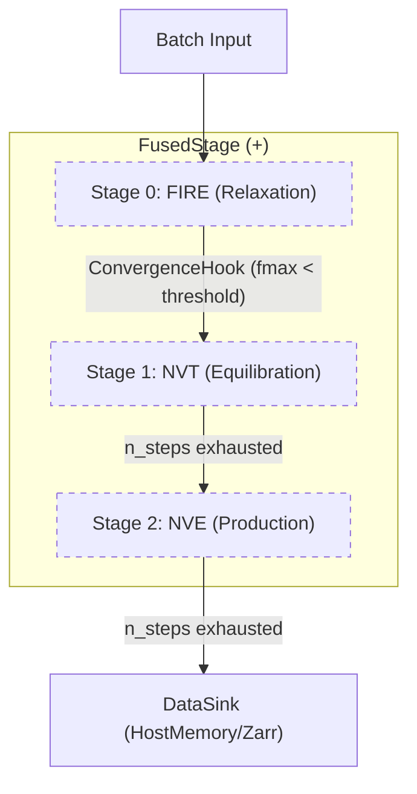
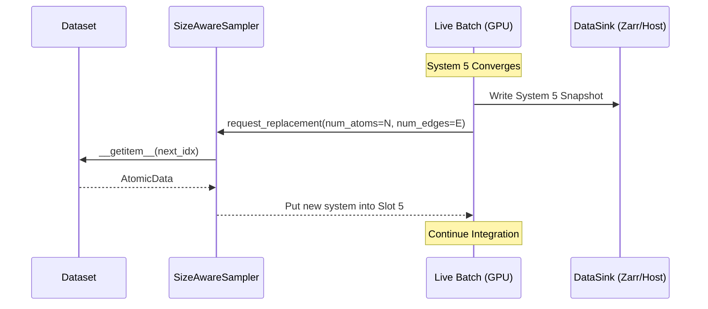

<!-- source: DeepWiki mcp.deepwiki.com · repo NVIDIA/nvalchemi-toolkit · page 5.1 Basic and Intermediate Examples · fetched 2026-10-26 -->

# Basic and Intermediate Examples

Relevant source files

The following files were used as context for generating this wiki page:

- [examples/advanced/03_custom_convergence.py](examples/advanced/03_custom_convergence.py)
- [examples/basic/01_data_structures.py](examples/basic/01_data_structures.py)
- [examples/basic/02_geometry_optimization.py](examples/basic/02_geometry_optimization.py)
- [examples/basic/03_ase_integration.py](examples/basic/03_ase_integration.py)
- [examples/basic/04_nve_energy_conservation.py](examples/basic/04_nve_energy_conservation.py)
- [examples/basic/05_nvt_langevin.py](examples/basic/05_nvt_langevin.py)
- [examples/distributed/01_distributed_pipeline.py](examples/distributed/01_distributed_pipeline.py)
- [examples/distributed/02_distributed_monitoring.py](examples/distributed/02_distributed_monitoring.py)
- [examples/intermediate/01_multistage_pipeline.py](examples/intermediate/01_multistage_pipeline.py)
- [examples/intermediate/02_trajectory_zarr_io.py](examples/intermediate/02_trajectory_zarr_io.py)
- [examples/intermediate/03_npt_variable_cell.py](examples/intermediate/03_npt_variable_cell.py)
- [examples/intermediate/04_inflight_batching.py](examples/intermediate/04_inflight_batching.py)
- [examples/intermediate/05_safety_and_monitoring.py](examples/intermediate/05_safety_and_monitoring.py)

This page provides a technical walkthrough of the `nvalchemi-toolkit` example gallery, categorized into **Basic** (data structures, single-stage dynamics, ASE integration) and **Intermediate** (multistage pipelines, Zarr I/O, variable-cell NPT, and inflight batching) tiers. These examples demonstrate the practical application of the toolkit's four-layer architecture and operator-based DSL.

## Basic Examples

The basic tier focuses on the fundamental data structures and the execution of single-stage dynamics simulations.

### Data Structures: AtomicData and Batch
The toolkit uses a graph-based representation for molecular systems. `AtomicData` represents a single system, while `Batch` represents a GPU-resident collection of systems.

*   **`AtomicData`**: Built on Pydantic, it requires `positions` and `atomic_numbers` [examples/basic/01_data_structures.py:31-36](). It supports arbitrary node, edge, and system-level properties via `add_node_property`, `add_edge_property`, and `add_system_property` [examples/basic/01_data_structures.py:84-90]().
*   **`Batch`**: Created via `Batch.from_data_list` [examples/basic/01_data_structures.py:137-157](). It manages the `batch_ptr` and `ptr` tensors to allow segmented operations on the GPU [examples/basic/01_data_structures.py:172-177]().

### Geometry Optimization (FIRE)
Geometry optimization is typically performed using the **FIRE** (Fast Inertial Relaxation Engine) algorithm [examples/basic/02_geometry_optimization.py:23-28]().

*   **Implementation**: The `FIRE` optimizer propagates atoms with Newtonian dynamics but damps velocities toward the force direction [examples/basic/02_geometry_optimization.py:23-28]().
*   **Convergence**: A `ConvergenceHook` monitors the maximum per-atom force norm (`fmax`). Systems that fall below the threshold are removed from the active batch to save compute [examples/basic/02_geometry_optimization.py:35-39]().
*   **Neighbor Lists**: A `NeighborListHook` is registered to recompute the neighbor matrix before model forward passes [examples/basic/02_geometry_optimization.py:30-34]().

### ASE Integration
The toolkit provides seamless integration with the **Atomic Simulation Environment (ASE)**.

*   **Ingestion**: `AtomicData.from_atoms(atoms)` converts an `ase.Atoms` object, automatically mapping ASE tags to `AtomCategory` (e.g., `SURFACE`, `BULK`, `GAS`) [examples/basic/03_ase_integration.py:68-81]().
*   **Constraints**: `FreezeAtomsHook` uses these categories to fix the positions of specific atoms (e.g., freezing a copper slab while relaxing an adsorbate) [examples/basic/03_ase_integration.py:170-175]().

### NVE and NVT Dynamics
Standard MD ensembles are implemented as dynamics stages.

*   **NVE (Microcanonical)**: Uses the `VelocityVerlet` algorithm. Energy conservation is monitored via `EnergyDriftMonitorHook` [examples/basic/04_nve_energy_conservation.py:48-54]().
*   **NVT (Canonical)**: `NVTLangevin` implements the **BAOAB** splitting scheme for high configurational accuracy [examples/basic/05_nvt_langevin.py:24-30](). It couples the system to a heat bath using a friction coefficient $\gamma$ [examples/basic/05_nvt_langevin.py:30-34]().

**Sources:** [examples/basic/01_data_structures.py](), [examples/basic/02_geometry_optimization.py](), [examples/basic/03_ase_integration.py](), [examples/basic/04_nve_energy_conservation.py](), [examples/basic/05_nvt_langevin.py]()

---

## Intermediate Examples

Intermediate examples demonstrate complex orchestration, persistent I/O, and advanced thermodynamic ensembles.

### Multistage Pipelines (FusedStage)
The `+` operator allows users to compose multiple dynamics stages into a single `FusedStage` pipeline [examples/intermediate/01_multistage_pipeline.py:183-188]().

#### Data Flow: Multistage Transition
The diagram below illustrates how a system migrates through a `FIRE -> NVT -> NVE` pipeline.

**System State Migration**

**Sources:** [examples/intermediate/01_multistage_pipeline.py:183-191](), [nvalchemi/dynamics/base.py:51]().

### Zarr Trajectory I/O
For large-scale simulations, snapshots are written to **Zarr** stores.

*   **Writing**: A `SnapshotHook` directs the `Batch` state to a `ZarrData` sink at a defined `frequency` [examples/intermediate/02_trajectory_zarr_io.py:128-135]().
*   **Reading**: `AtomicDataZarrReader` provides random access to the stored snapshots, which is then wrapped in a `Dataset` and `DataLoader` for training or post-processing [examples/intermediate/02_trajectory_zarr_io.py:180-182]().

### NPT Variable Cell Dynamics
The **NPT ensemble** (constant Pressure and Temperature) allows the simulation cell to fluctuate.

*   **Implementation**: Uses the **Martyna-Tobias-Klein (MTK)** barostat coupled to a **Nosé-Hoover chain (NHC)** thermostat [examples/intermediate/03_npt_variable_cell.py:24-28]().
*   **Stress Tensor**: The model must provide a `stress` tensor. For the `LennardJonesModelWrapper`, this is enabled via `model.model_config.compute_stresses = True` [examples/intermediate/03_npt_variable_cell.py:62-73]().

### Inflight Batching
Inflight batching (Mode 2) maintains a fully occupied GPU by replacing graduated systems with new samples from a dataset in real-time.

**Inflight Replacement Logic**

*   **`SizeAwareSampler`**: Pre-scans the dataset using `get_metadata` to build size-bins [examples/intermediate/04_inflight_batching.py:83-87](). It ensures that replacement systems fit within the memory budget of the vacated slot [examples/intermediate/04_inflight_batching.py:173-178]().
*   **`system_id`**: Each sample is assigned a unique ID to track its trajectory across refill events [examples/intermediate/04_inflight_batching.py:49-51]().

**Sources:** [examples/intermediate/01_multistage_pipeline.py](), [examples/intermediate/02_trajectory_zarr_io.py](), [examples/intermediate/03_npt_variable_cell.py](), [examples/intermediate/04_inflight_batching.py]()

---

## Safety and Monitoring

The intermediate tier also introduces safety hooks to prevent simulation failure.

| Hook Class | Role | Implementation Detail |
| :--- | :--- | :--- |
| `NaNDetectorHook` | Failure Detection | Checks positions and forces for NaNs; terminates the run if found. |
| `MaxForceClampHook` | Stability | Clamps force magnitudes to a maximum value to prevent "explosions" in high-energy states. |
| `EnergyDriftMonitorHook` | Validation | Calculates $E_{total}$ drift per atom per step and warns/errors if it exceeds a threshold [examples/basic/04_nve_energy_conservation.py:166-173](). |
| `ProfilerHook` | Performance | Records wall-clock time between hook stages for bottleneck analysis [examples/distributed/02_distributed_monitoring.py:142-145](). |

**Sources:** [examples/basic/04_nve_energy_conservation.py](), [examples/distributed/02_distributed_monitoring.py](), [examples/intermediate/05_safety_and_monitoring.py]()

---

