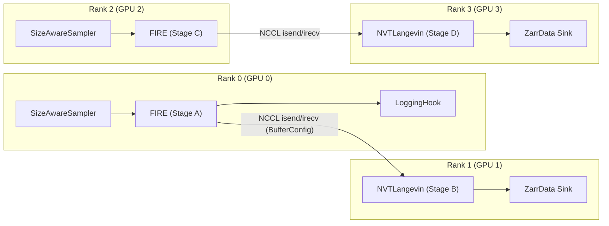

<!-- source: DeepWiki mcp.deepwiki.com · repo NVIDIA/nvalchemi-toolkit · page 5.2 Advanced and Distributed Examples · fetched 2026-10-26 -->

# Advanced and Distributed Examples

Relevant source files

The following files were used as context for generating this wiki page:

- [examples/advanced/03_custom_convergence.py](examples/advanced/03_custom_convergence.py)
- [examples/advanced/04_mace_nvt.py](examples/advanced/04_mace_nvt.py)
- [examples/advanced/05_custom_integrator.py](examples/advanced/05_custom_integrator.py)
- [examples/advanced/06_ewald_electrostatics.py](examples/advanced/06_ewald_electrostatics.py)
- [examples/advanced/07_composable_model_composition.py](examples/advanced/07_composable_model_composition.py)
- [examples/basic/05_nvt_langevin.py](examples/basic/05_nvt_langevin.py)
- [examples/distributed/01_distributed_pipeline.py](examples/distributed/01_distributed_pipeline.py)
- [examples/distributed/02_distributed_monitoring.py](examples/distributed/02_distributed_monitoring.py)
- [examples/distributed/README.rst](examples/distributed/README.rst)
- [nvalchemi/dynamics/hooks/neighbor_list.py](nvalchemi/dynamics/hooks/neighbor_list.py)
- [nvalchemi/dynamics/optimizers/fire.py](nvalchemi/dynamics/optimizers/fire.py)
- [nvalchemi/dynamics/optimizers/fire2.py](nvalchemi/dynamics/optimizers/fire2.py)
- [nvalchemi/models/__init__.py](nvalchemi/models/__init__.py)
- [nvalchemi/models/_ops/lj.py](nvalchemi/models/_ops/lj.py)

This section covers advanced simulation patterns in the NVIDIA ALCHEMI Toolkit (`nvalchemi`), including custom logic for convergence and integration, multi-model composition, and large-scale distributed pipelines using multiple GPUs.

## 1. Advanced Dynamics and Customization

The toolkit is designed for extensibility, allowing users to inject custom logic into the simulation loop via the hook system or by subclassing core dynamics components.

### 1.1 Custom Convergence Criteria
The `ConvergenceHook` is responsible for detecting when a system has reached a steady state (e.g., in geometry optimization) and masking it from further computation [nvalchemi/dynamics/base.py:19-37](). While the toolkit provides a standard `from_forces` factory, users can define multi-criteria convergence or arbitrary logic using the `custom_op` parameter.

| Feature | Implementation | Use Case |
| :--- | :--- | :--- |
| **Force Norm** | `ConvergenceHook.from_forces(threshold)` | Standard geometry optimization. |
| **Multi-Criteria** | List of dicts with `reduce_op="norm"` | Combining force and energy stability [examples/advanced/03_custom_convergence.py:114-131](). |
| **Custom Operator** | Callable returning `[B]` bool mask | Relative energy change $|\Delta E / E| < \varepsilon$ [examples/advanced/03_custom_convergence.py:151-174](). |

**Sources:** [examples/advanced/03_custom_convergence.py:19-37](), [examples/advanced/03_custom_convergence.py:114-131](), [examples/advanced/03_custom_convergence.py:151-174]().

### 1.2 Custom Integrators
New molecular dynamics integrators are created by subclassing `BaseDynamics` and implementing the `pre_update` and `post_update` methods [examples/advanced/05_custom_integrator.py:19-30](). This allows for the implementation of novel thermostats, barostats, or non-equilibrium driving forces.

**Data Flow in Custom Integrator:**
1. **`pre_update`**: Update positions and perform the first velocity half-kick [examples/advanced/05_custom_integrator.py:152-174]().
2. **`compute`**: The model evaluates forces at the new positions.
3. **`post_update`**: Perform the second velocity half-kick and any auxiliary logic like velocity rescaling [examples/advanced/05_custom_integrator.py:176-200]().

**Sources:** [examples/advanced/05_custom_integrator.py:19-30](), [examples/advanced/05_custom_integrator.py:152-200]().

---

## 2. Model Composition and Foundation Models

Advanced workflows often require combining multiple potentials (e.g., MLIP + Classical) or utilizing large-scale foundation models like MACE.

### 2.1 MACE and Foundation Models
The `MACEWrapper` provides a high-performance interface to the Message-passing Atomic Cluster Expansion models [examples/advanced/04_mace_nvt.py:19-27]().
* **Automatic Wiring**: The `NeighborListHook` can be automatically configured by reading the `model.model_card.neighbor_config`, ensuring the correct format (`COO` for MACE, `MATRIX` for LJ) is used [examples/advanced/04_mace_nvt.py:124-132]().
* **Foundation Registry**: Models can be loaded via `MACEWrapper.from_checkpoint` using local paths or named registry entries [examples/advanced/04_mace_nvt.py:93-96]().

### 2.2 Composable Model Composition
The `ComposableModelWrapper` (accessible via the `+` operator) allows stacking multiple models [nvalchemi/models/__init__.py:65-68]().
* **Hybrid Potentials**: Combining a MACE foundation model with a classical Lennard-Jones term for short-range repulsion.
* **Electrostatics**: Adding `EwaldModelWrapper` or `PMEModelWrapper` for long-range interactions [nvalchemi/models/__init__.py:77-92]().

**Sources:** [examples/advanced/04_mace_nvt.py:19-27](), [examples/advanced/04_mace_nvt.py:93-96](), [examples/advanced/04_mace_nvt.py:124-132](), [nvalchemi/models/__init__.py:65-92]().

---

## 3. Distributed Pipelines

For high-throughput screening or multi-stage simulations, `DistributedPipeline` orchestrates execution across multiple GPUs using NCCL.

### 3.1 Topology and Data Flow
A `DistributedPipeline` maps GPU ranks to specific dynamics stages. Systems flow between ranks via asynchronous `isend`/`irecv` operations [examples/distributed/01_distributed_pipeline.py:154-158]().

**Pipeline Communication Logic**
"Natural Language Space" to "Code Entity Space" Bridge:
1. **Upstream Stage**: An instance of `FIRE` or `NVTLangevin` with `prior_rank=None`. It uses a `SizeAwareSampler` to feed the pipeline [examples/distributed/01_distributed_pipeline.py:169-175]().
2. **Communication Buffer**: `BufferConfig` defines the fixed-size tensors (atoms, edges, systems) required for NCCL transfers [examples/distributed/01_distributed_pipeline.py:181-187]().
3. **Downstream Stage**: A stage with `next_rank=None`. It receives systems, completes its dynamics, and writes to a `DataSink` (e.g., `HostMemory` or `ZarrData`) [examples/distributed/01_distributed_pipeline.py:191-194]().

**Sources:** [examples/distributed/01_distributed_pipeline.py:154-194]().

### 3.2 Distributed Monitoring and Observability
In a multi-GPU environment, monitoring must be rank-aware to prevent file contention.

| Entity | Role in Distributed Execution |
| :--- | :--- |
| `LoggingHook` | Writes per-rank CSV logs (energy, temperature) [examples/distributed/02_distributed_monitoring.py:142-145](). |
| `ProfilerHook` | Records step timings and NVTX annotations per rank [examples/distributed/02_distributed_monitoring.py:145-146](). |
| `ZarrData` | Provides persistent, shardable trajectory storage on disk [examples/distributed/02_distributed_monitoring.py:157-164](). |
| `DownstreamDoneHook` | Detects idle stages and terminates the pipeline after a `patience` period [examples/distributed/02_distributed_monitoring.py:106-123](). |

**Distributed Pipeline Architecture**

**Sources:** [examples/distributed/01_distributed_pipeline.py:27-29](), [examples/distributed/02_distributed_monitoring.py:106-164]().

### 3.3 Termination and Collation
* **Termination**: The pipeline terminates when all ranks report `done=True`. Upstream ranks finish when their samplers are exhausted; downstream ranks use `DownstreamDoneHook` to exit after a period of inactivity [examples/distributed/01_distributed_pipeline.py:110-133]().
* **Collation**: After the `pipeline.run()` call, rank 0 typically performs post-run collation, reading the per-rank CSV logs to generate a unified summary [examples/distributed/02_distributed_monitoring.py:28-29]().

**Sources:** [examples/distributed/01_distributed_pipeline.py:110-133](), [examples/distributed/02_distributed_monitoring.py:28-29]().

---

