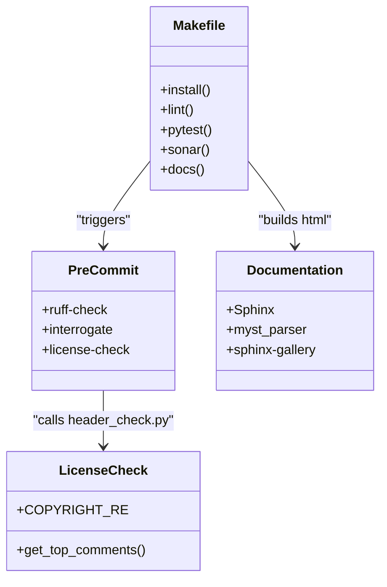

<!-- source: DeepWiki mcp.deepwiki.com · repo NVIDIA/nvalchemi-toolkit · page 6 Infrastructure and Development · fetched 2026-10-26 -->

# Infrastructure and Development

<details>
<summary>Relevant source files</summary>

The following files were used as context for generating this wiki page:

- [.pre-commit-config.yaml](.pre-commit-config.yaml)
- [Makefile](Makefile)
- [SECURITY.md](SECURITY.md)
- [docs/index.md](docs/index.md)
- [docs/modules/index.md](docs/modules/index.md)
- [docs/userguide/about/contributing.md](docs/userguide/about/contributing.md)
- [docs/userguide/about/faq.md](docs/userguide/about/faq.md)
- [nvalchemi/dynamics/demo.py](nvalchemi/dynamics/demo.py)
- [sonar-project.properties](sonar-project.properties)
- [test/_license/header.txt](test/_license/header.txt)
- [test/_license/header_check.py](test/_license/header_check.py)

</details>


The NVIDIA ALCHEMI Toolkit (nvalchemi) employs a robust infrastructure designed to ensure code quality, high-performance execution, and comprehensive documentation. This section provides an overview of the development lifecycle, the automated quality assurance pipelines, and the documentation systems that support the toolkit's "GPU-first" philosophy.

## Development Lifecycle and Tooling

The project utilizes `uv` as the primary package and environment manager [Makefile:28-33](). Development workflows are orchestrated via a `Makefile` that provides a standardized interface for installation, linting, testing, and documentation builds.

### Local Environment Setup
Developers can initialize their environment using `uv sync`, which handles all dependencies including optional extras like `mace` and `warp-lang` [Makefile:27-28](). Pre-commit hooks are mandatory for local development to catch common issues before they reach the CI pipeline [Makefile:34]().

### Development Workflow Diagram
The following diagram illustrates the path from local development to the integrated codebase.

**Code Quality and Contribution Flow**
```mermaid
graph TD
    subgraph "LocalDevelopment"
        ["uv sync"] -- "Environment Setup" --> ["Code Changes"]
        ["Code Changes"] -- "make lint" --> ["Ruff / Interrogate"]
        ["Code Changes"] -- "make pytest" --> ["Local Coverage"]
        ["Ruff / Interrogate"] --> ["Pre-commit Hooks"]
        ["Local Coverage"] --> ["Pre-commit Hooks"]
    end

    subgraph "QualityGate"
        ["Pre-commit Hooks"] -- "git commit -s" --> ["DCO Sign-off"]
        ["DCO Sign-off"] -- "GitHub PR" --> ["CI Workflow"]
        ["CI Workflow"] -- "GPU Tests" --> ["H100 Validation"]
        ["CI Workflow"] -- "SonarQube" --> ["Quality Gate"]
    end

    ["Quality Gate"] -- "Approval" --> ["Main Branch"]

    style LocalDevelopment fill:none
    style QualityGate fill:none
```
Sources: [Makefile:26-58](), [.pre-commit-config.yaml:16-67](), [docs/userguide/about/contributing.md:125-167]()

## CI/CD, Testing, and Code Quality

The toolkit maintains high standards for code integrity through an automated CI/CD pipeline. Key components include:

*   **Static Analysis**: The project uses `ruff` for linting and formatting [Makefile:40-58](), and `interrogate` to ensure docstring coverage [Makefile:59-62]().
*   **License Compliance**: A custom script `test/_license/header_check.py` validates that all source files contain the appropriate Apache-2.0 and NVIDIA copyright headers [test/_license/header_check.py:25-156]().
*   **Testing**: Automated testing is performed via `pytest`, with a requirement for code coverage (typically targeting >70%) [Makefile:71-83]().
*   **SonarQube Integration**: The project is integrated with SonarQube for deep code analysis, tracking technical debt, and security vulnerabilities [Makefile:112-130]().

For detailed information on the CI configuration and quality metrics, see **[CI/CD, Testing, and Code Quality (#6.1)]**.

Sources: [Makefile:40-83](), [.pre-commit-config.yaml:33-48](), [test/_license/header_check.py:1-24]()

## Documentation Build System

The documentation is built using Sphinx and hosted with the `pydata_sphinx_theme` [Makefile:145-147](). It serves as the primary resource for both users and developers.

*   **Rich Content**: Uses `myst_parser` for Markdown support and `sphinx-gallery` to execute and render example notebooks [Makefile:135-143]().
*   **API Reference**: Automatically generated from docstrings, ensuring the documentation stays in sync with the `jaxtyping`-annotated codebase [docs/modules/index.md:1-15]().
*   **Custom Extensions**: Includes specialized extensions for rendering `ModelCard` capabilities and simulation galleries.

For details on building the docs and the gallery pipeline, see **[Documentation Build System (#6.2)]**.

Sources: [Makefile:132-157](), [docs/index.md:63-102](), [docs/modules/index.md:7-15]()

## Contribution Guidelines

NVIDIA ALCHEMI Toolkit welcomes community contributions under the **Developer Certificate of Origin (DCO)** [docs/userguide/about/contributing.md:30-34](). 

### Key Requirements
*   **Sign-off**: Every commit must be signed off (`git commit -s`) to certify adherence to DCO terms [docs/userguide/about/contributing.md:33-34]().
*   **Security**: Security vulnerabilities should **not** be reported via GitHub Issues. Instead, use the NVIDIA Product Security portal or email `psirt@nvidia.com` [SECURITY.md:7-12]().
*   **Style**: Adherence to the project's `ruff` configuration and docstring requirements is mandatory [Makefile:40-62]().

**Infrastructure Entity Mapping**

Sources: [Makefile:1-188](), [.pre-commit-config.yaml:16-67](), [test/_license/header_check.py:16-25]()

---
**Child Pages:**
*   [6.1 CI/CD, Testing, and Code Quality](#)
*   [6.2 Documentation Build System](#)

---

