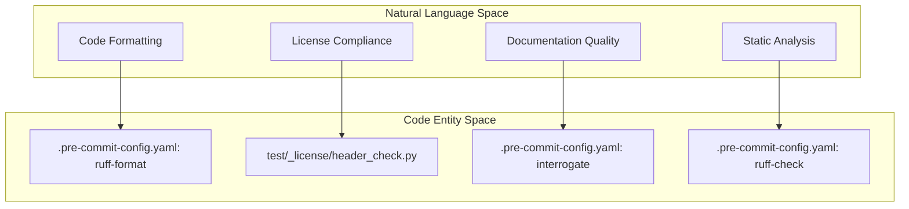
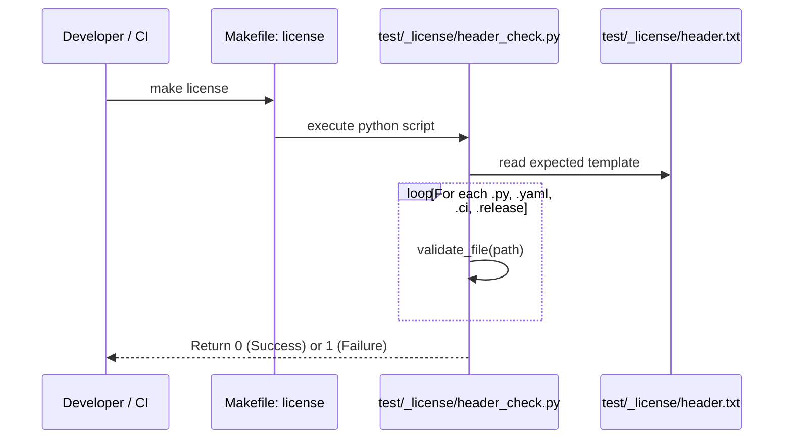

<!-- source: DeepWiki mcp.deepwiki.com · repo NVIDIA/nvalchemi-toolkit · page 6.1 CI/CD, Testing, and Code Quality · fetched 2026-10-26 -->

# CI/CD, Testing, and Code Quality

Relevant source files

The following files were used as context for generating this wiki page:

- [.github/ISSUE_TEMPLATE/bug_report.yml](.github/ISSUE_TEMPLATE/bug_report.yml)
- [.github/ISSUE_TEMPLATE/config.yml](.github/ISSUE_TEMPLATE/config.yml)
- [.github/ISSUE_TEMPLATE/feature_request.yml](.github/ISSUE_TEMPLATE/feature_request.yml)
- [.github/codecov.yml](.github/codecov.yml)
- [.github/workflows/ci.yml](.github/workflows/ci.yml)
- [.pre-commit-config.yaml](.pre-commit-config.yaml)
- [Makefile](Makefile)
- [docs/index.md](docs/index.md)
- [docs/modules/index.md](docs/modules/index.md)
- [docs/userguide/about/contributing.md](docs/userguide/about/contributing.md)
- [docs/userguide/about/faq.md](docs/userguide/about/faq.md)
- [nvalchemi/dynamics/demo.py](nvalchemi/dynamics/demo.py)
- [nvalchemi/dynamics/integrators/nph.py](nvalchemi/dynamics/integrators/nph.py)
- [nvalchemi/dynamics/integrators/npt.py](nvalchemi/dynamics/integrators/npt.py)
- [sonar-project.properties](sonar-project.properties)
- [test/_license/header.txt](test/_license/header.txt)
- [test/_license/header_check.py](test/_license/header_check.py)
- [test/conftest.py](test/conftest.py)
- [test/dynamics/conftest.py](test/dynamics/conftest.py)
- [test/dynamics/test_state_management.py](test/dynamics/test_state_management.py)

This section describes the automated infrastructure and quality assurance protocols used in the NVIDIA ALCHEMI Toolkit (`nvalchemi`). The project employs a "GPU-first" CI/CD philosophy, ensuring that performance-critical CUDA kernels and multi-GPU communication logic are verified on actual hardware (H100) before merging.

## GitHub Actions CI Workflow

The primary CI pipeline is defined in `.github/workflows/ci.yml`. It is triggered by pushes to `main`, pull requests, merge group events, and a daily schedule at 07:00 UTC [`.github/workflows/ci.yml`:34-42]().

### Workflow Stages and Data Flow

The workflow is divided into functional jobs that utilize `uv` for high-performance dependency management and environment synchronization [`.github/workflows/ci.yml`:106-110]().

| Job | Purpose | Runner |
| :--- | :--- | :--- |
| `changed-files` | Detects modified files to optimize downstream execution [`.github/workflows/ci.yml`:60-87](). | `ubuntu-latest` |
| `lint` | Executes static analysis and formatting checks [`.github/workflows/ci.yml`:95-123](). | `ubuntu-latest` |
| `get-pr-labels` | Retrieves GitHub labels (e.g., `ciflow:all`) for conditional logic [`.github/workflows/ci.yml`:127-155](). | `ubuntu-latest` |
| `test` | Runs the full `pytest` suite on NVIDIA H100 GPUs [`.github/workflows/ci.yml`:159-222](). | `linux-amd64-gpu-h100-latest-1` |
| `verify-status` | Final gatekeeper ensuring all required jobs passed. | `ubuntu-latest` |

### GPU Test Environment
The `test` job executes within a specialized container `nvcr.io/nvidia/cuda:13.1.0-runtime-ubuntu24.04` with full GPU access enabled via `--gpus all` [`.github/workflows/ci.yml`:166-168](). This environment allows for testing:
* **Warp Kernels:** Validation of NPT/NPH integrators that rely on JIT-compiled Warp ops [`nvalchemi/dynamics/integrators/npt.py`:46-54]().
* **State Management:** Verifying lazy initialization and tensor shapes across various integrators [`test/dynamics/test_state_management.py`:134-190]().
* **Coverage:** Code coverage is collected during the GPU run and uploaded to Codecov [`.github/workflows/ci.yml`:214-222]().

**Sources:** [`.github/workflows/ci.yml`:32-222](), [`test/dynamics/test_state_management.py`:1-190]()

## Makefile and Developer Tooling

The `Makefile` serves as the unified interface for local development and CI automation. It abstracts complex `uv` and `pre-commit` commands into simple targets.

### Key Makefile Targets

| Target | Command | Description |
| :--- | :--- | :--- |
| `install` | `uv sync --all-extras` | Installs all dependencies including `mace`, `warp-lang`, and `training` [`Makefile`:26-28](). |
| `lint` | `uv run pre-commit run ...` | Runs all hooks defined in `.pre-commit-config.yaml` [`Makefile`:40-48](). |
| `pytest` | `uv run pytest --cov=nvalchemi` | Runs the test suite with coverage tracking [`Makefile`:71-74](). |
| `coverage` | `uv run coverage xml` | Generates XML reports with a 70% minimum threshold [`Makefile`:79-83](). |
| `license` | `uv run python test/_license/header_check.py` | Validates SPDX license headers on all source files [`Makefile`:63-65](). |
| `sonar` | `sonar-scanner ...` | Uploads analysis to NVIDIA's SonarQube instance [`Makefile`:112-129](). |

**Sources:** [`Makefile`:1-188]()

## Code Quality and Linting

`nvalchemi` enforces strict coding standards through `pre-commit` hooks and `ruff`.

### Pre-commit Configuration
The `.pre-commit-config.yaml` file defines the following checks:
* **Ruff:** Used for both linting (`ruff-check`) and formatting (`ruff-format`) [`.pre-commit-config.yaml`:33-41]().
* **Interrogate:** Ensures docstring coverage meets the requirements defined in `pyproject.toml` [`.pre-commit-config.yaml`:42-48]().
* **Markdownlint:** Validates documentation style [`.pre-commit-config.yaml`:49-58]().
* **Custom License Hook:** A local Python script that checks for the mandatory NVIDIA Copyright and Apache-2.0 license headers [`.pre-commit-config.yaml`:59-67]().

### Code Entity to Tooling Mapping

The following diagram maps high-level quality goals to the specific code entities and tools that implement them.

**Quality Infrastructure Mapping**

**Sources:** [`.pre-commit-config.yaml`:1-67](), [`Makefile`:40-65]()

## SonarQube Integration

For deep static analysis and long-term quality tracking, the toolkit integrates with NVIDIA's internal SonarQube instance.

### Implementation Details
* **Project Key:** `GPUSW_ALCHEMI_ALCHEMIStudio_alchemistudio` [`sonar-project.properties`:1]().
* **Exclusions:** Test files, examples, and benchmarks are excluded from coverage calculations to focus on the core `nvalchemi` library [`Makefile`:129]().
* **Execution:** The `make sonar` target automatically downloads the `sonar-scanner` CLI if missing and requires a `SONAR_TOKEN` environment variable [`Makefile`:95-129]().

**Sources:** [`Makefile`:95-129](), [`sonar-project.properties`:1]()

## License Header System

The project uses a custom verification system to ensure all files carry the correct legal headers.

### Header Check Workflow

The following diagram illustrates how the license check is integrated into the developer workflow and CI.

**License Verification Flow**

**Sources:** [`Makefile`:63-65](), [`.pre-commit-config.yaml`:59-67]()

---

