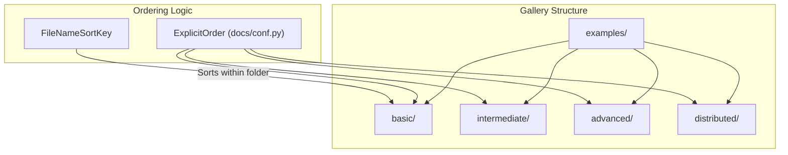
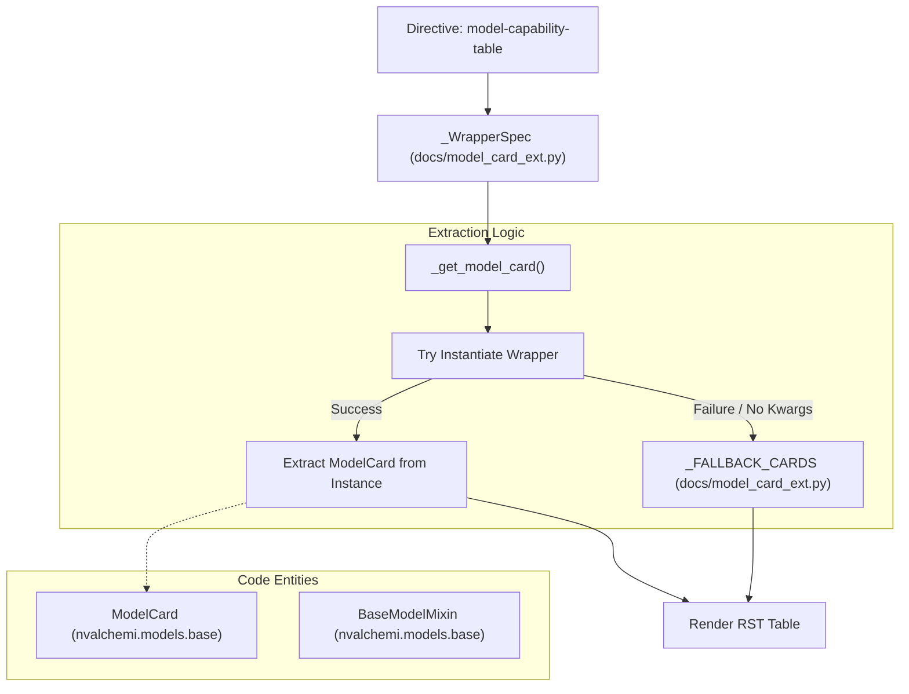

<!-- source: DeepWiki mcp.deepwiki.com · repo NVIDIA/nvalchemi-toolkit · page 6.2 Documentation Build System · fetched 2026-10-26 -->

# Documentation Build System

Relevant source files

The following files were used as context for generating this wiki page:

- [docs/conf.py](docs/conf.py)
- [docs/model_card_ext.py](docs/model_card_ext.py)
- [docs/models/index.md](docs/models/index.md)
- [docs/modules/models.rst](docs/modules/models.rst)
- [docs/sg_execution_times.rst](docs/sg_execution_times.rst)

The NVIDIA ALCHEMI Toolkit documentation system is built on **Sphinx**, utilizing a combination of standard extensions and custom-built logic to provide an integrated view of API references, executable examples, and model capability declarations. The system is designed to be GPU-aware, executing example scripts during the build process to capture outputs and performance metrics.

## Core Components and Configuration

The documentation build is orchestrated by `docs/conf.py`, which configures the theme, extensions, and environment-driven behaviors.

### Theme and Parsers
*   **Theme**: The toolkit uses `pydata_sphinx_theme` [docs/conf.py:99-99](), customized with NVIDIA-specific branding and CSS [docs/conf.py:101-109]().
*   **Markdown Support**: `myst_parser` is integrated to allow authoring in Markdown while maintaining compatibility with reStructuredText (RST) directives like `colon_fence` and `dollarmath` [docs/conf.py:72-81]().
*   **API Generation**: `sphinx.ext.autodoc` and `sphinx.ext.autosummary` are used to generate API reference pages from Python docstrings [docs/conf.py:67-70]().

### Environment Variables
The build process is sensitive to several environment variables that control the execution of the example gallery:

| Variable | Default | Description |
| :--- | :--- | :--- |
| `NVALCHEMI_PLOT` | `1` | Enables plotting within example scripts for thumbnail generation [docs/conf.py:34-34](). |
| `DOC_VERSION` | `main` | Sets the version string displayed in the documentation [docs/conf.py:35-35](). |
| `PLOT_GALLERY` | `True` | Controls whether `sphinx-gallery` captures figure outputs [docs/conf.py:36-36](). |
| `RUN_STALE_EXAMPLES` | `False` | If `True`, forces re-execution of examples even if no changes are detected [docs/conf.py:37-41](). |

Sources: [docs/conf.py:29-47](), [docs/conf.py:63-81](), [docs/conf.py:96-134]()

---

## Example Execution Pipeline (`sphinx-gallery`)

The `sphinx-gallery` extension manages the lifecycle of example scripts located in the `examples/` directory. These scripts are parsed, executed, and converted into interactive documentation pages.

### Execution Lifecycle
1.  **Discovery**: The system matches files in `../examples/` against the `filename_pattern` (typically numbered `.py` files) [docs/conf.py:140-143]().
2.  **Execution**: Scripts are executed in a fresh process. The build uses `sphinxext.reset_torch` (referenced in `reset_modules`) to ensure CUDA state is handled correctly between examples [docs/conf.py:158-161]().
3.  **Capture**: Standard output and Matplotlib figures are captured. `capture_repr` is configured to handle both HTML and standard string representations [docs/conf.py:169-169]().
4.  **Backreferences**: The system generates links between API documentation and the examples that use those specific functions/classes [docs/conf.py:156-157]().

### Gallery Organization
The examples are organized into a hierarchical structure defined by `ExplicitOrder` in the `subsection_order` configuration [docs/conf.py:146-153]().

**Gallery Ordering Diagram**

### Execution Metrics
The build system tracks computation time and memory usage for every example. These are aggregated into a summary table in `docs/sg_execution_times.rst` [docs/sg_execution_times.rst:7-92]().

Sources: [docs/conf.py:137-170](), [docs/sg_execution_times.rst:1-92]()

---

## Custom Extension: `model_card_ext`

To automate the documentation of model capabilities, a custom Sphinx extension `model_card_ext` is implemented in `docs/model_card_ext.py`. This extension inspects the toolkit's model wrappers and extracts metadata from their `ModelCard` attributes.

### Directives
*   `.. model-capability-table::`: Generates a matrix of supported features (Forces, Stresses, PBC, etc.) for a category of models [docs/model_card_ext.py:19-22]().
*   `.. foundation-model-table::`: Renders a table of pre-trained checkpoints available in the foundation model registry [docs/model_card_ext.py:23-25]().

### Data Flow and Fallbacks
Since some model wrappers require large neural network weights or specific CUDA environments that might not be available on a standard documentation build server, the extension uses a fallback mechanism.

**Model Metadata Extraction Flow**

### Implementation Details
*   **Static Fallbacks**: Definitions for complex models like `MACEWrapper` are hardcoded in `_FALLBACK_CARDS` to ensure documentation builds even without model weights [docs/model_card_ext.py:48-80]().
*   **Category Mapping**: Wrappers are categorized into `ml` (Machine Learning) and `physical` (Analytical/Classical) for targeted rendering in the documentation [docs/model_card_ext.py:88-120]().
*   **Icon Rendering**: Boolean capabilities are converted to Unicode icons (`✓` or `✗`) via `_bool_icon` [docs/model_card_ext.py:169-171]().

Sources: [docs/model_card_ext.py:15-41](), [docs/model_card_ext.py:48-120](), [docs/model_card_ext.py:139-184](), [docs/models/index.md:7-42]()

---

## API Reference Generation

The toolkit uses a structured approach to API documentation, separating core classes from specific implementations. This is managed via `docs/modules/` files using `autosummary`.

### Module Organization
The `docs/modules/models.rst` file defines the structure for the Models API:
1.  **Core Classes**: `ModelConfig`, `ModelCard`, and `BaseModelMixin` from `nvalchemi.models.base` [docs/modules/models.rst:7-19]().
2.  **Implementations**: Grouped by type (MACE, Lennard-Jones, DFTD3, PME, Ewald) [docs/modules/models.rst:34-84]().
3.  **Composition**: The `ComposableModelWrapper` for combining multiple potentials [docs/modules/models.rst:86-96]().

Sources: [docs/modules/models.rst:1-96]()

---

