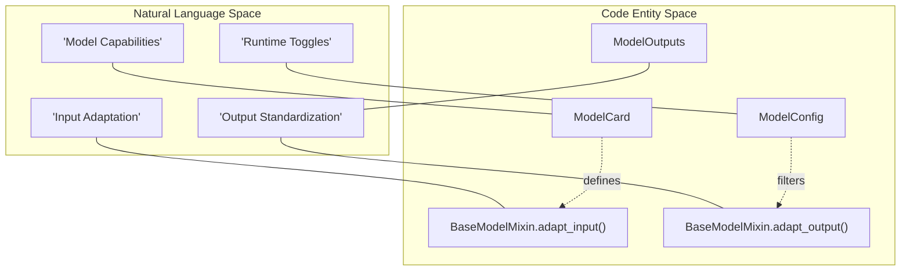
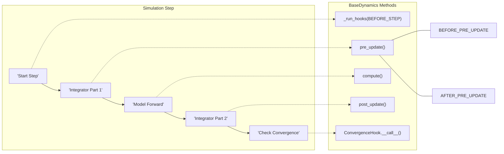

<!-- source: DeepWiki mcp.deepwiki.com · repo NVIDIA/nvalchemi-toolkit · page 7 Glossary · fetched 2026-10-26 -->

# Glossary

Relevant source files

The following files were used as context for generating this wiki page:

- [AGENTS.md](AGENTS.md)
- [README.md](README.md)
- [docs/modules/data.rst](docs/modules/data.rst)
- [docs/modules/dynamics/convergence.rst](docs/modules/dynamics/convergence.rst)
- [docs/modules/dynamics/distributed_pipeline.rst](docs/modules/dynamics/distributed_pipeline.rst)
- [docs/modules/dynamics/fused_stage.rst](docs/modules/dynamics/fused_stage.rst)
- [docs/modules/dynamics/implementing_dynamics.rst](docs/modules/dynamics/implementing_dynamics.rst)
- [docs/modules/dynamics/overview.rst](docs/modules/dynamics/overview.rst)
- [docs/modules/typing.rst](docs/modules/typing.rst)
- [docs/userguide/about/install.md](docs/userguide/about/install.md)
- [docs/userguide/about/intro.md](docs/userguide/about/intro.md)
- [docs/userguide/dynamics.md](docs/userguide/dynamics.md)
- [docs/userguide/models.md](docs/userguide/models.md)
- [nvalchemi/_typing.py](nvalchemi/_typing.py)
- [nvalchemi/data/batch.py](nvalchemi/data/batch.py)
- [nvalchemi/data/datapipes/__init__.py](nvalchemi/data/datapipes/__init__.py)
- [nvalchemi/data/datapipes/backends/zarr.py](nvalchemi/data/datapipes/backends/zarr.py)
- [nvalchemi/data/datapipes/dataset.py](nvalchemi/data/datapipes/dataset.py)
- [nvalchemi/dynamics/base.py](nvalchemi/dynamics/base.py)
- [nvalchemi/dynamics/sinks.py](nvalchemi/dynamics/sinks.py)
- [nvalchemi/models/base.py](nvalchemi/models/base.py)
- [nvalchemi/models/demo.py](nvalchemi/models/demo.py)
- [pyproject.toml](pyproject.toml)
- [test/data/test_zarr_datapipe.py](test/data/test_zarr_datapipe.py)
- [test/dynamics/test_base.py](test/dynamics/test_base.py)
- [test/dynamics/test_safety_hooks.py](test/dynamics/test_safety_hooks.py)
- [uv.lock](uv.lock)

This page provides definitions for the technical terms, domain-specific jargon, and architectural concepts used within the NVIDIA ALCHEMI Toolkit (`nvalchemi`). It serves as a reference for onboarding engineers to bridge the gap between high-level simulation concepts and their specific implementations in the codebase.

## Core Data Structures

### AtomicData
The fundamental unit of data representing a single molecular or atomic system. It is implemented as a Pydantic-backed graph where atoms are nodes and interatomic interactions (bonds or neighbors) are edges.
*   **Implementation**: `AtomicData` inherits from `BaseModel` to provide runtime validation of tensor shapes and types.
*   **Key Fields**: `positions`, `atomic_numbers`, `cell`, `pbc`.
*   **Sources**: [nvalchemi/data/atomic_data.py:25-100](), [nvalchemi/data/atomic_data.py:105-150]()

### Batch
A GPU-resident container that concatenates multiple `AtomicData` objects into a single large graph to enable efficient vectorized processing (SIMT).
*   **Mechanism**: It uses "segmented" storage. Node indices in `edge_index` are shifted by the cumulative sum of atoms in previous systems.
*   **Key Attributes**: `batch` (mapping nodes to system IDs), `ptr` (system boundaries in node space), `num_graphs`.
*   **Sources**: [nvalchemi/data/batch.py:45-120](), [nvalchemi/data/batch.py:200-250]()

### SegmentedLevelStorage
A specialized storage pattern used in `Batch` to handle variable-sized data (like atoms or edges) across multiple systems.
*   **Data Flow**: Data is flattened into a single tensor, and a `ptr` (pointer) tensor tracks the start and end indices of each system within that flattened array.
*   **Sources**: [nvalchemi/data/batch.py:150-180]()

---

## Model & Potential Layer

### BaseModelMixin
A mixin class that standardizes the interface for any Interatomic Potential (MLIP). It separates the raw model logic from the toolkit's data structures.
*   **Lifecycle**: `adapt_input` (Batch -> Model Tensors) → `forward` → `adapt_output` (Model Tensors -> ModelOutputs).
*   **Sources**: [nvalchemi/models/base.py:50-150](), [docs/userguide/models.md:38-81]()

### ModelCard
A static declaration of a model's capabilities and requirements. It allows the dynamics engine to negotiate features (e.g., whether the model supports periodic boundary conditions or requires a neighbor list).
*   **Key Flags**: `supports_forces`, `needs_pbc`, `forces_via_autograd`.
*   **Sources**: [nvalchemi/models/base.py:160-220](), [docs/userguide/models.md:82-128]()

### ModelConfig
A runtime configuration object that controls what properties the model should compute during a specific forward pass.
*   **Key Flags**: `compute_energies`, `compute_forces`, `compute_stresses`.
*   **Sources**: [nvalchemi/models/base.py:230-280](), [docs/userguide/models.md:130-160]()

### Natural Language to Code Entity Mapping: Model Layer
The following diagram illustrates how abstract model concepts map to specific classes and methods.

"Model Interface Architecture"

*   **Sources**: [nvalchemi/models/base.py:50-280](), [docs/userguide/models.md:36-160]()

---

## Dynamics & Execution

### Hook
A protocol-based callback system that allows users to inject logic at specific points in the simulation loop without modifying the integrator.
*   **Stages**: Defined in `HookStageEnum` (e.g., `BEFORE_STEP`, `AFTER_COMPUTE`, `ON_CONVERGE`).
*   **Sources**: [nvalchemi/dynamics/base.py:106-186](), [docs/userguide/dynamics.md:20-53]()

### FusedStage
A scaling strategy that combines multiple dynamics stages (e.g., Relaxation + MD) on a **single GPU**.
*   **Optimization**: It shares a single model forward pass across all systems in the batch, even if they are in different stages. It uses masking to apply specific integrator updates to relevant systems.
*   **Operator**: Composed using the `+` operator.
*   **Sources**: [nvalchemi/dynamics/base.py:200-250](), [docs/userguide/dynamics.md:74-110]()

### DistributedPipeline
A scaling strategy for **multi-GPU** execution. It maps one dynamics stage to one GPU rank.
*   **Communication**: Uses `isend`/`irecv` to move graduated samples (e.g., a system that finished relaxation) from one rank to the next.
*   **Operator**: Composed using the `|` operator.
*   **Sources**: [nvalchemi/dynamics/base.py:71-74](), [docs/modules/dynamics/distributed_pipeline.rst:10-22]()

### Inflight Batching
A high-throughput technique where "graduated" (converged or finished) samples are replaced by new samples from a `DataLoader` in real-time, keeping the GPU saturated.
*   **Implementation**: Managed by `SizeAwareSampler` and the `refill_check` logic in `BaseDynamics`.
*   **Sources**: [docs/userguide/about/intro.md:67-73](), [nvalchemi/dynamics/base.py:400-450]()

### Natural Language to Code Entity Mapping: Dynamics Loop
The diagram below maps the conceptual simulation steps to the internal method calls in `BaseDynamics`.

"Dynamics Execution Lifecycle"

*   **Sources**: [nvalchemi/dynamics/base.py:106-186](), [docs/userguide/dynamics.md:20-53]()

---

## I/O & Storage

### Zarr CSR Layout
The toolkit stores variable-sized atomic graphs in Zarr using a Compressed Sparse Row (CSR) style.
*   **Components**: Flat arrays for data (e.g., `positions`) and pointer arrays (`atoms_ptr`, `edges_ptr`) to reconstruct individual systems.
*   **Sources**: [nvalchemi/data/datapipes/backends/zarr.py:50-120](), [docs/userguide/about/intro.md:136-143]()

### DataSink
An abstraction for where simulation results (trajectories or final states) are stored.
*   **Backends**: 
    *   `GPUBuffer`: Fast, on-device circular buffer.
    *   `HostMemory`: CPU-side RAM storage.
    *   `ZarrData`: Persistent disk storage.
*   **Sources**: [nvalchemi/dynamics/sinks.py:43-76](), [nvalchemi/dynamics/sinks.py:201-235]()

---

## Technical Abbreviations Summary

| Abbreviation | Full Term | Context |
| :--- | :--- | :--- |
| **MLIP** | Machine-Learned Interatomic Potential | General category of models supported. |
| **PBC** | Periodic Boundary Conditions | Simulation of infinite bulk systems. |
| **CSR** | Compressed Sparse Row | Data layout for variable-sized graph storage. |
| **SIMT** | Single Instruction, Multiple Threads | GPU execution model enabled by `Batch`. |
| **NCCL** | NVIDIA Collective Communications Library | Backend for `DistributedPipeline`. |

*   **Sources**: [docs/userguide/about/intro.md:5-16](), [nvalchemi/dynamics/base.py:161-164](), [nvalchemi/data/datapipes/backends/zarr.py:50-100]()