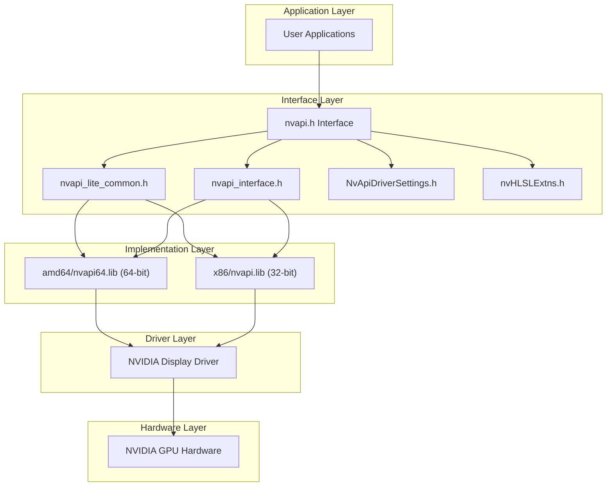
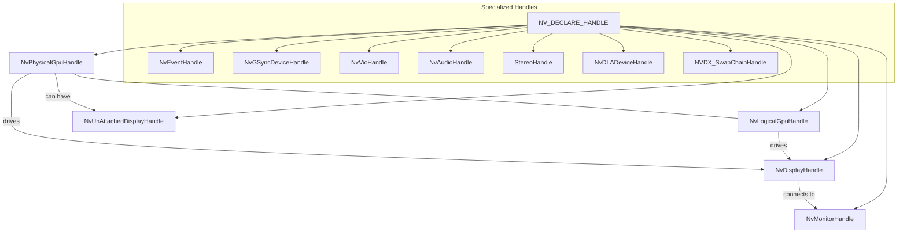
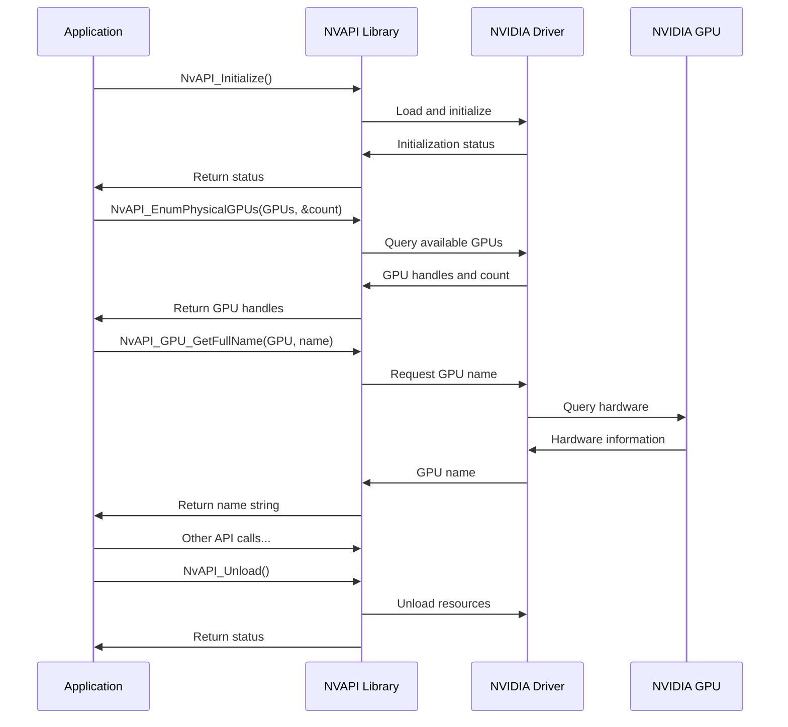

<!-- source: DeepWiki mcp.deepwiki.com · repo NVIDIA/nvapi · page 1 Overview · fetched 2026-10-26 -->

# Overview

Relevant source files

The following files were used as context for generating this wiki page:

- [amd64/nvapi64.lib](amd64/nvapi64.lib)
- [docs/NVAPI_Reference_OpenSource.chm](docs/NVAPI_Reference_OpenSource.chm)
- [docs/R570_NVAPI_OpenSource_Release_Notes.pdf](docs/R570_NVAPI_OpenSource_Release_Notes.pdf)
- [nvapi.h](nvapi.h)
- [nvapi_lite_common.h](nvapi_lite_common.h)
- [x86/nvapi.lib](x86/nvapi.lib)

The NVIDIA API (NVAPI) is NVIDIA's proprietary programming interface that provides direct access to NVIDIA GPU driver and hardware features. It allows developers to leverage NVIDIA-specific capabilities beyond what standard graphics APIs (like DirectX, OpenGL, and Vulkan) offer. This repository contains the interface definitions, header files, and library binaries needed to integrate NVAPI into applications.

For detailed implementation examples, see [Sample Code and Examples](#5), and for comprehensive reference documentation, see [Reference Documentation](#6).

## Core Architecture

NVAPI follows a layered architecture design that provides a robust interface between applications and NVIDIA GPU hardware. The architecture consists of the following key components:

At the core of NVAPI is the `nvapi.h` header file, which serves as the main entry point for applications. This header includes several component headers that define various aspects of the API:

- `nvapi_lite_common.h`: Defines common data types, constants, and handle definitions.
- `nvapi_interface.h`: Contains interface function declarations and access methods.
- `NvApiDriverSettings.h`: Provides driver configuration and settings control.
- `nvHLSLExtns.h`: Defines shader extensions specific to NVIDIA hardware.

The implementation is contained in the platform-specific libraries:
- `nvapi64.lib` for 64-bit (AMD64) applications
- `nvapi.lib` for 32-bit (x86) applications

These libraries communicate with the NVIDIA display driver, which in turn interacts with the GPU hardware.

Sources: [nvapi.h:38-44](), [nvapi_lite_common.h:27-37](), [amd64/nvapi64.lib](), [x86/nvapi.lib]()

## Handle System and Object Model

NVAPI uses a handle-based design pattern to reference and interact with various hardware and software components. Handles are opaque pointers that represent resources such as GPUs, displays, and specialized features.

The handle system represents the hardware and software topology:

- **NvPhysicalGpuHandle**: Represents a single physical GPU in the system.
- **NvLogicalGpuHandle**: Represents one or more physical GPUs acting together (e.g., in SLI configuration).
- **NvDisplayHandle**: Represents a display device connected to an NVIDIA GPU.
- **NvUnAttachedDisplayHandle**: Represents a potential display output that's not currently connected.
- **NvMonitorHandle**: Represents a monitor connected to a display output.

Specialized handles exist for specific features like GSync (for monitor synchronization), VIO (video input/output), stereo 3D, and more.

Sources: [nvapi_lite_common.h:127-165]()

## Functional Domains

NVAPI organizes its functionality into several domains, each addressing specific aspects of GPU and display management:

```mermaid
graph TD
    subgraph "NVAPI Core"
        Init["Initialization (NvAPI_Initialize)"]
        Unload["Unloading (NvAPI_Unload)"]
        Error["Error Handling (NvAPI_GetErrorMessage)"]
        Version["Version Info (NvAPI_GetInterfaceVersionString)"]
    end
    
    subgraph "GPU Management"
        GPUEnum["GPU Enumeration
        NvAPI_EnumPhysicalGPUs
        NvAPI_EnumLogicalGPUs"]
        
        GPUInfo["GPU Information
        NvAPI_GPU_GetFullName
        NvAPI_GPU_GetGPUType
        NvAPI_GPU_GetPCIIdentifiers"]
        
        GPUPerf["Performance Monitoring
        NvAPI_GPU_GetDynamicPstatesInfoEx
        NvAPI_GPU_GetThermalSettings"]
    end
    
    subgraph "Display Management"
        DispConfig["Display Configuration
        NvAPI_DISP_GetDisplayConfig
        NvAPI_DISP_SetDisplayConfig"]
        
        DispEDID["EDID Management
        NvAPI_GPU_GetEDID
        NvAPI_GPU_SetEDID"]
        
        DispColor["Color Management
        NvAPI_Disp_ColorControl
        NvAPI_Disp_HdrColorControl"]
        
        DispHDR["HDR Capabilities
        NvAPI_Disp_GetHdrCapabilities"]
    end
    
    subgraph "Graphics API Extensions"
        D3D["Direct3D Extensions"]
        OGL["OpenGL Extensions"]
        Vulkan["Vulkan Extensions"]
        HLSL["HLSL Extensions"]
    end
    
    subgraph "Driver Settings"
        DRS["Driver Registry Settings"]
        AA["Anti-Aliasing"]
        DLSS["DLSS Settings"]
    end
    
    Init --> GPUEnum
    Init --> DispConfig
    Init --> D3D
    Init --> DRS
```

The functional domains include:

1. **Core API Functions**: Basic operations like initialization, unloading, error handling, and version information.
2. **GPU Management**: Functions for enumerating GPUs, retrieving information about them, and monitoring performance.
3. **Display Management**: Control of displays, EDID (Extended Display Identification Data) handling, color settings, and HDR capabilities.
4. **Graphics API Extensions**: NVIDIA-specific extensions for Direct3D, OpenGL, Vulkan, and HLSL.
5. **Driver Settings**: Configuration of driver behavior, including anti-aliasing, DLSS, and other graphics settings.
6. **Specialized Features**: Support for technologies like SLI, Stereo 3D, GSync, and more.

Sources: [nvapi.h:67-177](), [nvapi_lite_common.h:258-367]()

## Basic Usage Pattern

NVAPI follows a consistent usage pattern:

1. **Initialization**: Call `NvAPI_Initialize()` to initialize the NVAPI library.
2. **Handle Acquisition**: Enumerate and obtain handles to the resources you need (GPUs, displays, etc.).
3. **API Usage**: Use NVAPI functions with the acquired handles to perform operations.
4. **Cleanup**: When done, call `NvAPI_Unload()` to release NVAPI resources.

Here's a simple flow of NVAPI usage:

All API functions return an `NvAPI_Status` value, which should be checked to ensure operations were successful. The `NvAPI_GetErrorMessage` function can be used to convert error codes to human-readable messages.

Sources: [nvapi.h:67-118](), [nvapi.h:119-157]()

## Error Handling

NVAPI uses a comprehensive error reporting system through status codes. Every function returns an `NvAPI_Status` value that indicates success or a specific error type.

| Status Range | Description |
|--------------|-------------|
| `NVAPI_OK` (0) | Success |
| -1 to -99 | General errors (initialization, argument validation, etc.) |
| -100 to -199 | Handle and resource errors |
| -200 and beyond | Feature-specific errors |

The `NvAPI_GetErrorMessage` function converts these status codes into human-readable strings for debugging and error reporting purposes.

Sources: [nvapi_lite_common.h:261-371]()

## Platform Support

NVAPI is primarily designed for Windows operating systems:

- Windows 10 and higher
- Both 32-bit (x86) and 64-bit (x64) architectures

The API is distributed in two forms:
- 32-bit library: `x86/nvapi.lib`
- 64-bit library: `amd64/nvapi64.lib`

Applications must link against the appropriate library based on their target architecture.

Sources: [nvapi.h:34-36](), [x86/nvapi.lib](), [amd64/nvapi64.lib]()

---

