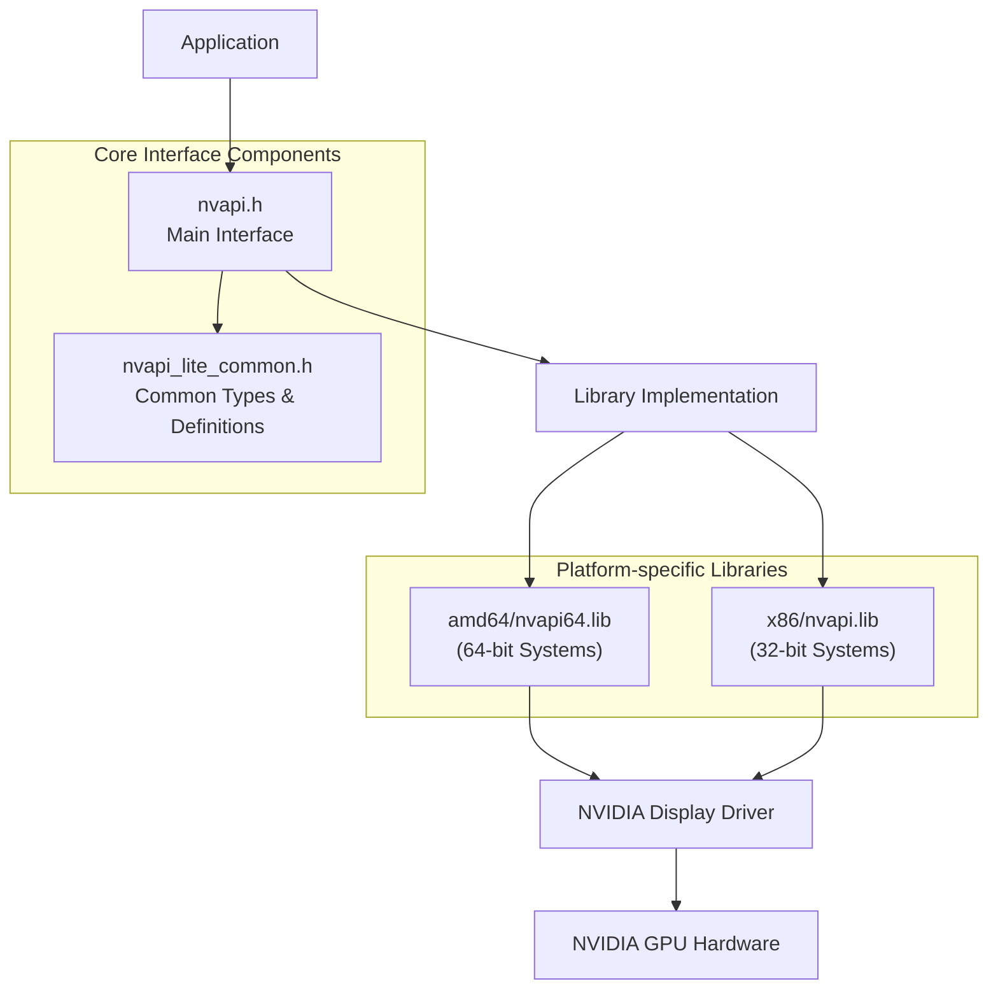
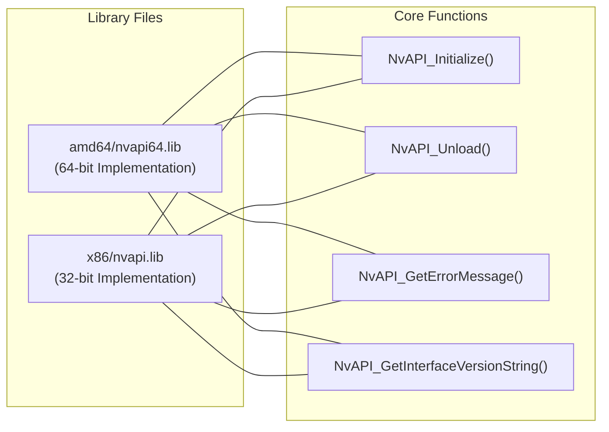
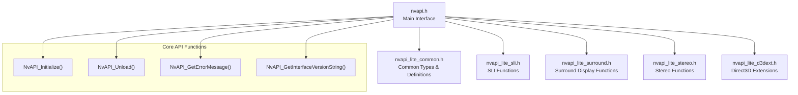
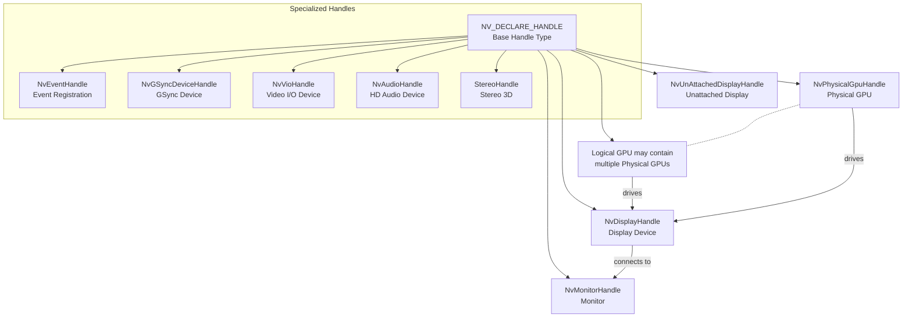
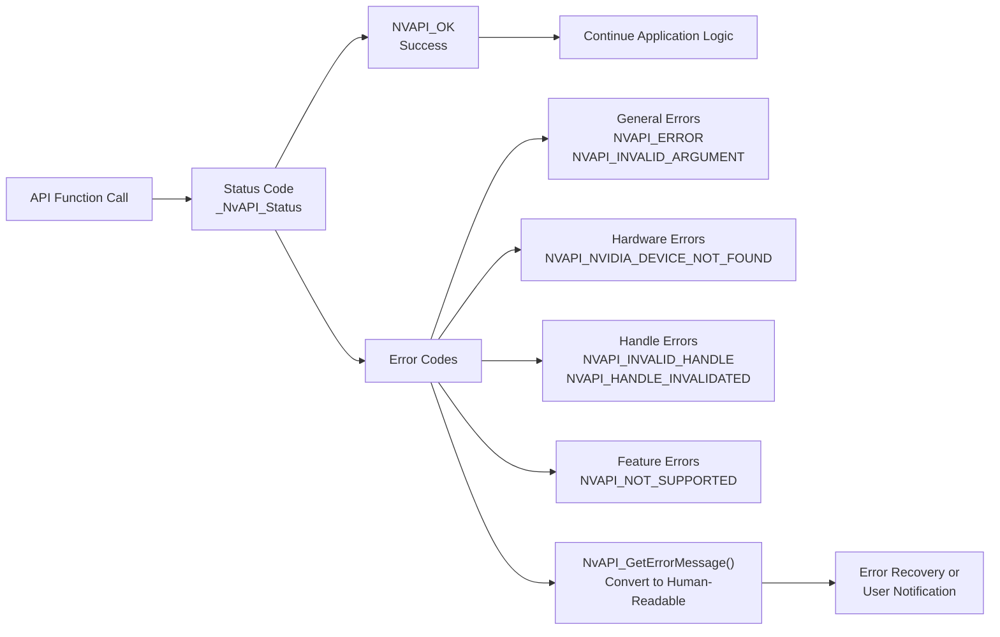
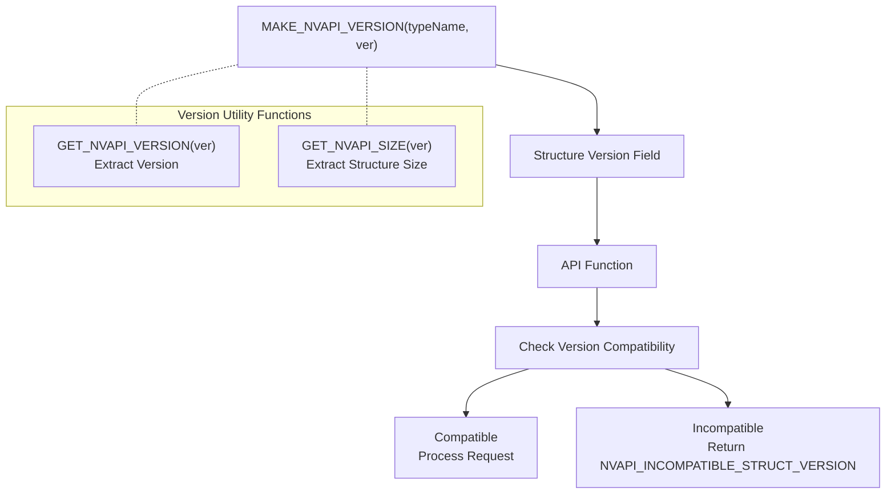
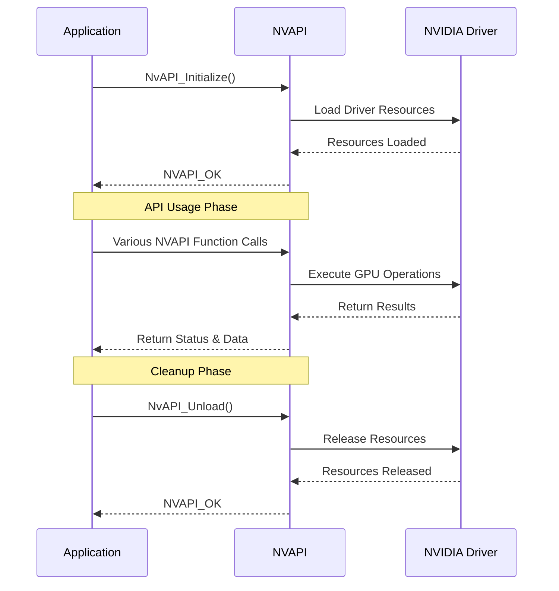

<!-- source: DeepWiki mcp.deepwiki.com · repo NVIDIA/nvapi · page 2 Core Libraries and Interfaces · fetched 2026-10-26 -->

# Core Libraries and Interfaces

<details>
<summary>Relevant source files</summary>

The following files were used as context for generating this wiki page:

- [amd64/nvapi64.lib](amd64/nvapi64.lib)
- [nvapi.h](nvapi.h)
- [nvapi_interface.h](nvapi_interface.h)
- [nvapi_lite_common.h](nvapi_lite_common.h)
- [x86/nvapi.lib](x86/nvapi.lib)

</details>


This page provides a comprehensive explanation of the foundational libraries and interfaces that make up the NVIDIA API (NVAPI). NVAPI is a cross-platform toolset that enables applications to access NVIDIA GPU features and capabilities not exposed through standard operating system or graphics APIs. This document covers the core library structure, interface definitions, and common data types that serve as the foundation for the entire NVAPI.

For more detailed information about the specific library implementations, see [NVAPI Libraries](#2.1). For the main header interface structure, see [Main Header Interface](#2.2). For common data types and definitions, see [Common Types and Definitions](#2.3).

## Core Architecture Overview

The NVAPI is structured around a set of libraries and header files that provide a common interface for applications to interact with NVIDIA GPUs. The core components include the platform-specific libraries (32-bit and 64-bit), the main interface header, and common type definitions.



Sources:
- [amd64/nvapi64.lib]()
- [x86/nvapi.lib]()
- [nvapi.h:26-37]()
- [nvapi_lite_common.h:26-32]()

## Library Implementation

NVAPI provides platform-specific library implementations for both 32-bit and 64-bit systems. These libraries contain the actual implementation of the API functions that interface with the NVIDIA driver.



Both libraries implement the same API functions but are compiled for different architectures:

1. **64-bit Library (nvapi64.lib)**:
   - Located in the `amd64` directory
   - Used by 64-bit applications
   - Contains implementations of all NVAPI functions for x64 architecture

2. **32-bit Library (nvapi.lib)**:
   - Located in the `x86` directory
   - Used by 32-bit applications
   - Contains implementations of all NVAPI functions for x86 architecture

Applications don't need to explicitly link to these libraries. Instead, they include the `nvapi.h` header file, which sets up the appropriate library inclusion based on the compilation target architecture.

Sources:
- [amd64/nvapi64.lib]()
- [x86/nvapi.lib]()
- [nvapi.h:86-117]()

## Interface Structure

The NVAPI interface is primarily defined through header files, with `nvapi.h` serving as the main entry point. This header includes other necessary headers and defines the core API functions that applications can use.



Key components of the interface structure:

1. **Main Header (nvapi.h)**:
   - Serves as the primary interface for applications
   - Includes other supporting headers
   - Defines core API functions
   - Establishes the structure for various GPU operations

2. **Core API Functions**:
   - `NvAPI_Initialize()`: Initializes the NVAPI library
   - `NvAPI_Unload()`: Unloads the NVAPI library
   - `NvAPI_GetErrorMessage()`: Converts error codes to human-readable messages
   - `NvAPI_GetInterfaceVersionString()`: Retrieves API version information

Sources:
- [nvapi.h:38-46]()
- [nvapi.h:86-177]()

## Common Types and Handle System

NVAPI defines a comprehensive set of common types and a handle system to represent various NVIDIA resources. These are primarily defined in `nvapi_lite_common.h`.



Key aspects of the common types system:

1. **Basic Data Types**:
   - Platform-independent primitive types (NvU32, NvS32, NvU64, etc.)
   - Boolean type (NvBool)
   - String types of various lengths (NvAPI_String, NvAPI_ShortString, etc.)

2. **Handle System**:
   - Opaque handles to represent GPU-related resources
   - Main hierarchy includes physical GPUs, logical GPUs, displays, and monitors
   - Specialized handles for features like GSync, stereo 3D, video I/O, etc.

3. **Status Codes**:
   - Comprehensive set of error and status codes through the `_NvAPI_Status` enumeration
   - Used by all API functions to indicate success or specific failure reasons

The table below shows the primary handle types and their purposes:

| Handle Type | Description | Role |
|-------------|-------------|------|
| NvPhysicalGpuHandle | Single physical GPU | Represents individual graphics hardware |
| NvLogicalGpuHandle | One or more physical GPUs acting in concert | Represents SLI configurations |
| NvDisplayHandle | Display device driven by NVIDIA GPU | Represents an attached display |
| NvUnAttachedDisplayHandle | Unattached display device | Represents available but not connected displays |
| NvMonitorHandle | Monitor handle | Represents the physical display monitor |
| NvEventHandle | Event registration | Used for event notification system |
| NvGSyncDeviceHandle | GSync device | For frame synchronization across displays |
| NvVioHandle | Video input/output | For professional video capture/output |
| StereoHandle | Stereo 3D | Interface for stereoscopic 3D features |

Sources:
- [nvapi_lite_common.h:127-165]()
- [nvapi_lite_common.h:91-111]()
- [nvapi_lite_common.h:260-397]()

## API Status and Error Handling

NVAPI includes a comprehensive error handling system based on status codes returned by API functions. These status codes are defined in the `_NvAPI_Status` enumeration.



Key components of the error handling system:

1. **Status Enumeration**:
   - Defined in `nvapi_lite_common.h`
   - Ranges from success (`NVAPI_OK = 0`) to various error conditions
   - Grouped by error categories (general, hardware, handle-related, etc.)

2. **Error Message Function**:
   - `NvAPI_GetErrorMessage()` converts status codes to human-readable strings
   - Allows applications to present meaningful error messages to users

3. **Common Error Patterns**:
   - Initialization errors: `NVAPI_API_NOT_INITIALIZED`, `NVAPI_LIBRARY_NOT_FOUND`
   - Hardware errors: `NVAPI_NVIDIA_DEVICE_NOT_FOUND`
   - Parameter errors: `NVAPI_INVALID_ARGUMENT`, `NVAPI_INVALID_POINTER`
   - Handle errors: `NVAPI_INVALID_HANDLE`, `NVAPI_HANDLE_INVALIDATED`
   - Feature support: `NVAPI_NOT_SUPPORTED`, `NVAPI_NO_IMPLEMENTATION`

Example usage pattern for error handling:

```
NvAPI_Status status = NvAPI_SomeFunction(parameters);
if (status != NVAPI_OK) {
    NvAPI_ShortString errorMessage;
    NvAPI_GetErrorMessage(status, errorMessage);
    // Handle error or display message
}
```

Sources:
- [nvapi_lite_common.h:260-397]()
- [nvapi.h:123-137]()

## Version and Compatibility System

NVAPI includes a versioning system to handle structure versioning and API compatibility. This allows for forward and backward compatibility as the API evolves.



Key aspects of the versioning system:

1. **Structure Versioning Macro**:
   - `MAKE_NVAPI_VERSION(typeName, ver)` combines structure size with version number
   - Each structure includes a `version` field initialized with this macro
   - Allows API functions to verify both structure size and version

2. **Version Extraction**:
   - `GET_NVAPI_VERSION(ver)` extracts the version number
   - `GET_NVAPI_SIZE(ver)` extracts the structure size

3. **Version Utility Functions**:
   - `NvAPI_GetInterfaceVersionString()` returns human-readable API version
   - `NvAPI_GetInterfaceVersionStringEx()` enhanced version information

This versioning system allows NVAPI to evolve while maintaining compatibility with applications built against older versions of the API.

Sources:
- [nvapi_lite_common.h:244-251]()
- [nvapi.h:157-177]()

## Core API Lifecycle

The NVAPI has a specific lifecycle that applications must follow to properly initialize, use, and clean up the API.



Key aspects of the API lifecycle:

1. **Initialization**:
   - Application must call `NvAPI_Initialize()` before any other function
   - Initializes internal state and loads appropriate libraries
   - Returns `NVAPI_OK` on success or an error code on failure

2. **Usage**:
   - Application can call any NVAPI functions
   - Each function returns a status code indicating success or failure
   - Some resources may be allocated during API usage

3. **Cleanup**:
   - Application should call `NvAPI_Unload()` when done with NVAPI
   - Releases resources and decrements internal reference counter
   - When counter reaches zero, unloads NVAPI library

It's important to note that initialization and unloading are reference-counted, meaning they can be called multiple times as long as each call to `NvAPI_Initialize()` is matched with a call to `NvAPI_Unload()`.

Sources:
- [nvapi.h:69-117]()

## Conclusion

The Core Libraries and Interfaces form the foundation of the NVIDIA API, providing a consistent and robust interface for applications to interact with NVIDIA GPUs. The architecture is designed to support both 32-bit and 64-bit platforms, provide comprehensive error handling, ensure forward and backward compatibility, and manage resources properly throughout the API lifecycle.

By understanding these core components, developers can effectively use NVAPI to access advanced NVIDIA GPU features in their applications, while ensuring proper initialization, error handling, and cleanup.

---

