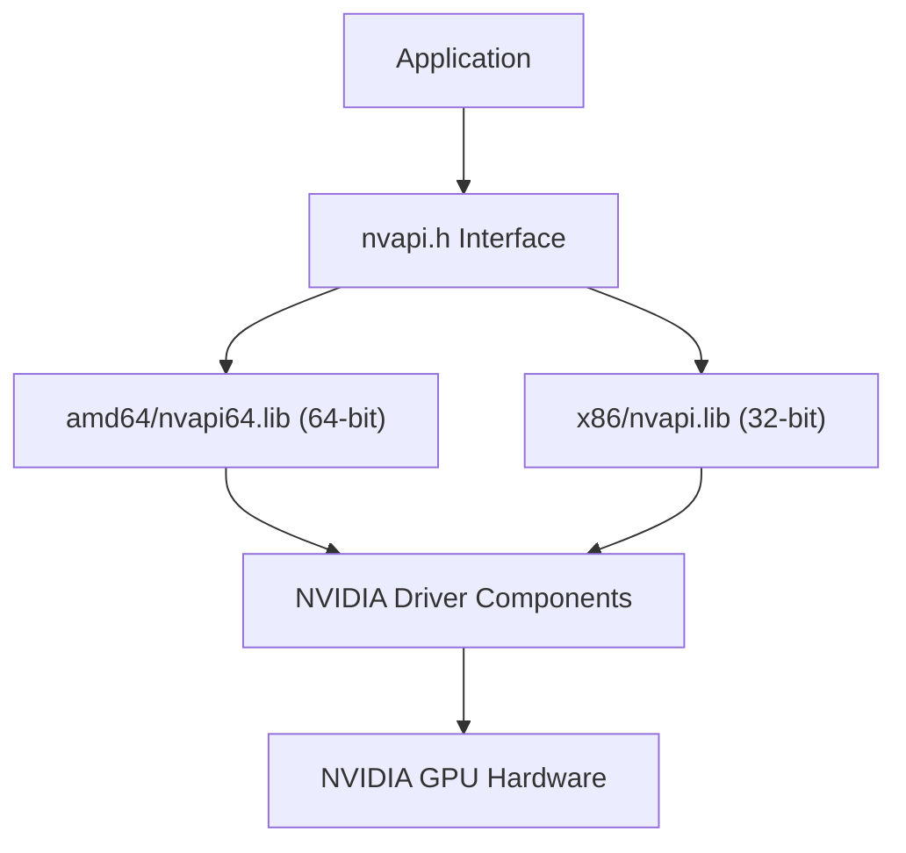
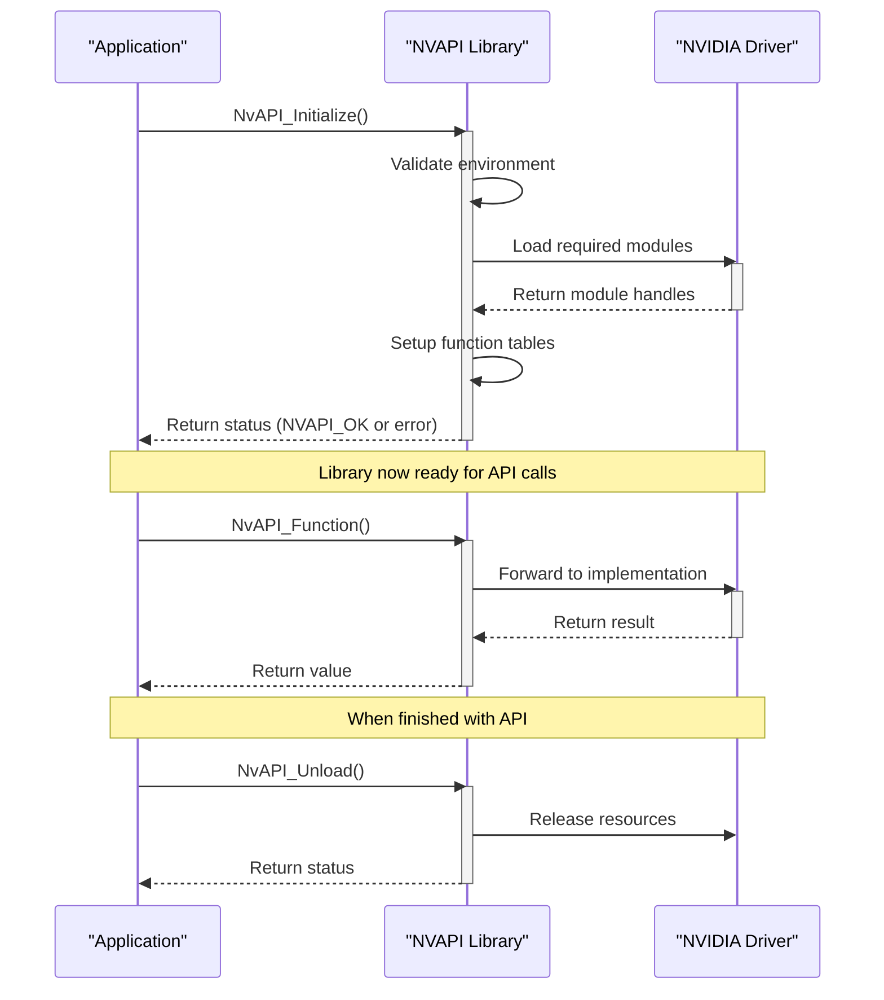
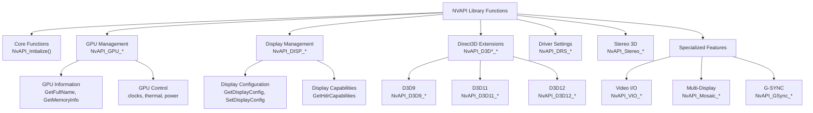

<!-- source: DeepWiki mcp.deepwiki.com · repo NVIDIA/nvapi · page 2.1 NVAPI Libraries · fetched 2026-10-26 -->

# NVAPI Libraries

<details>
<summary>Relevant source files</summary>

The following files were used as context for generating this wiki page:

- [amd64/nvapi64.lib](amd64/nvapi64.lib)
- [x86/nvapi.lib](x86/nvapi.lib)

</details>


This page details the NVIDIA API (NVAPI) library implementation, focusing on the 32-bit and 64-bit libraries that form the core binary components of the NVAPI. These libraries provide the executable code that bridges applications and NVIDIA GPU drivers, enabling access to NVIDIA-specific hardware features beyond what standard graphics APIs offer.

For information about the main interface header, see [Main Header Interface](#2.2). For details on common data types used throughout NVAPI, see [Common Types and Definitions](#2.3).

## Library Architecture

NVAPI provides two primary binary libraries:

| Library File | Architecture | Description |
|--------------|--------------|-------------|
| `amd64/nvapi64.lib` | 64-bit (x64) | Library for 64-bit applications |
| `x86/nvapi.lib` | 32-bit (x86) | Library for 32-bit applications |

These libraries act as intermediaries between applications and the NVIDIA graphics driver. They primarily contain function stubs that forward calls to the actual implementations in the driver.

### Architecture Diagram



Sources: [amd64/nvapi64.lib]()

## Library Implementation

The NVAPI libraries themselves contain minimal implementation. They primarily:

1. Provide function entry points that applications link against
2. Handle API initialization and module loading from the driver
3. Forward function calls to the appropriate driver implementations
4. Process return values and errors

### Loading and Initialization Process



The library initialization is handled by several internal functions:

- `NvAPI_Initialize()` - User-facing initialization function
- `?NvAPI_InitializeEx@@YA?AW4_NvAPI_Status@@W4_NV_DRIVER_TYPE@@@Z` - Extended initialization with driver type specification
- `?LoadModule@@YA?AW4_NvAPI_Status@@W4_NVAPI_MODULE_ID@@W4_NV_DRIVER_TYPE@@@Z` - Dynamic module loading function

Sources: [amd64/nvapi64.lib]()

## Exported Functions

The NVAPI libraries export over 800 functions providing access to various NVIDIA GPU capabilities, organized into functional categories.

### Function Categories



Sources: [amd64/nvapi64.lib]()

### Function Count by Category

| Category | Prefix | Examples |
|----------|--------|----------|
| Direct3D 12 | `NvAPI_D3D12_` | `NvAPI_D3D12_CreateHeap()`, `NvAPI_D3D12_SetDepthBoundsTestValues()` |
| Direct3D 11 | `NvAPI_D3D11_` | `NvAPI_D3D11_CreateDevice()`, `NvAPI_D3D11_SetDepthBoundsTest()` |
| GPU | `NvAPI_GPU_` | `NvAPI_GPU_GetFullName()`, `NvAPI_GPU_GetMemoryInfo()` |
| Stereo 3D | `NvAPI_Stereo_` | `NvAPI_Stereo_Enable()`, `NvAPI_Stereo_SetSeparation()` |
| Display | `NvAPI_DISP_` | `NvAPI_DISP_GetDisplayConfig()`, `NvAPI_DISP_GetMonitorCapabilities()` |
| Driver Settings | `NvAPI_DRS_` | `NvAPI_DRS_CreateProfile()`, `NvAPI_DRS_SetSetting()` |
| Direct3D 9 | `NvAPI_D3D9_` | `NvAPI_D3D9_RegisterResource()`, `NvAPI_D3D9_CreateSwapChain()` |

Sources: [amd64/nvapi64.lib]()

## Internal Components

While most implementation resides in the NVIDIA driver, the libraries contain several internal components:

### Security Mechanisms

The libraries implement security measures to ensure integrity:

1. **Signature Verification**: Functions like `nvVerifyFileSignatureW()` validate the authenticity of NVIDIA components
2. **Secure Loading**: `nvLoadSignedLibraryExA()` and related functions ensure only trusted modules are loaded
3. **Critical Section Management**: `CAutoCriticalSection` and `CSingletonCriticalSection` classes provide thread synchronization

### Module Management

Internal functions handle dynamic loading of NVIDIA driver components:

- **Module Loading**: `?LoadModule@@YA?AW4_NvAPI_Status@@W4_NVAPI_MODULE_ID@@W4_NV_DRIVER_TYPE@@@Z`
- **Module Validation**: `?ValidateModuleHandle@@YA?AW4_NvAPI_Status@@W4_NVAPI_MODULE_ID@@W4_NV_DRIVER_TYPE@@@Z`
- **Module Unloading**: `?NvAPI_UnloadEx@@YA?AW4_NvAPI_Status@@W4_NV_DRIVER_TYPE@@@Z`

### Error Handling

All NVAPI functions return an `NvAPI_Status` value indicating success or failure. Common status codes include:
- `NVAPI_OK` (0): Operation successful
- `NVAPI_ERROR` (-1): Generic error
- `NVAPI_INVALID_ARGUMENT` (-5): One or more arguments are invalid
- `NVAPI_NOT_SUPPORTED` (-12): Requested feature not supported

The library provides `NvAPI_GetErrorMessage()` to convert these codes to human-readable text.

Sources: [amd64/nvapi64.lib]()

## Usage Guidelines

### Initialization and Cleanup

Applications using NVAPI must:

1. Call `NvAPI_Initialize()` before using any other NVAPI functions
2. Check the return status of each NVAPI function call
3. Call `NvAPI_Unload()` when finished to release resources

### Library Selection

- 64-bit applications should link against `amd64/nvapi64.lib`
- 32-bit applications should link against `x86/nvapi.lib`

### Thread Safety

Many NVAPI functions are thread-safe, but developers should:
- Avoid calling `NvAPI_Initialize()` or `NvAPI_Unload()` from multiple threads simultaneously
- Use their own synchronization when accessing shared resources returned by NVAPI
- Check documentation for specific thread safety requirements of individual functions

### Error Handling Example

```c
NvAPI_Status status = NvAPI_Initialize();
if (status != NVAPI_OK) {
    char errorMessage[256];
    NvAPI_GetErrorMessage(status, errorMessage);
    // Log or display error message
    // Handle initialization failure
}
```

Sources: [amd64/nvapi64.lib]()

## Versioning and Compatibility

The NVAPI libraries maintain compatibility with different driver versions through:

1. **Function Discovery**: Applications can query for function pointers using `nvapi_QueryInterface()` to check availability
2. **Version Information**: `NvAPI_GetInterfaceVersionString()` provides version details
3. **Feature Detection**: Many subsystems offer capability query functions to determine feature support

This allows applications to work across multiple driver versions by adapting to available functionality.

Sources: [amd64/nvapi64.lib]()

---

